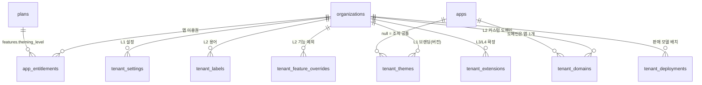

# 04_DATA_MODEL — 멀티테넌트 DB 구조와 테마 테이블

작성일 2026-10-14. SQL 정본은 [`supabase/0011_core_tenant_theming.sql`](supabase/0011_core_tenant_theming.sql)(제안·staged)이고 이 문서는 그 설명이다. 둘이 다르면 SQL이 이긴다. 경로 인용의 `migrations/`는 `products/_supabase-modular/migrations/`다.

## 1. 멀티테넌트 DB 기본 규칙 (이미 코어에 있는 것 — 모든 제품 테이블)

멀티테넌트 테마 이전에, 데이터 자체가 테넌트별로 나뉘어야 한다. 이 저장소의 코어가 이미 이 구조이며 새 제품도 그대로 따른다.

| 구성요소 | 규칙 | 근거 |
|---|---|---|
| 테넌트 테이블 | `core.organizations`. 가입 시 개인 조직 자동 생성, 회사 조직은 `is_personal=false` | `migrations/0001_core_identity.sql:32-42` |
| 멤버십·역할 | `core.org_members(org_id, user_id, role owner/admin/member/viewer, status)`. 조직당 owner 1명. 쓰기는 SECURITY DEFINER 함수만 | `0001:48-63`, `0004` 4절 |
| 모든 업무 테이블 | `org_id uuid not null references core.organizations(id) on delete cascade` | `DB_CONVENTIONS.md` 3장 |
| RLS | 모든 테이블 ON. 읽기 `core.is_org_member(org_id) and core.has_entitlement(org_id,'<app>')`, 쓰기 정책엔 `with check` 필수, `FOR ALL` 금지, 삭제는 owner/admin | `DB_CONVENTIONS.md` 7장 |
| 앱 이용권 | `core.app_entitlements(org_id, app_id, plan_id, status)`가 단일 출처. 플랜 기능은 `core.plans.features` | `0002_core_billing.sql:115-131` |
| 돈·권한·한도 | 사용자 쓰기 금지. SELECT 정책 + `guard_privileged_write` 트리거 + RPC/service_role | `DB_CONVENTIONS.md` 8장 |
| 파일 | Storage 경로 첫 폴더 = `org_id`. 정책이 `core.storage_org_id(name)`으로 멤버십 검사 | `0005_core_jobs_storage.sql:300-361` |
| 감사 | `core.write_audit(org_id, action, …)` append-only | `0004:238-310` |
| 세션 | `core.session_context(app, org)` 한 번으로 사용자·조직·역할·플랜 | `0004:115` |
| 격리 시험 | 다른 조직 사용자(B)로 0행·42501 확인하는 RLS 스모크 | `DB_CONVENTIONS.md` 13.3 |
| 배치 | 통합(모듈러) 기본, 규제·격리 요구 시 모놀리스 또는 고객사 전용 프로젝트 | `_supabase-modular/ARCHITECTURE.md` |

새 제품 테이블을 만들 때 점검: `org_id` 있음 / RLS ON / SELECT 정책에 멤버십·엔타이틀먼트 / 쓰기 정책 `with check` / 돈·상태 컬럼은 RPC로 / 파일 경로 `org_id/` 시작 / 스모크에 교차 조직 항목.

## 2. 테마 확장의 관계도



범위 규칙: `tenant_themes`, `tenant_settings`는 `app_id = null`(조직 공통)과 앱 전용 행을 함께 가질 수 있고 해석 시 **앱 전용 → 조직 공통** 순서로 찾는다. 라벨·기능·도메인·확장은 앱마다 다르므로 `app_id not null`.

## 3. 테이블

### 3.1 `core.tenant_themes` (L1)

| 컬럼 | 형식 | 규칙 |
|---|---|---|
| `id` | uuid PK | |
| `org_id` | uuid FK → organizations, cascade | 불변(트리거) |
| `app_id` | text FK → apps, null 허용 | null = 조직 공통. 불변 |
| `status` | `draft` / `published` / `archived` | 사용자는 쓸 수 없음(컬럼 권한 없음). 전이는 4장 |
| `version` | int | 게시 시 범위(조직 + 앱 또는 공통)별 1부터 증가 |
| `name` | text 1~60 | 관리용 이름 |
| `brand_name` | text 1~60 | 화면·메일·OG에 쓰는 이름 |
| `logo_horizontal_path` 외 5개 | text | `<org_id>/theming/…` 만(`is_theming_asset_path`, CHECK) |
| `tokens` | jsonb | `{"light":{…},"dark":{…}}`, 허용 목록 키·안전한 값만(`is_valid_theme_tokens`, CHECK) |
| `fonts` | jsonb | `heading`/`body`/`mono` → 레지스트리 키(`is_valid_theme_fonts`, CHECK) |
| `source` | `manual` / `logo_extract` / `ai` / `import` | 만든 방법 |
| `contrast_report`, `contrast_checked_at` | jsonb, timestamptz | 서버만 기록. 내용이 바뀌면 트리거가 null로 |
| `created_by`, `published_by`, `published_at`, `archived_at` | | 게시 정보는 RPC만 |

인덱스: 범위마다 게시본 1개(`tenant_themes_one_published_idx`), 범위·버전 유일(`tenant_themes_version_uniq`).

### 3.2 `core.tenant_settings` (L1, 내비게이션은 L2)

| 컬럼 | 규칙 |
|---|---|
| `org_id`, `app_id`(null = 공통) | 범위마다 1행(`tenant_settings_scope_uniq`) |
| `support_email` | 메일 형식, `<>` 금지 |
| `support_url` | `https://`만, 300자 이하(`javascript:` 거부) |
| `email_from_name` | 1~40자, `<>"` 줄바꿈 금지(메일 헤더 주입 방지) |
| `default_locale`, `timezone` | `ko`, `Asia/Seoul` 기본 |
| `legal` | 객체, 4KB 미만. 키(제안): `company_name`, `ceo`, `business_no`, `ecommerce_no`(통신판매업 신고번호), `address`, `phone`, `privacy_url`, `terms_url` — 푸터 사업자 정보 표시용 |
| `footer_links` | 배열 12개 이하 `[{label, href}]` |
| `navigation` | 배열 16KB 미만 `[{key, hidden?, order?, label_key?}]`. 해석 함수는 L2 이상일 때만 내보낸다 |

### 3.3 `core.tenant_labels` (L2)

PK `(org_id, app_id, locale, key)`. `key`는 `^[a-z][a-z0-9_.]{1,79}$`(예: `nav.customers`), `value` 1~200자. 쓰기 정책은 owner/admin + 단계 2 이상.

### 3.4 `core.tenant_feature_overrides` (L2, 서버만 쓰기)

PK `(org_id, app_id, feature_key)`. `value` jsonb, `reason`, `expires_at`(만료되면 무시), `granted_by`. `feature_key = 'theming_level'`이면 값은 0~4 정수만(CHECK). `guard_privileged_write` 이중 잠금.

### 3.5 `core.tenant_domains` (L2)

| 컬럼 | 규칙 |
|---|---|
| `hostname` | 소문자 FQDN 253자 이하. 제거되지 않은 도메인은 전 플랫폼 유일 |
| `app_id` | 도메인 하나는 앱 하나를 연다 |
| `status` | 4장 전이 |
| `is_primary` | (조직, 앱)마다 활성 대표 1개. 처음 활성화된 도메인이 대표 |
| `verification` | 호스팅이 준 DNS 안내(레코드 종류·이름·값). 비밀 금지 |
| `last_error`, `verified_at`, `last_checked_at`, `removed_at` | 워커가 기록 |

쓰기는 `request_tenant_domain`(사용자), `set_tenant_domain_status`(서버)만. 직접 INSERT는 42501.

### 3.6 `core.tenant_extensions` (L3/L4, 서버만 쓰기)

`unique (org_id, app_id, slot_key)`. `kind`: `slot`(L3) / `hook`·`webhook`(L4). `config`는 서버만 읽는다(사용자에게 컬럼 권한 없음, 해석 결과에도 없음). 비밀값은 `core.encrypted_credentials`에.

### 3.7 `core.tenant_deployments` (운영)

`unique (org_id, app_id)`. `deploy_model` A/B/C, `status` provisioning/active/suspended/retired, `supabase_project_ref`, `vercel_project_id`, `region`, `release_channel` canary/stable/pinned, `pinned_version`, `contract_ref`. owner/admin과 운영자만 읽기.

## 4. 상태 전이

### 4.1 테마

| 현재 | 허용 다음 | 누가 | 방법 |
|---|---|---|---|
| draft | (내용 수정) | owner/admin | UPDATE(RLS: `status='draft'`). 내용이 바뀌면 대비 결과 초기화 |
| draft | published | owner/admin, 서버 | `publish_tenant_theme` — 단계 ≥ 1, 대비 통과(TM002), 같은 범위 이전 게시본 → archived, version +1, 감사 `theme.publish` |
| draft | archived | 서버 | service UPDATE |
| published | archived | `publish_tenant_theme`가 자동 | |
| published / archived | (내용 수정) | 아무도 | TM003. `clone_tenant_theme`로 새 초안 |
| draft | 삭제 | owner/admin | DELETE(RLS: 초안만) |

되돌리기 = 보관본 복제(`clone_tenant_theme`) → 게시. 내용이 같으므로 대비 결과를 이어받는다.

### 4.2 도메인

| 현재 | 허용 다음 | 누가 |
|---|---|---|
| (없음) | pending | owner/admin `request_tenant_domain`(단계 ≥ 2, 조직당 5개, 중복 TM005) |
| pending | verifying / failed / removed | 서버 |
| verifying | active / failed / removed | 서버 |
| active | failed / removed | 서버 |
| failed | verifying / removed | 서버 |
| removed | (끝) | 같은 호스트 이름을 다시 요청할 수 있다 |

## 5. 함수

| 함수 | 종류 | EXECUTE | 반환·오류 |
|---|---|---|---|
| `is_valid_theme_tokens(jsonb)`, `is_valid_theme_fonts(jsonb)`, `is_theming_asset_path(uuid,text)` | IMMUTABLE 검증(CHECK용) | authenticated, service_role | boolean |
| `theming_level_unchecked(org, app)` | DEFINER, 내부용 | service_role만 | 0~4. `app=null`이면 활성 엔타이틀먼트 중 최댓값. 조직 오버라이드 우선, 삭제된 조직·만료·정지 엔타이틀먼트는 0 |
| `theming_level(org, app)` | DEFINER | authenticated, service_role | 멤버·운영자·서버에게만 실제 값, 그 외 0 |
| `effective_features(org, app)` | DEFINER | authenticated, service_role | `plans.features || overrides`, 엔타이틀먼트 없으면 null, 비멤버 42501 |
| `resolve_tenant(hostname, slug, app)` | DEFINER, 공개 | anon, authenticated, service_role | `03_CODE_STRUCTURE.md` 2장 형식 jsonb(대표 도메인은 L2 이상, 내비게이션은 L2 이상, 확장 키는 L3 이상) 또는 null(단계 0, 없음, 비활성 도메인, 정지) |
| `tenant_public_labels(org, app, locale)` | DEFINER, 공개 | anon, authenticated, service_role | 단계 ≥ 2이면 `{key: value}`, 아니면 `{}` |
| `publish_tenant_theme(theme_id)` | DEFINER RPC | authenticated, service_role | 게시된 행. P0002, 42501, TM001, TM002 |
| `clone_tenant_theme(theme_id)` | DEFINER RPC | authenticated, service_role | 새 초안 id. P0002, 42501 |
| `request_tenant_domain(org, app, hostname)` | DEFINER RPC | authenticated, service_role | pending 행. 42501, TM004, TM005, 23514(형식) |
| `set_tenant_domain_status(id, status, verification, error)` | DEFINER, 서버 | service_role만 | 갱신된 행. P0002, 22023 |

모든 DEFINER 함수는 `set search_path = ''`, 스키마 한정, 사용자 호출용은 `is_service_caller()` + `has_org_role`로 검사한다(`DB_CONVENTIONS.md` 8.3 점검표).

## 6. 권한 요약

| 테이블 | anon | authenticated 읽기 | authenticated 쓰기 | service_role |
|---|---|---|---|---|
| tenant_themes | 없음 | 멤버·운영자 | 초안만: INSERT/UPDATE(내용 컬럼만)/DELETE, owner·admin, 단계 ≥ 1 | 전부(트리거 규칙은 적용) |
| tenant_settings | 없음 | 멤버·운영자 | owner·admin, 단계 ≥ 1 | 전부 |
| tenant_labels | 없음 | 멤버·운영자 | owner·admin, 단계 ≥ 2 | 전부 |
| tenant_feature_overrides | 없음 | 멤버·운영자 | 없음(42501) | 전부 |
| tenant_domains | 없음 | 멤버·운영자 | RPC만 | 전부 |
| tenant_extensions | 없음 | owner·admin·운영자(`config` 제외) | 없음 | 전부 |
| tenant_deployments | 없음 | owner·admin·운영자 | 없음 | 전부 |

anon은 테이블에 접근하지 못하고 `resolve_tenant`, `tenant_public_labels`만 호출한다.

## 7. 사용자 정의 SQLSTATE

| 코드 | 뜻 | 화면 문구(제안) |
|---|---|---|
| TM001 | 초안이 아닌 테마를 게시 | "이미 게시되었거나 보관된 테마입니다. 복제해서 수정해 주세요." |
| TM002 | 대비 검사 미통과 | "글자와 배경의 대비가 부족한 색이 있습니다. 자동 보정을 적용하거나 색을 바꿔 주세요." |
| TM003 | 게시본·보관본 내용 수정 | "게시된 테마는 바꿀 수 없습니다. 복제해서 새 초안으로 수정해 주세요." |
| TM004 | 도메인 개수 초과(5개) | "연결할 수 있는 도메인은 5개까지입니다." |
| TM005 | 이미 쓰는 도메인 | "다른 워크스페이스에서 쓰고 있는 도메인입니다." |

코어가 쓰는 접두사(CR/PM/SB/OA/JB/AU)와 제품 접두사(`DB_CONVENTIONS.md` 1장)와 겹치지 않는다.

## 8. 플랜과 단계 값 연결 (seed 예시)

```sql
-- 제품 seed: 화이트라벨 플랜에 단계를 넣는다(금액은 제품 01_PRD.md 4장과 Price_Plans 가 정본)
insert into core.plans (app_id, code, name, price_krw, billing_interval, features, is_default) values
  ('docs', 'wl_basic', 'White-label Basic', 0, 'month', '{"theming_level": 1}', false),
  ('docs', 'wl_pro',   'White-label Pro',   0, 'month', '{"theming_level": 2}', false)
on conflict (app_id, code) do nothing;
-- 개별 고객사 예외(운영자, service_role): L3 슬롯 계약
insert into core.tenant_feature_overrides (org_id, app_id, feature_key, value, reason, expires_at)
values ('<org_id>', 'docs', 'theming_level', '3', '2026-11 계약 #A-012 대시보드 슬롯', '2027-11-01');
```

## 9. 모놀리스·모델 B·이동

| 상황 | 방법 |
|---|---|
| 모놀리스(제품 단독 프로젝트) | `sed 's/core\./public./g' 0011_core_tenant_theming.sql > <제품>/supabase/monolith/migrations/0003_tenant_theming.sql`. 파일 안의 `revoke … from public, anon, authenticated`가 public 스키마 기본 권한을 회수한다. 의존: `MONOLITH_CORE_LITE.sql` SECTION 0·1·2·5-A(필수 절)와 Storage 절(로고 업로드) |
| 모델 B(고객사 전용 Supabase) | 같은 마이그레이션 + 그 고객사 조직 1개. 컨트롤 플레인의 `tenant_deployments`에 `deploy_model='B'`, `supabase_project_ref` 기록 |
| C → B 이동 | `_supabase-modular/ARCHITECTURE.md` 4.2절 절차 + 이 테이블 7개를 `org_id`로 추출해 적재. 로고 파일은 Storage 경로 그대로 복사(경로에 org_id가 있으므로 uuid 유지 필수) |
| B → C 이동 | 같은 절차 역방향(4.1절). `tenant_domains`는 hostname 유일 제약 때문에 원 프로젝트에서 `removed` 처리 후 적재 |
| 번호 | 코어 범위 0000~0099 중 0010은 `staged/0010_core_auth_identity_links.sql`이 사용 중이라 0011 |

## 10. 검증

| 명령(저장소 루트) | 기대 |
|---|---|
| `node products/_tools-sqlcheck/check.mjs --vector mod products/_supabase-modular/migrations/000*.sql products/_supabase-modular/seed.sql Multi-tenant_Theming/supabase/0011_core_tenant_theming.sql` | OK(두 번 적용해도 OK) |
| `node Multi-tenant_Theming/supabase/tests/run-smoke.mjs --target mod` | PASS=91 FAIL=0 |
| `node Multi-tenant_Theming/supabase/tests/run-smoke.mjs --target mono` | PASS=91 FAIL=0 |

제품이 이 확장을 쓰기 시작하면 제품 `rls_smoke.sql`에 "B가 A 조직 테마로 해석된 화면에서 A 데이터 0행" 같은 제품 항목을 더한다.
