# 제품 현황 (2026-11-11 기준)

제품 16개의 기획·개발 단계와 완성도를 한 장에 모았습니다. 제품 이름을 누르면 그 제품의 진행 현황·구조도·화면 섹션으로 갑니다. 레포 이름을 누르면 GitHub 레포로 갑니다.

## 한눈에 보기

| 개발 단계 | 제품 수 | 제품 |
|---|---:|---|
| 개발 중 | 2 | arch-studio, flora-publishing |
| 일시 정지 | 1 | sceneflow |
| 원본 코드(통합 제품 코드 없음) | 6 | admin-suite, nomad-commerce, website-floria, study-note, microweb-studio, nomad-blog |
| 기획만(코드 없음) | 7 | astro-ai, live-poll, stock-dashboard, toon-factory, book-trailer, local-news, nomad-docs |

16개 제품 모두 기획 문서 01~07을 갖췄습니다(sceneflow, toon-factory, book-trailer는 08 포함).

## 제품별 현황

| 제품 | 개발 단계 | 완성도 | 마지막 커밋 | 랜딩 | 대시보드 | 레포 |
|---|---|---|---|---|---|---|
| [arch-studio](products/arch-studio/README.md#진행-현황-2026-11-11-기준) | 개발 중 | 작업 63/92 완료 | 2026-11-03 | 시안 캡처 | 실행 화면(데모) | [Arch-Studio](https://github.com/DevOps0906/Arch-Studio) 공개 |
| [flora-publishing](products/flora-publishing/README.md#진행-현황-2026-11-11-기준) | 개발 중(W0) | 작업 1/70 완료 표시, 12/70 커밋 | 2026-11-03 | 아직 골격 | 아직 골격 | [flora-publishing](https://github.com/DevOps0906/flora-publishing) 비공개 · 선행 [Flora-V2](https://github.com/DevOps0906/Flora-V2) 비공개 |
| [sceneflow](products/sceneflow/README.md#진행-현황-2026-11-11-기준) | 일시 정지 | P0 72/88, P1 4/20(main 기준) | 2026-11-01 | 시안 캡처 | 와이어프레임 캡처 | [SceneFlow](https://github.com/DevOps0906/SceneFlow) 비공개 |
| [admin-suite](products/admin-suite/README.md#진행-현황-2026-11-11-기준) | 원본 코드 | 리뷰 기준 ERP 50%, 병원 45%, 학교 55% | 2026-06-11 | 로그인 실행 화면 | 병원만 시안 | [nexus-erp](https://github.com/DevOps0906/nexus-erp) · [Hospital](https://github.com/DevOps0906/Hospital) · [school-management-system](https://github.com/DevOps0906/school-management-system) 비공개 |
| [nomad-commerce](products/nomad-commerce/README.md#진행-현황-2026-11-11-기준) | 원본 코드 | 리뷰 기준 55% | 2026-06-11 | 실행 화면 | 캡처 불가(데모 계정 없음) | [sellingstudio](https://github.com/DevOps0906/sellingstudio) 비공개 |
| [website-floria](products/website-floria/README.md#진행-현황-2026-11-11-기준) | 원본 코드(연결 확인 필요) | 리뷰 기준 65% | 2026-06-12 | 실행 화면 | 해당 없음(정적 사이트) | [Lucury_Website](https://github.com/DevOps0906/Lucury_Website) 비공개 |
| [study-note](products/study-note/README.md#진행-현황-2026-11-11-기준) | 원본 코드 | 리뷰 기준 85% | 2026-11-08 | 실행 화면 | 해당 없음(단일 화면 앱) | [study-note-organizer-codex-01](https://github.com/theBestTrade/study-note-organizer-codex-01) 공개 |
| [microweb-studio](products/microweb-studio/README.md#진행-현황-2026-11-11-기준) | 원본 코드 | 리뷰 기준 45%, 55%, 50% | 2026-05-26 | 캡처하지 않음(실명 가능성) | 빌더 실행 화면 | [premium-wedding-invitation](https://github.com/theBestTrade/premium-wedding-invitation) · [nexus-micro-web-builder](https://github.com/theBestTrade/nexus-micro-web-builder) 공개, webcraft-agency-simulator 조회 불가 |
| [nomad-blog](products/nomad-blog/README.md#진행-현황-2026-11-11-기준) | 원본 코드(로컬, git 없음) | 리뷰 기준 35%(Shorts Maker) | 미확인 | 캡처하지 않음 | 캡처하지 않음 | 없음 |
| [astro-ai](products/astro-ai/README.md#진행-현황-2026-11-11-기준) | 기획만 | 구현 없음(원본 기획 리뷰 55%, 40%) | - | 코드 없음 | 코드 없음 | 없음 |
| [live-poll](products/live-poll/README.md#진행-현황-2026-11-11-기준) | 기획만 | 구현 없음(원본 기획 리뷰 35%) | - | 코드 없음 | 코드 없음 | 없음 |
| [stock-dashboard](products/stock-dashboard/README.md#진행-현황-2026-11-11-기준) | 기획만 | 구현 없음(원본 기획 리뷰 20%) | - | 코드 없음 | 코드 없음 | 없음 |
| [toon-factory](products/toon-factory/README.md#진행-현황-2026-11-11-기준) | 기획만 | 구현 없음(원본 기획 리뷰 20%) | - | 코드 없음 | 코드 없음 | 없음 |
| [book-trailer](products/book-trailer/README.md#진행-현황-2026-11-11-기준) | 기획만 | 구현 없음(신규 기획, 리뷰 없음) | - | 코드 없음 | 코드 없음 | 없음 |
| [local-news](products/local-news/README.md#진행-현황-2026-11-11-기준) | 기획만 | 구현 없음(신규 기획, 리뷰 없음) | - | 코드 없음 | 코드 없음 | 없음 |
| [nomad-docs](products/nomad-docs/README.md#진행-현황-2026-11-11-기준) | 기획만 | 구현 없음(신규 기획, 리뷰 없음) | - | 코드 없음 | 코드 없음 | 없음 |

## 읽는 법

| 열 | 기준 |
|---|---|
| 개발 단계 | 개발 중(통합 제품 개발 레포에서 진행) / 일시 정지 / 원본 코드(통합 전 원본 프로젝트 코드만 있음) / 기획만 |
| 완성도 | 작업표가 있으면 완료 작업 수/전체 작업 수(작업 개수 기준, 기능 완성률 아님). 없으면 [`reviews/`](reviews/README.md)의 원본 리뷰 수치. "원본 기획 리뷰"는 원본 기획 문서의 완성도이고 구현 완성도가 아님 |
| 랜딩·대시보드 | 실행 화면 / 시안(레포 안 디자인 HTML·이미지) / 와이어프레임 / 캡처 불가와 사유. 모두 1440×900 |
| 공개 여부 | 화면 캡처는 모두 이 저장소 `products/<제품>/screenshots/`에 있음. 비공개 레포 제품의 구조도는 그 레포 README에만 있고, 권한이 있는 계정에서만 열림 |

## 화면 모음 (2026-11-11 캡처, 1440×900)

캡처 13장입니다. 각 제품 README의 화면 섹션에 출처가 적혀 있습니다. 대시보드가 없는 제품은 데모 계정이 없거나 아직 골격이라 캡처하지 못했습니다(제품별 현황 표 참고).

| 제품 | 화면 | 캡처 |
|---|---|---|
| [arch-studio](products/arch-studio/README.md#화면) | 랜딩(시안) | 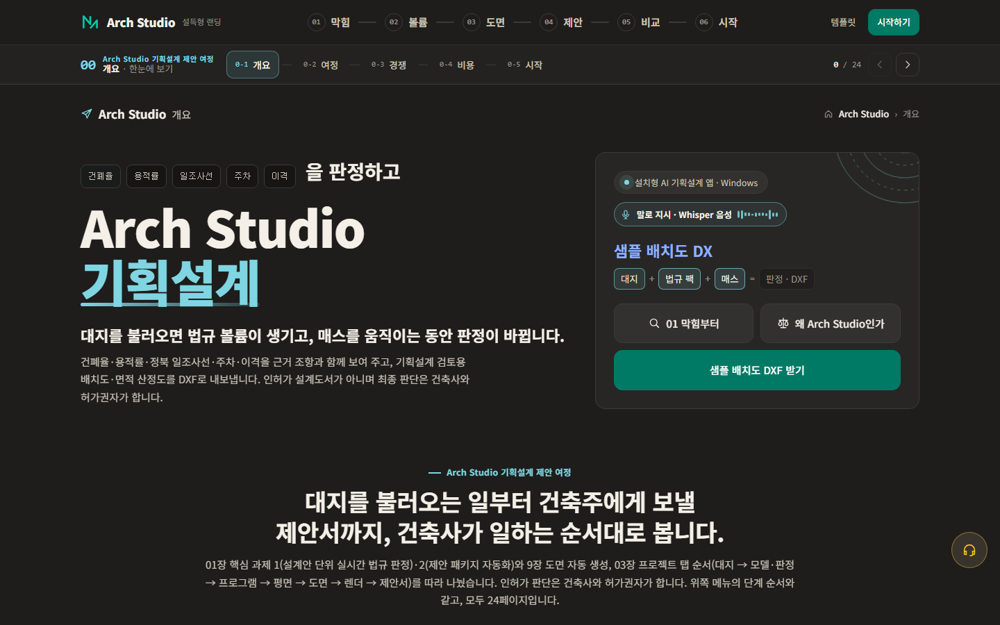 |
| [arch-studio](products/arch-studio/README.md#화면) | 대시보드(데모 실행 화면) | 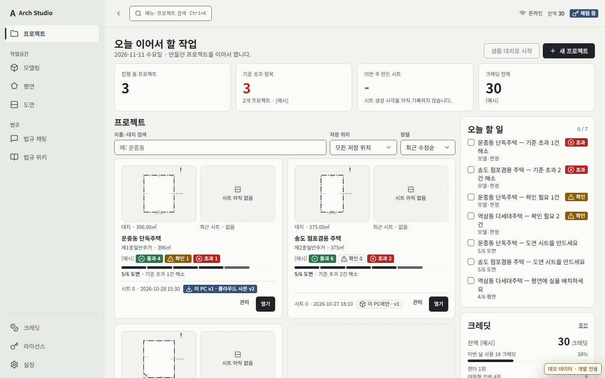 |
| [sceneflow](products/sceneflow/README.md#화면) | 랜딩(시안) | 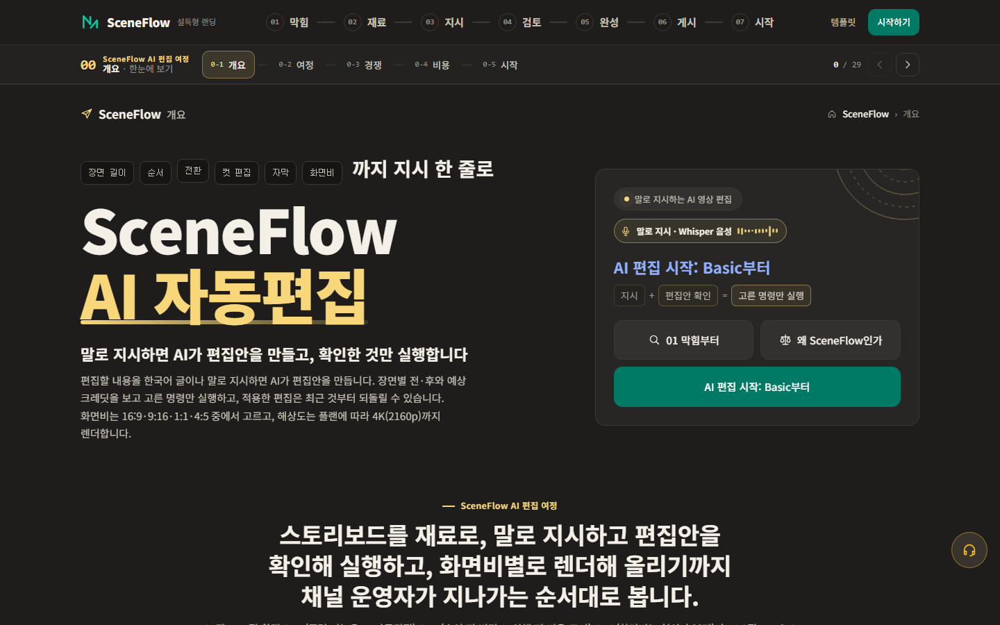 |
| [sceneflow](products/sceneflow/README.md#화면) | 대시보드(와이어프레임) | 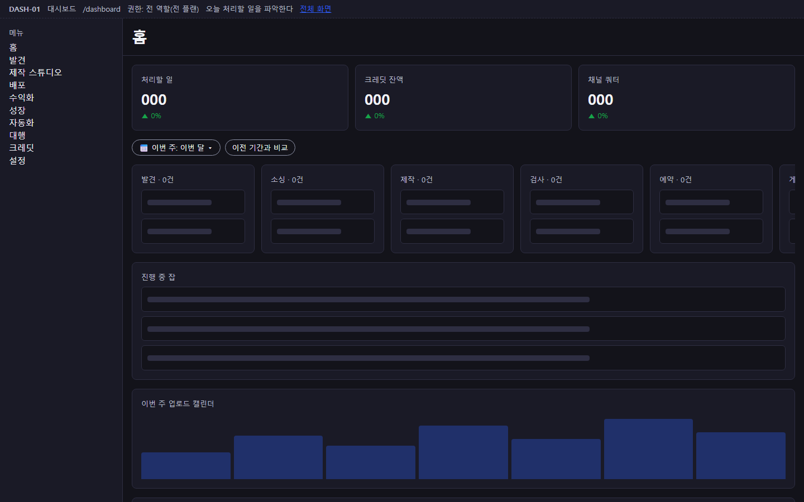 |
| [flora-publishing](products/flora-publishing/README.md#화면) | 랜딩(선행 원본 Flora-V2 실행 화면) | 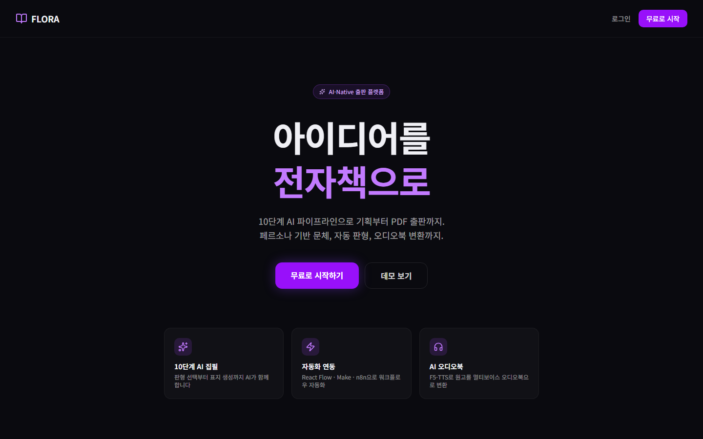 |
| [admin-suite](products/admin-suite/README.md#화면) | ERP 로그인(실행 화면) | 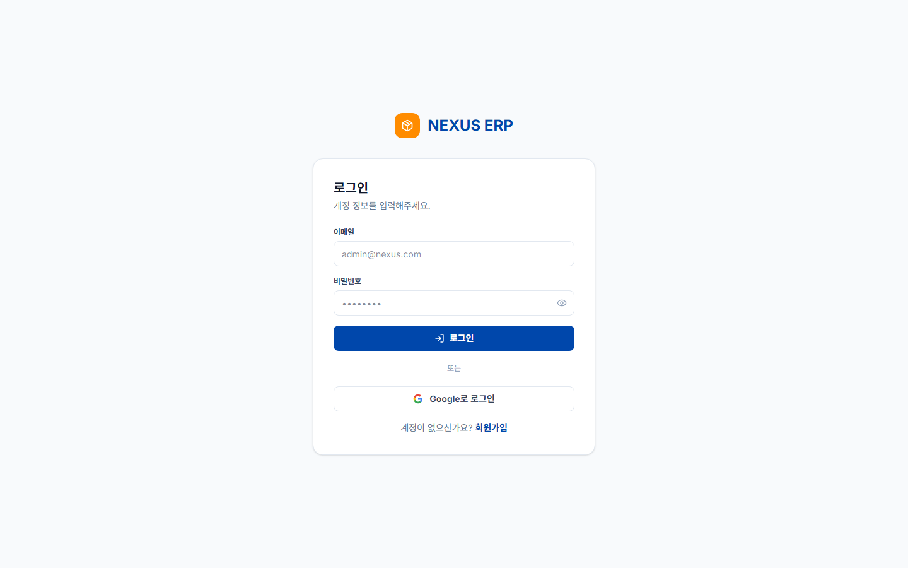 |
| [admin-suite](products/admin-suite/README.md#화면) | 병원 로그인(실행 화면) | 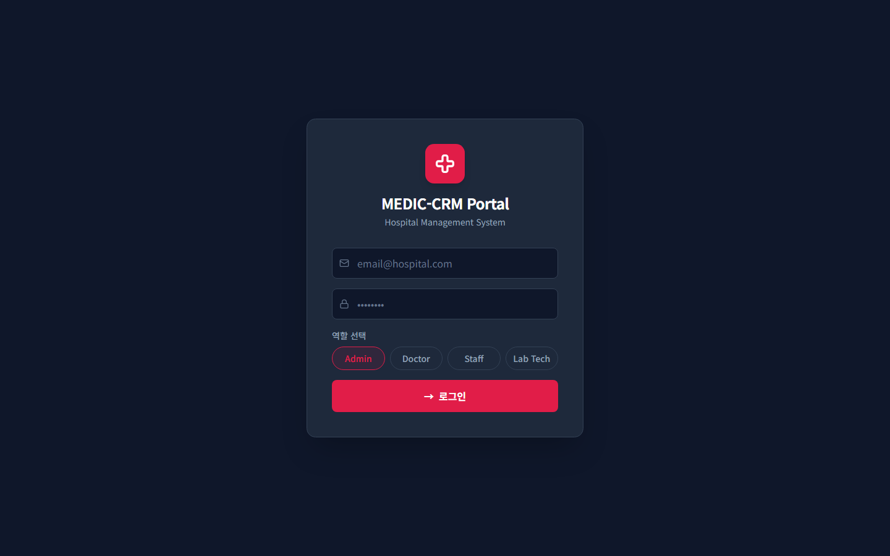 |
| [admin-suite](products/admin-suite/README.md#화면) | 병원 대시보드(시안) | 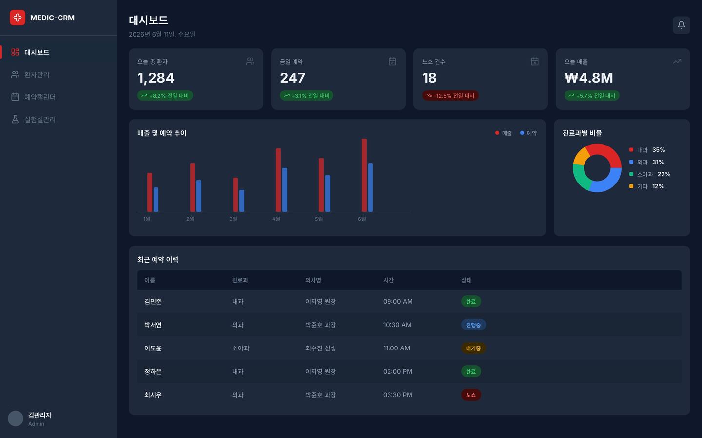 |
| [admin-suite](products/admin-suite/README.md#화면) | 학교 로그인(실행 화면) | 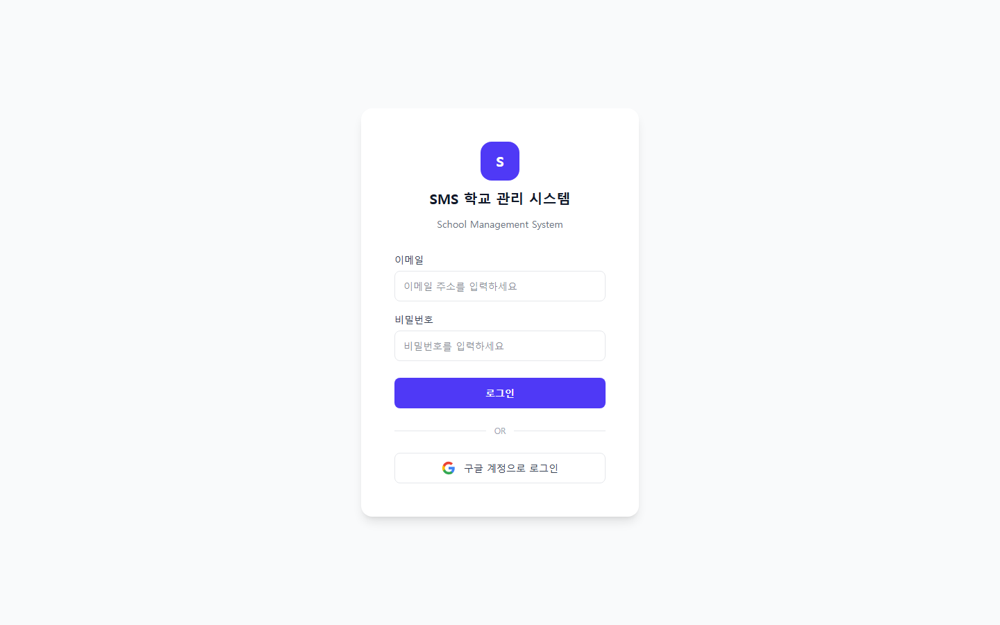 |
| [nomad-commerce](products/nomad-commerce/README.md#화면) | 랜딩(sellingstudio 실행 화면) | 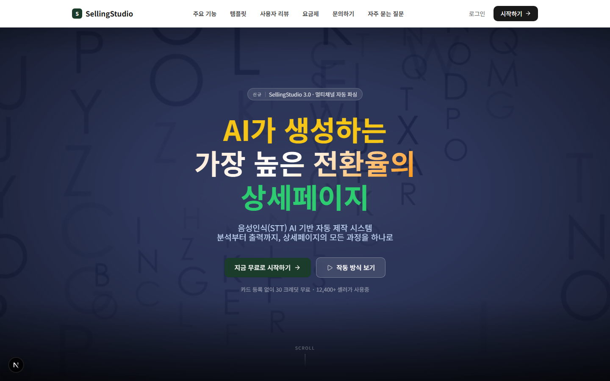 |
| [website-floria](products/website-floria/README.md#화면) | 랜딩(Lucury_Website 실행 화면) |  |
| [study-note](products/study-note/README.md#화면) | 랜딩(실행 화면) | 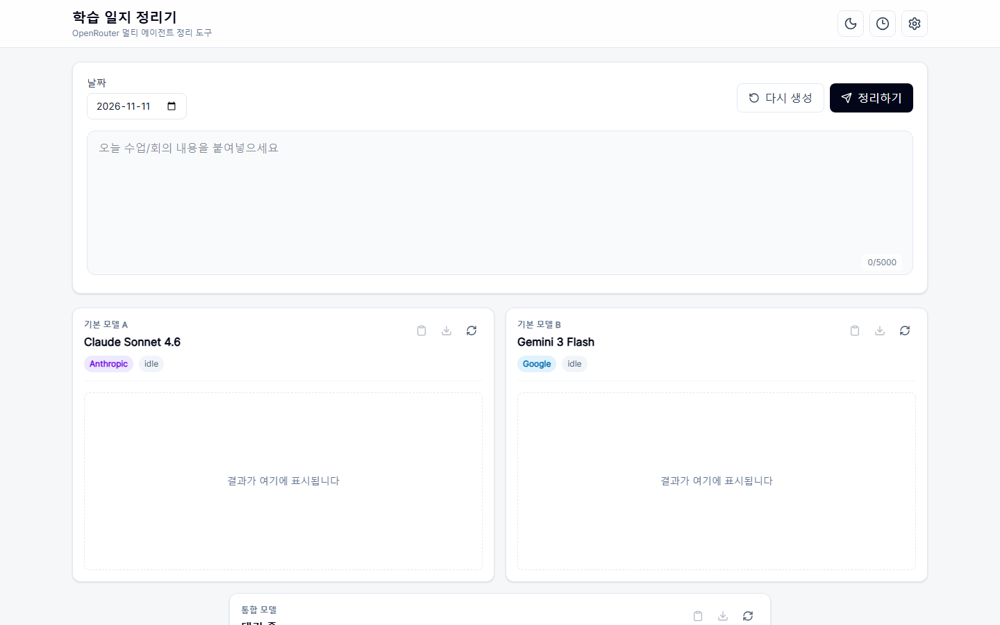 |
| [microweb-studio](products/microweb-studio/README.md#화면) | 빌더(실행 화면) | 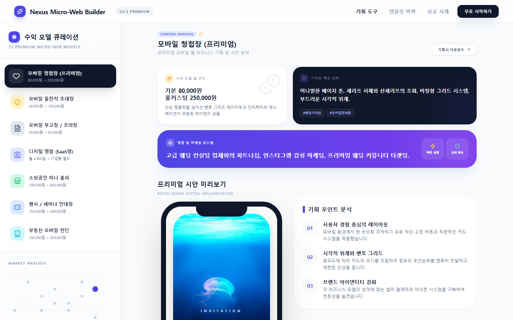 |

## 확인이 필요한 것

| 항목 | 내용 |
|---|---|
| website-floria 원본 | 원본 레포 Lucury_Website의 실제 내용은 건설사 "한울건설" 사이트로, Floria 기획과 다릅니다 |
| sceneflow 완성도 기준 | main 병합 기준(P0 72/88)과 기능 브랜치 README의 기준(분모 86·22)이 달라 하나로 정해야 합니다 |
| flora-publishing 완성도 기준 | 작업표 완료 표시(1/70)와 커밋된 작업(12/70)이 다릅니다 |
| webcraft-agency-simulator | 로컬 원격은 theBestTrade로 되어 있으나 GitHub에서 조회되지 않습니다 |
| study-note 로컬 원본 | 로컬 체크아웃(2026-05-29)이 GitHub main(2026-11-08)보다 뒤처져 있습니다 |
