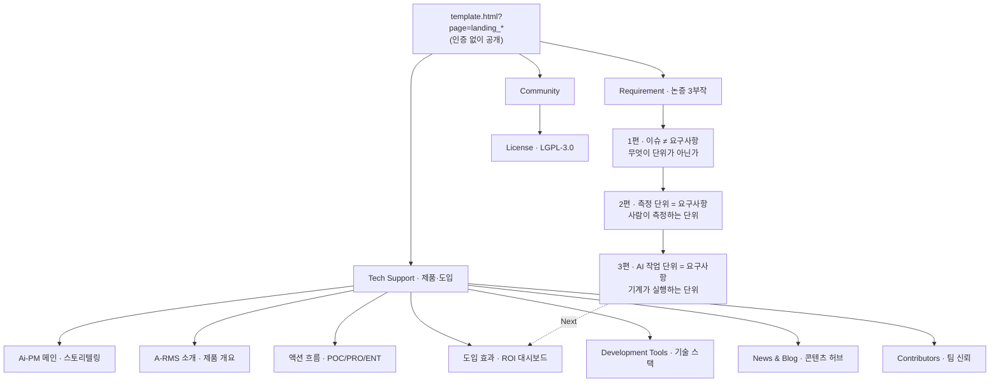

# A-RMS 랜딩 벤치마킹 리포트

> 작성일: 2026-10-17 · 작성: 리치노마드 김대영(RichNomad) · 분석 대상: https://www.a-rms.net/arms/template.html?page=landing_index 외 9개 페이지

A-RMS 랜딩은 jQuery + Bootstrap 3 관리자 테마 위에 만든 다크 글래스모피즘 B2B 사이트다. 핵심은 화려한 기술이 아니라 "문제 → 원인 → 근거 수치 → 해결 구조 → ROI" 순서의 설득 설계다. 디자인은 글래스 카드 1종, 색 4개, 섹션 틀 1개를 반복하는 단순한 시스템이라 Next.js + Tailwind로 그대로 옮기기 쉽다.

---

## 1. 기술 스택 — 확인된 사실

프론트엔드는 React·Vue·TypeScript 없이 바닐라 JS + jQuery로 만든 멀티페이지 앱이고, 랜딩도 실제 제품 앱과 같은 코드베이스 안에 있다. 아래 내용은 313DEVGRP가 공개한 저장소의 프론트엔드 규약 문서(`arms-frontend-web`)로 확인했다.

| 영역 | 사용 기술 | 벤치마킹 관점 |
| --- | --- | --- |
| 마크업·스타일 | Bootstrap 3 + 유료 관리자 테마 Lightblue4(Flatlogic), Font Awesome + Glyphicon | 관리자 테마의 `widget` 카드를 랜딩 카드로 재활용 → 앱과 랜딩의 시각 일관성 확보 |
| 스크립트 | jQuery 3 + 바닐라 JS(ES5/ES6 혼재), 번들러 없음 | 빌드 없이 배포 가능하지만 유지보수 비용이 큼 |
| 라우팅 | `template.html?page={page}` 한 장 + `$.load()`로 `html/{page}/content-container.html` 조각 삽입 | 페이지 = HTML 조각 1개 + JS 1개 쌍. 공통 GNB·푸터는 한 번만 작성 |
| 랜딩 규칙 | 페이지 이름이 `landing_`으로 시작하면 로그인 검사 생략, 랜딩 전용 내비·푸터 사용 | 마케팅 페이지를 제품 안에서 바로 운영 |
| 애니메이션 | GSAP 3.12.2, Swiper 11.1.4, unityping(타이핑), textillate(텍스트 효과) | 저장소에 번들로 포함. 랜딩별 실제 사용 범위는 화면으로 추정 |
| 차트·시각화 | ECharts 5.5, D3 6.7, three.js r165, drawio 임베드 | 도넛·막대 차트는 ECharts 또는 CSS로 구현 가능 |
| 다국어 | `data-locale` 속성 + ko/en JSON | 지구본 아이콘(3개 언어) 메뉴가 GNB에 상시 노출 |
| 백엔드 | Java Spring Boot MSA: Keycloak 인증 게이트웨이(WebFlux), MySQL, OpenSearch 집계, Kafka, Redis, Spring AI(Ollama 우선, Anthropic 대체) | 랜딩의 "Ai 통계 분석" 주장은 실제 AI 모듈이 뒷받침 |
| 라이선스 | LGPL-3.0 오픈소스(Java Service Tree Framework) | 오픈소스 + 엔터프라이즈 라이선스(POC·PRO·ENT) 판매 모델 |

> 코드를 직접 열람하지 않은 부분(어떤 랜딩이 GSAP을 쓰는지 등)은 화면 캡처로 추정했으며, 각 항목에 "추정"으로 표시했다.

---

## 2. 정보구조 — GNB 하위메뉴 지도

상단 GNB는 제품 앱과 같은 Project · Requirement · Management · System 4개 메뉴이고, 랜딩은 그 드롭다운 안에 섞여 있다. 랜딩과 앱의 메뉴를 하나로 합쳐서, 방문자가 마케팅 페이지에서 제품 화면으로 바로 넘어가게 한 구조다.



분류는 각 페이지 브레드크럼(Support System · Requirement · Community)을 기준으로 했다. 논증 3부작은 편마다 Next 섹션으로 다음 편을 열게 하고, 마지막에는 도입 효과(ROI)로 보낸다.

---

## 3. 페이지별 분석

10개 페이지는 크게 4종의 템플릿으로 나뉜다. 모두 같은 GNB·브레드크럼·글래스 푸터를 공유하고, 본문만 달라진다. URL과 페이지 매칭 중 function·poc는 캡처만으로는 구분되지 않아 내용 기준으로 적었다.

| 페이지 | 템플릿 유형 | 구성 순서 | 핵심 컴포넌트 | 벤치마킹 포인트 |
| --- | --- | --- | --- | --- |
| Ai-PM 메인 (`landing_index`) | 스토리텔링 랜딩 | 히어로 → 역할 탭 → 역할별 고충 3카드 → 원인 도해 → 피해 수치 → 해결 흐름도 → 도입 효과·ROI → 채널 | 거대 타이포 히어로 + 우측 CTA 글래스 카드, 도넛 3개, 단계별 막대, 육각형 단계 배지, KPI 타일 5개 | 한 페이지에 문제부터 ROI까지 완결. 역할(임원·PM·실무자)별 탭으로 구매자·사용자를 동시에 설득 |
| A-RMS 소개 (`landing_introduce`) | 제품 개요 | 2단 히어로(텍스트 + 영상) → 개발 배경·적용 분야·기대 효과 3단 → 아키텍처 도해 → 4대 분석 질문 | 유튜브 임베드, 브로셔·프로필 링크 버튼, Problem/Application/Effect 3단 | "왜 만들었나 · 누가 쓰나 · 무엇이 좋아지나"를 한 화면에 배치 |
| 이슈 ≠ 요구사항 (`landing_issue_not_req`) | 논증형 아티클 | THESIS → CONTRAST → SYMPTOM → ARGUMENT → RESOLUTION → NEXT | 좌우 비교 카드(주황 vs 파랑), 시간축 다이어그램(선 vs 점), 증상 3카드, 4단계 흐름 + 되돌아오는 점선 | 모든 주장에 출처(논문·통계·자사 자료)를 카드 하단에 명시 |
| 측정 단위 = 요구사항 (`landing_measure_is_req`) | 논증형 아티클 | Thesis 히어로 + 우측 요약 카드 → Problem → Criteria 4요건 → Argument(TSRC) → Evidence(특허 흐름도) → Next | 요건 체크 4열, 비용 증가 체인(1배→10→200배), 대조군 비교 | 학술 인용(Paulk, Pfleeger, Hill)으로 B2B 신뢰도 확보 |
| AI 작업 단위 = 요구사항 (`landing_ai_work_to_req`) | 논증형 아티클 | Thesis + Hook 카드 → Problem 3케이스 → Criteria 6요건 + 판정표 → 닫힌 고리 7단계 → Evidence 3계층 → Next | ○△× 비교표, 7칸 스텝 레일, 코드블록 카드, 경고 콜아웃 | "3부작 3편" 시리즈 구성으로 다음 페이지 열람 유도. 페이지 자체를 증거로 쓰는 자기증명 섹션 |
| 액션 흐름 (`landing_poc` 또는 `function`, 추정) | 사용 가이드 | 중앙 정렬 헤더 → 라이선스 탭(POC 7·PRO 11·ENT 11·대시보드 5) → 단계 레일 → 세로 타임라인 → 비교 CTA | 아이콘 탭, 스텝 레일, 번호 원 + 세로선 타임라인, 3D 인물 일러스트 | 각 단계를 "사용자가 하는 일 / 시스템이 해 주는 일" 2줄로 분리 |
| 도입 효과 (`landing_effect`) | ROI 대시보드 | KPI 타일 5개 → 단계별 시간 절감 바 + 비용 구조 → 3년 누적 막대 → 결론 콜아웃 → 가상 채용공고 비교 | 색상별 KPI 타일, Before→After 진행 바, UNFILLED/HIRED 스탬프 | "채용 불가능한 직무를 대신한다"는 채용공고 패러디로 가치를 인건비로 환산 |
| Development Tools (`landing_devtools`) | 아이콘 그리드 | 3열 위젯 × 12개 카테고리(ALM·CI/CD·DB·ELK…AI) | 라이트 타일 아이콘 + 위젯 컨트롤(접기·전체화면) | 사용 기술 30여 개를 로고로 나열해 기술력 증명 |
| News & Blog | 콘텐츠 허브 | BEST ARTICLE → 인기 캐러셀 → 최신 리스트 + HOT 키워드·추천 사이드바 → 더보기 | Swiper 캐러셀, 색 키워드 칩, 조회수·날짜 메타 | 블로그를 랜딩 안으로 끌어와 SEO·재방문 확보 |
| Contributors / License | 신뢰 페이지 | 역할별 프로필 카드 그리드 / LGPL 전문 위젯 | 원형 사진, 스킬 배지, 경력 표기 | 오픈소스 커뮤니티 규모를 보여 신뢰도 보강 |

공통 요소는 상단 GNB(로고 · 4개 메뉴 · 검색 · 언어 · 계정), 섹션 타이틀 + 브레드크럼 바, 13개 SNS 채널 푸터, 우하단 상담 버튼과 맨 위로 버튼이다. 상담 버튼 옆에는 "프로젝트의 3요소는 Time, Scope, Resource라는 거 알고 계셨나요?" 같은 말풍선이 페이지마다 다르게 떠서 대화를 유도한다.

---

## 4. 디자인 시스템

전체 디자인은 "어두운 슬레이트 배경 + 반투명 카드 2단 중첩 + 의미가 고정된 4색"으로 요약된다. 배경색은 캡처 픽셀에서, 상태색은 공개 규약 문서에서 가져왔다.

### 4-1. 색 토큰

| 토큰 | 값 | 쓰임 |
| --- | --- | --- |
| 배경 기본 | `#484848` ~ `#515664` | 중성 회색에 푸른 기운을 섞은 바탕 |
| 배경 스포트라이트 | `#606881` | 상단 중앙·좌측에 깔리는 방사형 빛. 섹션마다 위치가 달라 깊이감 생성 |
| GNB | `#474a55` | 배경보다 한 톤 어둡고 하단 1px 경계선 |
| 글래스 카드(바깥) | 흰색 6~10% + 테두리 흰색 12% | 섹션 컨테이너. 라운드 약 24px, 큰 그림자 |
| 패널(안쪽) | `#424242` 전후(검정 25~35%) | 도해·차트·표를 담는 한 단계 어두운 상자 |
| 완료 / 긍정 | `#34d399` | ROI·절감액·"A-RMS가 해 주는 일" |
| 정상 / 정보 | `#a4c6ff` | 강조 데이터 텍스트, 요구사항(Requirement) 쪽 |
| 주의 / 강조 | `#fbbf24` · 주황 계열 | 아이브로 라벨(THESIS · 01), 핵심 단어 하이라이트, 브로셔 버튼 |
| 위험 / 문제 | `#f87171` | 이슈(Issue) 쪽, 비용 손실, UNFILLED 스탬프 |
| 보조 포인트 | 보라(약 `#a78bfa`) | 체크 아이콘, 연간 총 절감 숫자 |

### 4-2. 타이포그래피

- 한글은 Noto Sans KR 계열 한 가지로 통일(캡처 형태 기준 추정). 거대 히어로만 영문 굵은 산세리프("Ai-PM", 약 140px).
- 위계는 4단계: 섹션 헤드라인 약 34px 굵게, 카드 제목 18~22px, 본문 14~15px 밝은 회색, 출처·주석 12px 더 어두운 회색.
- 아이브로 라벨은 대문자 + 자간 넓힘 + 주황(`THESIS · 01`, `SOURCES`, `QUANTITATIVE ANALYSIS`).
- 헤드라인 안 핵심 단어만 색을 바꾼다("우리 제품은 언제 **출시** 할 수 있습니까?"). 문장 전체를 칠하지 않는 것이 규칙.
- 숫자는 크게(48~64px), 단위는 작게 붙인다("6,147 만원/년").

### 4-3. 레이아웃·간격

- 콘텐츠 최대 폭 약 1,700px(2,000px 캡처 기준 좌우 150px 여백), Bootstrap 3 12컬럼 그리드.
- 섹션 간격은 크게(120~160px), 카드 내부 패딩 32~40px.
- 섹션 틀은 항상 같다: 중앙 헤드라인 → 한 줄 서브카피 → 글래스 카드 1~3개.
- 논증형 페이지는 왼쪽 정렬, 설득형 메인은 중앙 정렬로 나눠서 읽는 리듬을 다르게 한다.
- 전체 화면 캡처에 보이는 가로 띠 이음매는 배경이 `fixed`로 고정된 흔적. 스크롤해도 빛과 노이즈가 제자리에 있어 카드만 떠 올라가는 느낌을 준다.

---

## 5. 컴포넌트 카탈로그

10개 페이지는 아래 14개 컴포넌트의 조합이다. 우선순위는 "먼저 만들면 가장 많은 페이지를 채우는 순서"다.

| 우선 | 컴포넌트 | 쓰인 페이지 | 구조 요점 |
| --- | --- | --- | --- |
| 1 | GlassCard (섹션 컨테이너) | 전부 | 반투명 배경 + 1px 테두리 + 24px 라운드 + `backdrop-filter: blur`. 헤더에 굵은 라벨 + 연한 설명 + 위젯 컨트롤(‹ ⌄ › ⤢) |
| 2 | SectionHeader | 전부 | 아이브로(`THESIS · 01`) → 헤드라인(핵심어 색 강조) → 리드 문단 → 인용 박스 |
| 3 | GNB + 메가 드롭다운 | 전부 | Project · Requirement · Management · System 4개 대메뉴 + 검색 + 언어 + 계정 |
| 4 | PageTitleBar | 전부 | 좌측 아이콘 + 굵은 메뉴명 + 연한 하위명, 우측 브레드크럼 |
| 5 | ChannelFooter | 전부 | NETWORKING 13개 원형 SNS 아이콘 + ABOUT US / GET IN TOUCH / RIGHTS & ADDR 3열 |
| 6 | KpiTile | 메인, effect | 아이콘 + 우측 태그(TIME·SAVED·ROI·BEP·3Y NET) + 큰 숫자 + 라벨 + 근거 한 줄. 타일마다 배경 색조 다름 |
| 7 | CompareCard (A vs B) | issue, measure, effect | 좌우 2단, 왼쪽 주황·빨강(문제) / 오른쪽 파랑·초록(해결), 같은 속성을 같은 줄에 배치 |
| 8 | StepRail (단계 레일) | issue, poc, ai_work | 아이콘 박스 + 화살표. 마지막 단계만 주황 테두리로 결과물 강조, 되돌아오는 점선 |
| 9 | Timeline (세로) | poc | 번호 원 + 세로선, 사용자 행동(☞) / 시스템 반응(›) 2줄 |
| 10 | IconTabs | 메인, poc | 아이콘 + 이름 + 개수("7단계"), 선택 탭 하단 바 |
| 11 | Callout (결론·경고) | effect, ai_work | 왼쪽 색 띠 + 아이콘 + 굵은 결론 + 설명 |
| 12 | DonutStat / ProgressBar | 메인, effect | 원형 게이지와 Before→After 막대(원래 값에 취소선) |
| 13 | ArchitectureDiagram | 메인, introduce, measure | HTML 박스 + 세로 라벨 + 육각형 단계 배지(①연결 ②배포 ③수집 ④통계) |
| 14 | SourceNote | 논증형 3종 | 카드 하단 12px 회색 "출처 — …" 한 줄 |

처음 5개(GlassCard · SectionHeader · GNB · PageTitleBar · Footer)만 만들어도 모든 페이지의 뼈대가 선다. 나머지는 페이지를 만들 때 하나씩 추가하면 된다.

---

## 6. 애니메이션 — 어디에 무엇을 쓰나

애니메이션은 절제돼 있고, "숫자·흐름·시선 유도" 세 곳에만 쓴다. 저장소에 번들된 라이브러리와 캡처 흔적을 대조한 추정이다.

| 위치 | 효과 | 근거 | 구현법 (권장) |
| --- | --- | --- | --- |
| 메인 히어로 CTA 카드 | "시스템 바로가기" 타이핑 | 캡처에 "스 바로가기"로 잘린 상태, unityping 번들 | 글자 배열을 setInterval로 찍기, 커서 깜빡임 |
| 히어로 카드 모서리 | 동심원 아크 선 | 정적 SVG 장식 | SVG 호 여러 개 + 느린 회전 |
| 섹션 진입 | 아래에서 페이드업 | GSAP 번들, 일반적 패턴 | IntersectionObserver + CSS transition(기본 상태는 보이게) |
| KPI·도넛 숫자 | 0 → 목표값 카운트업 | 대시보드형 숫자 카드 | requestAnimationFrame + easeOutCubic |
| 도넛 링·진행 바 | 차오르는 링·바 | 도넛 끝이 둥글게 처리된 SVG 형태 | SVG `stroke-dashoffset` / `width` transition |
| 흐름도 점선 | 점선이 흐르는 동작 | 툴체인 원형도·A-RMS 흐름도 점선 화살표 | `stroke-dasharray` + `@keyframes` dashoffset 루프 |
| 역할 카드 이미지 | 호버 시 블러 + 설명 오버레이 | 가운데 카드만 흐린 상태로 캡처 | `:hover` 시 `filter: blur()` + 오버레이 opacity |
| 헤드라인 파란 강조어 | 그라디언트 시머(추정) | 파란 강조어가 배경에 거의 묻힌 채 캡처 | `background-clip: text` + 그라디언트 이동 (대비 확보 필수) |
| 인기 콘텐츠 | 가로 캐러셀 | Swiper 11 번들, 우측 › 버튼 | Swiper 또는 CSS scroll-snap |
| 우하단 상담 버튼 | 말풍선 팝업 | 페이지마다 다른 문구 | 지연 후 등장, 닫기 버튼 |

**구현 원칙 3가지**

1. 로드 직후에도 내용이 보여야 하므로 `opacity: 0`으로 숨겨 두지 않는다(화면 밖 요소만 숨겼다가 등장).
2. `prefers-reduced-motion` 설정 시에는 모두 끈다.
3. 애니메이션은 숫자와 흐름에만 쓰고 텍스트 본문에는 쓰지 않는다.

---

## 7. 설득 구조 — 카피 프레임

A-RMS에서 가장 베낄 가치가 큰 것은 디자인보다 논증 프레임이다. 메인은 감정에, 하위 논증 페이지는 논리에 호소하고, effect 페이지가 돈으로 마무리한다.

### 7-1. 메인 랜딩 흐름 (감정 → 논리 → 돈)

1. **공감:** "우리는 똑같은 문제를 반복하고 있습니다" + 역할별 질문 3개(언제 출시? 경쟁력? 투자 대비 성과?)
2. **역할 분해:** 같은 문제를 임원·PM·실무자 시점으로 나눠 각자 자기 이야기로 읽게 함
3. **원인 지목:** "문제의 원인은 끊어진 정보입니다" — 단 하나의 적을 정의
4. **악화:** 일정 지연 47% · 요구사항 누락 39% · 연 6.1억 손실 등 외부 통계로 심각성 증명
5. **해결:** "연결된 정보" 흐름도로 방법을 보여줌(연결 → 배포 → 수집 → 통계)
6. **보상:** 도입 효과·절감 시간·ROI 241%·BEP 3.5개월
7. **행동:** 브로셔 · 소개서 · 시연 영상 · 13개 채널

### 7-2. 논증형 하위 페이지 프레임 (재사용 가능)

| 단계 | 역할 | A-RMS 예시 |
| --- | --- | --- |
| THESIS | 한 문장 주장 | 이슈 ≠ 요구사항 |
| CONTRAST | 헷갈리는 두 개념을 속성별로 나란히 비교 | 시점·단위·수명·완결성·합의 |
| SYMPTOM | 독자가 겪는 증상 3개 | 통계 오염, 연결 정보 없음, 관리를 위한 관리 |
| ARGUMENT | 왜 그런지 원리 설명 + 외부 인용 | Karl Weigers: 늦게 발견된 요구 오류 10~13배 |
| RESOLUTION | 우리 방식의 단계 흐름 | 연결 → 배포 → 수집 → 통계 |
| EVIDENCE | 제품·특허·자기증명 | 특허 출원번호, "이 페이지도 그렇게 만들어짐" |
| NEXT | 시리즈 다음 편으로 연결 | "3부작 3편" 카드 6개 |

주의할 점도 배울 만하다. 모든 추정치에 "가정 기반 추정치이며 실측 실적이 아닙니다", 특허에 "출원 상태이며 등록 여부와는 별개"를 명시해 과장 광고 리스크를 막았다. 정부지원사업·B2B 제안서에도 그대로 쓸 수 있는 태도다.

---

## 8. 구현 전략 — 어떤 방식으로 만들까

**추천은 B(Next.js 정적 랜딩).** A-RMS처럼 jQuery로 만들 이유는 "이미 jQuery 앱이 있어서"뿐이고, NOMAD 스택(Next.js 16 + Tailwind v4 + Shadcn)에서는 같은 결과를 더 적은 코드로 낼 수 있다.

| 항목 | A. A-RMS 방식 (jQuery + 조각 HTML) | B. Next.js App Router + Tailwind (추천) | C. 노코드 (Framer 등) |
| --- | --- | --- | --- |
| 초기 제작 | 3~4주 | 2~3주 (템플릿 재사용 시 1주) | 3~5일 |
| SEO | 약함 (본문을 JS로 주입) | 강함 (SSG로 완성 HTML) | 보통 |
| 하위 페이지 추가 | HTML+JS 쌍 작성 | MDX 파일 1개 | 페이지 복제 |
| 제품 앱과 연동 | 같은 코드베이스 | 같은 모노레포의 `(marketing)` 라우트 그룹 | 별도 도메인 |
| 화이트라벨·테마 복제 | 어려움 | CSS 변수만 교체 | 어려움 |
| 월 비용 | 서버 필요 | Vercel 무료~$20 | $15~$30 |

### 8-1. B안 구조 (MVP)

```text
app/(marketing)/
  layout.tsx            GNB + 푸터 + 고정 배경(빛·노이즈)
  page.tsx              메인 스토리텔링
  [slug]/page.tsx       논증형 하위 페이지 (content/*.mdx)
  effect/page.tsx       ROI 대시보드
components/landing/
  glass-card.tsx  section-header.tsx  kpi-tile.tsx
  compare-card.tsx  step-rail.tsx  timeline.tsx  callout.tsx
lib/nav.ts              GNB 하위메뉴 데이터 (한 곳에서 관리)
```

- **매핑:** A-RMS `section.widget` → `<GlassCard>`, `template.html?page=` → 파일 기반 라우팅, `data-locale` → next-intl, GSAP → Motion(구 Framer Motion) `whileInView`.
- **확장:** 논증형 페이지를 MDX 프레임(THESIS…NEXT 컴포넌트)으로 만들면, 새 글을 AI가 초안하고 사람은 검수만 하는 구조가 된다.
- **린 검증:** 제품이 없는 아이디어 단계라면 C(노코드)로 메인 1장 + 사전예약 폼부터 띄우고, 전환이 확인되면 B로 옮기는 순서가 비용 대비 안전하다.

---

## 9. 사업 적용 — 벤치마킹 체크리스트와 기회

가장 빠른 활용은 이 프레임을 NOMAD SaaS 하나(예: FLORA 또는 Ads-Flow)의 랜딩에 먼저 적용해 전환율을 확인하고, 검증된 템플릿을 웹 에이전시 상품으로 판매하는 것이다.

### 9-1. 벤치마킹 체크리스트

- [ ] 제품의 "단 하나의 적"을 한 단어로 정의했다 (A-RMS: 끊어진 정보)
- [ ] 구매자와 사용자를 역할별로 나눌 탭 3개를 정했다
- [ ] 외부 통계 3개와 출처를 확보했다
- [ ] 연결 → 배포 → 수집 → 통계 같은 4단계 해결 흐름을 그렸다
- [ ] 가정 조건을 명시한 ROI 표(시간·비용·BEP)를 만들었다
- [ ] 논증형 하위 페이지 3편을 시리즈로 기획했다
- [ ] 브로셔·소개서·시연 영상 CTA 3종을 준비했다
- [ ] 추정치·특허 상태 문구로 과장 표현을 막았다

### 9-2. 확장 기회

| 기회 | 내용 | 수익화 | 검증 방법 |
| --- | --- | --- | --- |
| 웹 에이전시 상품 | "B2B SaaS 논증형 랜딩 패키지" (메인 + 논증 3편 + ROI 페이지) | 패키지 300~800만원, 월 유지보수 | 포트폴리오 1건 게시 후 문의 수 확인 |
| AI 랜딩 자동 생성 에이전트 | 제품 정보·통계를 넣으면 THESIS~NEXT MDX와 ROI 표를 초안 | 건당 과금 또는 구독 | 대표님 제품 3개에 먼저 적용 |
| ROI 계산기 리드 마그넷 | effect 페이지를 입력형 계산기로 바꿔 이메일 수집 | 상담·도입 전환 | 기존 랜딩에 붙여 전환율 비교 |
| 정부지원사업 서류 | 문제→원인→해결→기대효과 구조가 사업계획서 양식과 거의 같음 | 선정 확률↑ | 다음 신청서에 ROI 표·가정 조건 표 그대로 사용 |
| 콘텐츠 | "B2B 랜딩 해부" 블로그·유튜브·강의 챕터 | 강의·전자책 부록 | 블로그 1편 조회수로 수요 확인 |

---

## 출처

- [313devgrp/java-service-tree-framework (GitHub)](https://github.com/313devgrp/java-service-tree-framework) — `.claude/skills/arms-frontend-web` 규약 문서, `.claude/agents/design.md` 아키텍처 지도
- [313devgrp Docker Hub](https://hub.docker.com/r/313devgrp/java-service-tree-framework-all-in-one)
- A-RMS 랜딩 10개 페이지 전체 화면 캡처 (사용자 제공, 2026-10-17). 사이트는 robots 정책으로 자동 수집을 막아 두어 직접 접속해 확인하지는 못했다.
