# ARCHITECTURE_DIAGRAMS: 전체 구조 UML 시각화

작성일 2026-10-23. 이해관계자(기획·개발·운영·법무) 소통용 그림 모음입니다. 정본은 각 문서이며, 그림과 문서가 다르면 문서가 우선입니다. GitHub에서 그림이 바로 렌더링됩니다(Mermaid).

표기: **실선 화살표** = 호출·데이터 흐름, **점선** = 검증·참조, "(제안)" = 확정 전 값. 같은 내용을 웹으로 본 페이지(목차, 읽는 법 포함)는 Claude 아티팩트로 게시했습니다: https://claude.ai/artifact/V1wKjsX2wAcdpbESxsyMUK (비공개, 공유 설정 필요).

| # | 그림 | UML 종류 | 누구에게 필요한가 | 근거 문서 |
|---|---|---|---|---|
| 1 | 시스템 컨텍스트 | 유스케이스/컨텍스트 | 전원 | `CORE_SPEC.md`, `AI_ARCHITECTURE.md` |
| 2 | 구성요소 구조 | 컴포넌트 | 개발·운영 | `AI_ARCHITECTURE.md` 1절, `CORE_SPEC.md` |
| 3 | 배포 구조 | 배치(Deployment) | 개발·운영·보안 | `_supabase-modular/ARCHITECTURE.md`, 제품 02 |
| 4 | 제품 지도와 공유 모듈 | 패키지 | 기획·경영 | `products/README.md`, `SHARED_MODULES.md` |
| 5 | 코어 데이터 모델 | 클래스(개념) | 개발·법무 | `_supabase-modular/migrations/` |
| 6 | 로그인과 콜백 | 시퀀스 | 개발·보안 | `AUTH_ROADMAP.md` 3.2절 |
| 7 | 크레딧 선차감과 잡 | 시퀀스 | 개발·운영 | `CORE_SPEC.md` 4.3절 |
| 8 | 결제 확인 | 시퀀스 | 개발·보안·법무 | `CORE_SPEC.md` 5.2절 |
| 9 | AI 채팅 | 시퀀스 | 개발·보안 | `AI_ARCHITECTURE.md` 2절 |
| 10 | 잡·인증 단계·Stay 상태 | 상태 머신 | 개발·기획 | `CORE_SPEC.md` 9절, `AUTH_ROADMAP.md`, `airbnb/05_DATA_MODEL.md` |
| 11 | 보안 신뢰 경계 | 배치+흐름 | 보안·경영·법무 | `SECURITY_BASELINE.md` |
| 12 | 보안 통제 지도 | 블록 | 전원 | `SECURITY_BASELINE.md` 1~22장 |

## 1. 시스템 컨텍스트: 누가 무엇을 쓰는가

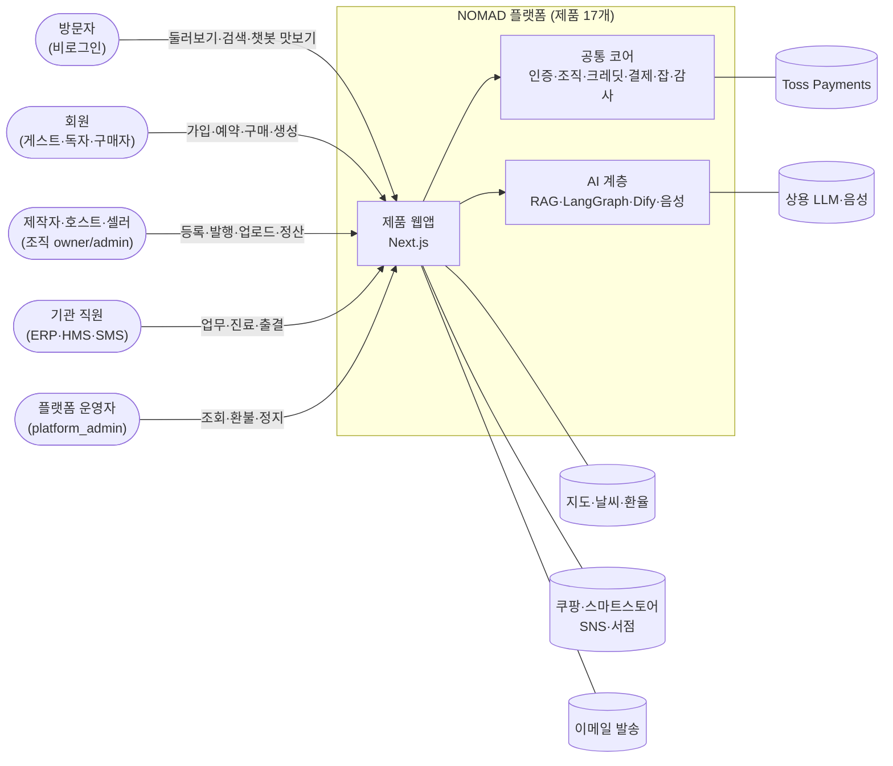

## 2. 구성요소: 한 요청이 지나가는 길

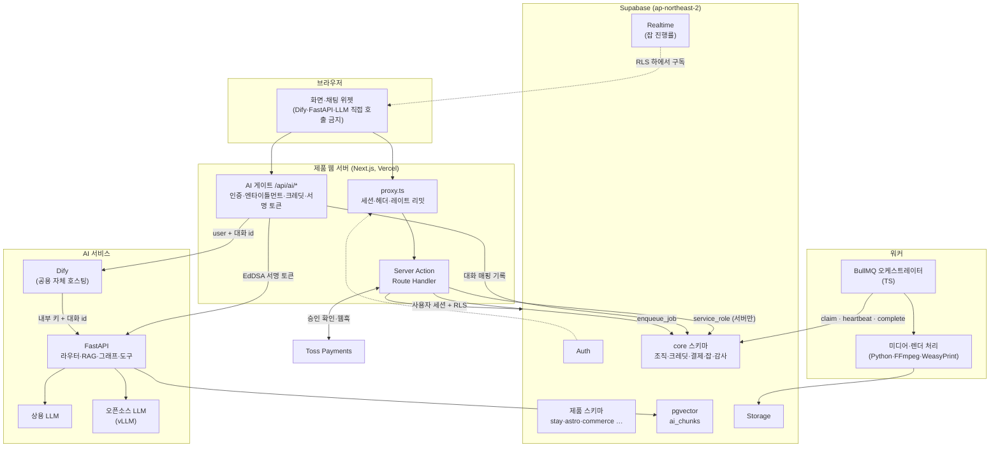

## 3. 배포 구조: 어디에 무엇이 놓이는가

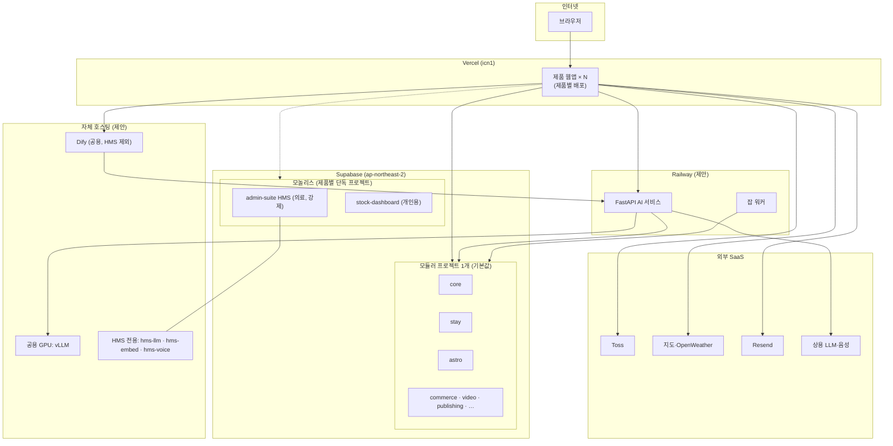

> 선택 기준: 기본은 모듈러(계정·크레딧 지갑 공유, 코어 보안 코드 한 번만 수정). 의료정보(HMS)와 개인용 증권 키(stock-dashboard)는 격리가 필요해 모놀리스. 코어 변경은 전 제품 RLS/RPC 회귀 테스트를 통과해야 적용.

## 4. 제품 지도와 공유 모듈

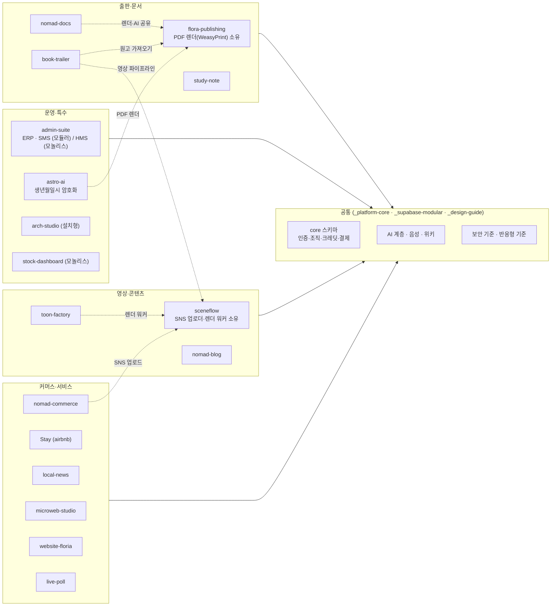

## 5. 코어 데이터 모델 (개념도, 대표 항목만)

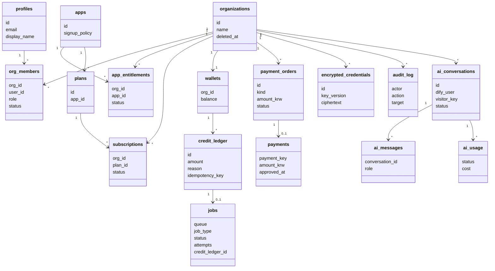

> 모든 제품 테이블은 `org_id`로 이 코어에 묶이고, 접근은 RLS가 `org_members`로 판정합니다. 열 이름은 이해를 위한 대표값이며 정확한 정의는 `_supabase-modular/migrations/`입니다.

## 6. 로그인과 콜백 (인증 단계 공통)

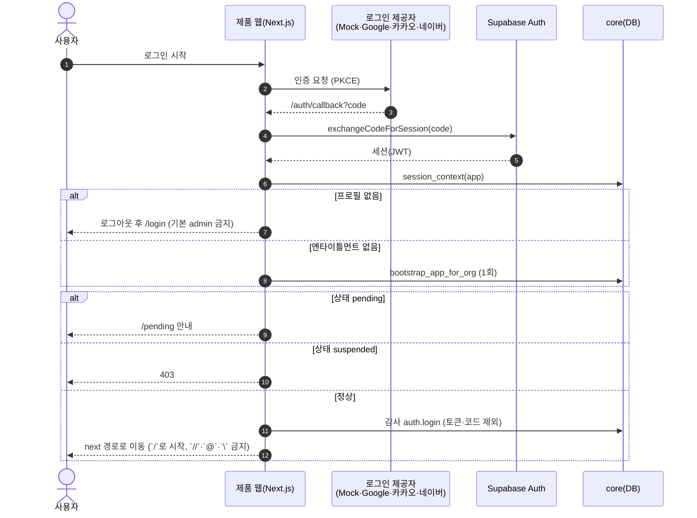

## 7. 크레딧 선차감과 잡 처리

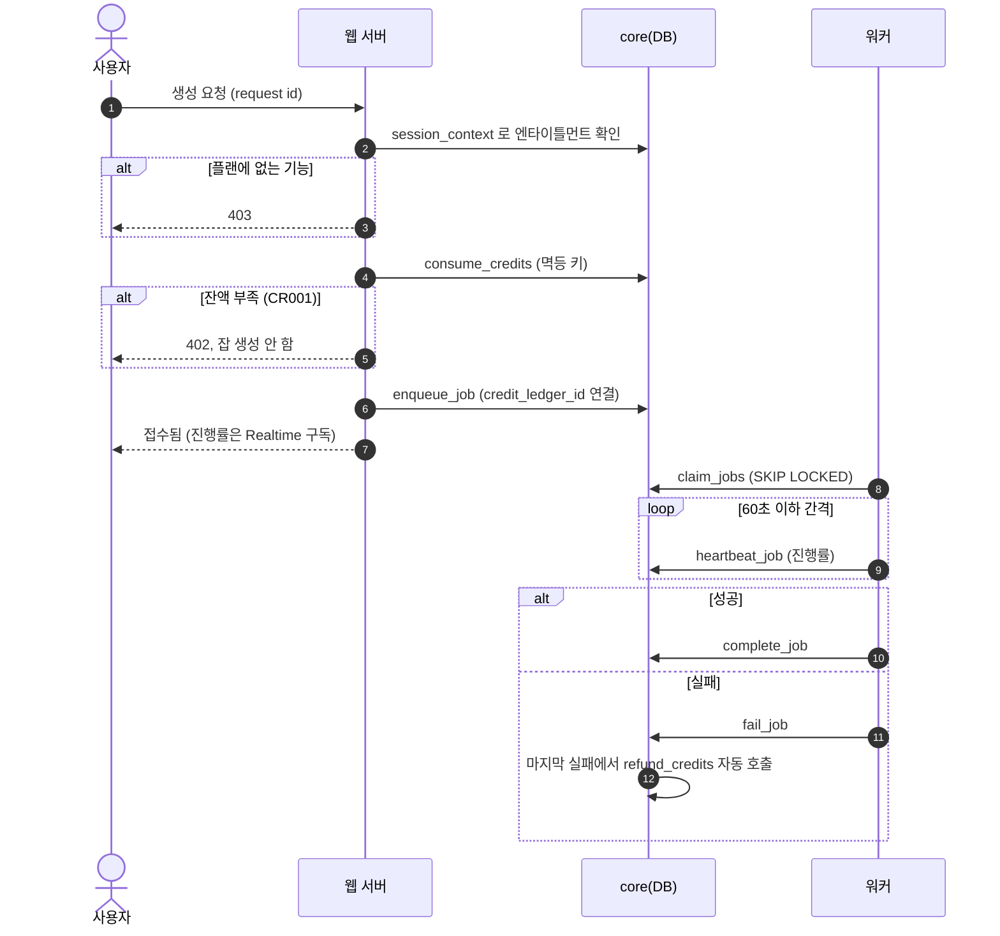

## 8. 결제 확인 (Toss 일반결제)

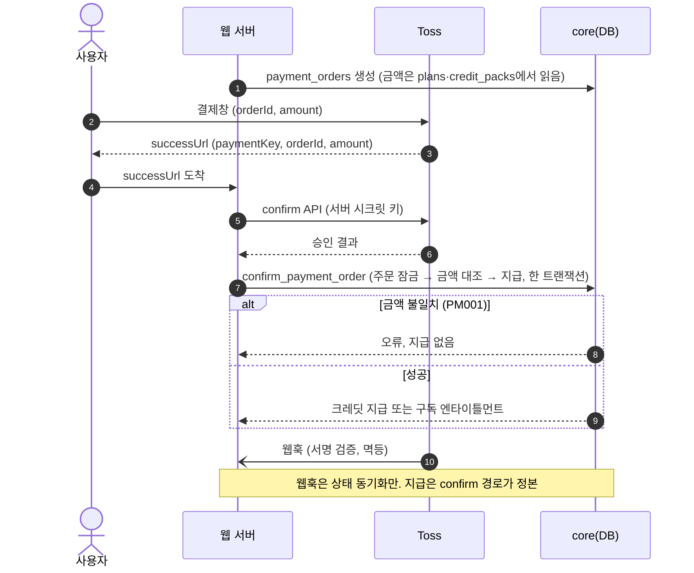

## 9. AI 채팅 (Dify 경유, 조직 격리)

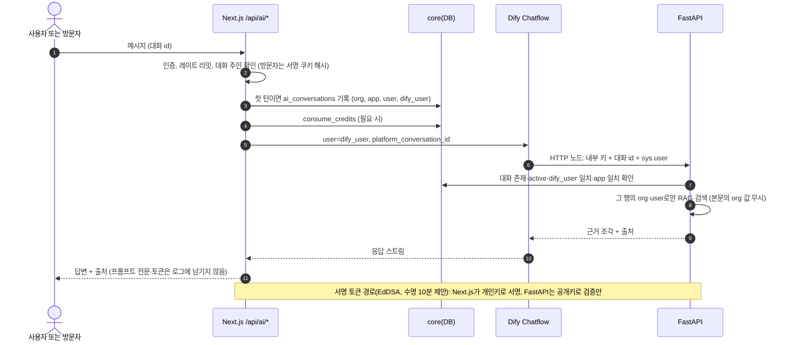

## 10. 상태 머신

### 10.1 잡 (`core.jobs`)

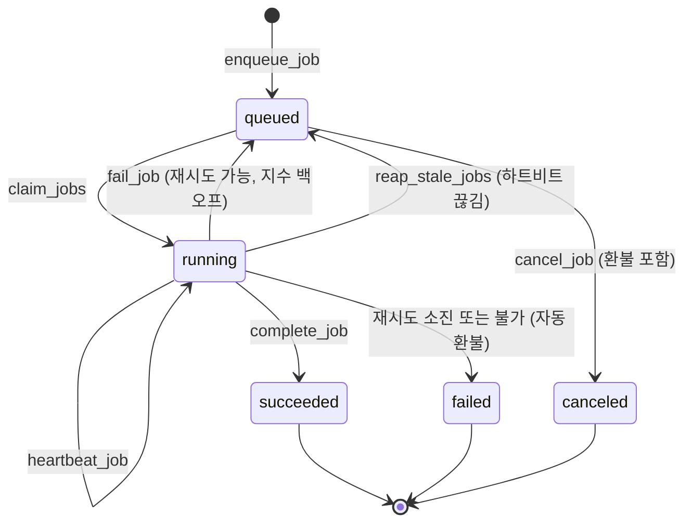

### 10.2 인증 단계 (`AUTH_ROADMAP`)

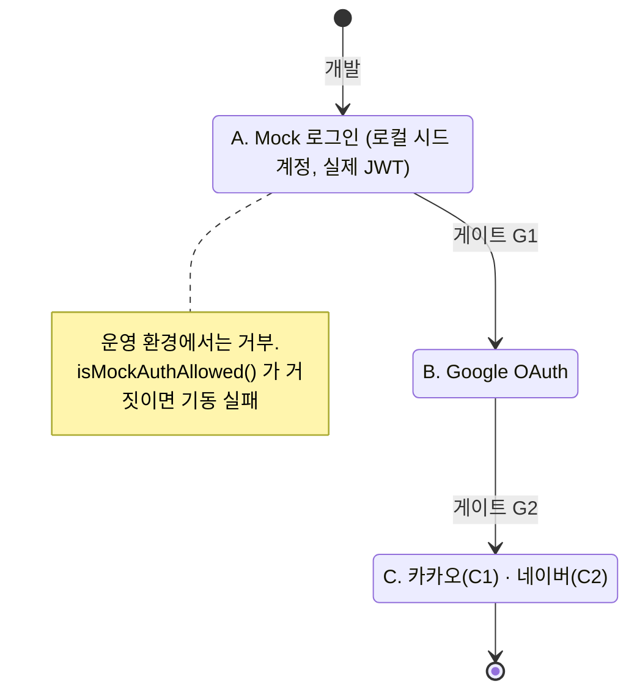

### 10.3 Stay 예약과 숙소

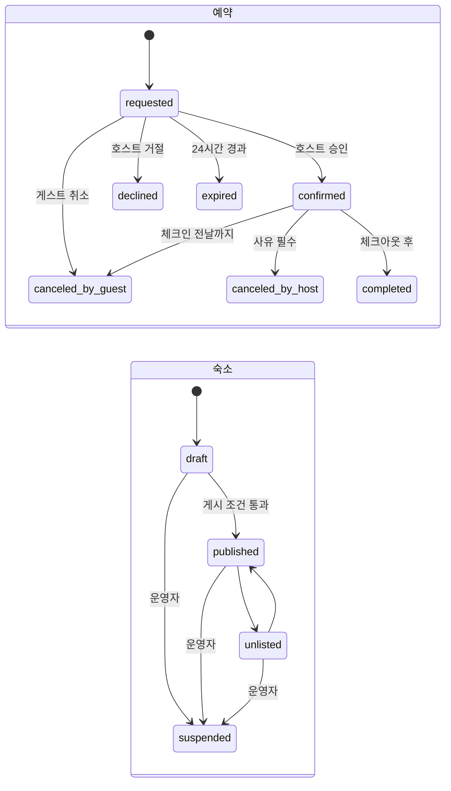

> `listing_private`(정확한 주소·좌표·체크인 안내)는 예약이 `confirmed` 이후에만 게스트에게 열립니다. `requested` 상태의 게스트는 0행을 봅니다.

## 11. 보안 신뢰 경계

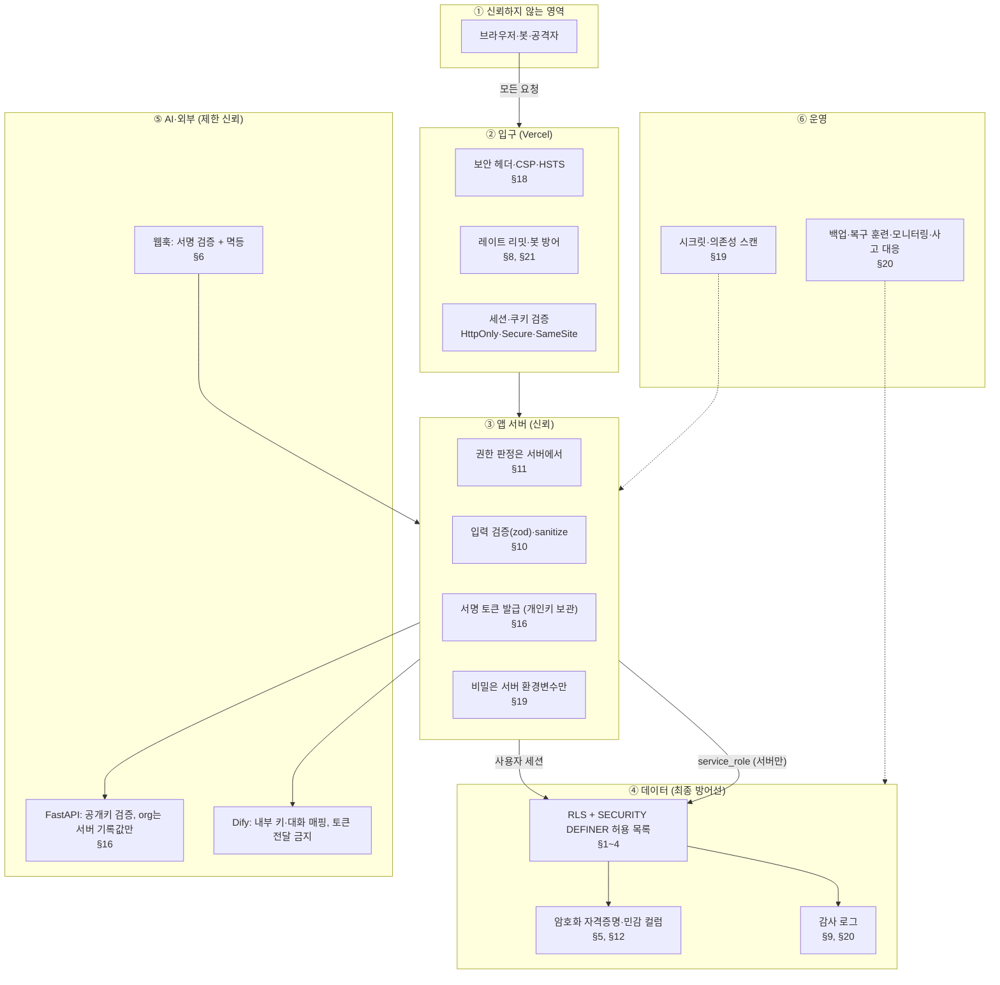

## 12. 보안 통제 지도: 위협 → 통제

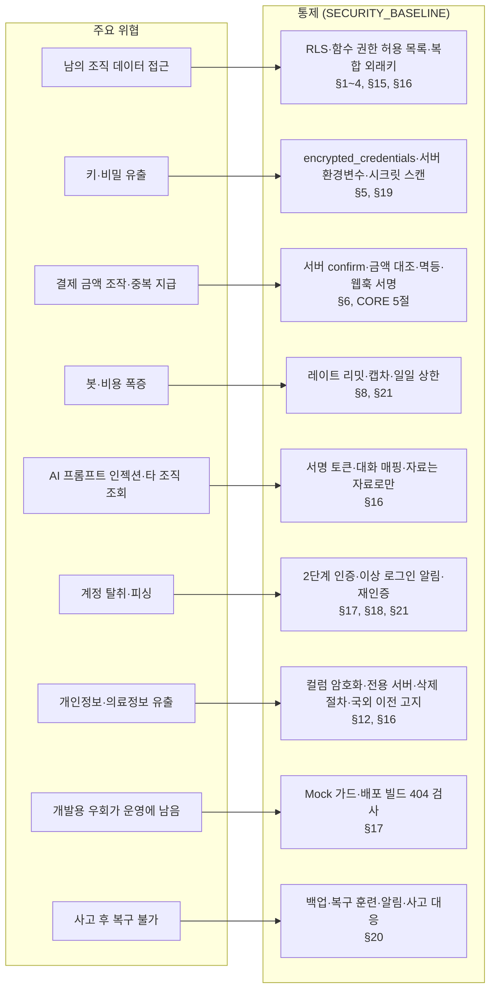

## 갱신 규칙

- 구조가 바뀌는 문서(`CORE_SPEC`, `AI_ARCHITECTURE`, `AUTH_ROADMAP`, `SECURITY_BASELINE`, 제품 02·05)를 고치면 이 파일의 해당 그림도 같은 커밋에서 고친다.
- 새 제품은 4번 그림에 넣고, 보안 통제가 늘면 12번에 한 줄을 추가한다.
- 그림은 개요다. 열 이름, 수치, 예외는 정본 문서를 따른다.
