# DIAGRAMS: Admin Suite UML 시각화

작성일 2026-10-23. 이해관계자(기획·개발·운영·법무) 소통용 그림 모음입니다. 정본은 각 문서이며, 그림과 문서가 다르면 문서가 우선입니다. GitHub에서 그림이 바로 렌더링됩니다(Mermaid). 전체 구조도(`../_platform-core/ARCHITECTURE_DIAGRAMS.md`)와 같은 스타일입니다.

**제품 한 줄 정의:** 중소기업(ERP), 의원급 병원(HMS), 학교(SMS)의 내부 직원이 역할별로 업무를 보는 관리 시스템 묶음이다. 보안 보일러플레이트를 한 번만 만든 공유 코어 `packages/admin-kit`(KIT) 위에 앱 3개(`apps/erp`, `apps/hms`, `apps/sms`)를 올린다. HMS는 의료정보 격리를 위해 병원마다 단독 Supabase(모놀리스)와 전용 AI 서버만 쓴다.

**근거 문서:** `README.md`, `01_PRD.md`, `02_ARCHITECTURE.md`, `03_SCREENS_UX.md`, `04_API.md`, `05_DATA_MODEL.md`, `SECURITY.md`, `MCP.md`, 공통 맥락은 `../_platform-core/SECURITY_BASELINE.md`(§ = 장 번호), `CORE_SPEC.md`.

**표기:** 실선 화살표 = 호출·데이터 흐름. 점선 = 검증·참조·구독·금지된 경로. "(제안)" = 문서가 제안이라 한 값, 확정 전. "P1"은 MVP 직후, "Phase 2"는 그 이후(01장 2절 구분 그대로). 이 제품은 크레딧을 쓰지 않는다(01장 4.1절).

## 그림 목록

| 번호 | 그림 | UML 종류 | 근거 문서 절 |
|---|---|---|---|
| 1-1 | 공통(KIT) 기능과 사용자 | 유스케이스(flowchart) | 01 2절, 3.1절, 3.5~3.6절 |
| 1-2 | ERP 기능과 사용자 | 유스케이스(flowchart) | 01 2절, 3.2절 |
| 1-3 | HMS 기능과 사용자 | 유스케이스(flowchart) | 01 2절, 3.3절 |
| 1-4 | SMS 기능과 사용자 | 유스케이스(flowchart) | 01 2절, 3.4절 |
| 2-1 | KIT와 앱 3개, DB 구성 | 컴포넌트(flowchart) | 02 2절, 7절, README 5절 |
| 2-2 | AI 연동 구성(공용 vs HMS 전용) | 컴포넌트(flowchart) | 02 5.5절, 7절, 04 6절 |
| 3-1 | ERP 데이터 모델 | 클래스 | 05 2.1절, 4.1절 |
| 3-2 | SMS 데이터 모델 | 클래스 | 05 2.2절, 4.2절 |
| 3-3 | HMS 데이터 모델 | 클래스 | 05 2.3절, 4.3절 |
| 3-4 | AI·음성 코어 표(참조) | 클래스 | 05 2.4절, 4.5절 |
| 4-1 | ERP 가입 요청과 승인 | 시퀀스 | 04 2절, 3.2절, 03 2.2절, KIT-F-005 |
| 4-2 | ERP 판매 등록 | 시퀀스 | 04 3.2절, 03 2.4절, ERP-F-004 |
| 4-3 | ERP 입출고·조정 | 시퀀스 | 04 3.2절, ERP-F-002 |
| 4-4 | SMS 구성원 초대와 수락 | 시퀀스 | 04 2절, 3.3절, 03 2.3절, SMS-F-003 |
| 4-5 | SMS 출석 일괄 저장 | 시퀀스 | 04 3.3절, 03 2.6절, SMS-F-005~007 |
| 4-6 | HMS 환자 등록·예약·접수 | 시퀀스 | 04 2절, 3.4절, 03 2.5절, HMS-F-002·005·006 |
| 4-7 | HMS 차트 열람과 진료기록 작성 | 시퀀스 | 04 2절, 3.4절, HMS-F-008·014 |
| 4-8 | HMS 검사 의뢰·입력·승인 | 시퀀스 | 04 3.4절, HMS-F-009~011 |
| 4-9 | AI 질문(ERP·SMS, Dify 경유) | 시퀀스 | 04 2.1절, 6.2절, 02 5.2절 |
| 4-10 | AI 질문(HMS, 전용 서버 직접) | 시퀀스 | 04 6.3절, 02 5.5절, HMS-F-015 |
| 5-1 | 판매 상태 | 상태 머신 | 05 3절 |
| 5-2 | 가입 요청 상태 | 상태 머신 | 05 3절 |
| 5-3 | 계정 상태(ERP·SMS·HMS) | 상태 머신 | 05 3절 |
| 5-4 | 예약 상태 | 상태 머신 | 05 3절 |
| 5-5 | 검사 상태 | 상태 머신 | 05 3절 |
| 5-6 | 수납 상태 | 상태 머신 | 05 3절 |
| 6-1 | 로그인 뒤 진입 분기 | 화면 흐름(flowchart) | 04 8.2절, 03 1.1절, 7절 |
| 6-2 | 역할→페이지 매트릭스(`defineAccess`)와 가드 | 화면 흐름(flowchart) | 01 KIT-F-002~004, 02 2절 |
| 6-3 | ERP 화면 이동 | 화면 흐름(flowchart) | 03 1.2절, 8.3.1절 |
| 6-4 | HMS 화면 이동 | 화면 흐름(flowchart) | 03 1.3절, 2.5절, 8.3.2절 |
| 6-5 | SMS 화면 이동 | 화면 흐름(flowchart) | 03 1.4절, 8.3.3절 |
| 7-1 | 전체 신뢰 경계 | 보안 경계(flowchart) | SECURITY 1·4절, 02 7절 |
| 7-2 | HMS 의료정보 경로와 접근 기록 | 보안 경계(flowchart) | SECURITY T2·T3, 05 2.3절, 4.3절, 01 6.2절 |
| 7-3 | HMS AI 전용 서버 격리 | 보안 경계(flowchart) | SECURITY T5, 02 5.5절, 01 6.6절 |
| 7-4 | ERP·SMS AI 경계 | 보안 경계(flowchart) | SECURITY T6·T8, 02 5.3절, 04 6.2절 |
| 7-5 | 위협-대응 지도 | 보안 경계(flowchart) | SECURITY 2절 T1~T8 |
| 8-1 | API 위에 얹는 MCP 구성 | 컴포넌트(flowchart) | MCP 1~3절, MCP_BASELINE 1·7절 |
| 8-3 | 도구 위험 등급과 노출 단계 | flowchart | MCP 1·2절, MCP_BASELINE 2절 |

---

## 1. 사용자와 기능 (유스케이스 관점)

### 그림 1-1. 공통(KIT) 기능

**읽는 법:** 왼쪽은 역할, 오른쪽은 세 앱이 같이 쓰는 KIT 기능이다. 기능 앞 꼬리표가 단계다(MVP, P1, Phase 2). 사용자는 조직을 스스로 만들 수 없고, 운영자가 서버 스크립트로 만든다(01장 3.5절).

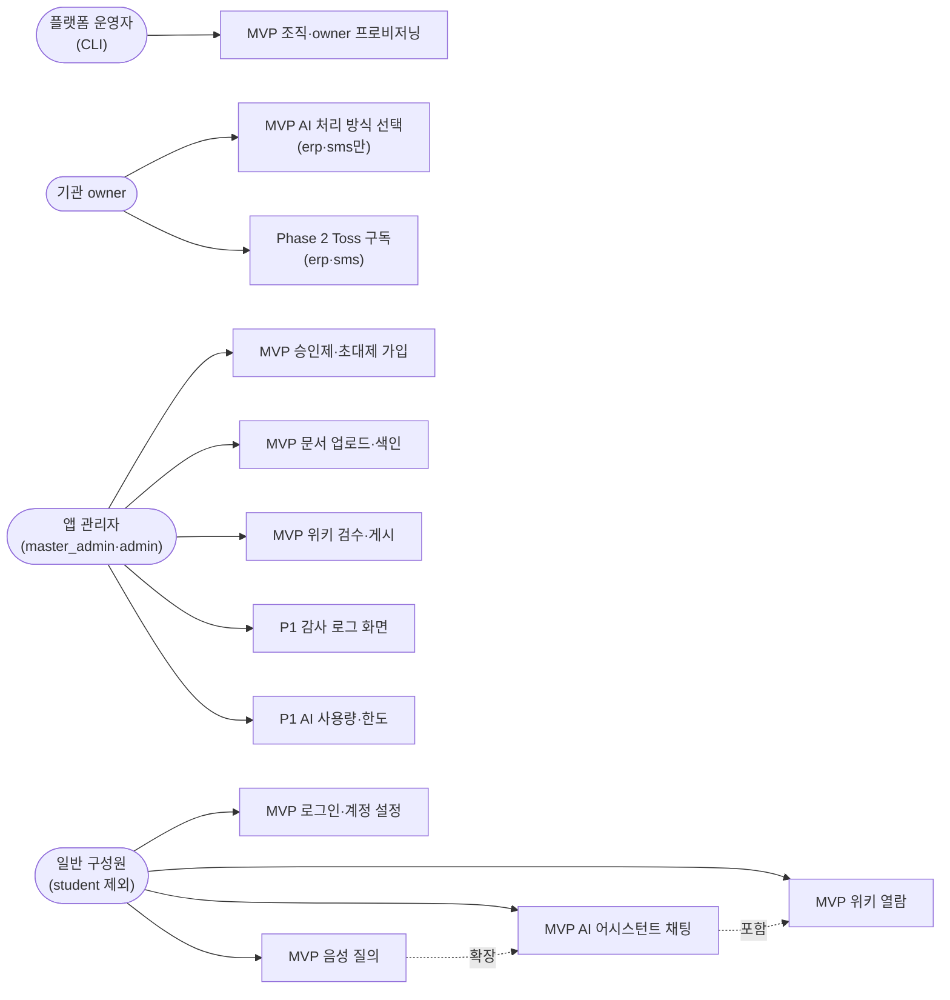

### 그림 1-2. ERP 기능

**읽는 법:** 역할별로 쓸 수 있는 기능을 이었다. 판매 관리자의 입출고는 출고만 허용하는 안이 권고값(D-3 B, 제안)이다.

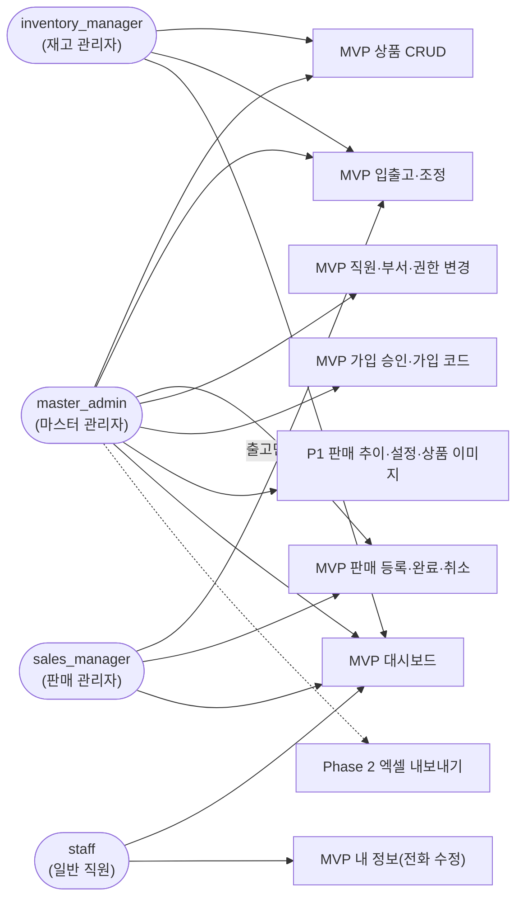

### 그림 1-3. HMS 기능

**읽는 법:** 의료 역할 4개(admin, doctor, staff, lab_tech)가 쓰는 기능이다. 진료 내용은 doctor만 본다(D-4 B). 실선 아래쪽 "접근 기록"은 민감정보를 건드리는 모든 기능이 거쳐 간다.

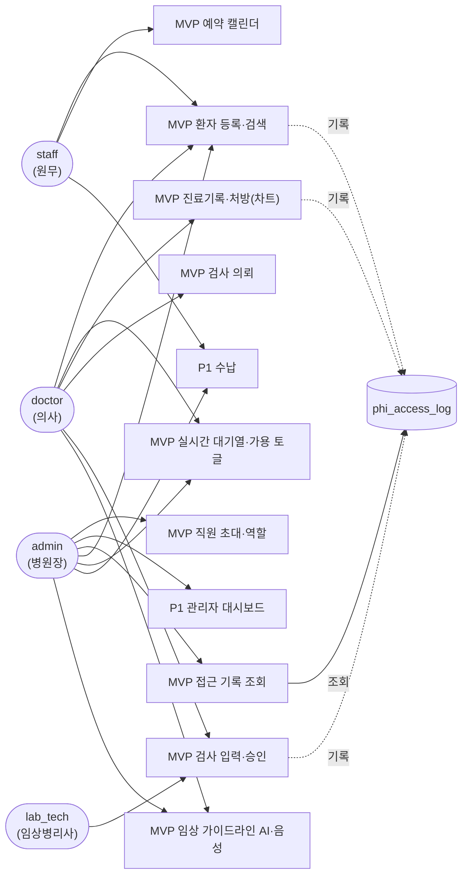

### 그림 1-4. SMS 기능

**읽는 법:** 교직원(admin, teacher(제안))은 관리 화면, 학생은 본인 화면만 쓴다. 학생용 AI는 미성년자 보호 때문에 Phase 2이며 지금은 막혀 있다(D-16).

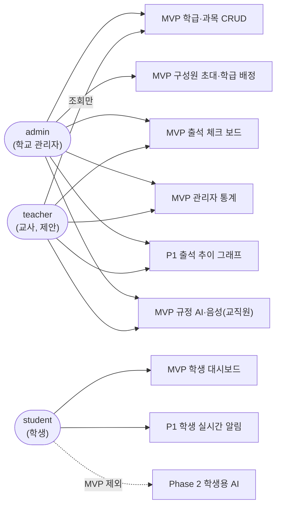

---

## 2. 구성요소 (component)

### 그림 2-1. KIT와 앱 3개, DB 구성

**읽는 법:** 앱은 KIT를 가져다 쓰지만 KIT는 앱 이름과 도메인 RPC를 모른다(앱이 설정 객체로 주입). 앱끼리는 서로 import하지 않는다. DB는 erp·sms가 모듈러(1차), hms는 병원마다 단독 프로젝트(강제)다.

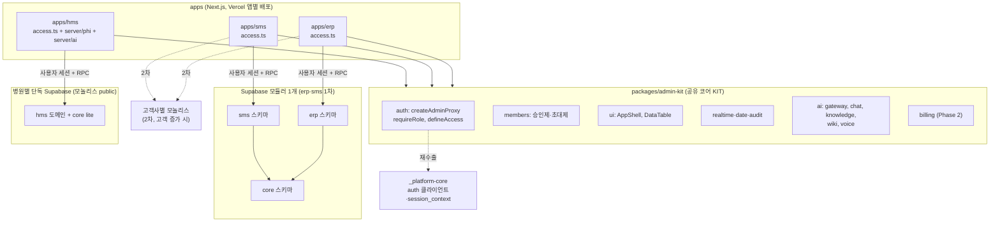

### 그림 2-2. AI 연동 구성(공용 vs HMS 전용)

**읽는 법:** 위쪽이 erp·sms(공용 Dify, 공용 GPU, 동의 시 상용 LLM), 아래쪽이 hms(병원 전용 네트워크)다. 점선 "금지"는 hms가 절대 건너지 못하는 경로다. 브라우저는 `/api/ai/*`, `/api/voice/*`만 부르고 Dify·FastAPI·LLM을 직접 부르지 않는다.

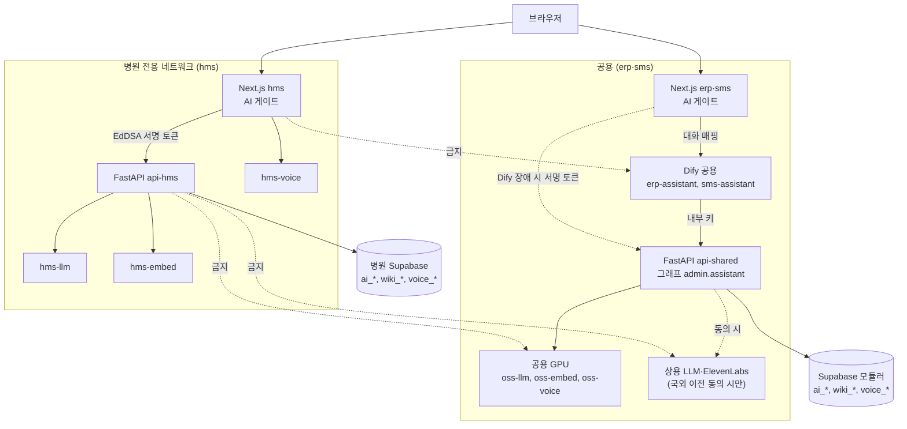

---

## 3. 데이터 모델 (class)

표기: 클래스 머리의 `<<...>>`는 접근 방식이다. 모든 테넌트 테이블은 `org_id`로 `core.organizations`에 매달리고, 같은 조직 안의 참조는 `(org_id, id)` 복합 FK로 묶어 조직을 건너뛰는 참조를 DB가 거부한다(05장 1절). 상태는 text + CHECK다. 모놀리스(hms 포함)에서는 스키마가 `public`이다.

### 그림 3-1. ERP 데이터 모델

**읽는 법:** 화살표는 FK(1 대 다). `inventory_moves`는 append-only(수정·삭제 없음), `join_codes`는 사용자 접근 자체가 없다. 수량(`quantity`) 변경은 RPC(`record_sale`, `record_inventory_move`)로만 한다.

```mermaid
classDiagram
  class organizations {
    <<core 참조>>
    +uuid id
  }
  class org_members {
    <<core 참조>>
    +uuid org_id
    +text role
  }
  class app_entitlements {
    <<core 참조>>
    +uuid org_id
    +text app_id
  }
  class workspaces {
    <<SELECT has_access>>
    +uuid org_id PK
    +text company_name
    +text status
    +int default_safety_stock
    +bool low_stock_alert
  }
  class join_codes {
    <<접근 불가 RPC만>>
    +uuid org_id PK
    +text join_code
    +timestamptz rotated_at
  }
  class departments {
    <<master_admin 쓰기>>
    +uuid id
    +uuid org_id
    +text name
    +uuid parent_id
  }
  class employees {
    <<본인 행 또는 master_admin>>
    +uuid org_id PK
    +uuid user_id PK
    +text display_name
    +uuid department_id
    +text erp_role
    +text status
  }
  class join_requests {
    <<본인 또는 master_admin>>
    +uuid id
    +uuid org_id
    +uuid user_id
    +text applicant_name
    +text status
    +uuid decided_by
  }
  class products {
    <<재고 3역할 SELECT>>
    +uuid id
    +uuid org_id
    +text sku
    +text name
    +numeric price
    +int quantity
    +int safety_stock
    +bool is_low_stock
  }
  class inventory_moves {
    <<append-only>>
    +bigint id
    +uuid product_id
    +text move_type
    +int quantity_delta
    +int quantity_after
    +uuid sale_id
    +text request_id
  }
  class sales {
    <<master_admin sales_manager>>
    +uuid id
    +uuid product_id
    +int quantity
    +numeric unit_price
    +text status
    +text request_id
  }

  organizations "1" --> "*" org_members
  organizations "1" --> "*" app_entitlements
  organizations "1" --> "1" workspaces
  workspaces "1" --> "1" join_codes
  workspaces "1" --> "*" departments
  departments "1" --> "*" departments : parent_id
  departments "1" --> "*" employees
  workspaces "1" --> "*" join_requests
  workspaces "1" --> "*" products
  products "1" --> "*" inventory_moves
  products "1" --> "*" sales
  sales "1" --> "*" inventory_moves : sale_id
```

| 테이블 | SELECT | 쓰기 경로 |
|---|---|---|
| `workspaces` | `erp.has_access(org_id)` | 설정은 `update_workspace_settings` |
| `join_codes` | 없음 | `get_join_code`, `rotate_join_code` (master_admin) |
| `departments` | `has_access` | 직접 쓰기 master_admin |
| `employees` | 본인 행, 또는 master_admin | `set_employee_role` 등 RPC |
| `join_requests` | 본인, 또는 master_admin | `request_join`, `decide_join_request` |
| `products` | master_admin, inventory_manager, sales_manager | 직접 쓰기(`quantity` 컬럼 제외) |
| `inventory_moves`, `sales` | 위 역할(sales는 master_admin, sales_manager) | RPC만 |

### 그림 3-2. SMS 데이터 모델

**읽는 법:** 도메인 표는 5개뿐이라 코어 3개(조직, 멤버십, 엔타이틀먼트)를 같이 그렸다. 학생은 `attendance`에서 본인 행만 읽는다. `attendance`는 (학생, 과목, 날짜) 유일이라 같은 날 재저장하면 upsert된다.

```mermaid
classDiagram
  class organizations {
    <<core 참조>>
    +uuid id
  }
  class org_members {
    <<core 참조>>
    +uuid org_id
    +text role
  }
  class app_entitlements {
    <<core 참조>>
    +uuid org_id
    +text app_id
  }
  class workspaces {
    <<SELECT has_access>>
    +uuid org_id PK
    +text school_name
    +int school_year
    +int teacher_backfill_days
    +text status
  }
  class classes {
    <<admin 쓰기>>
    +uuid id
    +uuid org_id
    +text name
    +int grade
    +uuid homeroom_teacher_id
  }
  class subjects {
    <<admin 쓰기>>
    +uuid id
    +uuid class_id
    +text name
    +uuid teacher_id
  }
  class members {
    <<본인 행 또는 교직원>>
    +uuid org_id PK
    +uuid user_id PK
    +text sms_role
    +uuid class_id
    +text student_no
    +text status
  }
  class attendance {
    <<교직원 또는 학생 본인>>
    +uuid id
    +uuid subject_id
    +uuid student_id
    +date attend_date
    +text status
    +uuid marked_by
  }

  organizations "1" --> "*" org_members
  organizations "1" --> "*" app_entitlements
  organizations "1" --> "1" workspaces
  workspaces "1" --> "*" classes
  classes "1" --> "*" subjects
  classes "1" --> "*" members : class_id
  subjects "1" --> "*" attendance
  members "1" --> "*" attendance : student_id
```

| 테이블 | SELECT | 쓰기 경로 |
|---|---|---|
| `workspaces` | `sms.has_access` | `update_workspace_settings` |
| `classes`, `subjects` | `has_access` | 직접 쓰기 `sms.is_admin` |
| `members` | 본인 행, 또는 `sms.is_staff` | `invite_school_member` 등 RPC |
| `attendance` | `is_staff` 또는 (`student_id = auth.uid()` 이고 `has_access`) | `mark_attendance`, `mark_attendance_bulk` RPC만 |

### 그림 3-3. HMS 데이터 모델

**읽는 법:** 굵게 구분할 것은 접근 방식이다. `patient_private`, `medical_records`, `lab_tests`는 사용자 GRANT가 없어 RPC로만 읽고 쓰며, 그 RPC가 같은 트랜잭션에서 `phi_access_log`에 한 줄을 남긴다. `patients`는 최소 식별 정보만 둔다.

```mermaid
classDiagram
  class workspaces {
    <<SELECT>>
    +uuid org_id PK
    +text hospital_name
    +int phi_log_retention_days
  }
  class staff_profiles {
    <<SELECT RLS>>
    +uuid org_id PK
    +uuid user_id PK
    +text role
    +text status
    +bool is_available
  }
  class patients {
    <<SELECT RLS 3역할>>
    +uuid id
    +text chart_no
    +text name
    +text sex
    +int birth_year
    +text phone_last4
    +timestamptz deleted_at
  }
  class patient_private {
    <<GRANT 없음 RPC만>>
    +uuid patient_id PK
    +date birth_date
    +text phone_ciphertext
    +text memo_ciphertext
    +int key_version
    +timestamptz privacy_consent_at
  }
  class appointments {
    <<SELECT RLS 3역할>>
    +uuid id
    +uuid patient_id
    +uuid doctor_id
    +timestamptz scheduled_at
    +text status
    +int queue_no
  }
  class medical_records {
    <<GRANT 없음 append-only>>
    +uuid id
    +uuid patient_id
    +uuid appointment_id
    +uuid author_id
    +text body_ciphertext
    +uuid amends_id
  }
  class lab_test_catalog {
    <<전역 SELECT>>
    +text code PK
    +text name
  }
  class lab_tests {
    <<GRANT 없음 RPC만>>
    +uuid id
    +uuid patient_id
    +text test_code
    +text status
    +text result_values
    +text abnormal_keys
  }
  class visit_charges {
    <<SELECT admin staff>>
    +uuid id
    +uuid appointment_id
    +int amount_krw
    +text status
  }
  class phi_access_log {
    <<append-only admin SELECT>>
    +bigint id
    +uuid actor_id
    +text actor_role
    +text action
    +uuid patient_id
    +text purpose
    +int row_count
  }

  workspaces "1" --> "*" staff_profiles
  workspaces "1" --> "*" patients
  patients "1" --> "1" patient_private
  patients "1" --> "*" appointments
  staff_profiles "1" --> "*" appointments : doctor_id
  appointments "1" --> "*" medical_records
  appointments "1" --> "*" lab_tests
  lab_test_catalog "1" --> "*" lab_tests : test_code
  appointments "1" --> "1" visit_charges
  patients "1" --> "*" phi_access_log
```

| 테이블 | SELECT (RLS) | 쓰기 경로 |
|---|---|---|
| `patients` | `deleted_at is null` 이고 `has_role` (admin, doctor, staff) | RPC (`register_patient`, `update_patient`) |
| `patient_private` | GRANT 없음 | `get_patient_detail` (admin, doctor, staff, 사유 필수) |
| `appointments` | admin, doctor, staff | `create_appointment`, `transition_appointment` |
| `medical_records` | GRANT 없음 | `add_medical_record`, `get_patient_chart` (doctor) |
| `lab_tests` | GRANT 없음 | `request_lab_test` 등 RPC |
| `visit_charges` | admin, staff | `record_charge`, `settle_charge`, `refund_charge` |
| `phi_access_log` | `has_access` 이고 core owner/admin | DEFINER 함수 내부만 |

### 그림 3-4. AI·음성 코어 표 (참조)

**읽는 법:** 제품은 AI 표를 새로 만들지 않고 코어 표를 참조만 한다(모놀리스는 `public.`). 클래스 머리가 "누가 SELECT 할 수 있나"이다. `ai_documents`, `wiki_pages`, `ai_runs`는 같은 조직 구성원 전원이 SELECT 가능하다는 코어 RLS 한계가 있어, 제품 규칙(run에 본문 금지, 위키는 "위키 대상" 컬렉션만)으로 완화한다(05장 4.5절).

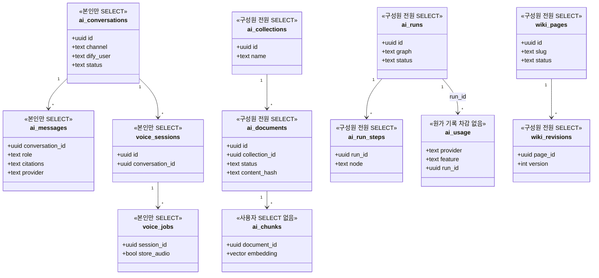

---

## 4. 핵심 시퀀스

공통: 쓰기는 Server Action 또는 Route Handler 첫 줄에서 `requireSession(appId)` 다음 `requireRole(appId, roles)`를 거치고(앱 검사), DB의 RPC가 `is_service_caller()` 또는 역할 헬퍼로 다시 검사한다(2차 검사). 도메인 쓰기는 사용자 세션으로 RPC를 호출하고, service_role은 프로비저닝·`approve_profile`·Auth Admin 초대에만 쓴다(04장 1절, SECURITY_BASELINE §1·§4).

### 그림 4-1. ERP 가입 요청과 승인 (KIT-F-005, ERP-F-012)

**읽는 법:** 위에서 아래로 시간 순서다. 승인 전 신청자는 도메인 테이블 SELECT가 0행이다. 승인 단계에서만 service_role이 `approve_profile`을 호출한다. 가입 코드 시도는 사용자당 5회/시간으로 제한된다(03장 2.2절).

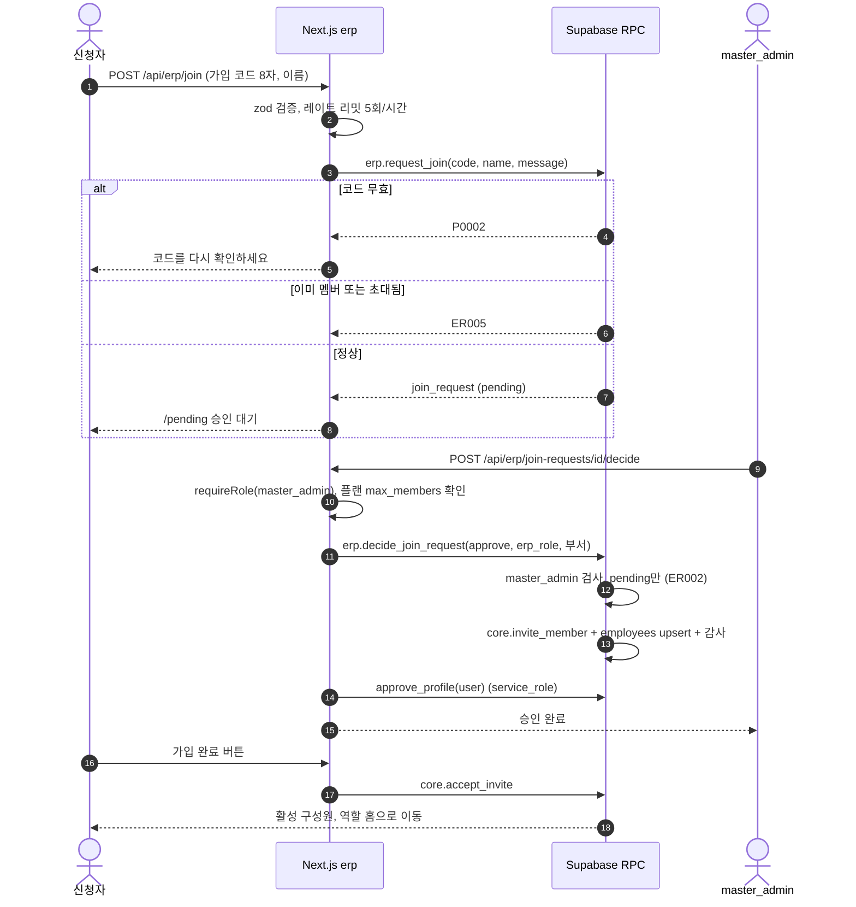

### 그림 4-2. ERP 판매 등록 (ERP-F-004)

**읽는 법:** 재고 차감과 판매 행 생성과 이력이 한 트랜잭션이다. 판매 관리자는 재고 직접 수정 권한이 없지만 RPC가 DEFINER라 차감이 성공한다. 같은 `request_id`로 다시 호출하면 기존 행을 돌려줘 재시도가 안전하다.

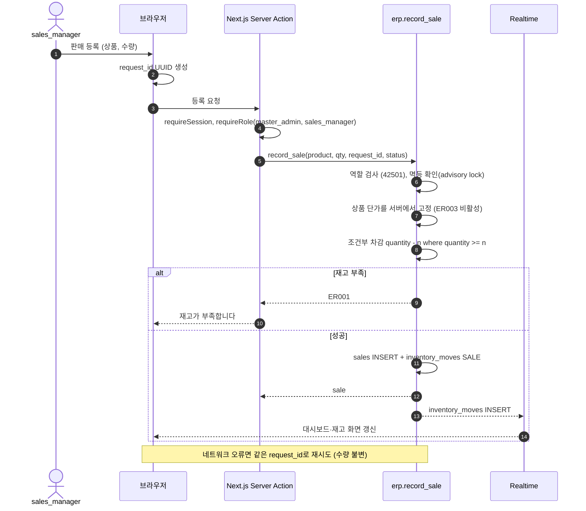

### 그림 4-3. ERP 입출고·조정 (ERP-F-002)

**읽는 법:** 상품 행을 `FOR UPDATE`로 잠그고 결과 수량이 음수면 거절한다. 판매 관리자는 OUT만(제안, D-3 B). 직접 UPDATE로 수량을 바꾸는 길은 컬럼 GRANT와 트리거가 이중으로 막는다.

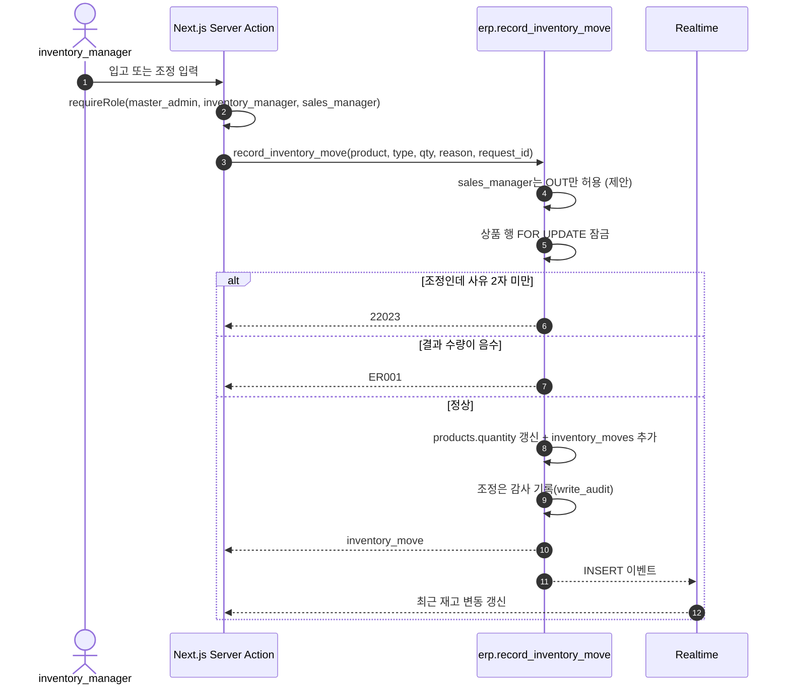

### 그림 4-4. SMS 구성원 초대와 수락 (SMS-F-003)

**읽는 법:** 미가입자는 Auth Admin 초대 메일이 먼저 나간다. 이 호출만 service_role이고, 도메인 초대 행은 관리자 본인 세션으로 만든다. 수락 전에는 `has_access=false`라 출석 대상도 아니다.

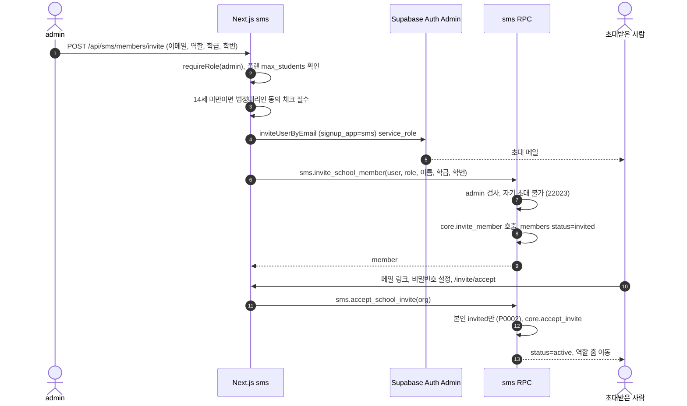

### 그림 4-5. SMS 출석 일괄 저장 (SMS-F-005~007)

**읽는 법:** 한 번에 최대 200건. 날짜 범위와 학급 소속은 DB가 검사한다. 저장된 행이 Realtime으로 학생 화면에 가며, 학생은 RLS 때문에 본인 행만 받는다. 알림 토스트는 P1이다.

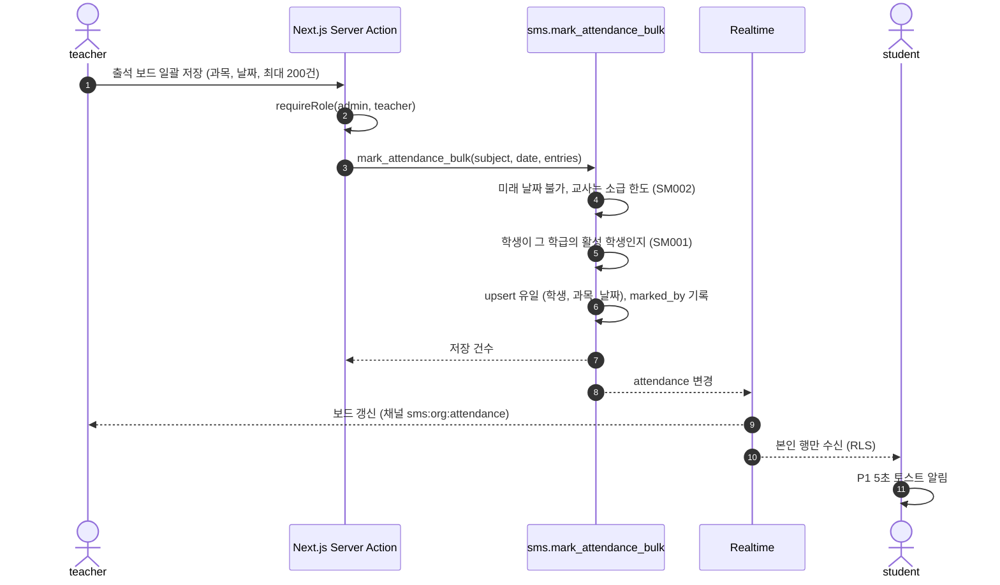

### 그림 4-6. HMS 환자 등록·예약·접수 (HMS-F-002, 005, 006)

**읽는 법:** 연락처는 Next.js의 `server/phi` 모듈이 암호화한 뒤 RPC로 보낸다(DB는 암호문만 저장). 예약은 의사별 advisory lock 뒤 시간 겹침을 검사한다. 접수 때 대기번호(KST 당일 순번)가 붙고 의사 대기열이 실시간 갱신된다.

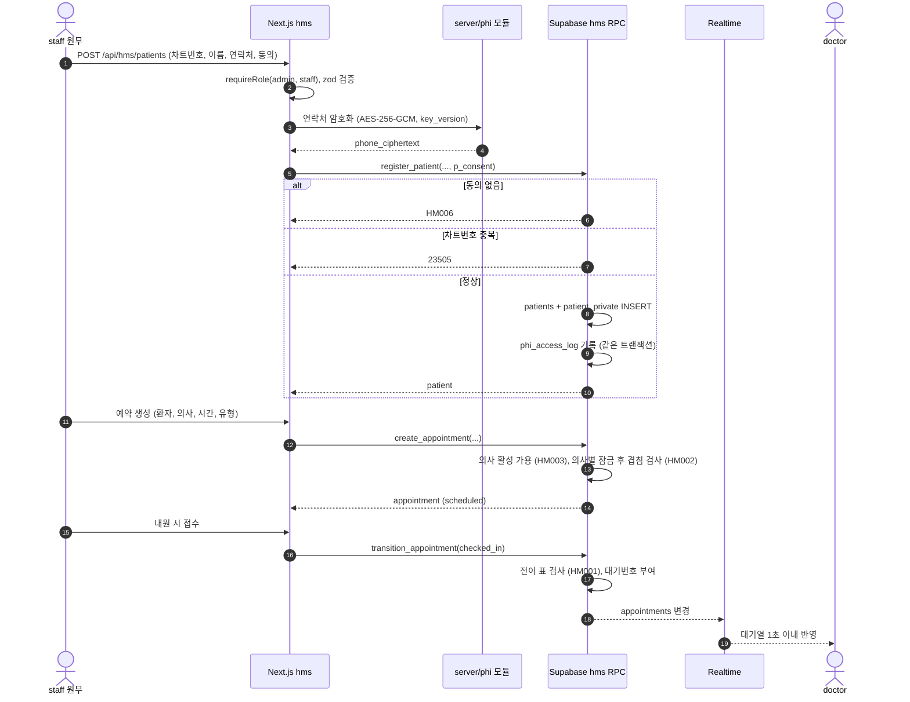

### 그림 4-7. HMS 차트 열람과 진료기록 작성 (HMS-F-004, 008, 014)

**읽는 법:** 차트 열람은 doctor만 가능하고, 열람 사유(`purpose`)가 필수이며, 열람 1회마다 `phi_access_log` 1행이 같은 트랜잭션에서 생긴다. 복호화는 `server/phi`에서만 일어나고 응답에는 `no-store` 캐시 헤더가 붙는다. 진료기록은 수정할 수 없고 정정은 새 행(`amends_id`)이다.

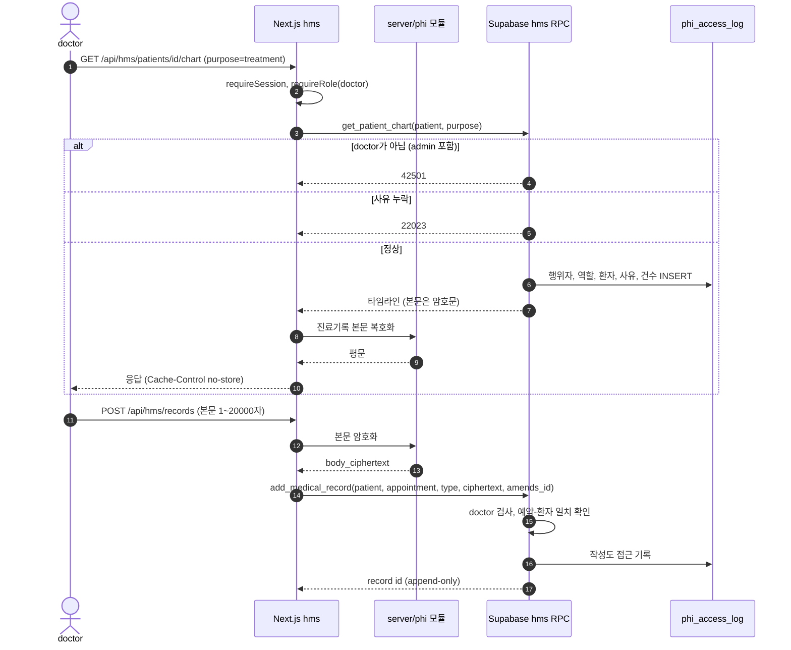

### 그림 4-8. HMS 검사 의뢰·입력·승인 (HMS-F-009~011)

**읽는 법:** 결과를 입력한 사람은 자기 결과를 승인할 수 없다(HM005, 이중 확인은 D-5 B 제안). 승인(`approved`) 이후 값은 바뀌지 않고, 정정은 사유를 달아 재개방한다.

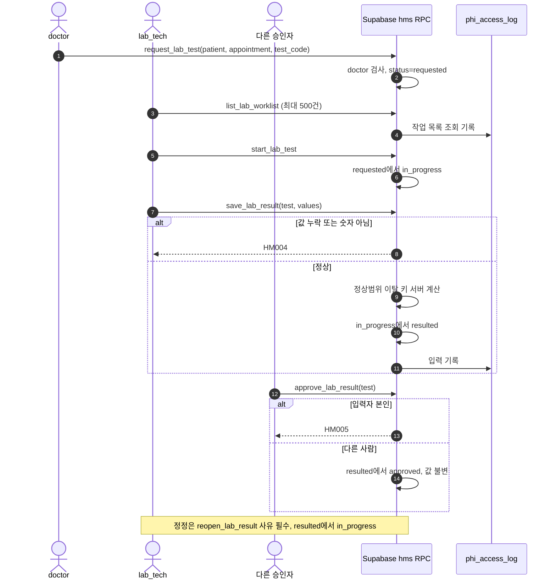

### 그림 4-9. AI 질문: ERP·SMS (Dify 경유, 02장 5.2절)

**읽는 법:** 브라우저는 Next.js만 부른다. 권한은 FastAPI가 요청 본문이 아니라 DB에서 직접 확인해 허용 컬렉션을 정한다. Dify가 5xx이거나 10초 무응답이면 Next.js가 서명 토큰으로 FastAPI에 직접 간다. AI는 읽기 전용이고 업무 테이블을 읽지 않는다.

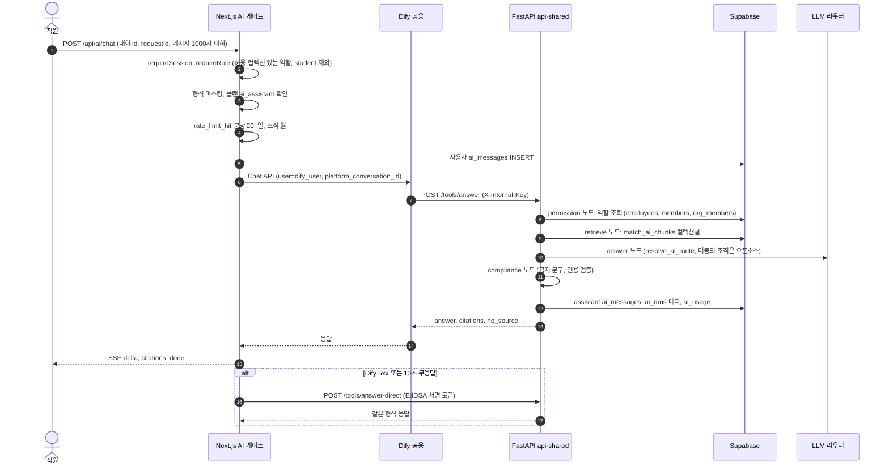

### 그림 4-10. AI 질문: HMS (전용 서버 직접, Dify 없음)

**읽는 법:** 환자 식별정보 패턴이 보이면 마스킹하지 않고 전송 전에 막는다(D-14 A). 호출 대상은 병원 전용 `api-hms`뿐이며 장애 때 다른 서버로 대체하지 않는다. 응답의 `provider`가 `hms-*`가 아니면 Next.js가 응답을 버린다. 이 경로는 환자 테이블을 읽지 않으므로 `phi_access_log` 대상이 아니다.

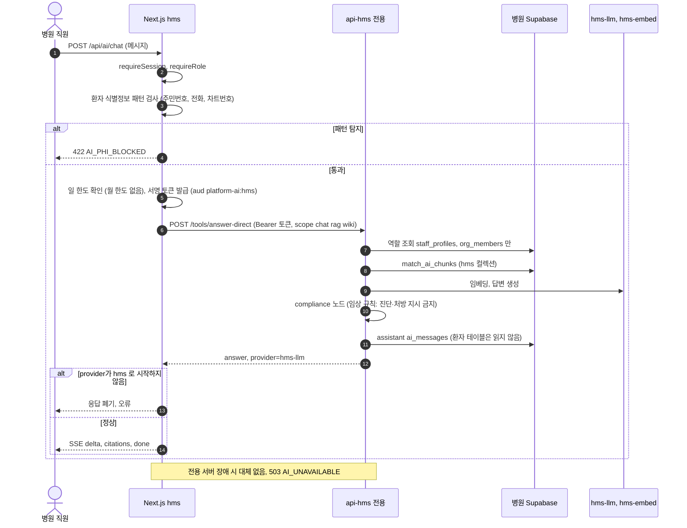

---

## 5. 상태 머신

05장 3절 상태 전이 표 그대로다. 각 전이는 DB 트리거(예: `sales_guard_transition`, `members_guard_transition`)와 RPC가 이중으로 강제한다.

### 그림 5-1. `erp.sales.status`

**읽는 법:** 괄호는 전이를 일으키는 역할과 부수 효과다. 완료 전 취소는 재고를 건드리지 않고, 완료 후 취소는 재고를 복원한다.

```mermaid
stateDiagram-v2
  [*] --> pending
  [*] --> completed : record_sale
  pending --> completed : complete_sale 조건부 재고 차감, SALE 이력
  pending --> canceled : cancel_sale 사유 필수
  completed --> canceled : cancel_sale 재고 복원, SALE_CANCEL 이력, 감사
  canceled --> [*]
```

### 그림 5-2. `erp.join_requests.status`

**읽는 법:** 승인과 거절은 master_admin만, 취소는 신청자 본인만 한다. 승인되면 core 초대 멤버십과 employees 행이 생기고 서버가 `approve_profile`을 호출한다.

```mermaid
stateDiagram-v2
  [*] --> pending : request_join
  pending --> approved : master_admin 승인
  pending --> rejected : master_admin 거절
  pending --> canceled : 신청자 본인 취소
  approved --> [*]
  rejected --> [*]
  canceled --> [*]
```

### 그림 5-3. 계정 상태 (ERP·SMS·HMS)

**읽는 법:** 세 앱의 계정 상태 컬럼을 한 장에 모았다. 정지(`suspended`)는 다음 요청부터 `has_access=false`로 막힌다. 자기 자신은 정지·역할 변경을 할 수 없다.

```mermaid
stateDiagram-v2
  state "ERP employees" as E {
    e_active : active
    e_susp : suspended
    e_active --> e_susp : master_admin
    e_susp --> e_active : master_admin
  }
  state "SMS members" as S {
    s_inv : invited
    s_active : active
    s_susp : suspended
    s_inv --> s_active : 본인 수락
    s_inv --> s_susp : admin
    s_active --> s_susp : admin
    s_susp --> s_active : admin
  }
  state "HMS staff_profiles" as H {
    h_inv : invited
    h_active : active
    h_susp : suspended
    h_inv --> h_active : 본인 수락
    h_active --> h_susp : admin
    h_susp --> h_active : admin
  }
```

### 그림 5-4. `appointments.status` (HMS)

**읽는 법:** 취소와 노쇼를 별도 상태로 나눠 대시보드에서 섞이지 않게 했다. 노쇼는 예약 시각 이후에만 가능하다. 완료되면 `patients.last_visit_at`이 갱신된다.

```mermaid
stateDiagram-v2
  [*] --> scheduled : create_appointment
  scheduled --> checked_in : staff 접수 대기번호 부여
  scheduled --> canceled : 사유 필수
  scheduled --> no_show : 예약 시각 이후만
  checked_in --> in_consultation : 담당 doctor 진료 시작
  checked_in --> canceled : staff, admin
  in_consultation --> completed : 담당 doctor 진료 완료
  completed --> [*]
  canceled --> [*]
  no_show --> [*]
```

### 그림 5-5. `lab_tests.status` (HMS)

**읽는 법:** `approved`는 값이 바뀌지 않는다. 입력자와 승인자는 달라야 한다(CHECK 제약, HM005). 정정은 `resulted`에서 사유를 달아 `in_progress`로 되돌린다.

```mermaid
stateDiagram-v2
  [*] --> requested : doctor 의뢰
  requested --> in_progress : lab_tech 시작
  requested --> canceled : doctor, admin
  in_progress --> resulted : lab_tech 입력 이탈 키 계산
  in_progress --> canceled : doctor, admin
  resulted --> approved : 입력자 제외 승인
  resulted --> in_progress : lab_tech 정정 재개방
  approved --> [*]
  canceled --> [*]
```

### 그림 5-6. `visit_charges.status` (HMS, P1)

**읽는 법:** 예약당 1건이다. 환불은 admin만 하고 사유가 필수다. 진료 완료 시 미수(`unpaid`)가 만들어진다.

```mermaid
stateDiagram-v2
  [*] --> unpaid : record_charge
  unpaid --> paid : settle_charge staff, admin
  unpaid --> void : staff, admin
  paid --> refunded : refund_charge admin 사유 필수
  void --> [*]
  refunded --> [*]
```

---

## 6. 화면 흐름

### 그림 6-1. 로그인 뒤 진입 분기

**읽는 법:** 콜백(`GET /auth/callback`)이 세션을 만든 뒤 상태에 따라 갈림길이 나뉜다. 세션은 모든 인증 단계(A Mock, B Google·이메일, C 카카오·네이버)에서 실제 Supabase JWT이고 분기는 같다. hms는 Stage C 제외, erp 새 사용자만 `bootstrap_app_for_org`를 1회 호출한다.

```mermaid
flowchart TB
  L["/login<br/>A Mock 패널 · B Google·이메일"]
  CB["GET /auth/callback<br/>세션 교환 → session_context"]
  NP["프로필 없음<br/>로그아웃 → /login?error=no_profile"]
  PN["/pending<br/>약관 동의 → 가입 코드 입력"]
  SU["403 정지"]
  IV["/invite/accept<br/>초대 수락 (sms·hms)"]
  NA["/no-access<br/>워크스페이스·엔타이틀먼트 없음"]
  HOME["역할 홈<br/>(access.ts)"]
  SG["/signup (ERP만)"]

  L --> CB
  SG -->|"이메일 가입"| L
  CB -->|"프로필 없음"| NP
  CB -->|"pending (erp)"| PN
  CB -->|"suspended"| SU
  CB -->|"invited 도메인 행"| IV
  CB -->|"엔타이틀먼트 없음"| NA
  CB -->|"활성 + 역할 있음"| HOME
  PN -->|"승인 후 가입 완료"| HOME
  IV -->|"수락"| HOME
```

### 그림 6-2. 역할→페이지 매트릭스(`defineAccess`)와 가드

**읽는 법:** 앱의 `src/access.ts` 한 곳이 역할 목록, 홈 경로, 페이지 매트릭스를 선언한다. 같은 매트릭스를 라우트 가드와 사이드바 메뉴 필터가 함께 쓰므로, 메뉴에 안 보이는 페이지는 URL을 직접 쳐도 403이다. 판정은 서버에서 끝나고 클라이언트 PageGuard는 쓰지 않는다(SECURITY_BASELINE §11). 마지막 방어선은 DB의 RPC와 RLS다.

```mermaid
flowchart LR
  ACC["src/access.ts<br/>defineAccess(role → 페이지)"]
  REQ["요청 URL"]
  PX["proxy.ts<br/>createAdminProxy"]
  PG["서버 레이아웃·페이지"]
  MENU["AppShell 사이드바<br/>(매트릭스 밖 메뉴 미렌더)"]
  SA["Server Action<br/>requireRole"]
  RPC["DB RPC<br/>has_role 2차 검사"]
  RLS["RLS<br/>has_access · has_role"]
  D403["403 (RSC 페이로드 없음)"]

  ACC -.->|"같은 매트릭스"| PX
  ACC -.->|"같은 매트릭스"| MENU
  ACC -.->|"같은 매트릭스"| SA
  REQ --> PX
  PX -->|"허용 역할"| PG
  PX -->|"매트릭스 밖"| D403
  PG --> SA
  SA --> RPC
  RPC --> RLS
```

### 그림 6-3. ERP 화면 이동

**읽는 법:** 각 박스 아래 줄이 접근 역할이다(03장 1.2절). 전원이 대시보드로 들어오고 나머지는 역할에 맞는 화면만 열린다. `MA`=master_admin, `IM`=inventory_manager, `SM`=sales_manager.

```mermaid
flowchart TB
  DSH["/dashboard<br/>전원"]
  INV["/inventory<br/>MA, IM, SM(조회+출고)"]
  INVD["/inventory/id (P1)<br/>상품 상세 이력"]
  SAL["/sales<br/>MA, SM"]
  HR["/hr<br/>MA 임직원·권한 변경"]
  REQ["/hr/requests<br/>MA 가입 승인·코드"]
  DEP["/hr/departments (P1)<br/>MA"]
  ME["/me (P1)<br/>전원 전화 수정"]
  SET["/settings (P2)<br/>MA"]
  AUD["/settings/audit (P1)<br/>owner·admin"]
  AST["/assistant · /wiki<br/>허용 컬렉션 역할"]

  DSH --> INV
  DSH --> SAL
  DSH --> HR
  DSH --> ME
  DSH --> AST
  INV --> INVD
  HR --> REQ
  HR --> DEP
  DSH --> SET
  SET --> AUD
```

### 그림 6-4. HMS 화면 이동

**읽는 법:** 접수·진료 흐름(예약 → 접수 → 대기열 → 차트 → 검사 → 수납) 순서로 이었다. `/patients/id/chart`는 doctor만, `/lab`은 lab_tech와 doctor, `/settings/access-log`는 admin만 연다. lab_tech가 `/patients`를 직접 입력하면 403이다.

```mermaid
flowchart TB
  CAL["/calendar<br/>staff·admin 생성, doctor 조회"]
  PAT["/patients<br/>staff, doctor, admin"]
  PD["/patients/id<br/>staff, admin 원무 정보"]
  CH["/patients/id/chart<br/>doctor 진료기록·검사"]
  Q["/queue<br/>doctor, admin 의사별 열"]
  LAB["/lab<br/>lab_tech, doctor"]
  BIL["/billing (P1)<br/>staff, admin"]
  STF["/staff<br/>admin 초대·역할"]
  ACL["/settings/access-log<br/>admin 접근 기록"]
  DSH["/dashboard (P1)<br/>admin"]
  NO["lab_tech의 /patients<br/>직접 입력 → 403"]

  PAT --> PD
  PAT --> CH
  CAL -->|"접수"| Q
  PD -->|"예약"| CAL
  Q -->|"진료 시작"| CH
  CH -->|"검사 의뢰"| LAB
  Q -->|"진료 완료"| BIL
  DSH --> STF
  DSH --> ACL
  NO -.-> PAT
```

### 그림 6-5. SMS 화면 이동

**읽는 법:** 교직원은 `/admin/*`, 학생은 `/student/dashboard`와 위키 일부만 쓴다. 학생 셸에는 어시스턴트 버튼과 마이크가 없다(D-16 A). `/admin/settings`는 새 경로이고 teacher의 소급 수정 기간 설정을 담는다.

```mermaid
flowchart TB
  DSH["/admin/dashboard<br/>admin, teacher"]
  ATT["/admin/attendance<br/>admin, teacher 출석 보드"]
  TRD["/admin/trend (P1)<br/>admin, teacher"]
  CLS["/admin/classes<br/>admin 쓰기, teacher 조회"]
  SUB["/admin/subjects<br/>admin 쓰기, teacher 조회"]
  MEM["/admin/members<br/>admin 초대·배정"]
  SET["/admin/settings<br/>admin 학교 설정"]
  STD["/student/dashboard<br/>student 내 출석 요약"]
  WIK["/wiki<br/>student는 sms-guide-all 범위만"]

  DSH --> ATT
  DSH --> TRD
  DSH --> CLS
  CLS --> SUB
  DSH --> MEM
  DSH --> SET
  STD --> WIK
```

---

## 7. 보안 경계

공통 규칙은 `SECURITY_BASELINE.md`의 장 번호(§)로 참조한다. 이 제품의 위험은 의료·학생 정보, 기관 간 데이터 분리, 역할 권한, AI의 민감 데이터 처리에 모인다(SECURITY 서두).

### 그림 7-1. 전체 신뢰 경계

**읽는 법:** 바깥쪽일수록 신뢰하지 않는다. 브라우저가 보내는 org, 역할, 가격은 믿지 않고 서버(Next.js)가 세션에서 확정하며, 마지막 판정은 DB(RLS + 이중 잠금 RPC)가 한다. 점선은 외부 서비스로 나가는 경로이고 HMS는 외부로 나가지 않는다.

```mermaid
flowchart LR
  subgraph UT["신뢰하지 않음"]
    BR["브라우저<br/>(입력·URL 조작 가능)"]
  end
  subgraph WEB["서버 영역 (Vercel Next.js)"]
    PX["proxy.ts 세션·헤더 §18"]
    RR["requireRole §11"]
    AIG["AI 게이트<br/>서명 토큰 §16"]
  end
  subgraph DBZ["데이터 영역 (Supabase)"]
    RLS["RLS + SECURITY DEFINER RPC<br/>§1 §2 §3 §4"]
    AUD["감사 로그 §9"]
    DATA[("erp·sms·hms 데이터")]
  end
  subgraph AIZ["AI 영역"]
    FA["FastAPI·Dify·GPU"]
  end
  subgraph EXT["외부"]
    EX["Toss(Phase 2)<br/>ElevenLabs·상용 LLM<br/>(erp·sms 동의 시)"]
  end

  BR --> PX
  PX --> RR
  RR -->|"사용자 세션"| RLS
  RLS --> DATA
  RLS --> AUD
  BR --> AIG
  AIG --> FA
  FA --> RLS
  AIG -.->|"국외 이전 동의 시"| EX
  FA -.->|"HMS는 금지"| EX
```

### 그림 7-2. HMS 의료정보 경로와 접근 기록

**읽는 법:** 의료 데이터는 한 길로만 다닌다. 브라우저 → Next.js(권한 확인, 사유 입력, 암호화·복호화) → RPC → 테이블. 민감 표 3개는 GRANT가 없어 RPC 말고는 읽을 수 없고, 읽을 때마다 접근 기록이 남는다. 접근 기록은 수정·삭제할 수 없고 admin만 조회한다.

```mermaid
flowchart TB
  BR["브라우저<br/>(암호문·키 수신 금지)"]
  subgraph NX["Next.js hms"]
    G["proxy + requireRole<br/>+ 열람 사유 purpose"]
    PHI["server/phi<br/>암호화·복호화 (HMS_PHI_KEY)"]
  end
  subgraph HDB["병원 단독 Supabase"]
    RPC["RPC (DEFINER)<br/>역할 검사·감사"]
    PT["patients<br/>RLS 3역할"]
    SEN["patient_private<br/>medical_records<br/>lab_tests (GRANT 없음)"]
    LOG[("phi_access_log<br/>append-only")]
  end
  ADM["admin<br/>/settings/access-log"]
  CSV["access-log.csv 내보내기"]

  BR --> G
  G --> PHI
  PHI --> RPC
  RPC --> SEN
  RPC -->|"같은 트랜잭션"| LOG
  G -.->|"RLS 직접 SELECT"| PT
  ADM --> LOG
  ADM --> CSV
  CSV -.->|"write_audit phi_access_log.export"| LOG
```

### 그림 7-3. HMS AI 전용 서버 격리

**읽는 법:** 병원 1곳은 앱, Supabase, `api-hms`, `hms-llm`, `hms-embed`, `hms-voice`가 한 세트다. 점선 "금지"는 공용 Dify, 상용 API, 공용 GPU, 환자 테이블, 복호화 키로 가는 길이다. 이를 환경변수 검사(기동 실패), DB 라우팅 고정(`force_open_source`), 허용 목록 테스트 세 겹으로 막는다.

```mermaid
flowchart LR
  subgraph HNET["병원 전용 네트워크 (외부 인터넷 송신 차단)"]
    NX["Next.js hms<br/>환자 식별정보 패턴 차단"]
    FA["api-hms<br/>FastAPI"]
    HL["hms-llm"]
    HE["hms-embed"]
    HV["hms-voice"]
    DBA[("허용 표만<br/>ai_*, wiki_*, voice_*<br/>staff_profiles, org_members")]
  end
  PAT[("환자·진료·검사·수납 표")]
  KEY["HMS_PHI_KEY"]
  DIFY["공용 Dify"]
  PUB["상용 API<br/>공용 GPU·음성"]

  NX -->|"서명 토큰 5분 이하 권고 (제안)"| FA
  NX --> HV
  FA --> HL
  FA --> HE
  FA --> DBA
  FA -.->|"읽기 금지"| PAT
  FA -.->|"전달 금지"| KEY
  NX -.->|"import 금지·기동 실패"| DIFY
  FA -.->|"금지"| PUB
```

### 그림 7-4. ERP·SMS AI 경계

**읽는 법:** erp·sms는 기본이 국내 오픈소스이고, owner가 국외 이전에 동의해야만 상용 LLM·ElevenLabs가 체인에 들어간다. 대화 원문은 본인만 읽는 `ai_messages`에만 있고, 코어 RLS가 구성원 전원에게 여는 표(`ai_runs` 등)에는 본문을 쓰지 않는다. 학생(SMS)은 AI 접근이 막혀 있다(D-16).

```mermaid
flowchart TB
  OW["owner<br/>/settings/ai 동의·철회"]
  ACK[("ai_org_settings<br/>동의 여부·고지문 버전")]
  GW["Next.js AI 게이트<br/>역할·한도·마스킹"]
  STU["student 요청"]
  DF["Dify (대화 매핑만)<br/>org·토큰·이름 미전달"]
  FA["FastAPI permission 노드<br/>DB에서 역할·컬렉션 확정"]
  OSS["오픈소스 oss-*"]
  COM["상용 LLM·ElevenLabs"]
  MSG[("ai_messages<br/>본인만 SELECT")]
  OPEN[("ai_runs·ai_documents·wiki<br/>구성원 전원 SELECT")]

  OW -->|"set_ai_cross_border_ack"| ACK
  STU -.->|"403"| GW
  GW --> DF
  DF --> FA
  FA --> OSS
  ACK -.->|"동의 시에만"| FA
  FA -.->|"동의 시"| COM
  FA -->|"대화 본문"| MSG
  FA -->|"본문 금지, id·개수만"| OPEN
```

### 그림 7-5. 위협-대응 지도

**읽는 법:** 왼쪽은 `SECURITY.md` 2절 위협 T1~T8, 오른쪽은 대응이다. 학생용 AI(T8)와 개발용 로그인 잔존(T7)처럼 코드가 아니라 단계·배포 규칙으로 막는 것도 있다.

```mermaid
flowchart LR
  T1["T1 타 기관 조회"]
  T2["T2 권한 밖 환자·학생 조회"]
  T3["T3 열람 은폐"]
  T4["T4 가입·초대 코드 남용"]
  T5["T5 의료 데이터 상용 AI 전송"]
  T6["T6 관리자의 타인 대화 열람"]
  T7["T7 Mock 로그인 운영 잔존"]
  T8["T8 학생용 AI 접근"]

  C1["RLS + org 복합 FK + outsider 테스트 §15"]
  C2["defineAccess + 서버 가드 §11"]
  C3["phi_access_log 필수·변경 불가"]
  C4["코드 8자 + 승인제, 초대 만료·1회, 시도 제한 §8"]
  C5["전용 서버 + 환자 정보 AI 제외 §16"]
  C6["관리자 기능 + 감사 기록 (제안)"]
  C7["isMockAuthAllowed + 배포 404 §17"]
  C8["Phase 2로 연기, 학교 승인·동의 후 D-16"]

  T1 --> C1
  T2 --> C2
  T3 --> C3
  T4 --> C4
  T5 --> C5
  T6 --> C6
  T7 --> C7
  T8 --> C8
```

---

## 8. 에이전트 접근 층 (MCP)

**읽는 법:** 기존 웹 경로(위)는 그대로이고, 에이전트용 입구(아래)가 같은 DB RPC를 호출합니다. 정본은 `MCP.md`, 공통 규칙은 `../_platform-core/MCP_BASELINE.md`입니다. 이 제품은 MVP에서 에이전트에 아무것도 노출하지 않고, 점선은 Phase 2 후보이거나 미결정(D-M#)입니다. 예약·결제처럼 준비와 확정을 나눌 쓰기 도구가 없어 시퀀스(8-2)는 그리지 않았습니다.

### 8-1. API 위에 얹는 MCP 구성

```mermaid
flowchart LR
  subgraph U["사용자 쪽"]
    ST["기관 직원<br/>브라우저"]
    AG["AI 에이전트<br/>ERP 관리자 SMS 관리자"]
  end

  subgraph WEB["기존 웹 경로 앱별"]
    NX["Next.js 서버 계층<br/>requireSession requireRole"]
  end

  subgraph MCPL["새 MCP 층 Phase 2 후보 앱별 분리"]
    TR["Streamable HTTP<br/>Bearer만 익명 없음"]
    RL["사용자 레이트 리밋"]
    TL["도구 3개 집계 읽기<br/>필드 허용 목록 출력"]
  end

  subgraph DB["DB 최종 방어선"]
    RPC["erp.dashboard_metrics<br/>erp.sales_trend<br/>sms.dashboard_stats"]
    RLS["has_access my_role<br/>RLS org 분리"]
  end

  subgraph HMSX["HMS 격리 DB"]
    HM["환자 차트 검사 수납<br/>MCP 없음"]
  end

  ST --> NX
  AG -.-> TR
  TR --> RL
  RL --> TL
  NX -->|"사용자 세션"| RPC
  TL -.->|"사용자 토큰 D-M2"| RPC
  RPC --> RLS
  AG -.->|"연결 안 함"| HM
```

### 8-3. 도구 위험 등급과 노출 단계

```mermaid
flowchart TB
  subgraph R2["R2 조직 집계 읽기 Phase 2 후보 D-M1 승인 후"]
    T1["admin_erp_get_dashboard_metrics"]
    T2["admin_erp_get_sales_trend"]
    T3["admin_sms_get_dashboard_stats"]
  end
  subgraph NO["만들지 않음"]
    N1["HMS 전부<br/>환자 차트 검사 수납"]
    N2["가입 승인 역할 변경 정지<br/>등급 A"]
    N3["판매 등록 입출고 출석 기록 환불<br/>사람이 웹에서"]
    N4["가입 코드 직원 학생 개인 행"]
  end
  R2 -.->|"쓰기는 웹 화면에서만"| N3
```

## 문서 불일치

그림에는 아래 "택한 쪽"을 그렸다.

| # | 항목 | 문서 A | 문서 B | 그림에서 택한 쪽 |
|---|---|---|---|---|
| 1 | HMS 환자 상세 접근 역할 | `04_API.md` 2절 `GET /api/hms/patients/:id` = admin, staff, doctor (`get_patient_detail`도 동일) | `03_SCREENS_UX.md` 1.3절 `/patients/[id]` = staff, admin | 화면은 03(그림 6-4), API는 04(그림 4-6 설명). 의사가 상세 API를 부를 수 있는지 확정 필요 |
| 2 | ERP 가입 코드 형식 | `04_API.md` 2절 `^[A-Z2-9]{8}$` | `05_DATA_MODEL.md` 2.1절 `^[A-HJ-NP-Z2-9]{8}$` (I, O 제외) | 05(DB 제약이 더 좁다). 그림에는 형식을 쓰지 않았다 |
| 3 | HMS 인스턴스 분리 | `SECURITY.md` 4·6절 "HMS 전용 인스턴스 여부 미결정" | `02_ARCHITECTURE.md` 7절, `01_PRD.md` 6.2절 "병원마다 단독 Supabase 프로젝트" | 02·01(그림 2-1, 7-2, 7-3) |
| 4 | 복합 FK 형태와 장 번호 | `SECURITY.md` T1 "(id, org_id, app_id) 복합 외래키(§16)" (§16은 AI·음성 표 규칙) | `05_DATA_MODEL.md` 1절 도메인 표는 `(org_id, id)` 복합 FK | 05. 그림 3-1~3-3은 `(org_id, id)` 기준 |
| 5 | HMS 서명 토큰 수명 | `04_API.md` 1절 공통 10분 | `04_API.md` 6.3절 hms 5분 이하 권고(제안) | 그림 7-3에 "5분 이하 권고 (제안)"로 표기 |
| 6 | SMS teacher 역할 | `README.md` 1절 "교사 단독 역할은 제안", `01_PRD.md` D-2 B 권고 | `05_DATA_MODEL.md`, `04_API.md`는 `sms_role` teacher를 전제로 서술 | teacher를 그리되 "(제안)"을 붙였다 |
| 7 | MCP 대시보드 지표 범위 | `04_API.md` 3.2절 `erp.dashboard_metrics`는 `has_access`(모든 구성원) | `04_API.md` 3.2절 `erp.sales_trend`는 master_admin·sales_manager만. 대시보드 반환 jsonb의 키 목록은 어느 문서에도 없음 | MCP에서 `admin_erp_get_dashboard_metrics` 출력 필드를 정할 수 없어 "확인 필요"(`MCP.md` D-M3). 그림 8-1은 3개 RPC만 표시 |
| 8 | MCP와 제품 AI의 수치 정책 | `01_PRD.md` ERP-F-015·SMS-F-012: 제품 AI는 재고·판매·출석 수치를 답하지 않음 | `MCP.md` 2절: 집계 수치 읽기 도구를 Phase 2 후보로 제안 | 기본값은 "열지 않음"으로 두고 사람 결정을 기다림(`MCP.md` D-M1). 그림은 점선으로 표시 |


## 그림에 못 담은 것

- 인증 단계 A/B/C의 단계별 로그인 화면 구성(03장 7절), Mock 시드 페르소나 표(05장 10절): 표가 더 읽기 쉬워 제외했다.
- 플랜 한도(402) 판정, 레이트 리밋 수치 전체(04장 1절): 시퀀스에는 대표 항목만 적었다.
- 위키 ingest·lint 비동기 작업과 문서 색인 상태(`pending → indexing → ready/failed`): 03장 2.9절 표 참조. 상태 표가 05장에 없어 상태 머신으로 그리지 않았다.
- Toss 결제 흐름(Phase 2, 03장 2.7절)과 음성 질의 세부(03장 2.10절).
- 06장 작업 계획(ADM-06-xxx)과 07장 원본 이식 표.

## 갱신 규칙

해당 근거 문서(특히 `05_DATA_MODEL.md` 테이블·상태·RLS, `04_API.md` 엔드포인트·RPC, `03_SCREENS_UX.md` 화면·역할, `SECURITY.md`)를 고치면 이 그림도 같이 고친다. 그림과 문서가 다르면 문서가 우선이다.
