# DIAGRAMS: Stay(가칭, airbnb) UML 시각화

작성일 2026-10-23. 정본은 각 문서이며, 그림과 문서가 다르면 문서가 우선입니다. GitHub에서 Mermaid로 바로 렌더링됩니다.

**제품 한 줄 정의:** 게스트가 지도와 날짜·인원으로 숙소를 찾아 예약을 요청하고, 개인 호스트가 13단계 마법사로 숙소를 올려 예약을 승인·관리하는 숙소 공유 웹 서비스(MVP는 결제 없는 예약 요청·확정).

**근거 문서:** `README.md`, `01_PRD.md`, `02_ARCHITECTURE.md`, `03_SCREENS_UX.md`, `04_API.md`, `05_DATA_MODEL.md`, `10_HOST_DASHBOARD.md`, `SECURITY.md`, `MCP.md`, 공통은 `../_platform-core/ARCHITECTURE_DIAGRAMS.md`, `SECURITY_BASELINE.md`, `CORE_SPEC.md`.

**표기:** 실선 화살표 = 호출·데이터 흐름, 점선 = 검증·참조·Phase 2, "(제안)" = 문서가 제안이라고 한 값. 노드 안 `SY-F-###`은 `01_PRD.md` 3절 기능 ID입니다.

| # | 그림 | UML 종류 | 근거 문서 절 |
|---|---|---|---|
| 1-1 | 게스트와 방문자의 기능 | 유스케이스(flowchart) | 01 2~3절, 03 1절 |
| 1-2 | 호스트와 운영자의 기능 | 유스케이스(flowchart) | 01 2~3절, 10 2절 |
| 2-1 | 웹·DB·외부 구성요소 | 컴포넌트(flowchart) | 02 2·3·7절, 04 6절 |
| 2-2 | AI·잡 구성요소 | 컴포넌트(flowchart) | 02 3~5절, 04 2.1·4·6절 |
| 3 | 데이터 모델 | 클래스 | 05 1~4절, 11절 |
| 4-1 | 예약 요청에서 승인까지 | 시퀀스 | 04 2·3절, 01 SY-F-008·009·024 |
| 4-2 | 숙소 AI 도우미 질문 | 시퀀스 | 04 2.1·6.2절, 01 SY-F-027·034 |
| 4-3 | 소개 작성 도우미와 게시 | 시퀀스 | 04 2·2.1절, 01 SY-F-014·017·029 |
| 4-4 | 사진 업로드 | 시퀀스 | 04 2·4절, 01 SY-F-015 |
| 5-1 | 숙소 상태 | 상태 머신 | 05 3절 |
| 5-2 | 예약 상태 | 상태 머신 | 05 3절 |
| 5-3 | 리뷰 상태 | 상태 머신 | 05 3절 |
| 6-1 | 게스트 화면 흐름 | flowchart | 03 1·2절 |
| 6-2 | 호스트 화면 흐름 | flowchart | 03 1·2·8절, 10 2절 |
| 7 | 보안 신뢰 경계 | flowchart | SECURITY 1~4절, SECURITY_BASELINE |
| 8-1 | API 위에 얹는 MCP 구성 | 컴포넌트(flowchart) | MCP 1~3절, MCP_BASELINE 1·7절 |
| 8-2 | 예약 준비와 사람 확정 | 시퀀스 | MCP 2·6절 |
| 8-3 | 도구 위험 등급과 노출 단계 | flowchart | MCP 2절, MCP_BASELINE 2절 |

## 1. 사용자와 기능

### 1-1. 게스트와 방문자

**읽는 법:** 왼쪽이 사람, 오른쪽이 기능입니다. 실선은 MVP, 점선은 Phase 2입니다. 방문자는 로그인 없이 검색과 상세만 쓰고, 나머지는 로그인 후 씁니다.

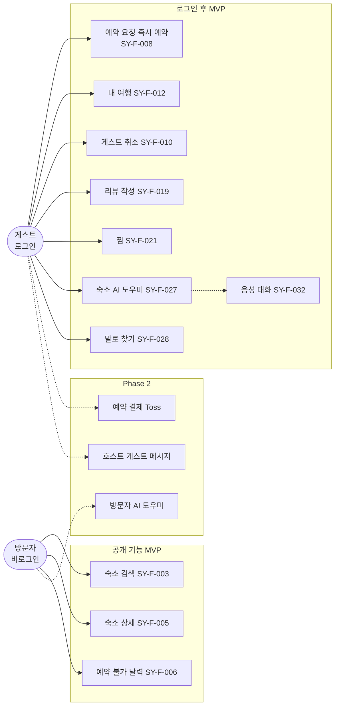

### 1-2. 호스트와 운영자

**읽는 법:** 호스트는 숙소를 올리고 예약에 답하며, 운영자는 MVP에서 스크립트로만 일합니다. 점선은 Phase 2입니다.

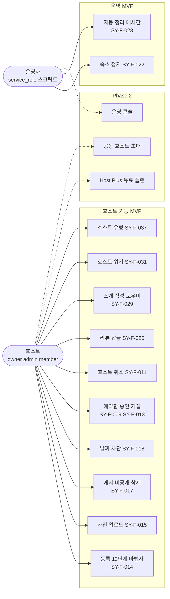

## 2. 구성요소

### 2-1. 웹, DB, 외부 서비스

**읽는 법:** 브라우저는 Next.js 웹만 부릅니다. 화면은 사용자 세션으로 DB(RLS와 RPC)를 부르고, service_role은 서버 전용 작업에만 씁니다. 코어 공통은 `ARCHITECTURE_DIAGRAMS.md` 그림 2와 같습니다.

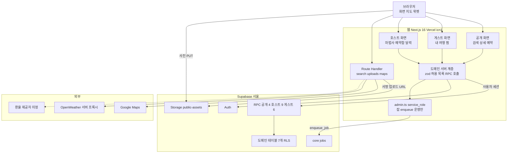

### 2-2. AI와 잡

**읽는 법:** 브라우저는 `/api/ai/*`, `/api/voice/*`, `/api/host/wiki/*`만 부릅니다. Dify, FastAPI, 모델 제공자는 웹 서버 뒤에 있습니다. 크레딧은 웹 서버가 선차감하고 FastAPI가 정산 데이터를 남깁니다.

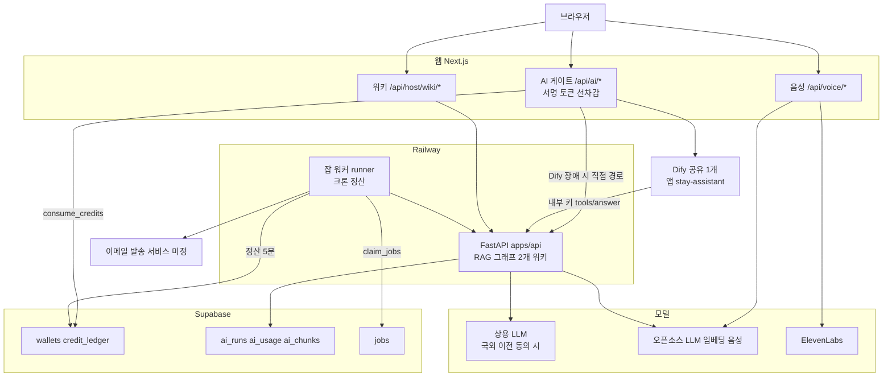

## 3. 데이터 모델

**읽는 법:** 도메인 테이블 7개(`listings`부터 `wishlists`)와 코어 참조 3개, 호스트 유형 제안 1개입니다. 테넌트는 `org_id`, 게스트는 `guest_user_id`나 `user_id`로 구분합니다. 모든 테이블은 RLS가 켜져 있고 anon 권한은 없으며, 상태 컬럼은 사용자 UPDATE 권한에서 빠져 있습니다.

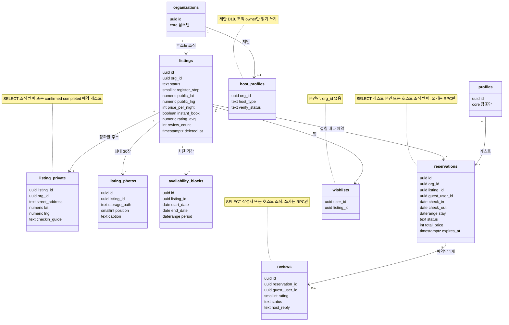

## 4. 핵심 시퀀스

### 4-1. 예약 요청에서 승인까지 (SY-F-008, 009, 024)

**읽는 법:** 위에서 아래로 시간 순서입니다. 게스트 ID는 요청 본문이 아니라 세션에서 오고, 같은 기간의 이중 예약은 DB 배타 제약이 최종 판정합니다. 이 흐름은 크레딧을 쓰지 않습니다.

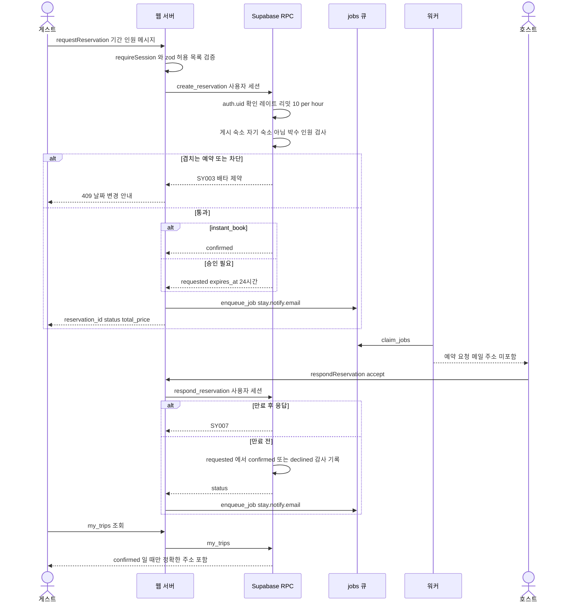

### 4-2. 숙소 AI 도우미 질문 (SY-F-027, 034)

**읽는 법:** 턴마다 먼저 크레딧을 선차감하고, 답이 전달되지 않으면 환불합니다. 근거는 숙소 공개 정보와 발행된 위키뿐이며 정확한 주소는 근거에 들어가지 않습니다.

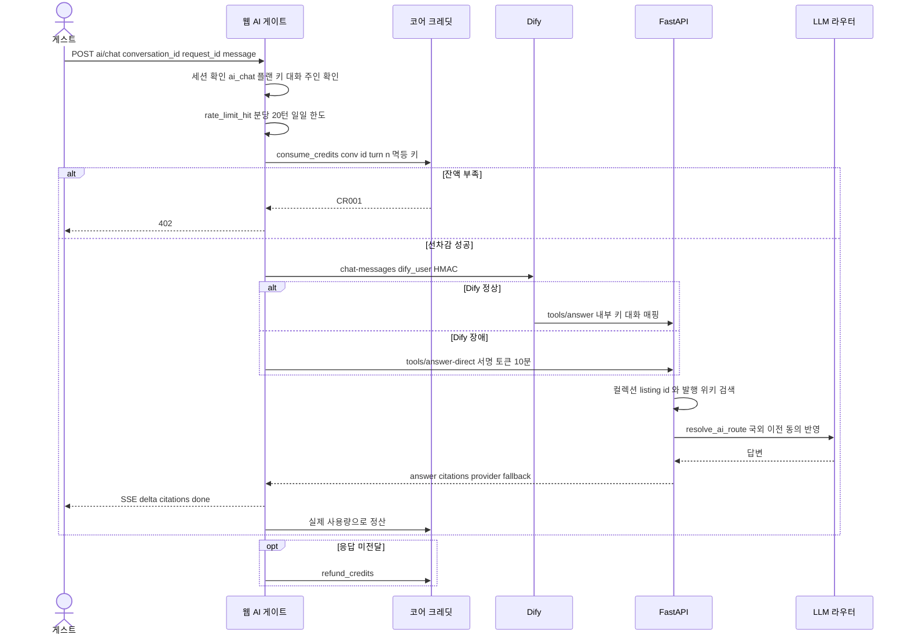

### 4-3. 소개 작성 도우미와 게시 (SY-F-014, 017, 029)

**읽는 법:** AI 초안은 자동 저장되지 않고 호스트가 고른 안만 `listings`에 저장됩니다. 게시 전환은 RPC가 게시 조건을 검사하고, 통과하면 색인 잡이 돌아갑니다.

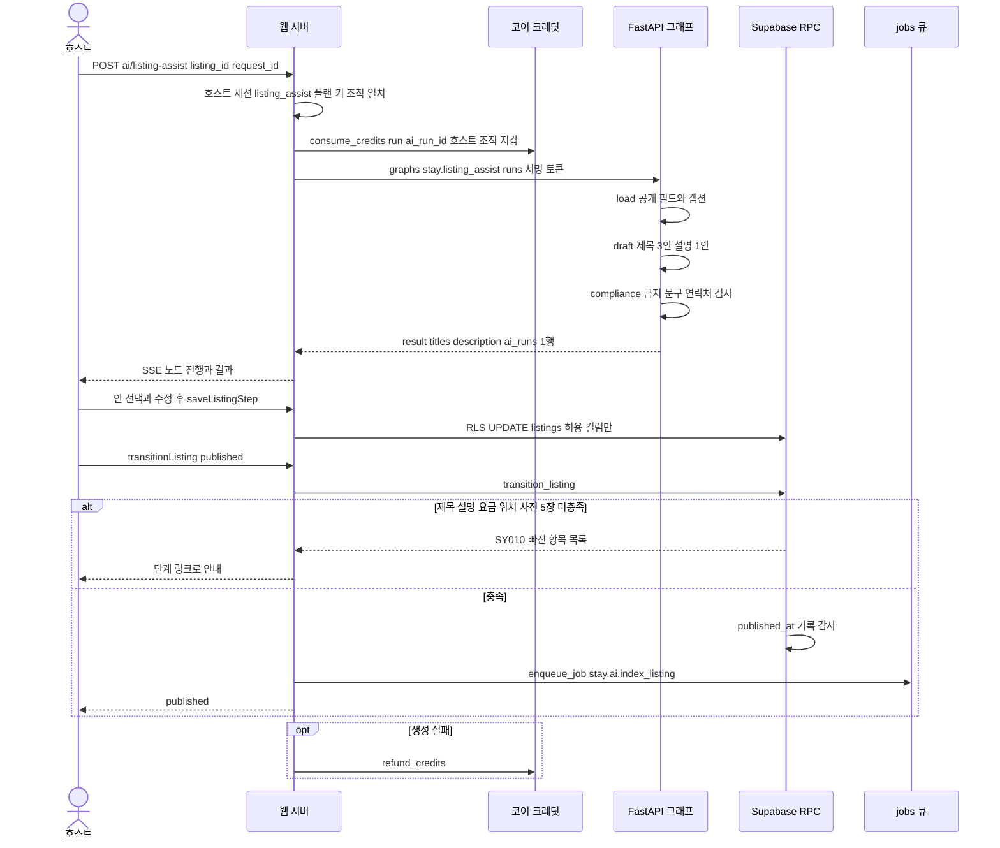

### 4-4. 사진 업로드 (SY-F-015)

**읽는 법:** 파일은 브라우저가 Storage로 직접 올리지만, 업로드 주소는 서버가 세션과 조직을 확인한 뒤 경로를 정해 서명합니다. 경로 규칙은 DB CHECK가 한 번 더 강제합니다.

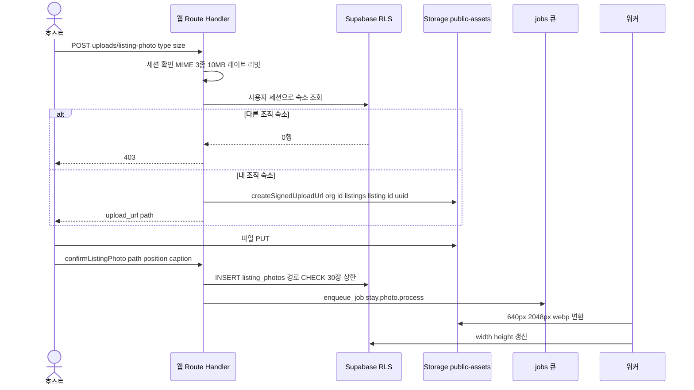

## 5. 상태 머신

### 5-1. 숙소 상태 (listings.status)

**읽는 법:** 화살표 옆이 전이를 일으키는 주체입니다. 호스트 전이는 `transition_listing`, 정지와 해제는 서비스 스크립트 `suspend_listing`입니다. 삭제는 상태가 아니라 `deleted_at` 소프트 삭제입니다.

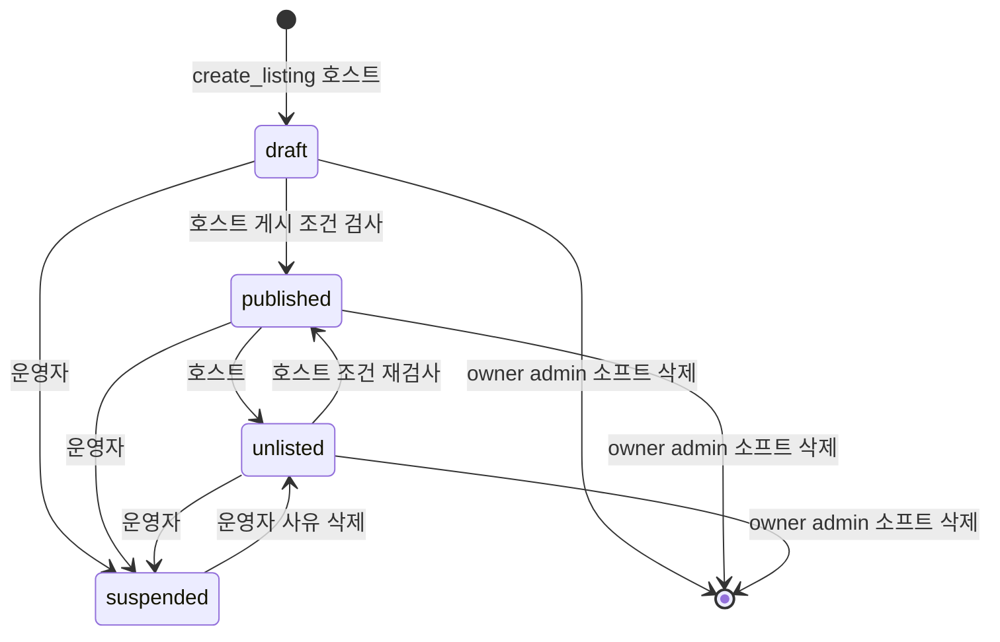

### 5-2. 예약 상태 (reservations.status)

**읽는 법:** `requested`와 `confirmed`만 날짜를 점유합니다(배타 제약 대상). `instant_book` 숙소는 `requested`를 거치지 않고 `confirmed`로 시작합니다(`01_PRD.md` SY-F-008, `05_DATA_MODEL.md` 2.1절).

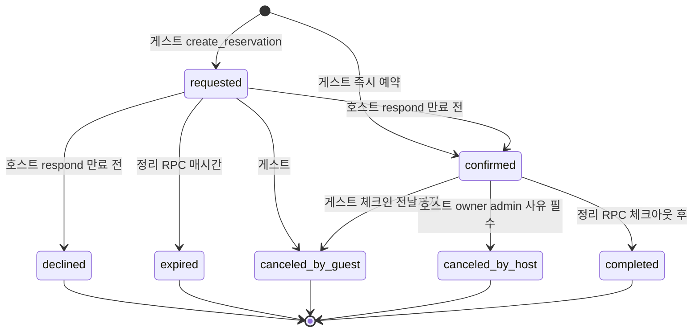

### 5-3. 리뷰 상태 (reviews.status)

**읽는 법:** 리뷰는 완료된 예약의 게스트만 14일 안에 만듭니다. 숨김은 운영자가 service_role로 직접 바꾸며 평균 별점이 다시 계산됩니다.

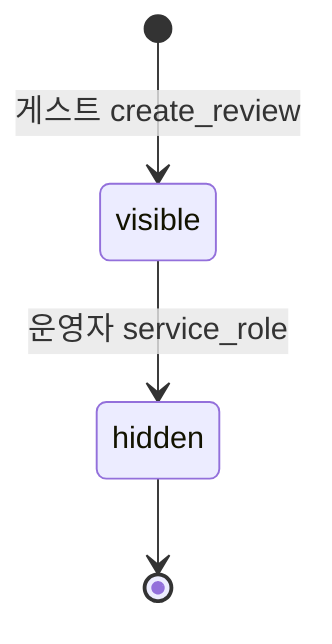

## 6. 화면 흐름

### 6-1. 게스트 화면

**읽는 법:** 실선은 사용자 이동, 점선은 로그인이 필요해 `/login?next=`로 갔다가 돌아오는 경로입니다. 비로그인이 볼 수 있는 화면은 홈, 검색, 상세, 로그인, 가입뿐입니다.

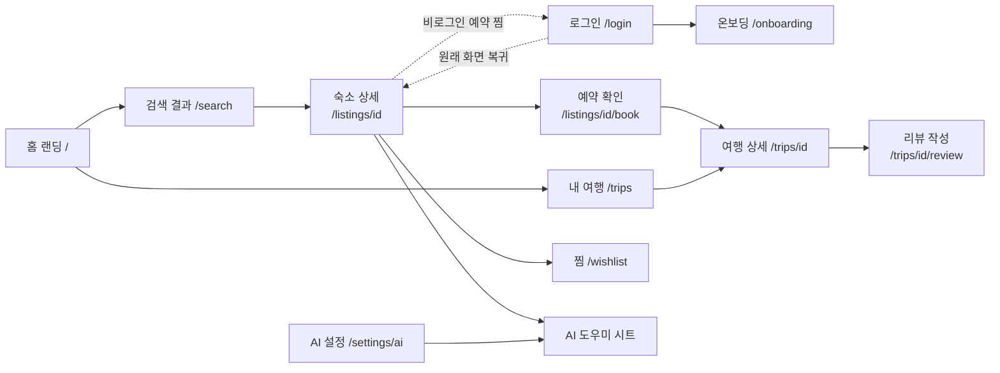

### 6-2. 호스트 화면

**읽는 법:** 호스트 화면만 좌측 GNB 셸 안에 있고, 등록 마법사는 GNB를 숨긴 전체 화면입니다. GNB 항목 수는 두 문서가 다릅니다(문서 불일치 1).

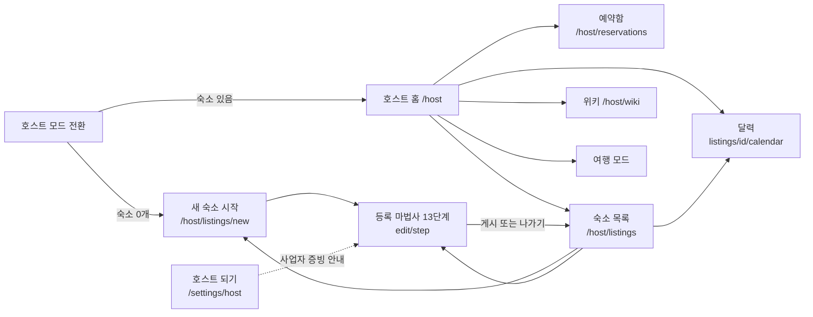

## 7. 보안 경계

**읽는 법:** 바깥에서 안으로 들어올수록 신뢰가 커지고, 가장 안쪽 DB가 최종 방어선입니다. `T1`~`T8`은 `SECURITY.md` 2절 위협 번호이고 `§`는 `SECURITY_BASELINE.md` 장 번호입니다.

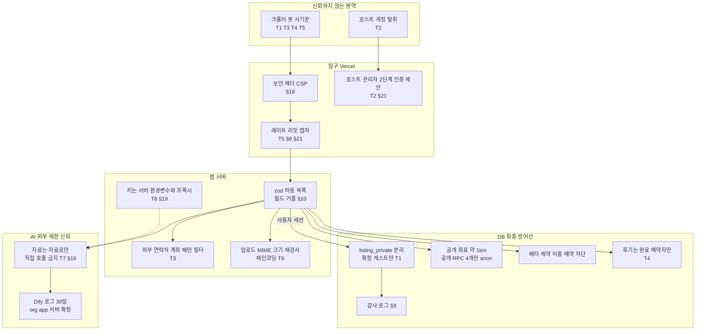

## 8. 에이전트 접근 층 (MCP)

**읽는 법:** 기존 웹 경로(위)는 그대로이고, 에이전트용 입구(아래)가 같은 DB RPC를 호출합니다. 정본은 `MCP.md`, 공통 규칙은 `../_platform-core/MCP_BASELINE.md`입니다. 점선은 Phase 1.5 이후 또는 미결정(D-M#)입니다.

### 8-1. API 위에 얹는 MCP 구성

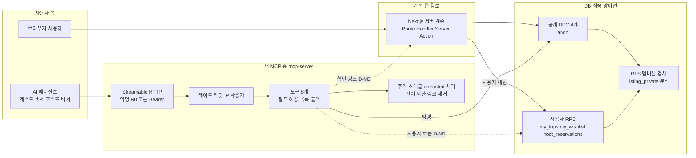

### 8-2. 예약 준비와 사람 확정 (`stay_prepare_reservation`)

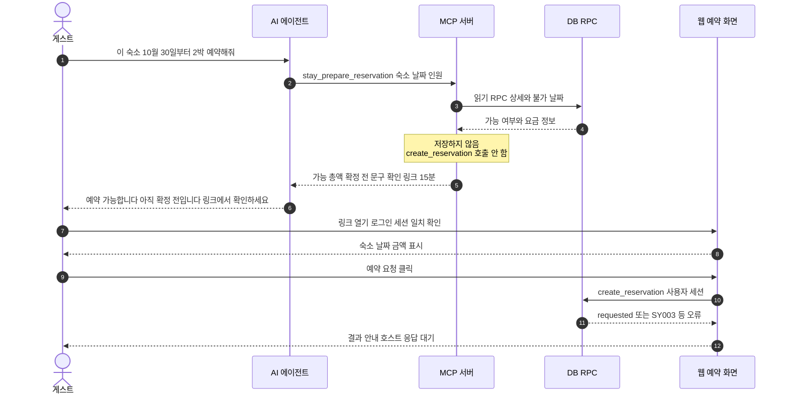

### 8-3. 도구 위험 등급과 노출 단계

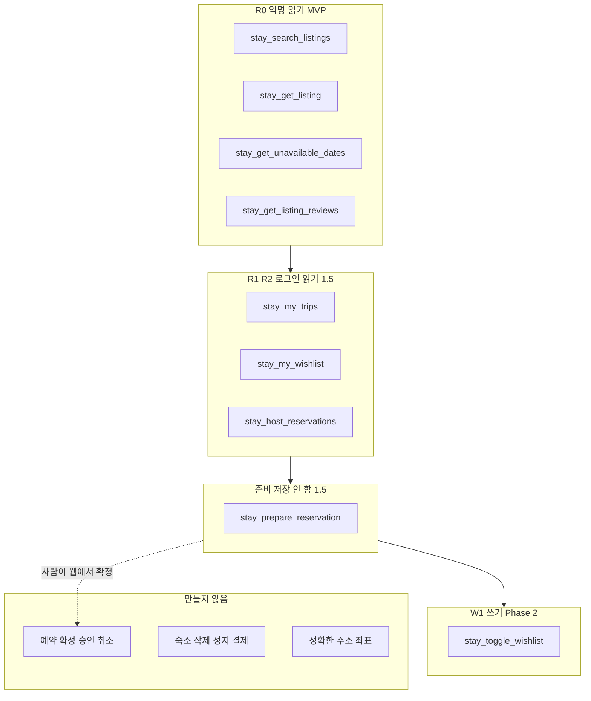

## 문서 불일치

1. **호스트 GNB 항목 수:** `10_HOST_DASHBOARD.md` 2절은 7개(홈, 예약, 숙소, 캘린더, 위키, 크레딧, 설정)이고 `03_SCREENS_UX.md` 8.1절은 6개(홈, 예약함, 숙소, 달력, 위키, 여행 모드로)입니다. 그림 6-2는 03장 경로 기준으로 그렸고 크레딧·설정은 `/settings/host`만 반영했습니다.
2. **인증 가드 파일명:** `02_ARCHITECTURE.md` 2절과 `06_AGENT_PLAN.md` SY-06-003은 `src/middleware.ts`, 공통 구성도는 `proxy.ts`입니다. 그림에는 파일명을 넣지 않았습니다.
3. **테이블 수와 호스트 유형:** `README.md`와 `05_DATA_MODEL.md` 머리는 "테이블 7개"인데 11절은 `stay.host_profiles` 신설을 제안합니다. 그림 3은 7개 + 제안 1개로 그렸고 `(제안)`을 붙였습니다. 모놀리스 SQL에는 아직 없습니다.
4. **`fx_rates`:** `04_API.md` 6.6절이 환율 캐시 `fx_rates`를 말하지만 `05_DATA_MODEL.md`에는 테이블이 없어 그림 3에서 뺐습니다.
5. **익명 호출 가능 RPC 수:** `04_API.md` 3절은 공개 RPC 4개와 `stay_today()`도 anon에 허용하고, `05_DATA_MODEL.md` 4절은 "공개 RPC 4개만"이라고 합니다. 그림은 4개로 적었습니다.

6. **MCP 가격 계산:** `MCP.md`의 `stay_prepare_reservation`이 총액을 돌려주려면 읽기용 가격 계산 RPC가 필요한데 `04_API.md` 3절에는 없고 `create_reservation`이 내부에서 계산합니다(`MCP.md` D-M5). 그림 8-2는 "요금 정보"를 DB가 준다고만 그렸습니다.
7. **MCP 인증:** 로그인 도구가 사용자 토큰을 어떻게 받는지 문서에 없습니다(`MCP.md` D-M1). 그림 8-1의 점선이 그 부분입니다.

## 갱신 규칙

위 근거 문서(특히 `05_DATA_MODEL.md` 상태 전이 표, `04_API.md` 엔드포인트, `SECURITY.md` 위협표)를 고치면 해당 그림도 같은 변경에서 함께 고친다.
