# DIAGRAMS: Arch Studio UML 시각화

작성일 2026-10-23. 이 문서는 `arch-studio`의 기획 문서를 그림으로 옮긴 것이다. 정본은 각 문서이며 그림과 문서가 다르면 문서가 우선한다. GitHub에서 Mermaid가 바로 렌더링된다. 전체 플랫폼 구조는 `../_platform-core/ARCHITECTURE_DIAGRAMS.md`를 본다.

**제품 한 줄 정의**: 건축사무소·시공사 설계자가 Windows PC에 설치하는 데스크톱 앱(Tauri 2)에서 대지를 불러와 법규 엔벨로프, 매스, 실시간 판정, 기획설계 도면 시트(DXF·SVG·PDF)를 만들고, 클라우드(웹·FastAPI)에서 법규 검토, AI 렌더, 제안서 PDF를 크레딧으로 쓰는 제품이다. 영구 라이선스는 시리얼 번호로 PC 2대에 활성화한다.

**근거 문서**: `README.md`, `01_PRD.md`, `02_ARCHITECTURE.md`, `03_SCREENS_UX.md`, `04_API.md`, `05_DATA_MODEL.md`, `MCP.md`. 공통은 `../_platform-core/SECURITY_BASELINE.md`, `CORE_SPEC.md`, `AI_ARCHITECTURE.md`.

**표기**: 실선 화살표 = 호출·데이터 흐름, 점선 = 검증·참조·서명 확인, "(제안)" = 문서가 제안이라 한 값. Phase 2·3 항목은 이름에 `P2`, `P3`를 붙였다.

**다른 제품과 다른 점**: 이 제품은 웹 서비스가 아니라 설치형 앱이다. 사용자 데이터의 정본은 PC의 로컬 SQLite이고, 로컬 기능의 권한은 서버가 서명한 라이선스 파일을 앱의 Rust 코어가 검증해서 정한다. 클라우드 기능(검토, 렌더, 제안서, 규칙 팩, 업데이트)은 호출마다 서버가 `arch.org_features`로 판정한다. 그래서 2번과 7번 그림에 설치·배포 경계와 라이선스 검증 경로를 따로 그렸다.

| # | 그림 | UML 종류 | 근거 문서 절 |
|---|---|---|---|
| 1-A | 사용자와 기능 (MVP) | 유스케이스(flowchart) | 01_PRD 1장, 2장, 3장, 9.2절 |
| 1-B | 사용자와 기능 (Phase 2, 3, 열린 결정) | 유스케이스(flowchart) | 01_PRD 2장, 9.2절 |
| 2-A | 구성요소: 설치 앱과 클라우드 | 컴포넌트(flowchart) | 02_ARCHITECTURE 2장 구성도, 2.2절, 4절 |
| 2-B | 배포와 라이선스 검증 | 배치(flowchart) | 02_ARCHITECTURE 2.2절, 7절, 01_PRD 4.4절 |
| 3-A | 데이터 모델: 카탈로그와 라이선스 | 클래스(classDiagram) | 05_DATA_MODEL 2.1~2.7절 |
| 3-B | 데이터 모델: 조직 데이터와 AI 실행 | 클래스(classDiagram) | 05_DATA_MODEL 2.8~2.14절 |
| 3-C | 데이터 모델: 로컬 SQLite | 클래스(classDiagram) | 05_DATA_MODEL 2.16절 |
| 4-A | 시퀀스: 시리얼 구매에서 활성화까지 | 시퀀스 | 03_SCREENS_UX 2.6절, 04_API 5절, AR-F-017·018 |
| 4-B | 시퀀스: 데스크톱 로그인(딥링크 PKCE) | 시퀀스 | 02_ARCHITECTURE 9.2절, 03_SCREENS_UX 2.1절 |
| 4-C | 시퀀스: AI 렌더(선차감과 환불) | 시퀀스 | 04_API 6장, 05_DATA_MODEL 3절·7절, AR-F-013 |
| 4-D | 시퀀스: 업데이트와 규칙 팩 자격 | 시퀀스 | 02_ARCHITECTURE 7절, 04_API 3장, 03_SCREENS_UX 2.7절 |
| 5-A | 상태: 라이선스 | 상태 머신 | 05_DATA_MODEL 3절 |
| 5-B | 상태: 기기 활성화 | 상태 머신 | 05_DATA_MODEL 3절 |
| 5-C | 상태: AI 실행 | 상태 머신 | 05_DATA_MODEL 3절 |
| 5-D | 상태: 조직 기능 상태(org_features) | 상태 머신 | 05_DATA_MODEL 3절, 01_PRD 4.3절 |
| 6-A | 화면 흐름: 데스크톱 | flowchart | 03_SCREENS_UX 1.1절, 2장 |
| 6-B | 화면 흐름: 웹 | flowchart | 03_SCREENS_UX 1.2절, 2.6절 |
| 7 | 보안 신뢰 경계 | flowchart | 02_ARCHITECTURE 6절, 05_DATA_MODEL 7절, 01_PRD 5장·6장 |
| 8-1 | 로컬 앱과 MCP 후보 위치 | 컴포넌트(flowchart) | MCP.md 1~3절, 05_DATA_MODEL 2.16절, 04_API 1절 |
| 8-3 | 도구 등급과 노출 단계 | flowchart | MCP.md 2절, _platform-core/MCP_BASELINE.md 2절 |

> 이 제품의 `SECURITY.md`는 아직 템플릿 상태("작성 필요")라서 7번 그림은 `02_ARCHITECTURE` 6장(위험 #1~#14), `05_DATA_MODEL` 7장(위험 #4~#20), `01_PRD` 5·6장을 근거로 그렸다. 맨 끝 "문서 불일치" 참고.

---

## 1. 사용자와 기능

### 그림 1-A. MVP 기능

**읽는 법**: 사람 역할(설계자, 건축주, 운영자)과 기능 묶음이다. 기능 ID는 `AR-F-###`. 점선 상자 안은 서버가 있어야 하는 기능, 나머지는 PC 안에서 로그인 없이 동작하는 로컬 기능이다. 도면 엔진 묶음(AR-F-028~034)은 2026-10-16에 추가된 범위(PRD 9장)다.

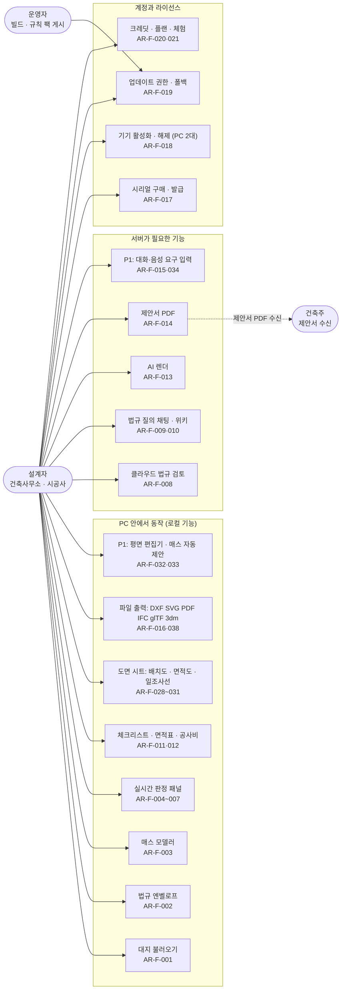

### 그림 1-B. Phase 2, 3과 열린 결정

**읽는 법**: MVP 이후 기능이다. `P2`는 Phase 2, `P3`는 Phase 3, "열린 결정"은 PRD가 아직 정하지 않은 항목이다. 범위 밖 항목은 맨 아래에 따로 표시했다.

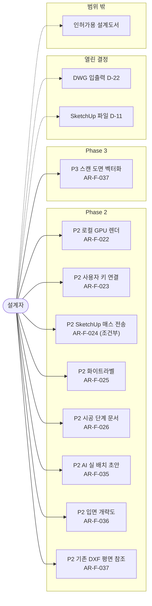

---

## 2. 구성요소와 배포

### 그림 2-A. 설치 앱과 클라우드 구성요소

**읽는 법**: 위쪽 큰 상자가 사용자 PC에 설치된 앱, 아래쪽이 운영사 클라우드다. 무거운 계산(판정, 매스, 도면 생성)은 PC의 워커가 하고, 클라우드는 라이선스, 규칙 팩 배포, AI, 결제를 맡는다. 화면은 Tauri API를 직접 부르지 않고 `shell-bridge`를 거친다. 점선은 서명 검증이다.

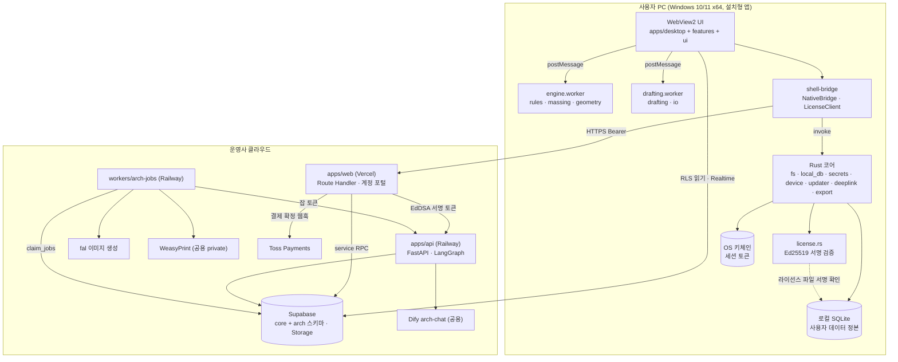

### 그림 2-B. 배포와 라이선스 검증 경로

**읽는 법**: 설치 파일이 사용자 PC까지 가는 길(왼쪽에서 오른쪽)과, 시리얼이 라이선스 파일로 바뀌어 PC에서 검증되는 길(아래)이다. 서버는 시리얼 원문을 저장하지 않고 SHA-256 해시만 저장한다. 업데이트 자격은 `build_date <= updates_until`로 정한다.

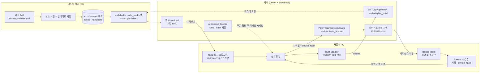

---

## 3. 데이터 모델

### 그림 3-A. 카탈로그와 라이선스 (서버 `arch` 스키마)

**읽는 법**: 상자가 테이블이고 안은 핵심 컬럼만이다. `licenses`는 구매한 조직(`org_id`)의 것이고 시리얼 원문은 저장하지 않는다. `license_activations`는 PC 한 대당 한 행이며 해제되면 되살리지 않고 새 행을 만든다. 접근 주체는 각 상자 아래 note에 적었다.

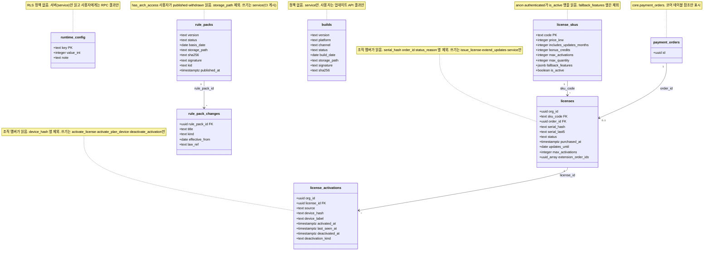

참고: `cost_catalogs`(개략 공사비 단가표)는 `builds`·`rule_packs`와 같은 게시 상태(draft, published, withdrawn)를 쓰며 RLS 정책이 없다. 컬럼이 많아 위 그림에서는 뺐다.

### 그림 3-B. 조직 데이터와 AI 실행 (서버 `arch` 스키마)

**읽는 법**: 위쪽 두 테이블은 사용자가 RPC로 저장하는 조직 데이터(표제란, 클라우드 사본)이고, 나머지는 AI 실행 기록 4종(`renders`, `reviews`, `intake_runs`, `proposals`)과 대지 조회 기록이다. AI 실행 테이블은 사용자 SELECT만 있고 쓰기는 service RPC(`start_ai_run`, `finish_ai_run`, `fail_ai_run`)만 한다. 공통 실행 컬럼(`request_id`, `status`, `credits`, `credit_ledger_id`, `job_id`)은 `renders` 칸 기준으로 적었다.

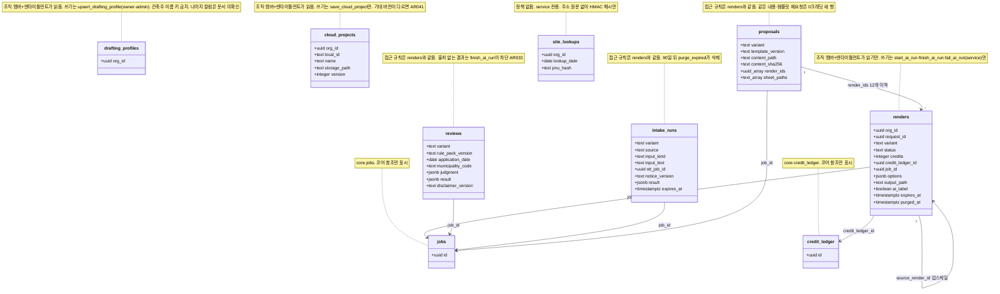

### 그림 3-C. 로컬 SQLite (데스크톱, 사용자 데이터 정본)

**읽는 법**: PC 안의 테이블이다. 화면은 SQL을 직접 쓰지 않고 Rust 명령 `local_db_*`만 부른다. 아래쪽 4개(`license_store`, `rule_pack_cache`, `cost_catalog_cache`, `drafting_profile_cache`)는 서버 값의 서명 사본 또는 읽기 캐시다. 권한 판정에는 `license_store`의 서명 파일만 쓰고 `local_settings`는 쓰지 않는다.

```mermaid
classDiagram
  class projects {
    +TEXT id PK
    +TEXT name
    +TEXT site_label
    +TEXT cloud_project_id
  }
  class model_revisions {
    +TEXT id PK
    +TEXT project_id FK
    +INTEGER rev
    +INTEGER schema_version
    +TEXT engine_version
    +TEXT design_model
    +TEXT sha256
  }
  class sheets {
    +TEXT id PK
    +TEXT project_id FK
    +TEXT sheet_spec
    +TEXT annotation_overrides
    +INTEGER based_on_rev
  }
  class judgment_snapshots {
    +TEXT id PK
    +TEXT project_id FK
    +INTEGER rev
    +TEXT rule_pack_version
    +TEXT application_date
    +TEXT result
  }
  class exports {
    +TEXT id PK
    +TEXT project_id FK
    +TEXT sheet_ids
    +TEXT format
    +TEXT rule_pack_version
  }
  class render_items {
    +TEXT id PK
    +TEXT project_id FK
    +TEXT cloud_render_id
    +INTEGER ai_label
  }
  class local_settings {
    +TEXT key PK
    +TEXT value
  }
  class license_store {
    +TEXT activation_id PK
    +TEXT file
    +TEXT kid
    +TEXT issued_at
    +TEXT max_issued_at_seen
  }
  class rule_pack_cache {
    +TEXT version PK
    +TEXT sha256
    +TEXT signature
    +TEXT published_at
    +INTEGER pending_changes
  }
  class cost_catalog_cache {
    +TEXT version PK
    +TEXT items
    +TEXT fetched_at
  }
  class drafting_profile_cache {
    +TEXT org_id PK
    +TEXT profile
    +TEXT fetched_at
  }
  projects "1" --> "*" model_revisions
  projects "1" --> "*" sheets
  projects "1" --> "*" judgment_snapshots
  projects "1" --> "*" exports
  projects "1" --> "*" render_items
  note for license_store "서버가 서명한 라이선스 파일 사본. Rust license.rs만 읽고 검증. 권한 판정의 유일한 근거"
  note for local_settings "UI 설정과 org_features 표시용 캐시. 권한 판정 입력 금지"
  note for rule_pack_cache "서버 규칙 팩의 읽기 캐시. 서명과 published_at이 updates_until 이하인 팩만 엔진에 전달"
  note for cost_catalog_cache "서버 단가표 사본. 읽기 캐시"
  note for drafting_profile_cache "서버 표제란 설정 사본. 편집은 온라인에서만"
```

---

## 4. 핵심 시퀀스

### 그림 4-A. 시리얼 구매에서 기기 활성화까지

**읽는 법**: 결제 확정은 화면 리다이렉트가 아니라 Toss 웹훅(또는 서버 confirm)으로만 인정하며, 같은 후처리를 두 경로가 불러도 주문 id 멱등으로 한 번만 발급된다. 서버에는 시리얼 해시만 남고 원문은 이메일로만 간다. 거부 코드는 `AR###`.

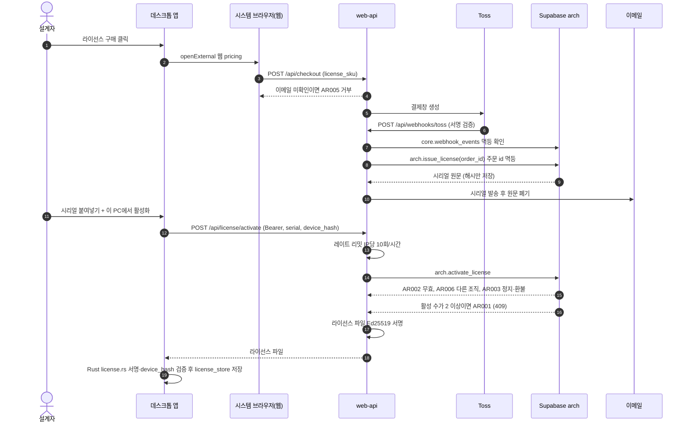

### 그림 4-B. 데스크톱 로그인 (딥링크 PKCE)

**읽는 법**: 앱 안 웹뷰에서 OAuth를 하지 않고 시스템 브라우저를 쓴다. 복귀 URL(`archstudio://auth/callback`)은 Rust가 허용 목록으로 검사하고, 앱이 직전에 시작한 시도(10분 이내, 1회)일 때만 코드를 교환한다. 토큰은 키체인에만 저장한다. 루프백 방식(b)은 딥링크가 막힐 때의 대안이다.

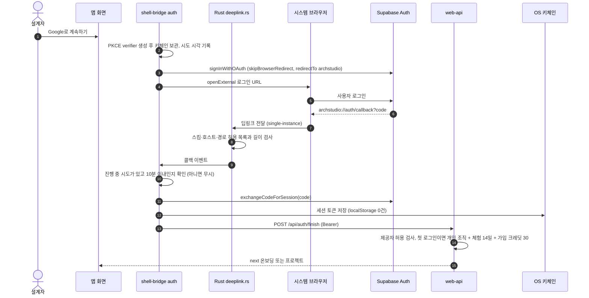

### 그림 4-C. AI 렌더 (선차감, 폴링, 환불)

**읽는 법**: 데스크톱은 금액을 보내지 않고 서버가 단가표로 계산한다. 실행 행 생성, 잡 생성, 크레딧 선차감은 `arch.start_ai_run` 한 트랜잭션이다. `request_id`가 같으면 재전송해도 이중 차감되지 않는다. 실패하면 `refund:job:<job_id>` 키로 환불해 `refunded`가 된다. 도면·3D 원본은 보내지 않고 깊이·윤곽 이미지만 올린다.

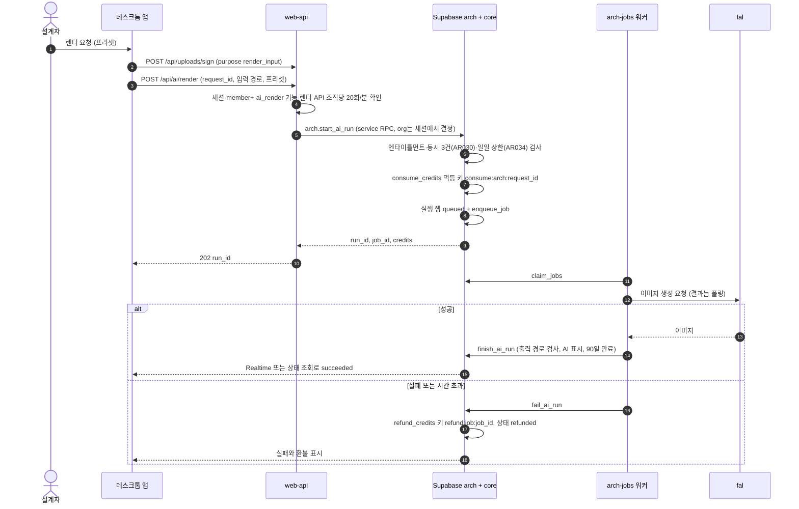

### 그림 4-D. 업데이트와 규칙 팩 자격

**읽는 법**: 업데이트 만료(폴백) 상태를 가르는 두 검사다. 빌드는 `build_date <= updates_until`, 규칙 팩은 `published_at <= updates_until`일 때만 받는다. 앱은 서버 응답과 별개로 팩 서명도 확인한다. 만료되면 로컬 기능은 마지막 자격 버전으로 계속 되고 클라우드 검토는 `AR012`로 막힌다.

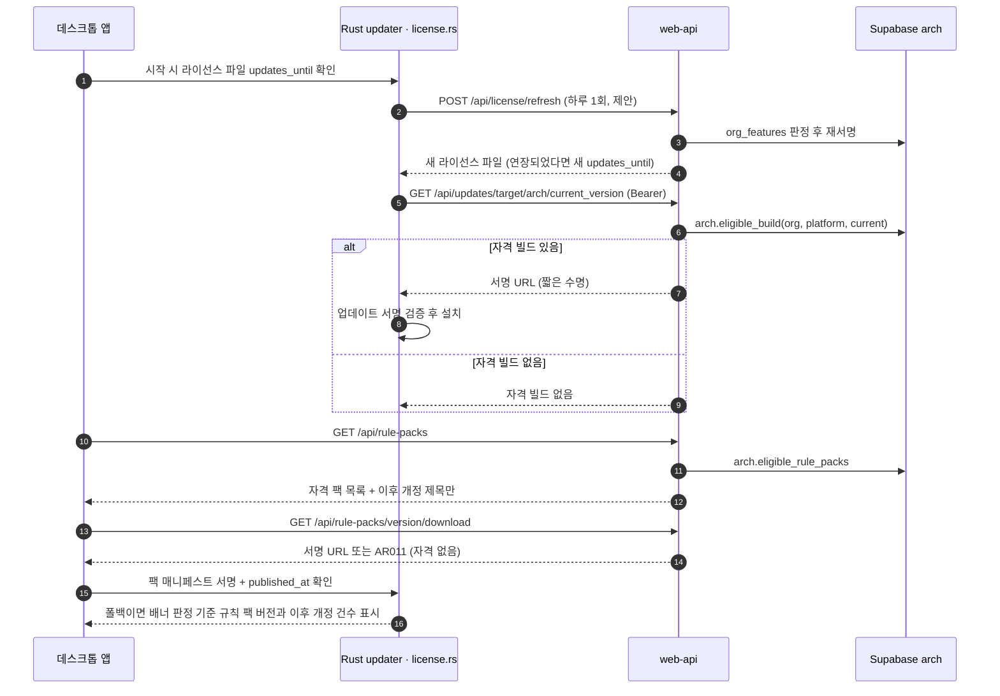

---

## 5. 상태 머신

### 그림 5-A. 라이선스 (`licenses.status`)

**읽는 법**: 전이는 모두 서버(service)가 한다. 사용자가 바꾸지 못한다. `refunded`·`revoked`는 종료 상태이고 전이 시 활성 기기를 모두 해제한다. `suspended`는 기기를 남기되 활성화·refresh·클라우드 기능을 `AR003`으로 거부한다. 전이 검사는 `enforce_license_transition` 트리거다.

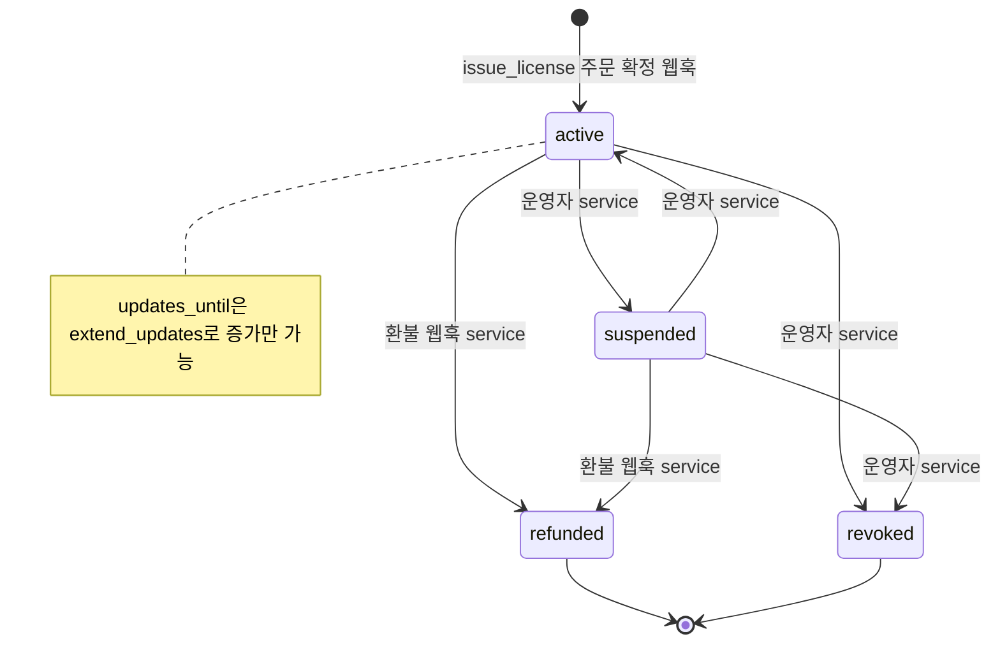

### 그림 5-B. 기기 활성화 (`license_activations`)

**읽는 법**: 한 행은 활성에서 해제로만 간다. 해제된 행을 되살리면 22023 오류이고, 같은 PC를 다시 쓰려면 새 행을 만든다. 해제 주체에 따라 `deactivation_kind`가 달라지고 셀프 해제만 30일 3회 한도(`AR004`)에 센다.

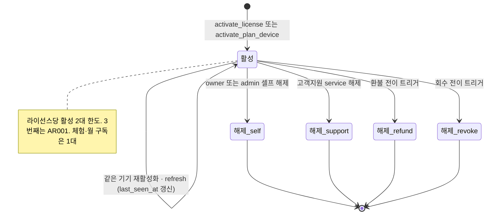

### 그림 5-C. AI 실행 (`renders`·`reviews`·`intake_runs`·`proposals`.`status`)

**읽는 법**: 전이를 바꾸는 주체는 service RPC뿐이다(`start_ai_run`, `finish_ai_run`, `fail_ai_run`, `reconcile_runs`). 시작 때 크레딧을 선차감하고, 실패하면 남은 차감액을 환불한 뒤 `refunded`가 된다. 전이 위반은 `enforce_run_transition`이 22023으로 막는다.

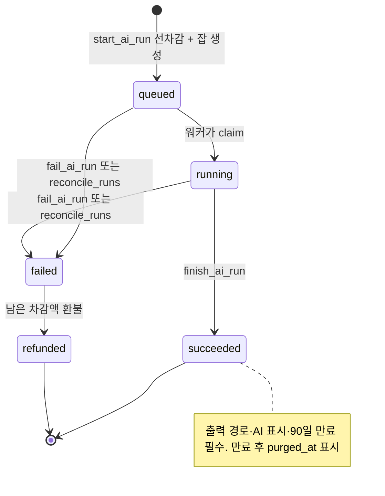

### 그림 5-D. 조직 기능 상태 (`org_features.state`, 저장하지 않고 계산)

**읽는 법**: DB에 저장하는 값이 아니라 `arch.org_features(org)`가 날짜·라이선스·플랜으로 매번 계산하는 값이다. 상태에 따라 4.3절 표대로 기능 집합이 정해지고, 클라우드 기능은 호출마다 이 값으로 판정한다. 로컬 기능은 별도로 라이선스 파일이 정한다.

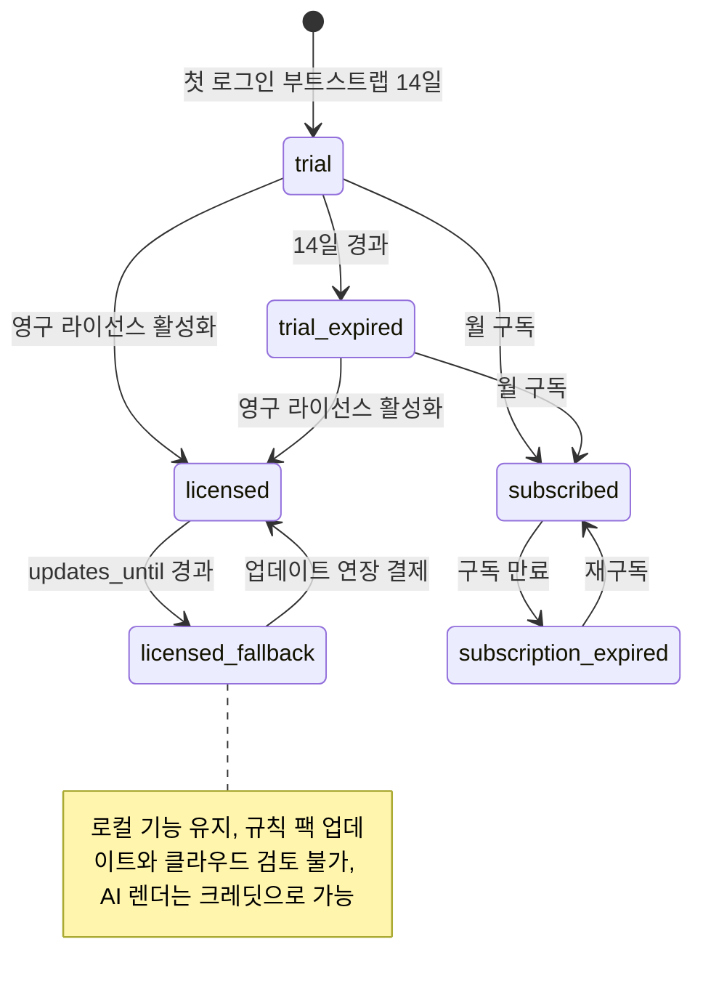

---

## 6. 화면 흐름

### 그림 6-A. 데스크톱 화면

**읽는 법**: 설치 앱의 화면 이동이다. 첫 실행은 로그인, 온보딩, 프로젝트 목록 순이고, 프로젝트 안에서는 대지, 모델, 프로그램, 평면, 시트, 렌더, 제안서, 검토 화면을 오간다. 라이선스 구매와 크레딧 팩 구매는 앱 안 결제가 아니라 시스템 브라우저(웹)로 나간다. 영구 라이선스를 활성화한 PC는 로그인 없이 로컬 화면을 쓴다.

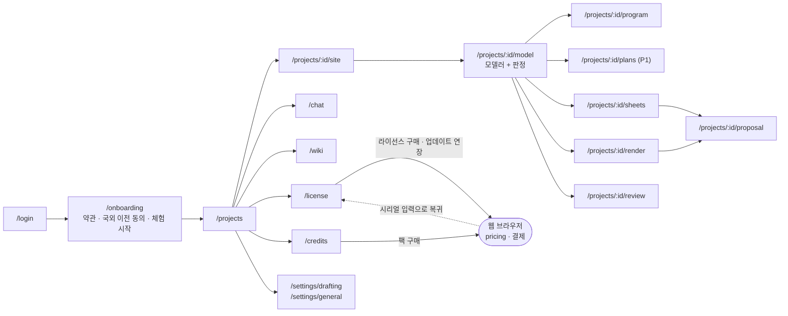

### 그림 6-B. 웹 화면

**읽는 법**: 웹에는 설계 화면이 없다. 랜딩, 가격, 다운로드, 계정 포털, 결제 결과만 있다. 결제 결과 화면은 확정 대기 상태를 보여 주고, 확정은 웹훅이 한다. 점선은 데스크톱 앱으로 돌아가는 길이다.

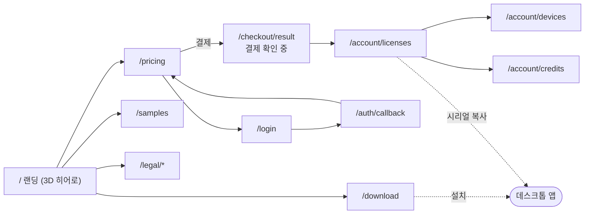

---

## 7. 보안 신뢰 경계

### 그림 7. 보안 신뢰 경계와 통제

**읽는 법**: 왼쪽에서 오른쪽으로 갈수록 신뢰가 높다. 사용자 PC(앱과 파일)는 믿지 않는 영역이고, 서버가 판정한다. 점선 화살표는 위협이 노리는 지점, 실선은 통제다. `§n`은 `../_platform-core/SECURITY_BASELINE.md`의 장 번호다. 이 제품 `SECURITY.md`가 비어 있어 통제 목록은 02_ARCHITECTURE 6장, 05_DATA_MODEL 7장에서 가져왔다.

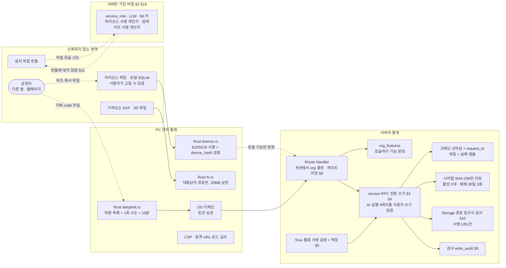

---

## 8. 에이전트 접근 층 (MCP)

**읽는 법:** 이 제품은 프로젝트 데이터의 정본이 데스크톱 로컬 SQLite이고, 서버 API는 라이선스·결제·크레딧 AI 작업뿐입니다. 그래서 **MVP에서는 원격 MCP를 열지 않고 노출 도구가 0개**입니다. 아래 그림은 "열 경우의 모양"입니다. 정본은 `MCP.md`, 공통 규칙은 `../_platform-core/MCP_BASELINE.md`입니다. 점선은 후보이거나 미결정(D-M#)입니다. 준비·확정 흐름을 가진 도구가 없어 시퀀스 그림(8-2)은 없습니다.

### 그림 8-1. 로컬 앱과 MCP 후보 위치

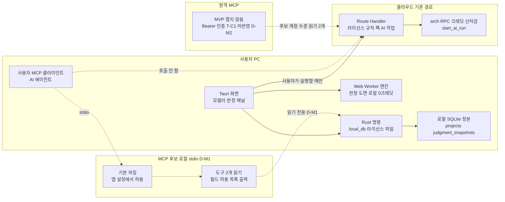

### 그림 8-3. 도구 위험 등급과 노출 단계

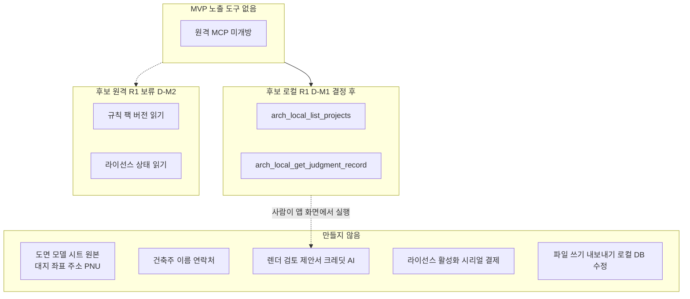

## 문서 불일치

그림을 그리며 확인한 문서 사이의 어긋남과, 문서에 없어서 그리지 못한 것이다. 그림은 아래 "그림에 쓴 쪽"을 따랐다.

| # | 위치 | 내용 | 그림에 쓴 쪽 |
|---|---|---|---|
| 1 | `SECURITY.md` | 자산, 위협, 제품별 수치가 모두 "작성 필요" 템플릿이다. SECURITY_BASELINE §22는 제품별 작성을 요구한다 | 7번 그림은 02장 6절, 05장 7절, 01장 5·6장으로 대체. SECURITY.md 작성 후 다시 맞춘다 |
| 2 | `05_DATA_MODEL` 2.8, 2.9절 이후 | `drafting_profiles`, `reviews`, `intake_runs`, `proposals`는 절 제목과 일부 컬럼만 보이고 전체 컬럼표가 없다 | 문서에 적힌 컬럼만 그렸다. `drafting_profiles`는 `org_id`만 표시 |
| 3 | `05_DATA_MODEL` 2.5절 `cost_catalogs` | 컬럼이 확인되지 않아 3-A 그림에서 뺐다 | 3-A 아래 문장으로만 설명 |
| 4 | `05_DATA_MODEL` 6절 `core.payment_orders` | `kind`에 일회성(영구 라이선스) 값이 없어 코어 요청 C-1이 필요하다고 적혀 있다 | 4-A 그림은 C-1이 반영된 것으로 가정했다 |
| 5 | `01_PRD` 4.4절 vs 02장 2.2절 | 라이선스 파일의 `offline_valid_until`은 PRD 필드 목록에 없고 02장이 더한 제안 필드다 | "(제안)"으로 취급, 5-D 그림에는 쓰지 않음 |
| 6 | `01_PRD` 9.2절 vs 3장 | AR-F-032·033·034는 9.2절에서 MVP(P1)인데 3장 기능표 번호 범위에는 AR-F-028~038이 9장에만 있다 | 9장을 따라 1-A에 P1로 표기 |
| 7 | `01_PRD` 4.3절 | 월 구독 만료와 체험 만료의 "열람·내보내기만" 범위가 로컬 파일 서명 기준(`offline_valid_until`)과 서버 기준 두 곳에서 정해진다 | 5-D는 서버 계산 상태만 그렸고, 로컬 판정은 2-B에서 라이선스 파일 경로로 표시 |
| 8 | `04_API` 5절 | Toss 웹훅 서명 방식과 이벤트 id 필드는 "미확인"이다 | 4-A는 "서명 검증"과 멱등까지만 쓰고 방식은 쓰지 않음 |
| 9 | `02_ARCHITECTURE` 9.2절 | 딥링크가 Supabase Redirect URLs에 등록되는지, Windows에서 동작하는지 미확인(D-15 스파이크). 막히면 루프백(b) | 4-B는 (a) 딥링크 경로를 그렸다 |
| 10 | 코드 서명 | 인증서 종류·비용 미확인(T-D5). 서명 전에는 SmartScreen 경고가 뜬다 | 2-B에 "코드 서명"만 표시, 경고는 03장 2.1절 참고 |
| 11 | `MCP.md` 전체 / `04_API.md` 1절 | 원격 MCP 인증이 기댈 Bearer 검증(코어 요청 T-C1)이 아직 반영 전이라고 04장이 적고 있다. MCP.md는 이를 원격 MCP를 열지 않는 이유 중 하나로 썼다 | 8-1에서 원격 MCP를 "MVP 열지 않음"으로 표시 |
| 12 | `MCP.md` D-M1 / `02_ARCHITECTURE.md` 2.1절, `05_DATA_MODEL.md` 2.16절 | 로컬 DB는 Rust `local_db_*` 명령으로만 접근한다고 하나 명령의 구체 이름이 문서에 없다. 로컬 MCP 도구가 부를 읽기 명령을 특정할 수 없다 | 8-1은 "Rust 명령"으로만 표기, MCP.md는 "확인 필요"로 표시 |
| 13 | `MCP.md` D-M1 / `CLAUDE.md` 7절 | 로컬 stdio MCP를 별도 프로세스로 번들에 넣으면 "사이드카 동봉 금지"에 걸린다. 앱 Rust가 서버를 겸하는 구성은 문서에 없다 | 8-1은 로컬 MCP를 점선 후보로만 그림 |
| 14 | `MCP.md` D-M3 / `05_DATA_MODEL.md` 2.16절 | 화면 판정은 매번 재계산(D 분류)이고 저장된 `judgment_snapshots`는 기록용이라고 한다. 따라서 로컬 읽기 도구가 줄 수 있는 것은 "현재 판정"이 아니라 마지막 기록뿐이다 | 도구 이름을 `arch_local_get_judgment_record`로 하고 출력에 기록 시점 문구를 넣음 |

그리지 못한 것: 플랫폼 공통 AI 계층(Dify, LangGraph 내부 그래프 `arch.review` `arch.intake`)의 노드 구조는 이 제품 문서가 아니라 `AI_ARCHITECTURE.md`에 있어 상세 시퀀스로 그리지 않았다. 환불 시 라이선스 해제(웹훅 환불 후처리)와 법규 검토 시퀀스도 4번에 넣지 않았다(2.2절 표와 `AR012` 규칙으로 4-D에 일부 반영).

## 갱신 규칙

1. 정본은 `01_PRD.md` ~ `05_DATA_MODEL.md`다. 문서가 바뀌면 이 파일의 해당 그림을 같은 날 고치고 맨 위 작성일을 갱신한다.
2. 그림을 고치면 위 표의 "근거 문서 절"도 함께 확인한다. 기능 ID(`AR-F-###`), 오류 코드(`AR###`), 테이블·컬럼 이름은 문서에 있는 것만 쓴다.
3. 한 그림은 노드 25개 이하로 유지한다. 넘으면 3-A, 3-B처럼 나눈다.
4. 문서가 "제안"이라고 한 값은 그림에서도 "(제안)"을 붙인다. 확정되면 지운다.
5. 문서끼리 어긋나면 한쪽을 골라 그리고 위 "문서 불일치"에 기록한다.
6. `SECURITY.md`가 채워지면 7번 그림의 자산, 위협, 통제를 그 문서 기준으로 다시 그리고 불일치 1번을 지운다.
7. 수정 후 Mermaid 검증(`validate.py`)을 돌려 모든 블록이 통과하는지 확인한다.
