# 신비로운AI (astro-ai) UML 다이어그램

작성일 2026-10-23. 제품 한 줄 정의: 만세력 엔진이 결정적으로 계산한 사주 원국과 사용자가 뽑은 타로 3장을 AI가 해설해, 본인과 가족·지인의 리포트를 A4 책자형 PDF로 소장하게 하고 이메일과 대시보드로 전달하는 크레딧팩 결제형 SaaS입니다(`README.md` 1절).

근거 문서: `README.md`, `01_PRD.md`, `02_ARCHITECTURE.md`, `03_SCREENS_UX.md`, `04_API.md`, `05_DATA_MODEL.md`, `SECURITY.md`, `MCP.md`, 공통 맥락은 `../_platform-core/ARCHITECTURE_DIAGRAMS.md`, `SECURITY_BASELINE.md`, `CORE_SPEC.md`. 정본은 각 문서이며, 그림과 문서가 다르면 문서가 우선입니다. 문서끼리 어긋난 곳은 파일 끝 "문서 불일치"에 적었습니다. GitHub에서 그림이 바로 렌더링됩니다(Mermaid).

표기: **실선 화살표** = 호출·데이터 흐름, **점선** = 검증·참조·구독, "(제안)" = 문서가 제안값이라고 밝힌 것. 기능 ID(AS-F-###)는 `01_PRD.md` 3절의 ID입니다.

06_AGENT_PLAN.md(작업 계획)와 07_SOURCE_MIGRATION.md(원본 이관)는 제품 구조가 아니라 개발 작업 관리 문서라 그림에서 뺐습니다.

| 번호 | 그림 | UML 종류 | 근거 문서 절 |
|---|---|---|---|
| 1-1 | 사용자와 기능: 방문자·회원 (MVP) | 유스케이스 관점 flowchart | `01_PRD` 2절, 3절 |
| 1-2 | 운영자 기능과 Phase 구분 | 유스케이스 관점 flowchart | `01_PRD` 2절, 3절, `02` 9절 |
| 2-1 | 구성요소: 웹·워커·AI·외부 서비스 | 컴포넌트 | `02` 결정표, 2절, 4절, 7절 |
| 2-2 | 구성요소: AI 계층 상세 | 컴포넌트 | `02` 5절, `04` 6.1절, 6.2절 |
| 3-1 | 데이터 모델 | 클래스 | `05` 1절, 2절, 4절, 6절 |
| 4-1 | 리딩 생성 (AS-F-009~012, 018, 029) | 시퀀스 | `02` 4절, `04` 2절, 4절 |
| 4-2 | 크레딧팩 결제 (AS-F-019) | 시퀀스 | `04` 2절, 5절, `03` 2.4절 |
| 4-3 | AI 채팅 (AS-F-032, 036) | 시퀀스 | `04` 2.1절, 6.2절, `03` 2.6절 |
| 4-4 | 이메일 발송 outbox (AS-F-017) | 시퀀스 | `05` 3.3절, `04` 3절 |
| 5-1 | 리딩 상태 `readings.status` | 상태 머신 | `05` 3.1절 |
| 5-2 | 렌더 상태 `reading_renders.status` | 상태 머신 | `05` 3.2절 |
| 5-3 | 발송 상태 `deliveries.status` | 상태 머신 | `05` 3.3절 |
| 6-1 | 화면 흐름: 공개·가입·온보딩 | flowchart | `03` 1절, 2.1절, 7절 |
| 6-2 | 화면 흐름: 대시보드와 어드민 | flowchart | `03` 1절, 2.2~2.4절, 8절 |
| 7-1 | 보안 경계 | flowchart (신뢰 경계) | `SECURITY.md` 1~2절, `SECURITY_BASELINE` |
| 8-1 | API 위에 얹는 MCP 구성 | 컴포넌트(flowchart) | `MCP` 1~3절, `MCP_BASELINE` 1·7절 |
| 8-2 | 리딩 준비와 사람 확정 | 시퀀스 | `MCP` 2·6절, `04` 2절 |
| 8-3 | 도구 위험 등급과 노출 단계 | flowchart | `MCP` 2절, `MCP_BASELINE` 2절 |

## 1. 사용자와 기능

### 그림 1-1. 방문자와 회원의 MVP 기능

읽는 법: 왼쪽 위 두 사람이 사용자입니다. 방문자는 로그인 없이 랜딩·Live Demo·위키만 쓰고, 회원은 보관함에 대상을 등록한 뒤 리딩을 만들고 PDF로 받습니다. 상자 안 숫자는 크레딧 단가(01장 4.2절)입니다. 모든 상자가 MVP 범위입니다.

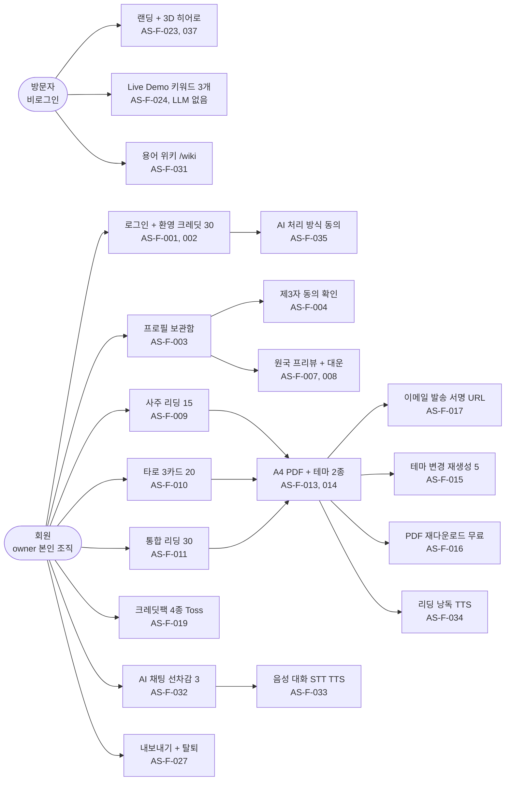

### 그림 1-2. 운영자 기능, 로그인 단계, Phase 구분

읽는 법: 위쪽은 `platform_admin`만 쓰는 최소 어드민과 지식 관리(MVP)입니다. 가운데는 로그인 수단이 켜지는 순서, 아래쪽은 MVP에 들어가지 않는 Phase 2와 폐기 항목입니다. 구분은 `01_PRD.md` 2절 표 그대로입니다.

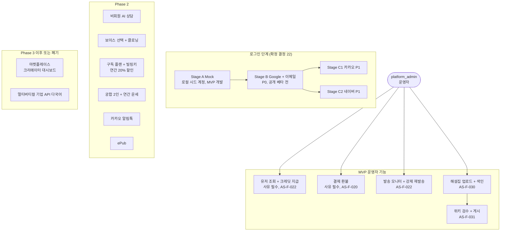

## 2. 구성요소

### 그림 2-1. 웹·워커·AI·외부 서비스

읽는 법: 위에서 아래로 사용자 요청이 내려갑니다. 읽기는 브라우저가 RLS로 직접 하고, 쓰기는 Route Handler와 워커만 service_role로 합니다. LLM 키는 FastAPI에만 있고 워커와 Vercel에는 없습니다(`02` 결정표). 점선은 구독입니다.

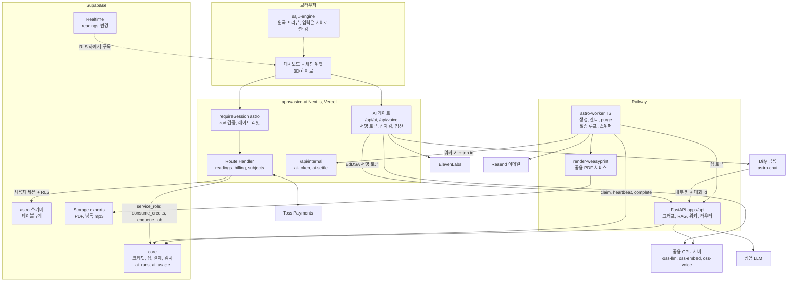

### 그림 2-2. AI 계층 상세

읽는 법: 오른쪽 위 그래프 `astro.reading`이 리딩 본문을 만들고, 채팅과 위키는 그래프가 아니라 FastAPI 도구 경로(`/tools/*`)로 갑니다. 그래프의 `chart` 노드는 TS 엔진이 저장한 값을 읽기만 하고 LLM을 쓰지 않습니다. 점선은 `compliance`에서 걸린 장만 1회 다시 쓰는 경로입니다.

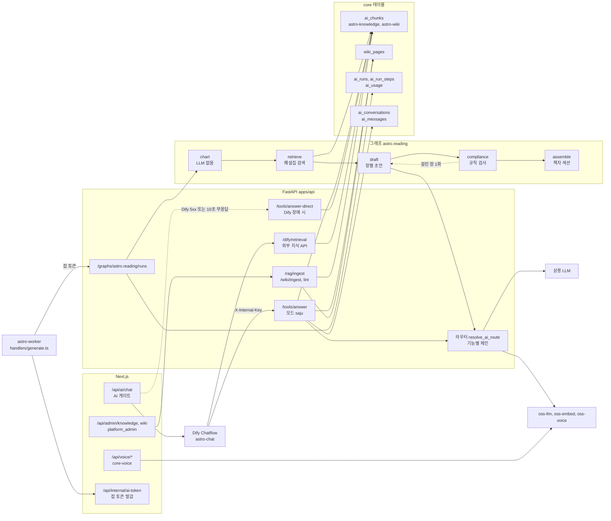

## 3. 데이터 모델

### 그림 3-1. `astro` 스키마 7개 테이블과 코어 참조 3개

읽는 법: 선은 FK(포함·참조)입니다. 제품 테이블 7개(themes, subjects, readings, reading_renders, deliveries, consents, preferences)와 참조만 하는 코어 테이블 3개를 그렸습니다. 모든 제품 테이블은 `org_id` 복합 FK로 다른 조직 행 참조를 DB가 거부합니다. 각 상자 아래 note가 RLS와 쓰기 주체입니다. AI·음성 테이블은 코어 것을 쓰고 제품 AI 표는 없습니다(`05` 6절).

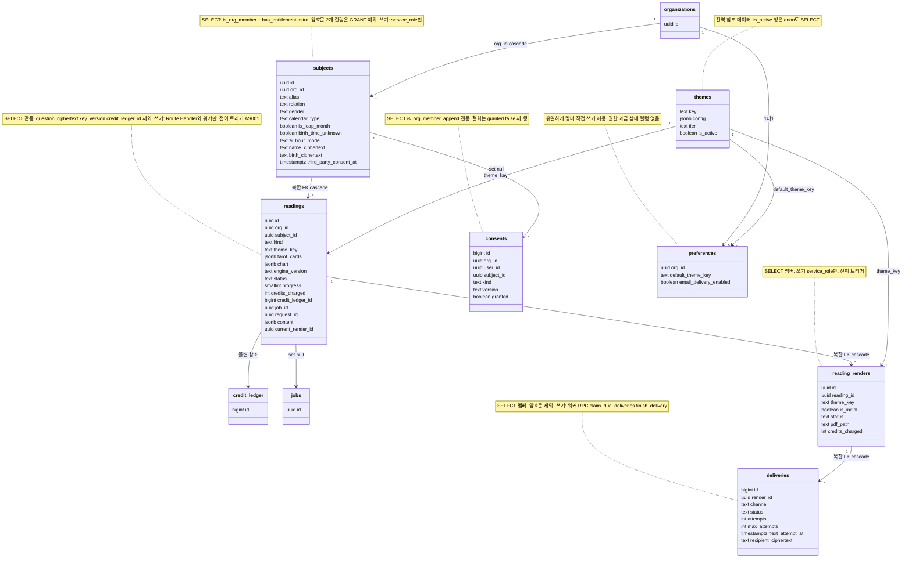

## 4. 핵심 시퀀스

### 그림 4-1. 리딩 생성 (AS-F-009~012, 018, 029)

읽는 법: 위쪽은 Route Handler가 검증·차감·잡 생성까지 한 번에 하고 202로 돌려보내는 구간, 아래쪽은 워커가 그래프를 부르고 PDF를 만드는 구간입니다. 검증·권한은 `requireSession`, 레이트 리밋, 멱등은 `request_id`, 크레딧은 선차감이고 최종 실패 시 `fail_job`이 자동 환불합니다. 상태 이름은 그림 5-1과 같습니다.

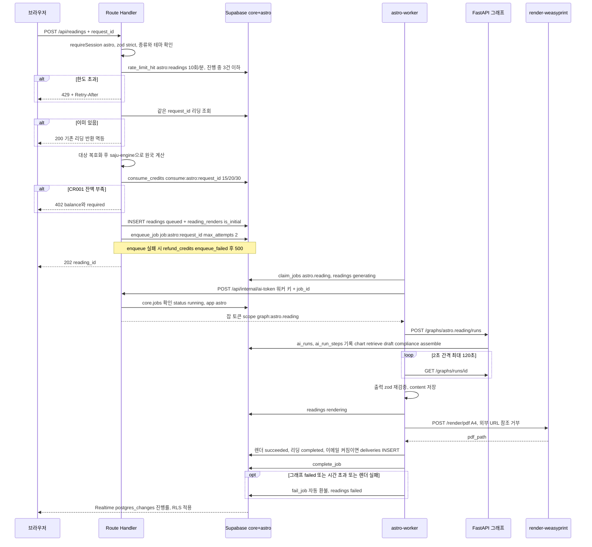

### 그림 4-2. 크레딧팩 결제 (AS-F-019)

읽는 법: 주문을 서버에서 먼저 저장하고 금액은 서버 값만 씁니다. 지급은 성공 URL 뒤 서버 confirm에서만 일어나고 웹훅은 상태 동기화뿐입니다. 같은 결제를 두 번 confirm해도 지급은 1회입니다(멱등). 금액이 다르면 `PM001`로 지급 0.

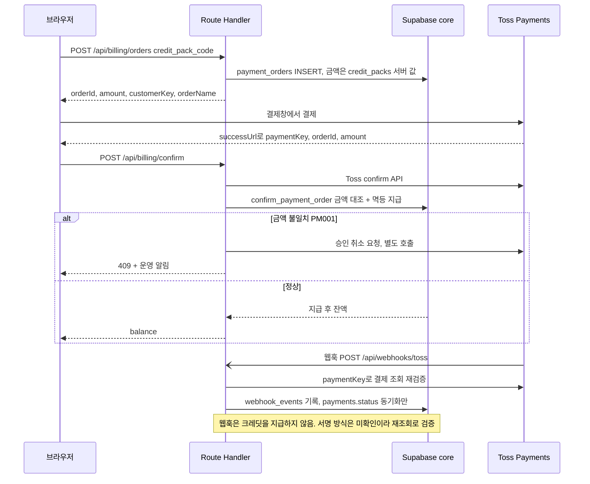

### 그림 4-3. AI 채팅 한 턴 (AS-F-032, 036)

읽는 법: 브라우저는 `/api/ai/*`만 부르고 Dify와 FastAPI는 서버끼리 부릅니다. 턴마다 제공자 호출 전에 3크레딧을 선차감하고 끝나면 실제 사용량(1~5)으로 정산해 차액을 환불합니다. 스트림이 끊기면 5분 주기 정산 크론이 처리합니다.

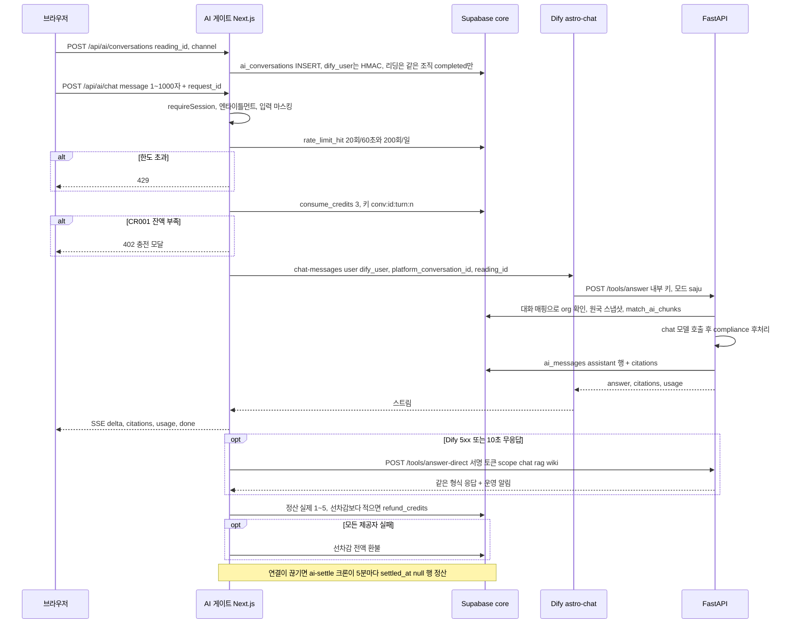

### 그림 4-4. 이메일 발송 outbox와 재발송 (AS-F-017)

읽는 법: 리딩 완료 때 발송 행이 만들어지고, 워커가 30초마다 `claim_due_deliveries`로 집어 갑니다. 실패하면 5분 뒤 재시도, 3회째 실패면 `dead`. 이메일에는 PDF를 붙이지 않고 서명 URL 링크만 보냅니다. 발송 실패는 리딩 성공에 영향이 없습니다.

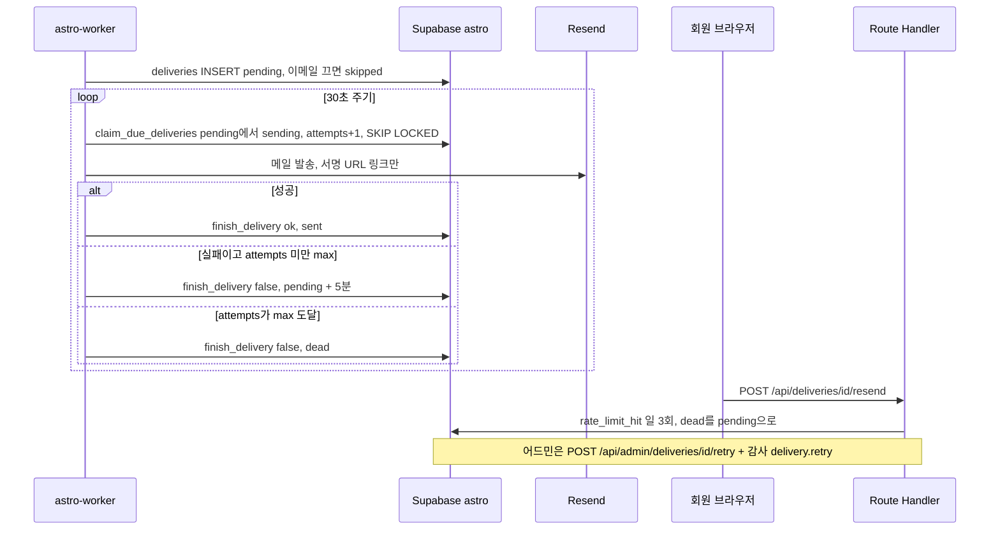

## 5. 상태 머신

### 그림 5-1. `readings.status`

읽는 법: 화살표 옆 글자가 전이를 일으키는 주체입니다. 전이는 BEFORE 트리거가 강제하고 service_role 쓰기에도 적용되어 위반은 `AS001`입니다. `completed`, `failed`, `canceled`는 끝 상태이고 재생성은 `reading_renders`로 합니다. `org_id`, `kind`, `request_id`, `credits_charged`는 바꿀 수 없습니다.

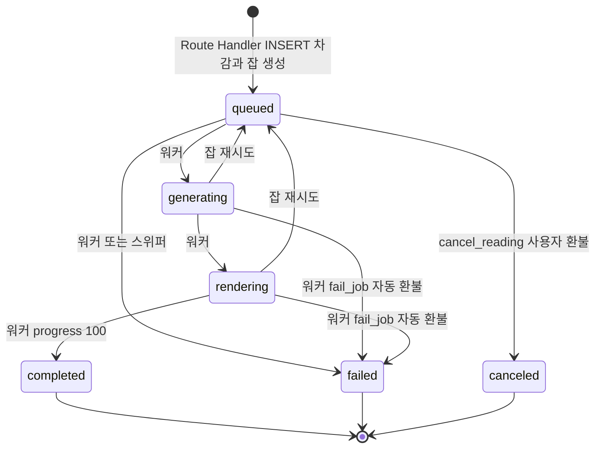

### 그림 5-2. `reading_renders.status`

읽는 법: PDF 렌더 한 건의 상태입니다. 최초 렌더는 리딩 생성 때 함께 만들어지고(0크레딧), 테마 변경 재생성은 5크레딧을 차감한 새 행입니다. `succeeded`가 되려면 `pdf_path`가 필수이고, 그때 `readings.current_render_id`가 갱신됩니다.

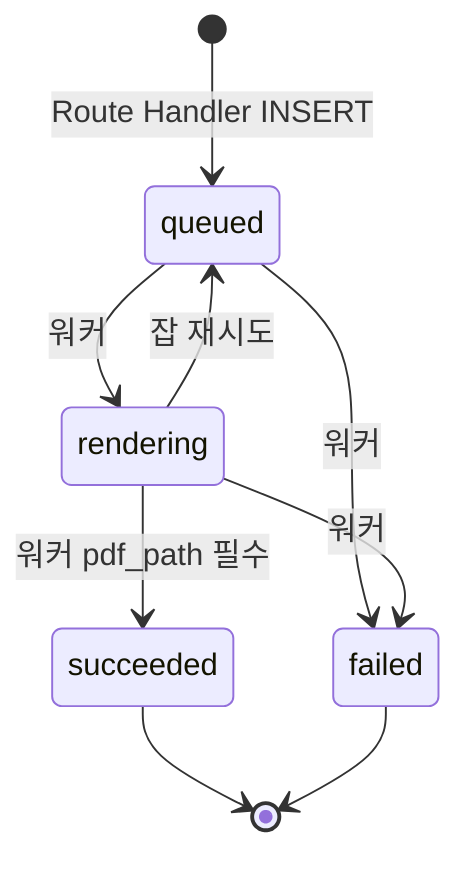

### 그림 5-3. `deliveries.status`

읽는 법: 이메일 발송 outbox 한 건의 상태입니다. `dead`에서만 다시 `pending`으로 돌아갈 수 있고, 그때 시도 횟수 초기화와 감사 기록을 서버가 함께 합니다.

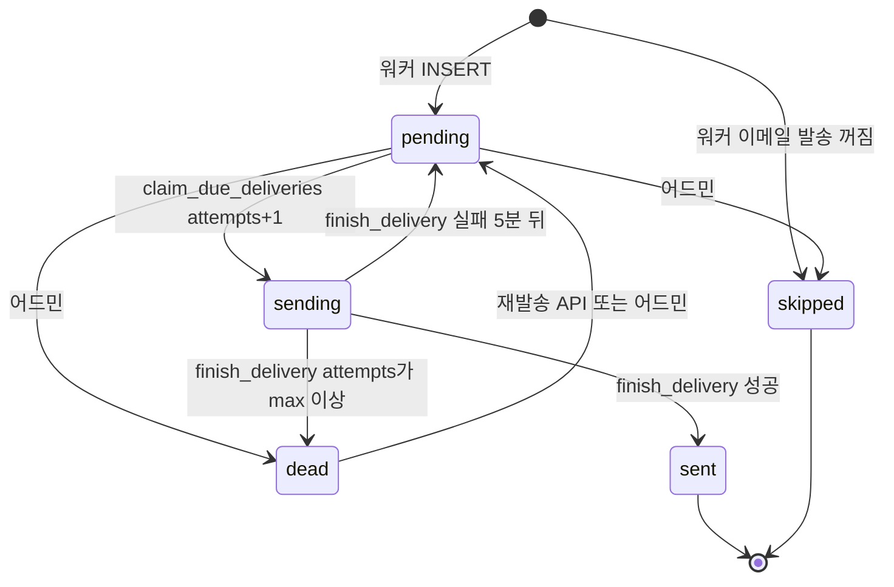

## 6. 화면 흐름

### 그림 6-1. 공개 화면, 가입, 온보딩

읽는 법: 왼쪽 공개 화면은 로그인 버튼 없이 쓸 수 있습니다. 가입 뒤에는 콜백에서 환영 크레딧이 지급되고, OAuth 첫 로그인이면 약관 동의(제안 경로)를 거쳐 AI 처리 방식 동의 화면을 지난 뒤 대시보드로 갑니다. Stage A에서는 `/signup`과 `/auth/verify`가 없습니다.

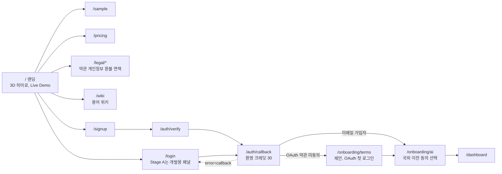

### 그림 6-2. 대시보드와 어드민

읽는 법: 왼쪽 위 `/dashboard`가 시작점입니다. 보관함에서 대상을 등록하고 리딩 시작 스테퍼 4단계를 거치면 리딩 상세로 가고, 잔액이 부족하면 크레딧 화면으로 보냅니다. 오른쪽 아래는 `platform_admin` 전용 별도 셸입니다. 우선순위 P1은 히스토리와 어드민 화면입니다(`03` 1절).

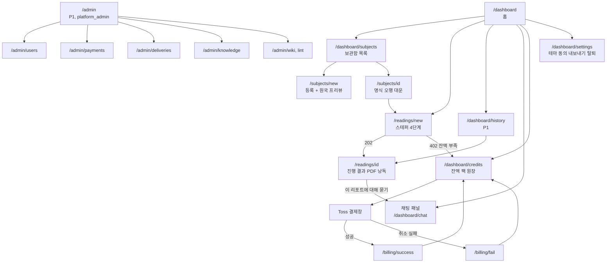

## 7. 보안 경계

### 그림 7-1. 자산·위협·대응의 신뢰 경계

읽는 법: 위에서 아래로 갈수록 믿을 수 있는 영역입니다. 상자 앞 T1~T8은 `SECURITY.md` 2절의 위협 번호이고, § 번호는 `SECURITY_BASELINE.md`의 장입니다. 가장 안쪽 데이터 영역(RLS, 암호화 컬럼, 감사 로그)이 최종 방어선입니다. 생년월일시는 앱 계층 AES-256-GCM으로 암호화해 키를 DB와 분리합니다.

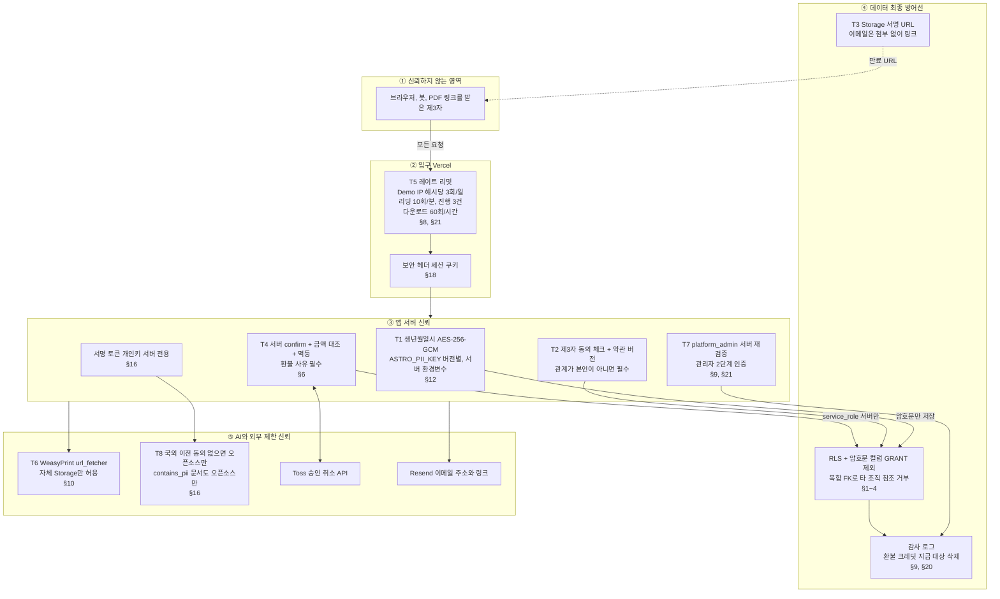

위협별 미결정(`SECURITY.md` 3절·6절): 세션 유휴·절대 만료, CSP 외부 허용 도메인, 감사 로그 보존 기간, 백업·복구 훈련 주기, 알림 수신자, 사고 대응 담당은 "작성 필요"이고, 유출 신고 시한·제3자 동의 문구·미성년 처리·국외 이전 고지·백업과 purge 충돌·운세 광고 규제는 "미확인" 또는 "미결정"이라 그림에 값을 넣지 않았습니다.

## 8. 에이전트 접근 층 (MCP)

**읽는 법:** 기존 웹 경로(위)는 그대로이고, 에이전트용 입구(아래)가 같은 Route Handler 응답과 RLS 읽기를 이용합니다. 이 제품은 생년월일시 등 민감 정보가 중심이라 노출 도구가 6개로 적고, 크레딧을 쓰는 도구는 없습니다. 정본은 `MCP.md`, 공통 규칙은 `../_platform-core/MCP_BASELINE.md`입니다. 점선은 Phase 1.5 이후 또는 미결정(D-M#)입니다.

### 8-1. API 위에 얹는 MCP 구성

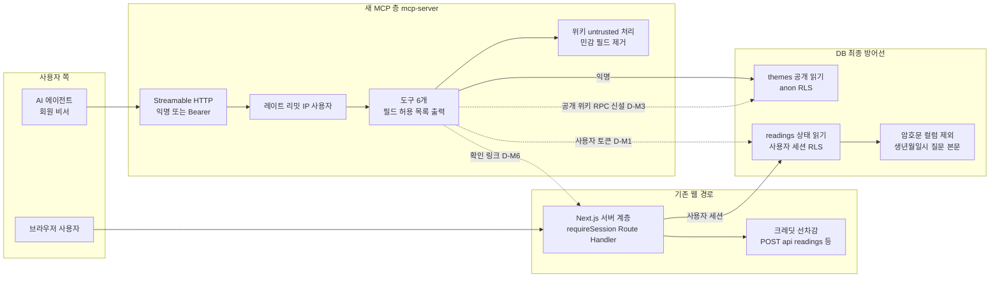

### 8-2. 리딩 준비와 사람 확정 (`astro_prepare_reading`)

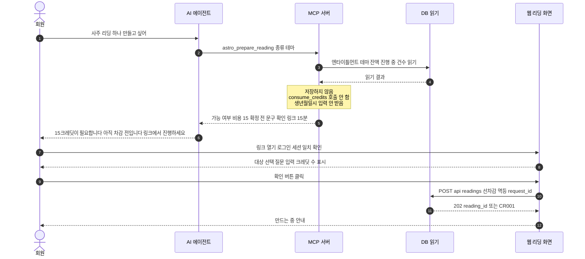

### 8-3. 도구 위험 등급과 노출 단계

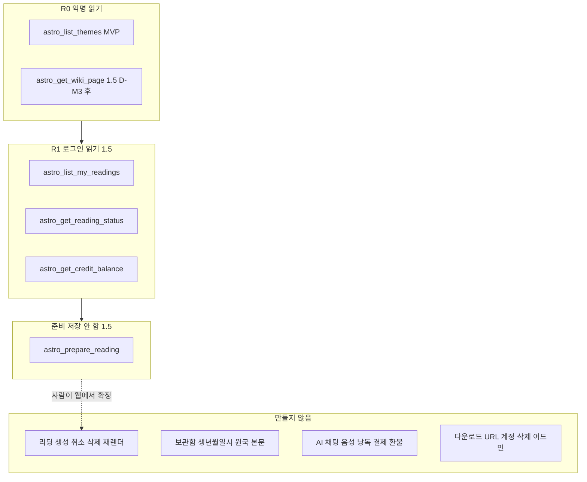

## 문서 불일치

그림에는 아래 각 항목의 앞쪽(01·05·04 문서) 값을 골랐습니다.

| # | 내용 | 문서 A | 문서 B | 그림에서 고른 쪽 |
|---|---|---|---|---|
| 1 | 이메일 재발송이 가능한 상태 | `04_API.md` 2절: `POST /api/deliveries/[id]/resend`의 오류가 "상태가 dead/sent 아님" 409라서 sent에서도 재발송이 되는 것처럼 읽힘 | `05_DATA_MODEL.md` 3.3절: `sent`는 전이 없음, `dead`만 `pending`으로 | 05(그림 5-3, 4-4는 dead만) |
| 2 | PDF 서명 URL 만료 | `SECURITY.md` T3: "만료 시간 짧게" | `01_PRD.md` AS-F-016, `04_API.md`: 7일 서명 URL | 7일(01, 04). 보안 문서의 "짧게"가 7일보다 짧은 값을 뜻하는지 확인 필요 |
| 3 | Live Demo 입력 저장 여부 | `SECURITY.md` T5: "입력은 저장하지 않는지 확인 필요"(미확인) | `01_PRD.md` AS-F-024, `04_API.md`: 입력 저장·로그 금지(확정 문장) | 저장 안 함(01, 04) |
| 4 | 히스토리 화면의 범위 | `01_PRD.md` AS-F-021: 대시보드에 히스토리 포함(MVP 기능) | `03_SCREENS_UX.md` 1절: `/dashboard/history` 우선순위 P1 | 03의 P1 표기(그림 6-2) |
| 5 | MCP 공개 위키 읽기 | `MCP.md`의 `astro_get_wiki_page`는 읽기 전용 공개 RPC가 필요 | `04_API.md` 2.1절 하단: 공개 위키는 서버 컴포넌트가 service_role로 읽음(MCP 경로는 service_role 금지) | 그림 8-1에 점선(D-M3)으로 표시 |
| 6 | MCP 리딩 목록 | `MCP.md`의 `astro_list_my_readings`는 목록 읽기 경로가 필요 | `04_API.md`에는 `GET /api/readings/[id]`만 있고 목록 Route Handler 없음(`03_SCREENS_UX.md` 3절은 RLS로 `readings` 직접 읽기) | RLS 직접 읽기(D-M4) |
| 7 | MCP 잔액 읽기 | `MCP.md`의 `astro_get_credit_balance`는 잔액 읽기 경로가 필요 | `03_SCREENS_UX.md` 3절은 `credit_balances`를 쓰지만 `04_API.md`·`05_DATA_MODEL.md`에 정의 없음 | 정의 확인 필요(D-M5), 그림에서는 "DB 읽기"로만 표기 |
| 8 | 외부 AI 제공자 전송 범위 | `SECURITY.md` T8·`CLAUDE.md`: 생년월일시 원문과 실명은 어떤 AI 제공자에도 보내지 않음 | `MCP.md`: 에이전트의 모델 제공자는 이 제품이 통제하지 못하는 경로. 도구 출력에서 해당 필드를 빼는 것으로만 대응 | 도구 출력에서 제외(D-M7 법무 확인) |

## 갱신 규칙

`01_PRD.md`, `02_ARCHITECTURE.md`, `03_SCREENS_UX.md`, `04_API.md`, `05_DATA_MODEL.md`, `SECURITY.md`를 고치면 해당 절의 그림도 같은 변경에서 함께 고칩니다(표의 "근거 문서 절" 참조).
