# 09 DIAGRAMS: BM-Core

> 모든 수치는 예시(제안)이며 실제 데이터로 교체한다. 다이어그램은 Mermaid 텍스트로 관리하고 렌더링은 도구가 한다.

## 00 도구 분담

| 도구 | 담당 | 이유 |
|---|---|---|
| Mermaid | 01~16 (16종 전부) | 구조·흐름·시퀀스·상태·ERD·일정·점수 분포·비율·퍼널·사분면 등 정적 도식. 문서·PR에 코드 그대로 포함 |
| Recharts | 대시보드 경제성 차트(BEP·LTV·CAC·매출 전망 실측 값), Waterfall·Funnel | 값이 계산 결과에 따라 바뀌고 화면 인터랙션이 필요 |
| React Flow | 인터랙티브 BM 캔버스 | 노드 편집·드래그 등 사용자 조작 |

원칙: Mermaid 문자열을 직접 관리하지 않고, Postgres 정규화 데이터를 정본으로 Mermaid 코드를 생성한다(Diagram Engine). React Flow·PDF·AI 문서가 같은 데이터를 재사용한다. 본 문서의 코드는 현재 수기 작성본이며, 정본 데이터 연결 후 생성 방식으로 대체한다.

## 01 전체 비즈니스 운영 구조

아이디어부터 사업계획서 생성까지 전체 흐름과 스코어 기준 분기(80점·60~79점·40~59점·40점 미만, 예시 제안).

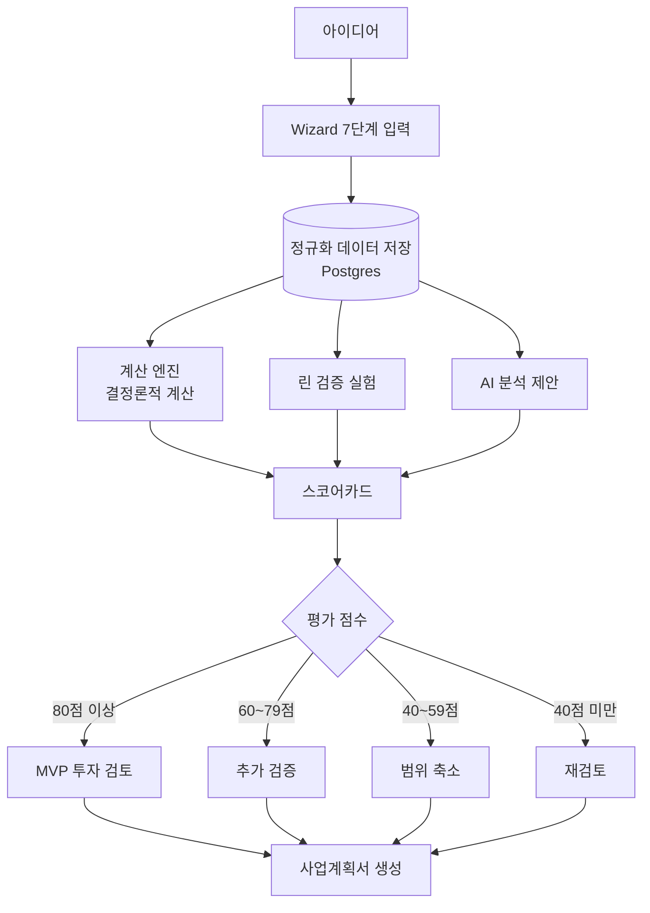

## 02 Wizard 사용자 여정

Wizard 1~7단계를 거쳐 분석 대시보드에 도달하는 순서.

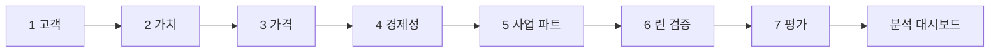

## 03 기술 아키텍처

Frontend, Application, Infra 세 계층과 각 구성 요소, 비동기 작업 경로.

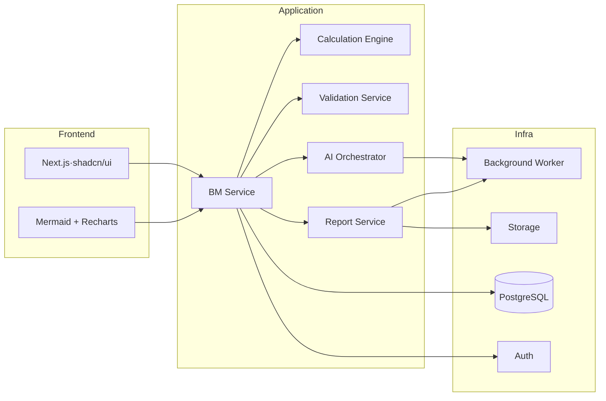

## 04 ERD (개념 모델)

팀장 요소 목록 기반 개념 ERD(수기 작성). 마이그레이션 확정 후 `sql2erd`로 재생성하여 대체한다.

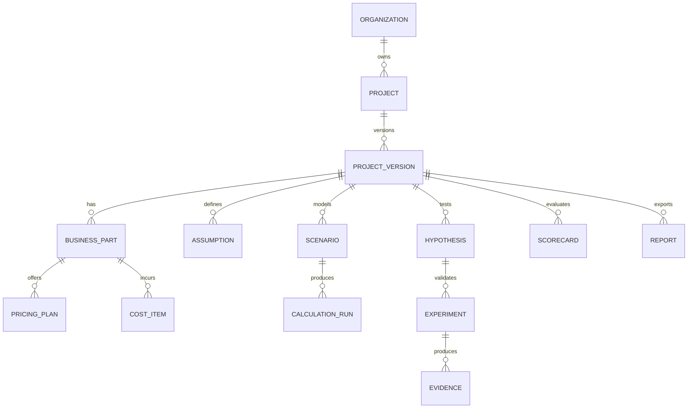

## 05 AI 분석 시퀀스

Wizard 저장 경로와 AI 분석 요청부터 승인·저장에 이르는 흐름.

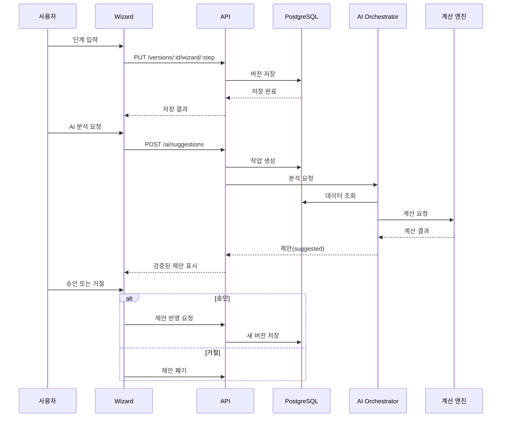

## 06 린 검증 의사결정 트리

검증 단계별 통과 기준(예시 제안)을 확인하고, 미달 시 문제 재정의·가치 제안 개선·가격 검증으로 분기.

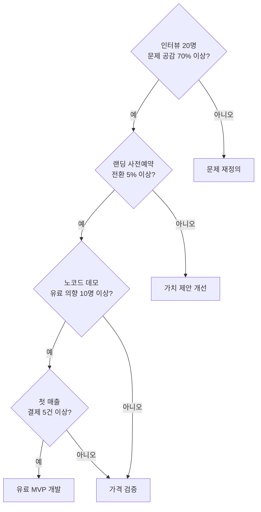

## 07 사업성 점수 분포

5개 축의 점수 분포(만점 20점 기준, 예시 제안).

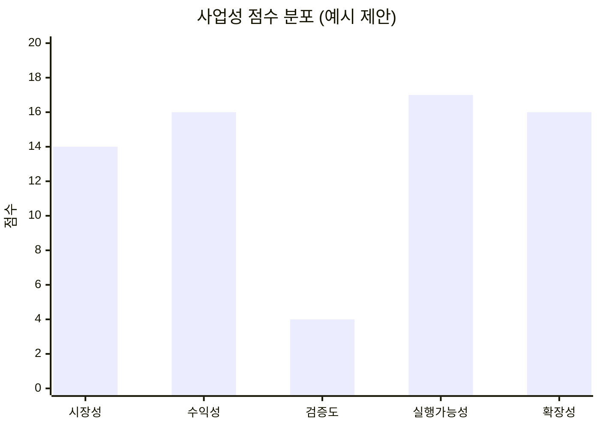

## 08 평가 상태 전이

평가 상태 값(영문 enum 이름)과 전이 조건. 80점 이상이면서 필수 조건을 충족해야 Ready가 된다(예시 제안).

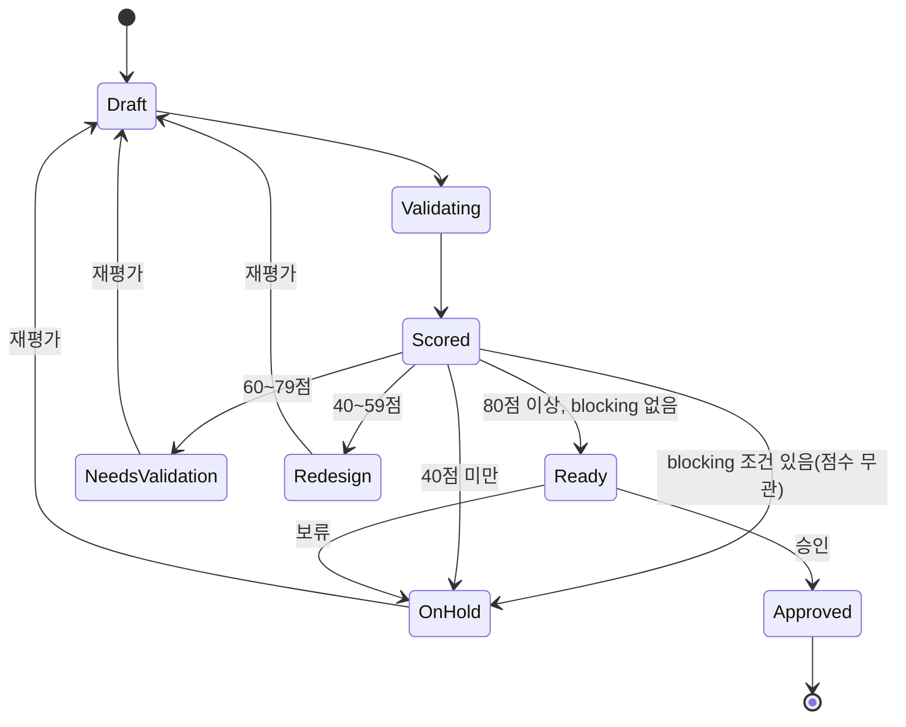

## 09 개발 로드맵 Gantt

12주 개발 일정. 시작일은 예시이며 1~2주 검증·설계부터 12주 결제·계측·운영까지 구간별로 나눈다.

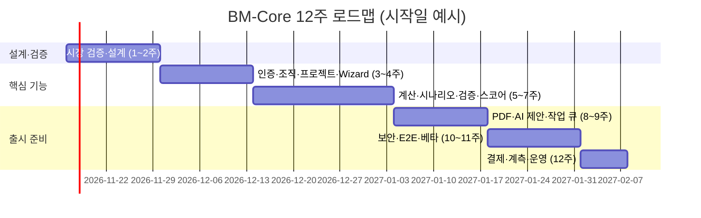

## 10 수익 흐름 Sankey

월 매출이 변동비·공헌이익으로 나뉘고, 공헌이익이 고정비와 영업이익으로 배분되는 흐름(만원/월, 예시 제안).
노드 대응: Revenue=총매출, Variable cost=변동비, Contribution=공헌이익, Fixed cost=고정비, Operating profit=영업이익 (Mermaid sankey 파서가 한글 노드명을 받지 않아 영문 표기).

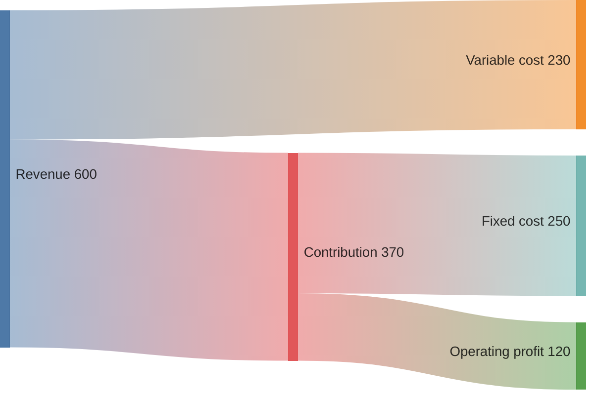

## 11 고객 유입 퍼널

방문에서 첫 달 활성까지의 전환 단계(전환율은 예시 제안).

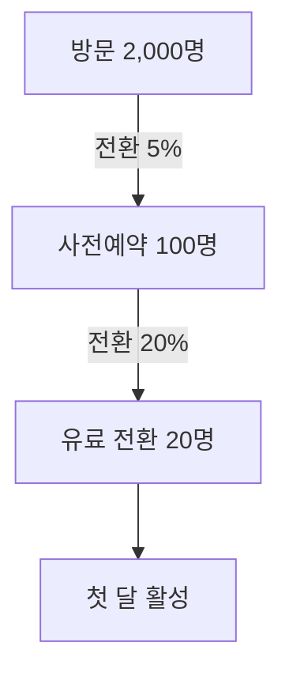

## 12 멀티테넌트 구조

조직별로 프로젝트와 BM 버전이 분리되고, Supabase Auth와 RLS로 조직 간 접근을 차단하는 구조.

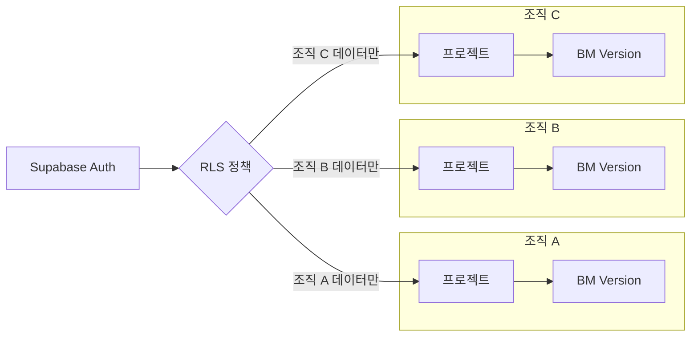

## 13 사업 아이템 우선순위

수익성과 실행가능성 기준으로 사업 아이템 4개를 배치한 사분면(좌표는 예시 제안).

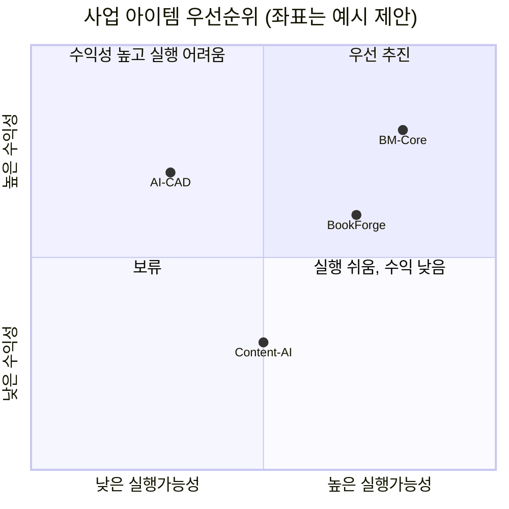

## 14 매출 성장 시나리오

1~6월 MRR 추이의 기준 시나리오(첫 번째 선)와 낙관 시나리오(두 번째 선). 6월 기준 값 262만원은 PRD의 MRR 시뮬레이션과 맞춘 값이고, 나머지 월별 값은 예시 제안이다.

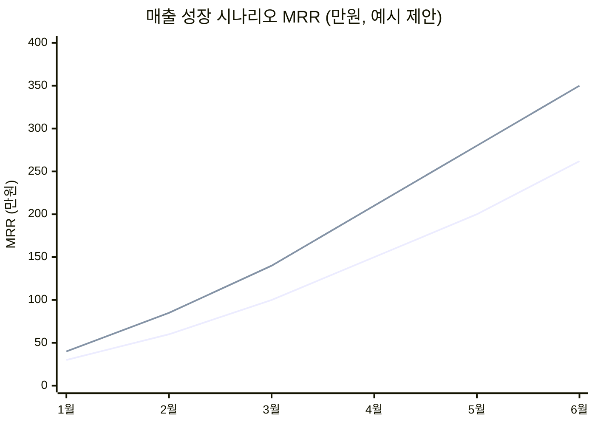

## 15 비용 구성

월 비용의 항목별 비율(%, 예시 제안).

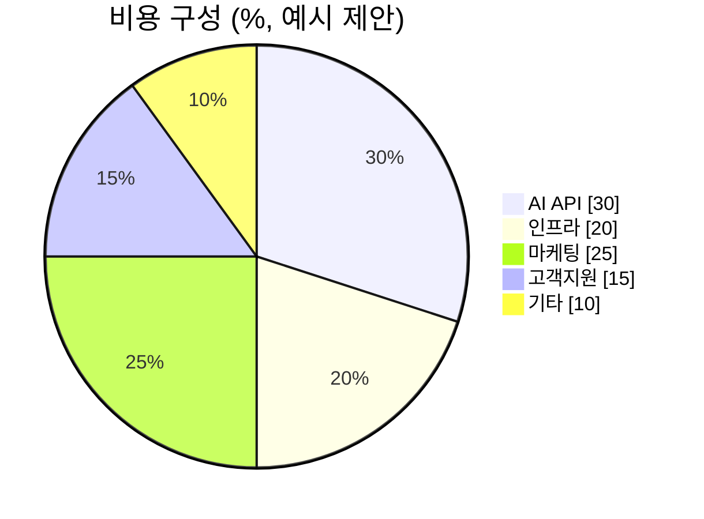

## 16 기능 개발 우선순위

사업 가치와 구현 난이도 기준으로 주요 기능을 배치한 사분면(좌표는 예시 제안).

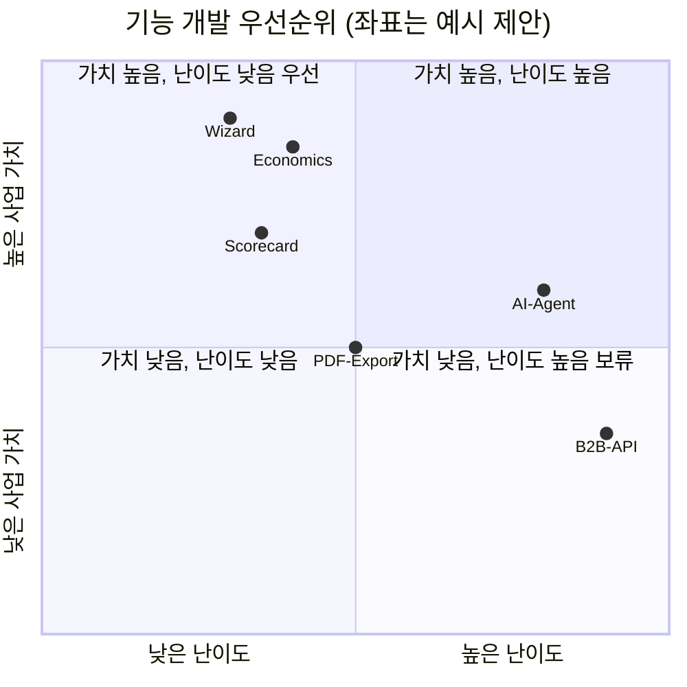
