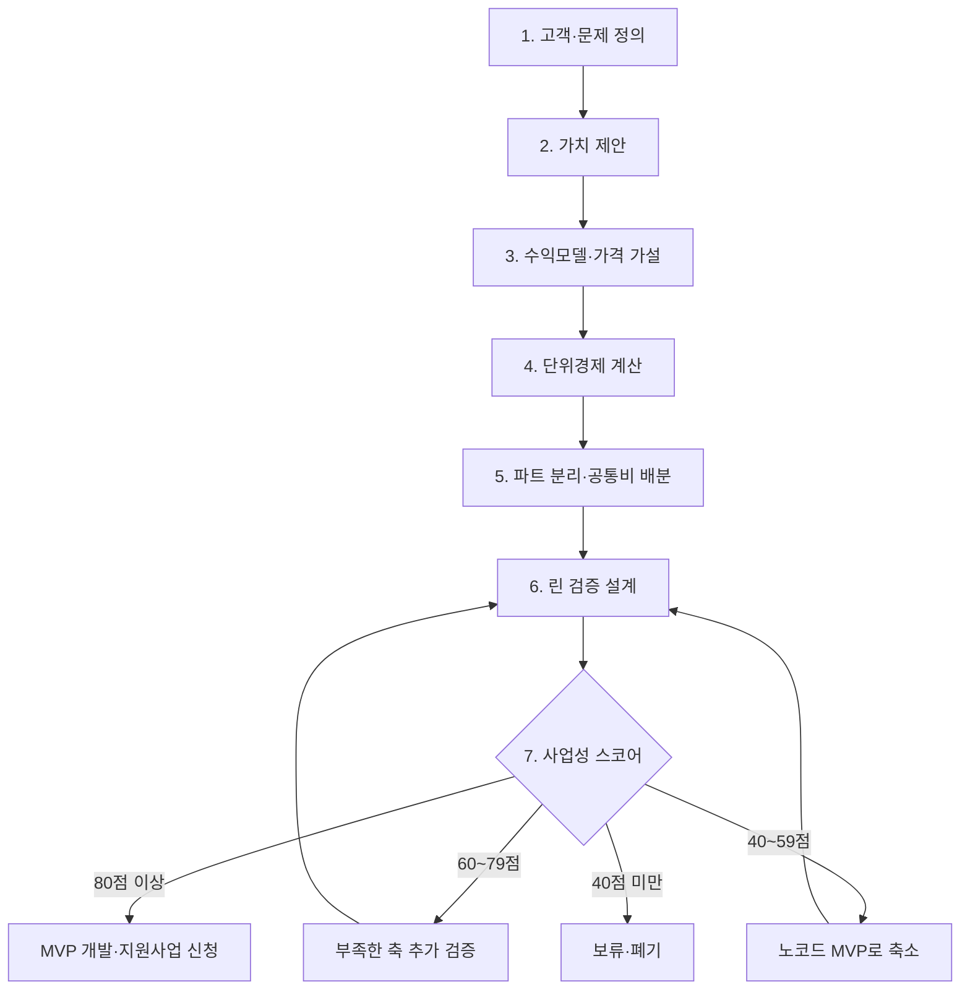
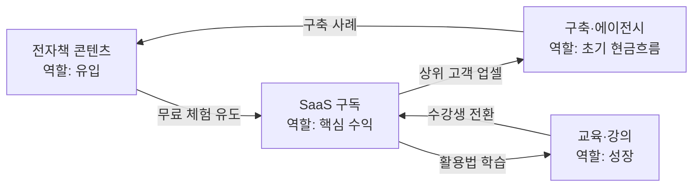

# BM 원본 자료 (사용자 제공, 2026-11-11) — 정리본

> 모든 수치는 가정치(제안). 검증하며 실제 데이터로 교체.

## A. BM 모델 구축 7단계 + 실습 예시 (BookForge: 1인 작가용 AI 전자책 제작 SaaS, 가칭)

### 전체 흐름

### 1단계 고객·문제 정의
| 항목 | 예시 |
|---|---|
| 타깃 | 책을 내고 싶은 직장인·강사·전문가 (비개발자) |
| 문제 | 원고 정리, 표지, 편집, 유통 등록이 각각 다른 도구와 외주라 한 권에 수십만 원, 수 주가 걸림 |
| 현재 대안 | 외주(크몽), 직접 작업(한글·캔바), 출판 대행 |
| 검증 질문 | "지금 전자책 한 권에 얼마를 쓰고 있나요?" |

### 2단계 가치 제안
"원고 초안만 올리면 하루 만에 유통 가능한 전자책 파일을 만들어 준다." 정량 표현이 핵심(비용 80% 절감, 기간 2주→1일).

### 3단계 수익모델·가격 가설
| 요금제 | 가격 | 내용 |
|---|---|---|
| Free | 0원 | 1권 체험(워터마크) |
| Pro | 월 29,000원 | 월 3권, 표지·편집 포함 |
| 크레딧 | 권당 9,900원 | 구독이 부담스러운 고객용 |
| 구축(B2B) | 건당 300만원 | 출판사·교육기관 전용 |
가격 근거: 경쟁 외주 단가(권당 30~50만원) 대비.

### 4단계 단위경제 (Pro)
| 항목 | 값 |
|---|---|
| ARPU | 29,000원 |
| 변동비(AI API 5,500 + 결제수수료 1,000 + CS 2,200) | 8,700원 |
| 공헌이익 | 20,300원 (70%) |
| 월 이탈률 | 5% 가정 |
| LTV | 20,300 ÷ 0.05 = 406,000원 |
| CAC 상한 | 406,000 ÷ 3 ≈ 135,000원 |
| 손익분기 | 월 고정비 300만원 ÷ 20,300 ≈ 148명 |

### 5단계 파트 분리·공통비 배분

| 파트 | 역할 | 수익모델 | 공통비 배분 기준 |
|---|---|---|---|
| A. SaaS | 핵심 수익 | 구독·크레딧 | 서버·API는 사용량 기준 |
| B. 전자책 | 유입 | 건당 판매 | 인건비는 매출 비중 |
| C. 교육 | 성장 | 강의 판매 | 인건비는 매출 비중 |
| D. 구축 | 현금흐름 | 프로젝트 | 인건비는 투입 시간 기준 |

### 6단계 린 검증 설계 (MVP 전)

퍼널 가정: 방문 2,000명 → 사전예약 100명(5%) → 유료 전환 20명(20%). 통과 기준은 실험 전에 숫자로 적어 둔다.

### 7단계 사업성 스코어 (예시)
| 축 | 만점 | 점수 | 근거 |
|---|---|---|---|
| 시장성 | 20 | 14 | 타깃 명확, 시장 규모 근거 보강 필요 |
| 수익성 | 20 | 16 | 공헌이익률 70%, LTV/CAC 3배 설계 |
| 검증도 | 20 | 4 | 아직 인터뷰·사전예약 전 |
| 실행가능성 | 20 | 17 | 1인 + AI 자동화로 운영 가능 |
| 확장성 | 20 | 16 | 화이트라벨·교육 연계 |
| 합계 | 100 | 67 | 60~79점: 검증도 보강이 우선 |
결론: 개발 시작이 아니라 6단계 검증 먼저. 검증 4→14점 이상이면 80점대.

### 데이터 구조 초안
PROJECT ||--o{ PART; PART ||--o{ PRICING_PLAN; PART ||--o{ COST_ITEM; PROJECT ||--o{ HYPOTHESIS; HYPOTHESIS ||--o{ EXPERIMENT; PROJECT ||--o{ SCORECARD; PROJECT ||--o{ DOC_TEMPLATE. 입력 한 번으로 예비창업패키지·초기창업패키지 등 공고별 양식에 자동 매핑.

### 보완 3가지
1. 단위경제 정교화: 고객군별 이탈률, 무료 사용자 운영비, 환불, 세금, 결제수수료 반영.
2. 사업성 평가 객관화: 점수를 정량 지표와 검증 증거(실결제 건수, 인터뷰 기록)에 연결.
3. 지원사업 자동화: 공고 양식·평가항목을 버전별 템플릿으로 관리.

### 제품 라인
- BM-Core 1.0 — 사업성 분석 엔진(7단계 Wizard, 요금제 설계, CAC·LTV·BEP, 점수, 시나리오)
- BM-Agent — AI 사업전략 분석가(시장조사, 경쟁 비교, 가격 추천, 근거 검토)
- BM-Docs — 사업계획서 자동 생성(지원사업 양식 매핑, PDF·DOCX)
개발 순서: BM-Core Wizard+계산 엔진 → 실제 프로젝트 적용 검증 → AI 에이전트·문서 자동화.

## B. BM-Core SaaS 1.0 PRD·아키텍처 (설계 기준일 2026-11-07, Next.js + Supabase)

### 1. 개요
창업 아이디어 → 수익모델·단위경제·검증 실험·사업성 점수·사업계획서용 구조화 데이터를 생성·관리하는 AI 기반 BM 설계 SaaS. "AI 사업계획서 생성기"가 아니라 사업의 경제성과 검증 수준을 지속 관리하는 플랫폼.

포지셔닝 비교(기존 사업계획서 AI vs BM-Core): 기능 문서 자동 작성 vs 사업모델 설계·검증 / 데이터 프롬프트 중심 vs 정규화된 BM 데이터 / 수익성 AI 추정 vs 결정론적 계산 엔진 / 검증 일회성 조언 vs 실험·증거·결과 관리 / 평가 주관적 vs 근거 기반 스코어카드 / 문서 단일 vs 템플릿별 매핑 / 확장 독립 vs API·AI 에이전트·B2B.

핵심 고객: 1순위 예비창업자·1인 창업자, 2순위 창업 컨설턴트·액셀러레이터, 3순위 창업지원기관·교육기관.

제품 목표(가설): Wizard 완료율 60%+, 첫 BM 분석 20분 이내, 30일 재방문 30%+, 무료→유료 5%+, 계산 엔진 테스트 100% 통과, PDF 생성 성공 99%+.

### 2. 아키텍처
스택: Next.js App Router·React·TypeScript / Tailwind·shadcn/ui / React Hook Form·Zod / Supabase Postgres·Auth·Storage / Recharts·React Flow / AI(OpenAI·Claude API) / DB 작업 큐 + Worker / 국내 PG / Sentry + 구조화 로그 / Vercel + Supabase. 모듈형 모놀리스 권장.
설계 원칙: 계산과 AI 판단 분리(계산은 코드), 증거 기반(출처·측정 시점·신뢰도), 버전 관리(재현 가능), 멀티테넌트 RLS, AI·PDF 비동기, MVP 우선(유료 고객 전 복잡한 에이전트·마켓플레이스 제외).

### 3. 7단계 Wizard
| 단계 | 필수 입력 | 완료 조건 |
|---|---|---|
| 1 고객 | 고객군, 핵심 문제, 현재 대안 | 고객군 1개+ |
| 2 가치 | 가치 제안, 해결 방법, 차별성 | 가치 제안 1개 |
| 3 가격 | 수익모델, 가격, 과금 단위 | 유료 플랜 1개 |
| 4 경제성 | 매출, 변동비, 고정비, 이탈률 | 계산 가능 상태 |
| 5 사업 파트 | 파트, 비용 항목, 배분 정책 | 배분 합계 검증 |
| 6 린 검증 | 가설, 실험, 성공 기준 | 실험 1개+ |
| 7 평가 | 평가 기준, 증거, 점수 | 평가 결과 저장 |
단계 상태: draft / in_progress / completed / needs_review. 완료 = 입력 형식 완결(시장 검증 완료와 구분). 자동 저장, 입력 검증, AI 보조, 이전 단계 수정.
AI 보조: 문제를 검증 가능한 문장으로 재구성, 모호한 가치 제안 탐지, 가격모델 대안 비교, 비용 누락 안내, 실험 성공·실패 기준 제안, 평가 근거 부족 표시. AI 값은 suggested 상태 → 사용자 승인 후 반영.

### 4. DB
테이블: organizations(id,name,owner_id), organization_members(org_id,user_id,role), projects(id,org_id,name,status), project_versions(id,project_id,version_no,status), customer_segments(id,version_id,persona,problem), value_propositions(id,version_id,statement,differentiation), business_parts(id,version_id,name,type), pricing_plans(id,part_id,amount,billing_period + 포함 사용량, 초과 단가, 유효 시작일), cost_items(id,part_id,cost_type,amount,allocation_rule_id; 월 고정/사용자당 변동/사용량 기반/일회성 구분), allocation_rules(id,version_id,basis,configuration), assumptions(id,version_id,metric_key,value,unit), economic_scenarios(id,version_id,name,parameters), calculation_runs(id,scenario_id,input_snapshot,result), hypotheses(id,version_id,statement,status), experiments(id,hypothesis_id,method,threshold), evidence(id,experiment_id,storage_path,source_type), scorecards(id,version_id,rubric_version,total_score), score_items(id,scorecard_id,dimension,score), score_evidence(score_item_id,evidence_id), reports(id,version_id,template_id,storage_path), subscriptions(id,org_id,plan_id,status), credit_ledger(id,org_id,delta,reason), jobs(id,org_id,type,status,payload), audit_logs(id,org_id,actor_id,action,created_at).
타입: uuid / 금액 numeric(18,2) / 비율 numeric(12,8)(5%=0.05) / 통화 char(3) / jsonb(스키마 검증 필수) / 상태 text+CHECK / timestamptz(UTC) / 버전 integer.
보안: 조직 소유 관계, RLS, owner/admin/editor/viewer, Service Role은 서버·Worker만, 공유 링크 만료·철회, AI에 최소 정보, 민감 파일 비공개 버킷. 클라이언트 org_id 신뢰 금지.

### 5. API (/api/v1, Route Handlers, Supabase 세션, Zod, cursor 페이지네이션, 비동기는 작업 ID, 낙관적 잠금, Idempotency Key)
POST/GET /projects, GET/PATCH /projects/:id, POST /projects/:id/versions, GET /versions/:id, PUT /versions/:id/wizard/:step, POST /versions/:id/validate, POST /versions/:id/parts, POST /parts/:id/pricing, POST /versions/:id/scenarios, POST /scenarios/:id/calculate, GET /calculations/:id, POST /versions/:id/hypotheses, POST /hypotheses/:id/experiments, POST /experiments/:id/evidence, POST /versions/:id/scorecards, POST /versions/:id/reports, GET /jobs/:id, POST /ai/suggestions.
계산 API 예: 요청 {scenarioVersion:3, mode:"full", idempotencyKey}. 응답 {calculationId, engineVersion:"1.0.0", currency:"KRW", results:{arpu:29000, variableCost:8700, contributionMargin:20300, contributionMarginRate:0.7, ltv:406000, cac:90000, ltvCacRatio:4.51, breakEvenCustomers:148}, warnings:["LTV assumes constant monthly churn","Customer lifetime is not yet validated"]}. CAC 90,000은 실제 CAC 가정; 135,000은 목표 LTV/CAC 3배의 허용 CAC 상한 → 별도 필드.
오류: 400 구조 / 401 인증 / 403 권한(타 조직) / 404 / 409 버전 충돌 / 422 도메인 검증(음수 이탈률) / 429 한도(AI 크레딧 소진) / 500. 결제·크레딧 차감·보고서 생성은 중복 실행 방지.

### 6. 계산 엔진
공식: ARPU=기간 매출÷평균 유료 고객 / 공헌이익=매출−변동비 / 공헌이익률=공헌이익÷매출 / 단순 LTV=월 고객당 공헌이익÷월 이탈률 / LTV/CAC=LTV÷실제 CAC / CAC 회수기간=CAC÷월 고객당 공헌이익 / BEP 고객=월 고정비÷월 고객당 공헌이익 / MRR / ARR=MRR×12 / 월 영업손익=총공헌이익−월 고정비. 단순 LTV는 이탈률 일정 가정 → 코호트 LTV로 확장.
BookForge: 공헌이익 20,300(70%), LTV 406,000, BEP 148명, CAC 90,000 가정 시 LTV/CAC 4.51.
시나리오(월 29,000 공통): 보수적 변동비 11,000·이탈 9%·고정비 400만 → BEP 223명, LTV 200,000 / 기준 8,700·5%·300만 → 148명, 406,000 / 낙관적 7,000·3%·250만 → 114명, 약 733,333.
모듈: packages/bm-engine/{domain(money,metrics,pricing,cost-allocation,scenarios,scorecard), calculators(contribution-margin,customer-ltv,acquisition-cost,break-even,revenue-forecast,scenario-analysis), validators, fixtures, tests}. React·Supabase 비의존 TS 패키지.
정확성: Decimal 연산, 통화별 반올림 명시, 입력·결과·엔진 버전 함께 저장, 0 나누기·음수 공헌이익·이탈률 0% 경계, 배분 합계=원 총비용, 예측과 실측 구분, 결과마다 공식·가정 목록. 공통비 배분은 원인 기준(서버·API=사용량, 인건비=투입 시간, 마케팅=캠페인 귀속) 우선.

### 7. 린 검증
흐름: 가설 등록 → 지표·통과 기준 확정 → 실험 → 증거 수집 → 데이터 품질 확인(불충분이면 실험으로) → 성공/실패/불확정 판정 → 스코어 갱신 → 결정(MVP 확대/가설 변경/보류).
실험 필드: 가설(월 29,000원 구독), 방법(유료 사전예약 랜딩), 지표(실결제 전환율), 표본(적격 방문 500), 통과(결제 10건+), 실패(3건 이하), 기간 14일, 증거(결제 내역·유입), 상태 planned/running/completed, 결과 passed/failed/inconclusive. 통과 기준은 사전 확정 후 버전 잠금.
증거 등급: A 실결제·계약·사용 로그 / B 고객 행동·사전예약 / C 인터뷰·설문 / D 경쟁사·시장조사 / E AI 추정·창업자 가정(미검증). A등급도 통계적 타당성 자동 보장 아님. AI 가정이 검증 데이터처럼 평가되지 않게 출처·측정 방법 필수.

### 8. 스코어카드
5축×20점, 축마다 세부 지표 4개×0~5점: 시장성(고객 명확성, 문제 강도, 시장 접근성, 경쟁 차별성) / 수익성(공헌이익, CAC/LTV, 현금흐름, 가격 수용성) / 검증도(인터뷰, 행동 데이터, 유료 결제, 반복 사용) / 실행가능성(기술, 인력, 자본, 운영·규제) / 확장성(반복 판매, 자동화, 고객 확장, B2B 확장). 판정 기준은 rubric_version 관리. 점수와 승인 분리: blocking_conditions(법적 문제, 실결제 검증 0건 등)이면 85점이어도 보류.

### 9. UI
화면 우선순위: 랜딩 P0, 온보딩(조직 생성·목적) P0, 프로젝트 목록 P0, Wizard P0, 경제성 분석(계산·차트·시나리오) P0, 린 검증 P0, 스코어카드 P0, 보고서 PDF P1, AI 분석 P1, 결제·구독 P1, 조직 관리 P1, 템플릿 관리(지원사업 양식) P2.
대시보드: 사업성 점수 67/100, 공헌이익률 70.0%, 손익분기 148명, 검증 진행 1/5, 점수 구성 막대.
디자인: 금융 분석 SaaS와 프로젝트 관리 도구 중간, 밝은 배경·절제된 블루·넓은 여백, 다크모드 선택, KPI Card·DataTable·Stepper·Scenario Selector·Evidence Drawer, 막대·선·워터폴·민감도 차트, 키보드 탐색·포커스·색 외 상태 표시, 모바일은 조회·간단 수정, 데스크톱은 분석·복잡 입력.

### 10. AI 에이전트 (제품 내부)
Problem Analyst(고객 문제 분석) P1, Pricing Analyst(가격 대안) P1, Cost Auditor(누락 비용·가정 검토) P1, Validation Planner(실험 설계) P1, Score Reviewer(평가 근거 점검) P1, Report Writer(사업계획서 초안) P2.
실행 흐름: 요청 → 작업 큐 → 권한·크레딧·입력 검증 → 데이터 조회 → 프롬프트·모델 선택 → 분석 → JSON 스키마 검증(실패 시 제한 재시도·실패 기록) → 제안 표시 → 승인 시 반영/거절 시 폐기.
통제: 사용자별 요청 한도, 모델별 토큰·비용 기록, 프롬프트 버전, 구조화 출력 검증, 개인정보 최소 전달, 시간 초과·재시도 정책, 승인 이력. Make·n8n은 주변 자동화(알림·CRM·사전예약 수집)만, 계산·핵심 데이터는 앱 내부.

### 11. 로드맵 (12주, 1인 + AI 코딩 에이전트, 공격적 목표 → 14~18주 가능)
1~2주 시장 검증·설계(인터뷰, 랜딩, 데이터 모델; PRD·ERD·UX 확정) / 3~4주 인증·조직·프로젝트·Wizard(7단계 저장) / 5~7주 계산·시나리오·검증·스코어(테스트 통과) / 8~9주 PDF·AI 제안·작업 큐(결과 생성·재현) / 10~11주 보안·E2E·베타(치명 결함 없음) / 12주 결제·계측·운영(제한적 유료 출시).

### 12. 테스트·인수 기준
Wizard 7단계 입력·수정·재진입 / 자동 저장 유실 없음 / 버전 조회·비교 / 계산 공식·경계값 전부 통과 / 배분 합계 일치 / 실험·증거·결과 추적 / 스코어 근거·평가 버전 보존 / AI 스키마 검증·승인 / 보고서=저장 데이터 일치 / 조직 간 접근 차단.
비기능: API p95 500ms, 단순 계산 p95 200ms, Wizard 저장 p95 1s, 가용성 99.5%/월, RPO 24h·RTO 4h, 조직 간 접근 차단 테스트 100%, WCAG 2.2 AA, 최신 Chrome·Edge·Safari.

### 13. 수익화 (가정)
Free 0원(프로젝트 1, 기본 Wizard) / Starter 19,900원(프로젝트 3, 경제성 분석, PDF) / Pro 49,000원(프로젝트 20, AI 분석, 시나리오) / Consultant 129,000원(다중 고객, 팀, 고급 보고서) / Enterprise 별도 견적(조직 관리, 커스텀 템플릿, API). AI 많은 기능은 크레딧·공정 사용.
MRR 시뮬레이션: Starter 50 + Pro 20 + Consultant 5 → 2,620,000원/월, ARR 31,440,000원(할인·환불·부가세·수수료·AI비·이탈 미반영).
월 운영비(인건비 제외): 호스팅 0~5만, Supabase 0~10만, AI API 5~30만, 이메일·모니터링 0~5만, 기타 3~10만, 합계 8~60만.

### 14. 프로젝트 구조
bm-core/{apps/web/{app/{(marketing),(auth),(dashboard),api/v1}, components, features/{projects,wizard,economics,experiments,scorecards,reports}}, packages/{bm-engine,bm-domain,validation,ai-orchestrator,report-engine,ui}, workers/jobs, supabase/{migrations,seed.sql,tests}, docs/{PRD,ARCHITECTURE,DATABASE,API,CALCULATION_ENGINE,DESIGN_SYSTEM,TEST_PLAN,ROADMAP}.md, AGENTS.md, README.md}. 계산 엔진은 기존 테스트 전부 통과해야 병합(CI).

### 15. 위험
AI 허위 시장 근거(높음: 출처 검증·가정 분리) / 부정확한 계산(매우 높음: 독립 엔진·회귀 테스트) / 낮은 유료 전환(높음: 유료 사전예약·가격 실험) / 조직 간 노출(매우 높음: RLS·권한 테스트) / AI 비용 증가(중~높: 크레딧·예산 상한) / 지원사업 양식 변경(중간: 템플릿 버전) / 범위 과다(높음: P0/P1/P2).

### 16. 추천·착수 전 확정 사항
우선순위: 1 Wizard+경제성 엔진(AI 없이도 유료 가치) / 2 실험 관리+스코어 / 3 AI 분석+PDF / 4 컨설턴트·기관 B2B.
착수 전 확정: 초기 핵심 고객(예비창업자 vs 컨설턴트), Wizard 필드·검증, 계산 공식·배분 규칙, 스코어 세부 기준, 무료·유료 경계, 1차 MVP의 AI·PDF 범위, 10명+ 실제 사용자 프로토타입 검증.

## C. Mermaid 시각화 확장 (BM-Core 1.1)
도구 분담: 프로세스·구조=Mermaid flowchart / DB=Mermaid ERD / 일정=Gantt / 매출·비용 흐름=Sankey / 점수·구성비=XY Chart·Pie / 수익성(BEP·LTV·CAC·매출 전망)=Recharts / 인터랙티브 BM=React Flow.
다이어그램 16종:
01 전체 비즈니스 운영 구조(flowchart: 아이디어→Wizard→데이터 저장→계산 엔진·린 검증·AI 분석→스코어카드→평가 분기 80+/60~79/40~59/<40 → MVP 투자 검토/추가 검증/범위 축소/재검토 → 사업계획서 생성)
02 Wizard 사용자 여정(1~7 → 분석 대시보드)
03 기술 아키텍처(Frontend: Next.js·shadcn·Mermaid+Recharts / Application: BM Service·Calculation Engine·Validation Service·AI Orchestrator·Report Service / Infra: PostgreSQL·Auth·Storage·Background Worker)
04 ERD(ORGANIZATION owns PROJECT, versions PROJECT_VERSION, has BUSINESS_PART, offers PRICING_PLAN, incurs COST_ITEM, defines ASSUMPTION, models SCENARIO, produces CALCULATION_RUN, tests HYPOTHESIS, validates EXPERIMENT, produces EVIDENCE, evaluates SCORECARD, exports REPORT)
05 AI 분석 시퀀스(사용자→Wizard→API→PostgreSQL 버전 저장; AI 요청→작업 생성→Orchestrator→조회→계산 엔진 요청→결과→제안→검증된 제안 표시→승인/거절→저장→새 버전)
06 린 검증 의사결정 트리(인터뷰 20명 공감 70%? → 랜딩 사전예약 5%? → 결제 5건? → 유료 MVP; 각 아니요는 재정의/개선/가격 검증)
07 사업성 점수 분포(xychart bar: 14,16,4,17,16)
08 평가 상태 전이(stateDiagram: Draft→Validating→Scored→Ready(80+·필수조건)/NeedsValidation/Redesign; Ready→Approved/보류)
09 개발 로드맵 Gantt(12주, 시작일 예시)
10 수익 흐름 Sankey(만원/월: 총매출 600, 변동비 230, 공헌이익 370, 고정비 250, 영업이익 120)
11 고객 유입 퍼널(방문 2,000 → 사전예약 100(5%) → 유료 20(20%) → 첫 달 활성)
12 멀티테넌트 구조(조직 A·B·C → 프로젝트 → BM Version, Supabase Auth+RLS)
13 사업 아이템 우선순위 quadrant(수익성×실행가능성; BM-Core, BookForge, AI-CAD, Content-AI — 좌표는 예시)
14 매출 성장 시나리오(xychart line, 1~6월, 기준·낙관)
15 비용 구성 pie(AI API 30, 인프라 20, 마케팅 25, 고객지원 15, 기타 10)
16 기능 개발 우선순위 quadrant(사업가치×난이도; Wizard, Economics, Scorecard, AI-Agent, PDF-Export, B2B-API)
대시보드 적용: 사업모델 개요(Flowchart·Mindmap) P0, 경제성(XY·Waterfall) P0, 평가(Bar·Radar·Quadrant) P0, 수익 구조(Sankey·Pie) P1, 시장 검증(Funnel·Timeline) P1, 개발 계획(Gantt·Kanban) P1, 시스템(ERD·Sequence) 내부 관리자, AI 전략(Decision Tree·Mindmap) P2. Waterfall·Funnel은 차트 라이브러리.
원칙: Mermaid 문자열이 아니라 Postgres 정규화 데이터를 정본으로 Mermaid 코드를 생성(Diagram Engine). React Flow·PDF·AI 문서가 같은 데이터 재사용.
