# DIAGRAMS: NOMAD Book Trailer UML 시각화

작성일 2026-10-23. 이해관계자(기획·개발·운영·법무) 소통용 그림 모음입니다. 정본은 이 폴더의 각 문서이며, 그림과 문서가 다르면 문서가 우선입니다. GitHub에서 그림이 바로 렌더링됩니다(Mermaid). 전체 구조는 `../_platform-core/ARCHITECTURE_DIAGRAMS.md`와 같은 스타일입니다.

**제품 한 줄 정의**: 원고(PDF·EPUB·DOCX·MD·TXT)나 FLORA 책을 넣으면 AI가 "팔리는 훅"을 찾아 브리프를 만들고, 장르별 문법으로 스토리보드를 짜고, 장면 이미지·내레이션·자막·음악을 붙여 쇼츠(9:16)·유튜브(16:9)·인스타(1:1, 4:5)·표지 루프 영상을 한 번에 렌더하고, 구매 링크 클릭까지 측정하는 북트레일러 자동화 SaaS입니다(`README.md` 1절).

**근거 문서**: `README.md`, `01_PRD.md`, `02_ARCHITECTURE.md`, `03_SCREENS_UX.md`, `04_API.md`, `05_DATA_MODEL.md`, `SECURITY.md`, `MCP.md`(미작성 상태, 7번 그림 참고), 공통 `../_platform-core/SECURITY_BASELINE.md`.

**표기**: **실선 화살표** = 호출·데이터 흐름, **점선** = 검증·참조·보조 경로, "(제안)" = 문서가 제안이라고 한 값, "(P1)" = MVP 직후 단계. 기능 ID는 `TR-F-nnn`(01_PRD), 오류 코드는 `TRnnn`(04_API 7절)입니다.

| # | 그림 | UML 종류 | 근거 문서 절 |
|---|---|---|---|
| 1 | 사용자와 기능 | 유스케이스 관점 | 01_PRD 1절, 2절, 3절 |
| 2 | 구성요소 | 컴포넌트 | 02_ARCHITECTURE 2절, 3절, 4절, 7절 |
| 3 | 데이터 모델 | 클래스 | 05_DATA_MODEL 1절, 2절, 4절 |
| 4-1 | 원고 분석과 브리프 | 시퀀스 | 04_API 2절, 3절, 4절, 03_SCREENS_UX 2.1절 |
| 4-2 | 장면 이미지·내레이션 생성 | 시퀀스 | 04_API 2절, 6절, 02_ARCHITECTURE 4절 |
| 4-3 | 멀티포맷 렌더 | 시퀀스 | 04_API 2절, 3절, 02_ARCHITECTURE 4절 |
| 4-4 | 구매 링크 클릭과 외부 승인 | 시퀀스 | 04_API 2절, 3절, 03_SCREENS_UX 2.5절 |
| 5-1 | 실행·렌더 상태 | 상태 머신 | 05_DATA_MODEL 3절 |
| 5-2 | 분석 상태와 트레일러 상태 | 상태 머신 | 05_DATA_MODEL 3절 |
| 5-3 | 외부 승인 상태 | 상태 머신 | 05_DATA_MODEL 2.15절, 3절 |
| 6 | 화면 흐름 | 흐름도 | 03_SCREENS_UX 1절, 2절, 8절 |
| 7 | 보안 경계 | 신뢰 경계 | 05_DATA_MODEL 4절, 7절, 02_ARCHITECTURE 2절, 6절, 04_API 1절 |
| 8-1 | 웹 경로와 MCP 층 (제안) | 컴포넌트 | MCP.md 2·3절, 04_API 1·2절 |
| 8-2 | 렌더 준비와 사람 확정 | 시퀀스 | MCP.md 6절, 04_API 2절 |
| 8-3 | 도구 위험 등급과 노출 단계 | 블록 | MCP.md 1·2절 |

## 1. 사용자와 기능

읽는 법: 왼쪽이 역할, 오른쪽이 기능입니다. 실선은 MVP, 점선은 P1·Phase 2입니다. 역할 접근은 03_SCREENS_UX 1절 표, 플랜(free, creator, publisher)은 01_PRD 4절을 따릅니다.

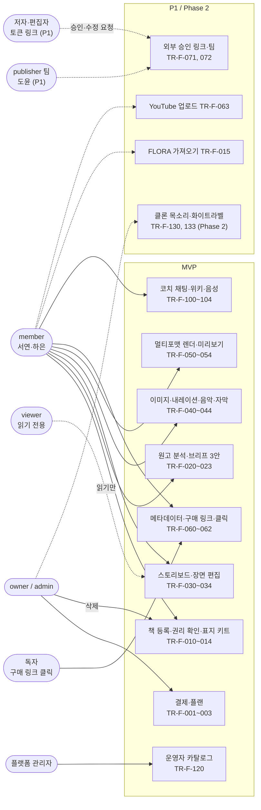

## 2. 구성요소

읽는 법: 제품 고유 모듈은 오케스트레이터, 렌더러, 컴포지션 패키지입니다. 오케스트레이터는 fal·ElevenLabs 키를, FastAPI는 LLM 키를 가지며 서로 직접 호출하지 않습니다(02_ARCHITECTURE 2절 "렌더러와 FastAPI의 경계"). 미리보기와 서버 렌더는 같은 컴포지션 코드를 씁니다. 코어는 `core` 한 묶음으로 줄였습니다.

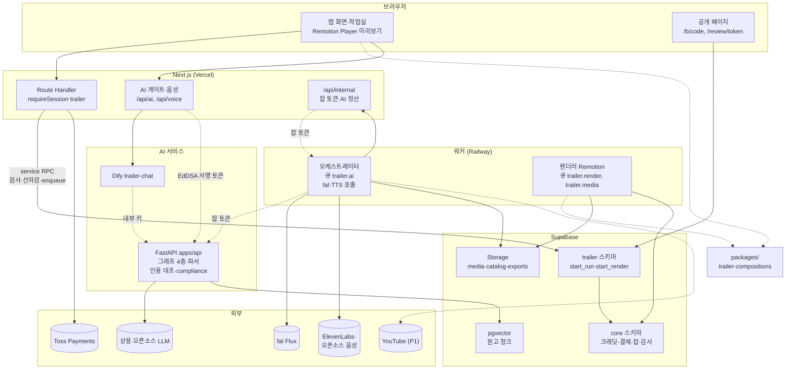

## 3. 데이터 모델

읽는 법: `trailer` 스키마 17개 중 핵심 14개입니다(`book_digests`, `reviews`, `runtime_config`는 5번 그림과 문서 참고). 모든 하위 테이블은 `(부모 id, org_id)` 복합 FK로 같은 조직 행만 가리킵니다. 접근 주체는 note에 적었고, 서버 컬럼은 사용자 GRANT가 없고 트리거가 되돌립니다.

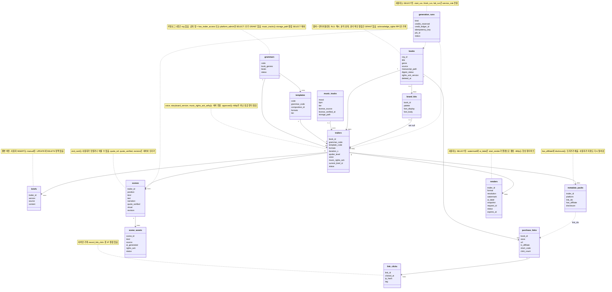

## 4. 핵심 시퀀스

### 4-1. 원고 분석과 브리프 (TR-F-010, 012, 020, 021)

읽는 법: 위에서 아래로 시간 순서입니다. 권리 확인(`TR003`)과 선행 단계(`TR004`)는 DB 함수 `start_run` 안에서 검사하고, 선차감·잡 등록도 같은 트랜잭션입니다. Route Handler는 크레딧 RPC를 직접 부르지 않습니다.

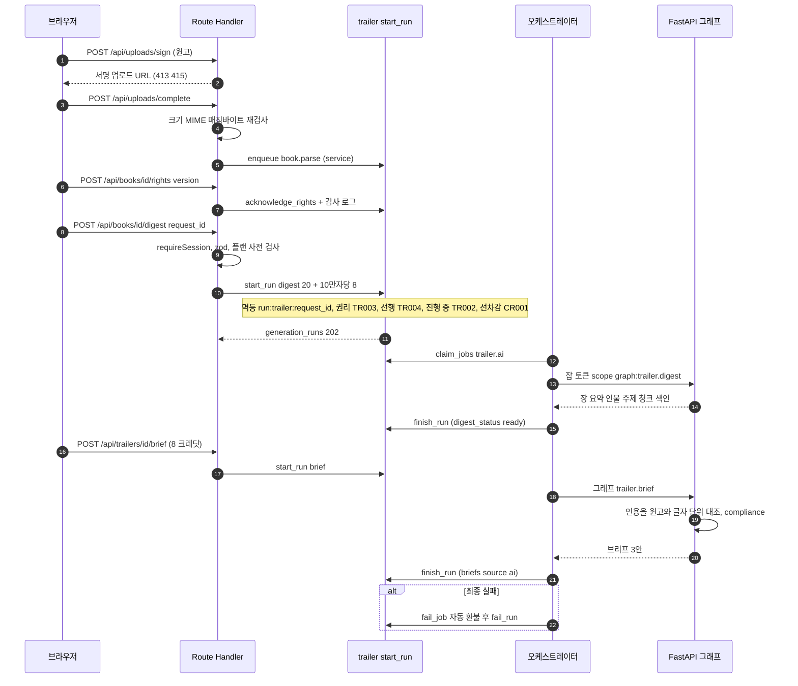

### 4-2. 장면 이미지·내레이션 생성 (TR-F-040, 041, 042)

읽는 법: 이미지와 TTS는 오케스트레이터가 호출합니다(LLM 키 없음). 내레이션은 첫 결과에서 제공자·보이스가 고정되고, 이후 다른 목소리 결과는 `finish_run`이 거부합니다(같은 목소리 규칙).

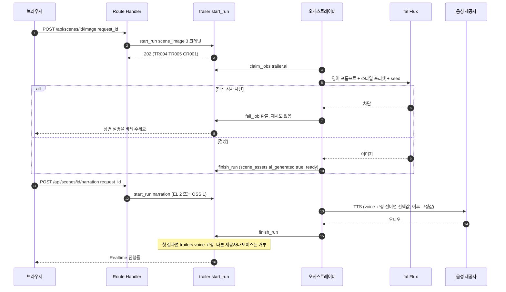

### 4-3. 멀티포맷 렌더 (TR-F-050, 052, 080)

읽는 법: 렌더 직전 compliance와 인용 검증이 서버에서 한 번 더 일어납니다. 워터마크·AI 표시는 요청 입력이 아니라 `start_render`가 플랜으로 정해 스냅샷에 고정하고, 렌더러는 스냅샷만 읽습니다.

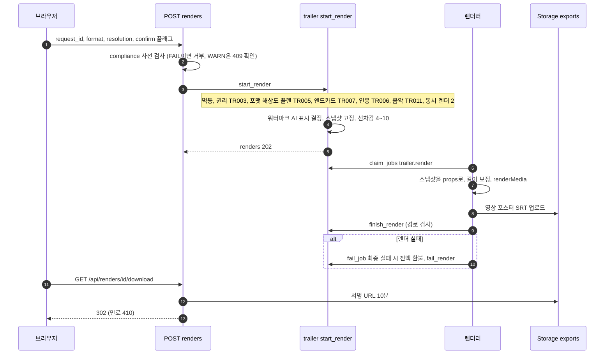

### 4-4. 구매 링크 클릭과 외부 승인 (TR-F-062, 071, P1)

읽는 법: 로그인 없는 공개 입구 두 개입니다. 둘 다 앱 서버가 코드·토큰 해시만 service RPC에 넘기고 레이트 리밋이 붙습니다. 승인 링크 토큰 원문은 만들 때 한 번만 보여 주고 DB에는 sha256만 저장합니다.

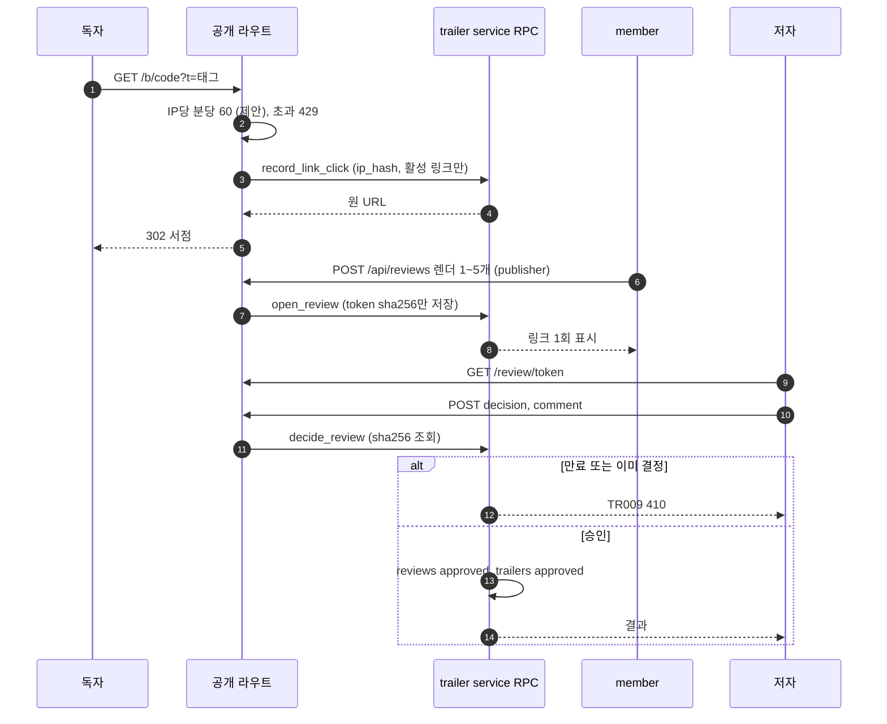

## 5. 상태 머신

### 5-1. 실행·렌더 상태 (`generation_runs.status`, `renders.status`)

읽는 법: 사용자는 쓸 수 없고 서버(워커 포함)만 바꿉니다. 트리거 `enforce_run_status_transition`이 service에도 적용되어 허용 전이 밖은 `TR001`입니다. queued에서 succeeded로 바로 갈 수 없습니다.

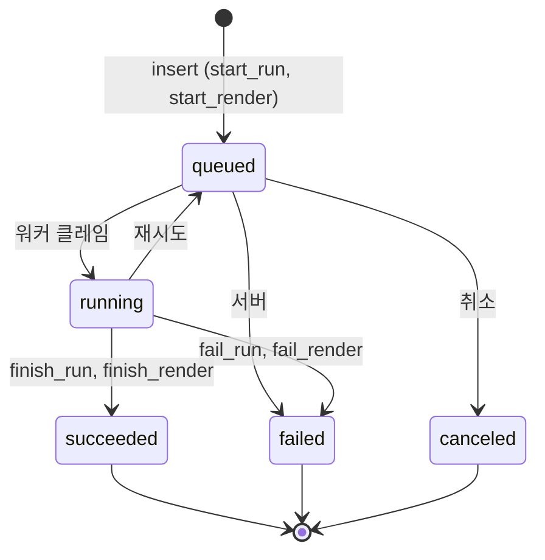

### 5-2. 분석 상태와 트레일러 상태 (`books.digest_status`, `trailers.status`)

읽는 법: 분석 상태는 서버가 바꾸고, 원고가 바뀌면 트리거가 `none`으로 되돌립니다. 트레일러는 멤버가 active와 archived를 오가고, approved는 480p가 아닌 성공 렌더가 있어야 하며(`TR004`) 승인 링크의 `decide_review`도 이 상태를 만듭니다.

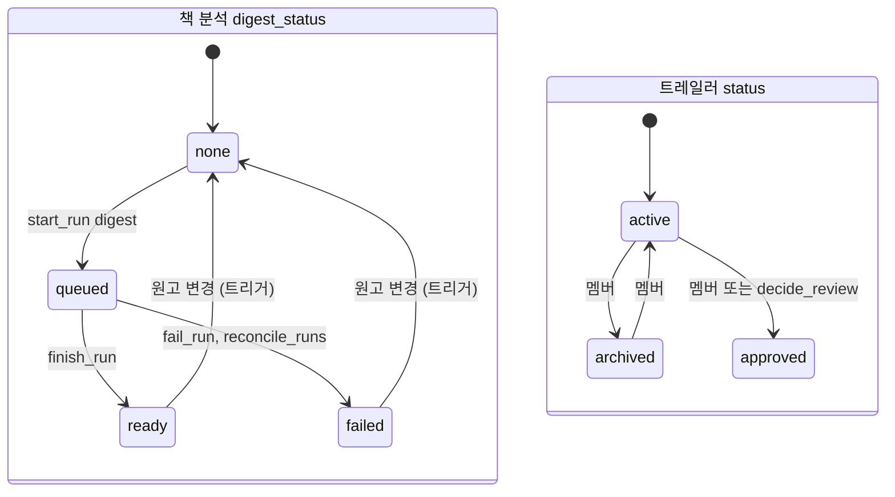

### 5-3. 외부 승인 상태 (`reviews.status`, P1)

읽는 법: 종료 상태는 고정입니다. 전이는 서버(`decide_review`, 만료 크론, 철회)만 일으키고 트리거 `enforce_review_transition`이 강제합니다.

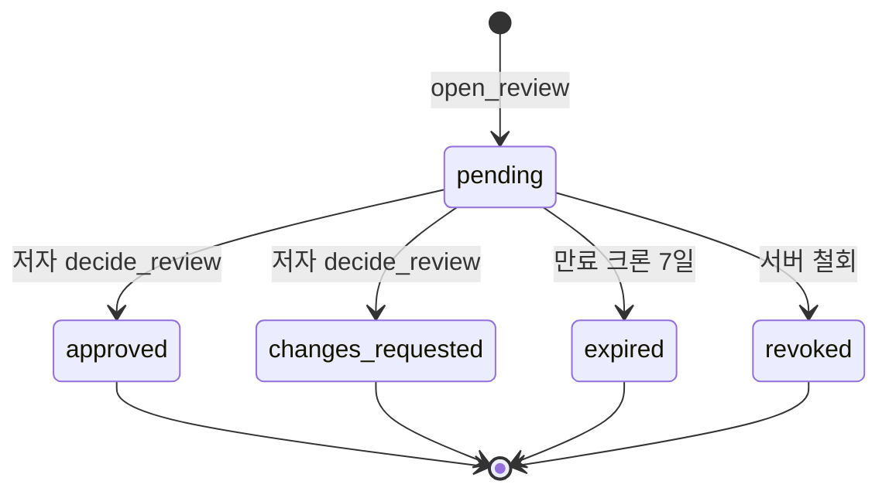

## 6. 화면 흐름

읽는 법: 가입 → 동의 → 책 등록 마법사 → 트레일러 만들기 → 단계 화면(브리프, 작업실, 렌더, 게시) 순서가 첫 사용 흐름입니다. 단계 화면은 트레일러 머리줄의 탭으로 이동합니다(8.5절, D-18 기본값). 점선은 P1 또는 어디서나 여는 화면입니다.

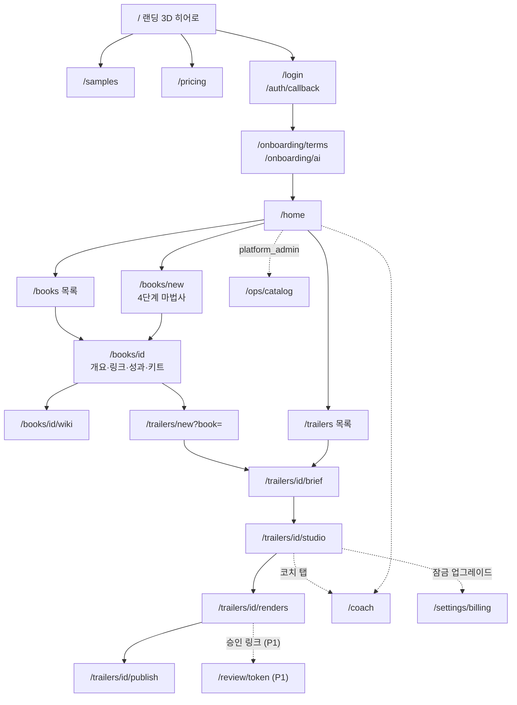

## 7. 보안 경계

읽는 법: 바깥에서 안쪽으로 신뢰가 높아집니다. 이 제품의 `SECURITY.md`는 아직 양식만 있고 자산·위협 표가 비어 있어서(맨 끝 "문서 불일치"), 이 그림은 05_DATA_MODEL 4절·7절, 02_ARCHITECTURE 2절·6절, 04_API 1절의 차단 설계를 근거로 그렸습니다. 공통 규칙은 `SECURITY_BASELINE.md`의 장 번호(§)로 참조합니다. 리뷰 "높음" 번호는 `README.md` 2.1절의 두 리뷰(Shorts Maker, Toon-Factory) 번호입니다.

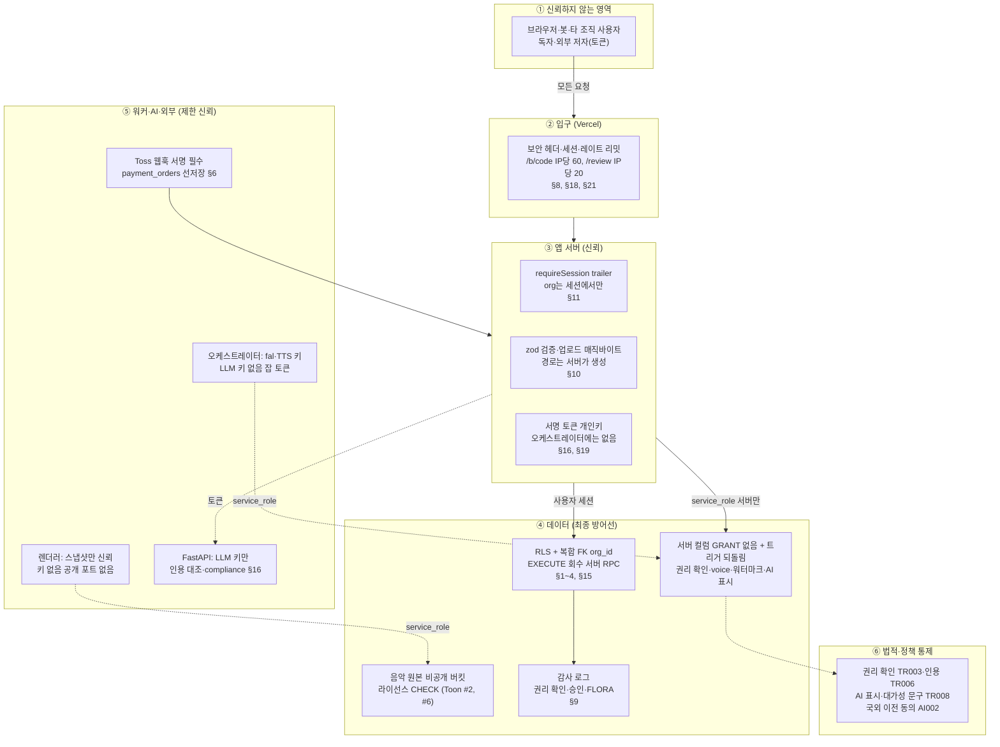

## 8. 에이전트 접근 층 (MCP)

**읽는 법:** 기존 웹 경로(위)는 그대로이고, 에이전트용 입구(아래)는 같은 서버 계층과 RLS 조회를 거칩니다. 정본은 `MCP.md`, 공통 규칙은 `../_platform-core/MCP_BASELINE.md`입니다. 점선은 Phase 1.5 이후 또는 미결정(D-M#)입니다. 이 제품은 원고와 그 파생물(분석, 브리프, 장면)과 렌더 파일을 도구로 내보내지 않고, 생성·렌더·배포 도구를 만들지 않습니다. 읽는 범위가 좁아 이 층 전체를 베타 이후 호출 로그를 보고 넓히거나 접는 것이 기본안입니다(`MCP.md` D-M5).

### 8-1. 웹 경로 위에 얹는 MCP 구성

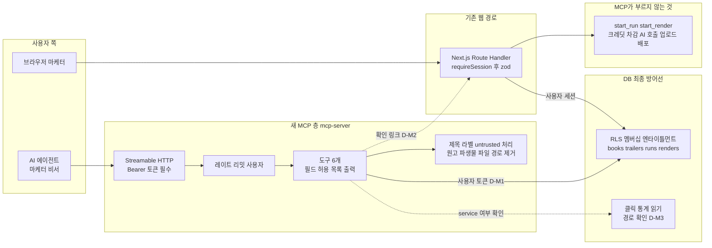

### 8-2. 렌더 준비와 사람 확정 (`trailer_prepare_render`)

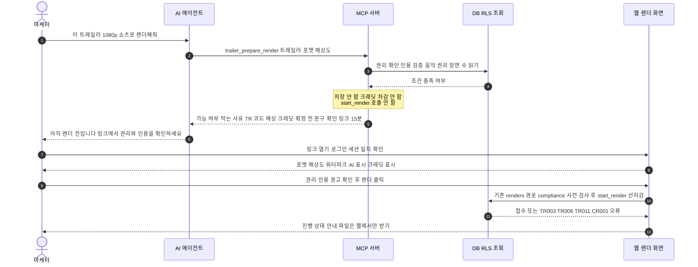

### 8-3. 도구 위험 등급과 노출 단계

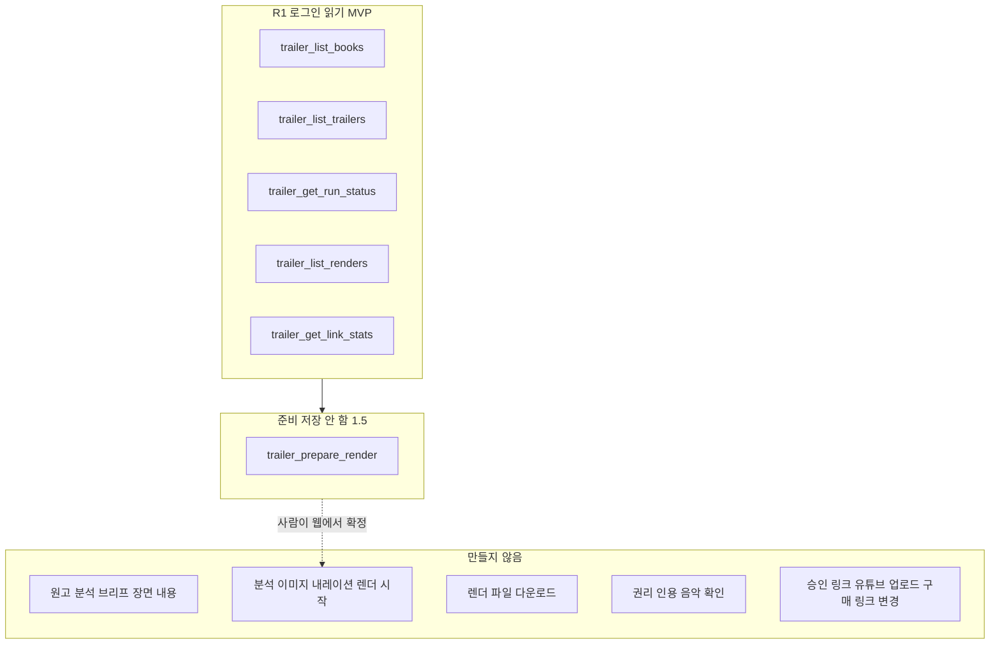

## 문서 불일치

| # | 내용 | 그림에서 고른 쪽 |
|---|---|---|
| 1 | `SECURITY.md`가 양식 상태(자산, 위협, 수치 표가 "작성 필요")라 7번 그림에 쓸 제품 위협 표가 없음. 대신 05장 4절·7절, 02장 6절, 04장 1절을 근거로 사용 | 위 3개 문서 |
| 2 | 화면 내비게이션: `03_SCREENS_UX.md` 1절 머리말은 왼쪽 내비게이션 "홈, 책, 코치, 설정"이고 8.3절은 GNB 메뉴 순서를 새로 정하며, `/trailers` 목록(8.4절)은 1절 화면 목록에 없는 새 경로(D-19 미정) | 6번 그림은 8.4절의 `/trailers`와 8.5절의 단계 탭을 포함 |
| 3 | `03_SCREENS_UX.md` 8.5절은 단계 화면 머리줄을 D-18 기본값(제안)으로 둠. 확정 아님 | 6번 그림에 포함하되 본문에 제안 표시 |
| 4 | MCP 읽기 경로: `04_API.md`에는 책·트레일러·실행·렌더를 읽는 GET이 없고(통계 `GET /api/books/:id/stats`만 있음) 화면은 RLS 직접 조회와 Realtime 구독을 쓴다. 렌더 전 compliance 사전 검사는 `POST .../renders` 안에서 `start_render` 직전에 일어나 읽기 전용으로 따로 부를 수 없다(`MCP.md` D-M3, D-M4) | 그림 8-1은 RLS 조회를 실선으로, 통계의 읽기 방식은 점선(확인 필요)으로 그림 |

## 갱신 규칙

`01_PRD.md`, `02_ARCHITECTURE.md`, `03_SCREENS_UX.md`, `04_API.md`, `05_DATA_MODEL.md`, `SECURITY.md` 중 하나를 고치면 이 문서의 해당 그림(위 표의 근거 절)도 같은 변경에서 함께 고칩니다.
