# DIAGRAMS: FLORA Publishing UML 시각화

작성일 2026-10-23. 정본은 이 폴더의 각 문서이며, 그림과 문서가 다르면 문서가 우선입니다. GitHub에서 그림이 바로 렌더링됩니다(Mermaid).

**제품 한 줄 정의**: 원고는 있지만 편집·조판 경험이 없는 1인 작가가 AI와 함께 기획, 집필, 판형 조정을 거쳐 인쇄용 PDF와 ePub을 완성하는 전자책 출판 SaaS(`README.md` 1절).

**근거 문서**: `README.md`, `01_PRD.md`, `02_ARCHITECTURE.md`, `03_SCREENS_UX.md`, `04_API.md`, `05_DATA_MODEL.md`, `SECURITY.md`, `MCP.md`, 공통 맥락은 `../_platform-core/ARCHITECTURE_DIAGRAMS.md`, `SECURITY_BASELINE.md`, `CORE_SPEC.md`.

**표기**: 실선 화살표는 호출·데이터 흐름, 점선은 검증·참조·주기 실행입니다. "(제안)"은 문서가 제안이라고 밝힌 값입니다. 기능 ID `PB-F-###`는 `01_PRD.md` 3장, `PB-06-###`는 `06_AGENT_PLAN.md`의 작업입니다. 보안 규칙 번호 `§n`은 `SECURITY_BASELINE.md`의 장 번호입니다.

| # | 그림 | UML 종류 | 근거 문서 절 |
|---|---|---|---|
| 1-a | 작가가 쓰는 기능 (MVP) | 유스케이스 | `01_PRD.md` 2·3장, `03_SCREENS_UX.md` 1절 |
| 1-b | 역할별 추가 기능과 Phase 구분 | 유스케이스 | `01_PRD.md` 2장, 3.1절 |
| 2-a | 배포 단위와 호출 관계 | 컴포넌트 | `02_ARCHITECTURE.md` 2·3·7절 |
| 2-b | 에이전트 실행 계층 (제품 고유 모듈) | 컴포넌트 | `02_ARCHITECTURE.md` 10절, `04_API.md` 9절 |
| 3 | 데이터 모델 | 클래스 | `05_DATA_MODEL.md` 1·2·4절 |
| 4-a | 전체 순차 생성 | 시퀀스 | `01_PRD.md` PB-F-017·047·057, `02_ARCHITECTURE.md` 4절, `04_API.md` 2절 |
| 4-b | 검수 승인 | 시퀀스 | `01_PRD.md` PB-F-058, `02_ARCHITECTURE.md` 10.3절, `04_API.md` 9.1절 |
| 4-c | 크레딧팩 결제 | 시퀀스 | `01_PRD.md` PB-F-035, `03_SCREENS_UX.md` 2.3절, `04_API.md` 2·5절 |
| 4-d | PDF 내보내기 | 시퀀스 | `01_PRD.md` PB-F-024·026, `02_ARCHITECTURE.md` 4절, `04_API.md` 2절 |
| 5-a | books 상태 | 상태 머신 | `05_DATA_MODEL.md` 3절 |
| 5-b | sections 생성 상태 | 상태 머신 | `05_DATA_MODEL.md` 3절, `02_ARCHITECTURE.md` 10.3절 |
| 5-c | generation_runs 상태 | 상태 머신 | `05_DATA_MODEL.md` 3절 |
| 5-d | agent_tasks 실행 상태 | 상태 머신 | `05_DATA_MODEL.md` 2.5·3절 |
| 5-e | agent_tasks 검수 상태 | 상태 머신 | `05_DATA_MODEL.md` 3절, `04_API.md` 3절 |
| 5-f | book_exports 상태 | 상태 머신 | `05_DATA_MODEL.md` 3절 |
| 5-g | manuscript_uploads 상태 | 상태 머신 | `05_DATA_MODEL.md` 3절 |
| 6-a | 작가 핵심 화면 흐름 | 화면 흐름 | `03_SCREENS_UX.md` 1·2·10절 |
| 6-b | 에이전트·결제·설정·운영 화면 흐름 | 화면 흐름 | `03_SCREENS_UX.md` 1·8·10절 |
| 7-a | 보안 신뢰 경계 | 배치+흐름 | `01_PRD.md` 6절, `02_ARCHITECTURE.md` 6절, `05_DATA_MODEL.md` 7절 |
| 7-b | 위협과 통제 지도 | 블록 | `02_ARCHITECTURE.md` 6절, `05_DATA_MODEL.md` 7절 |
| 8-1 | 웹 경로와 MCP 층 (제안) | 컴포넌트 | `MCP.md` 2·3절, `04_API.md` 1절 |
| 8-2 | 내보내기 준비와 사람 확정 | 시퀀스 | `MCP.md` 6절, `04_API.md` 2절 |
| 8-3 | 도구 위험 등급과 노출 단계 | 블록 | `MCP.md` 1·2절 |

## 1. 사용자와 기능

역할은 코어 조직 역할 owner, admin, member, viewer와 운영자 platform_admin입니다(`03_SCREENS_UX.md` 1절). 플랜은 Free와 Basic 둘이며 Basic에서만 열리는 기능에 "(Basic)"을 붙였습니다.

### 그림 1-a. 작가가 쓰는 기능 (MVP)

읽는 법: 왼쪽 역할이 오른쪽 기능을 씁니다. viewer는 읽기 전용입니다. 괄호의 ID는 `01_PRD.md` 3장 기능 번호이고, AI 묶음 5개는 모두 MVP입니다.

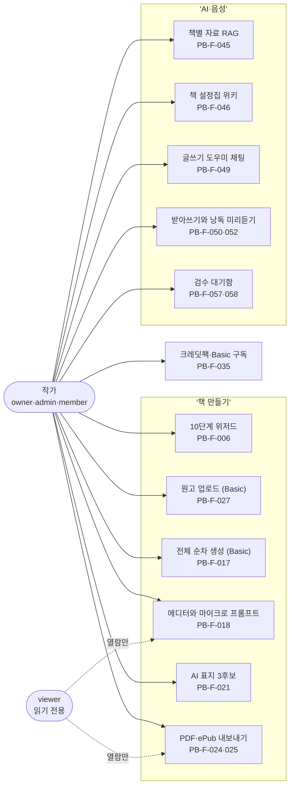

### 그림 1-b. 역할별 추가 기능과 Phase 구분

읽는 법: MVP(P1)은 MVP 범위지만 우선순위가 P1인 기능, Phase 2 이후와 폐기·범위 제외는 문서의 구분 그대로입니다. 점선은 "아직 만들지 않음"입니다.

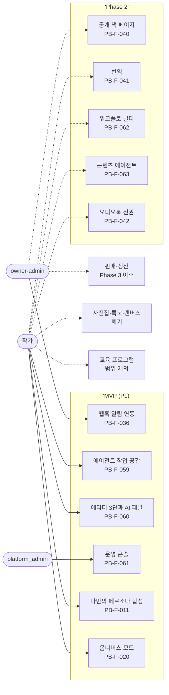

## 2. 구성요소

### 그림 2-a. 배포 단위와 호출 관계

읽는 법: 위가 사용자 쪽, 아래가 데이터입니다. 브라우저는 web만 부르고 Dify·FastAPI·제공자는 web이나 워커가 대신 부릅니다. 코어 부분은 `core` 한 상자로 줄였습니다.

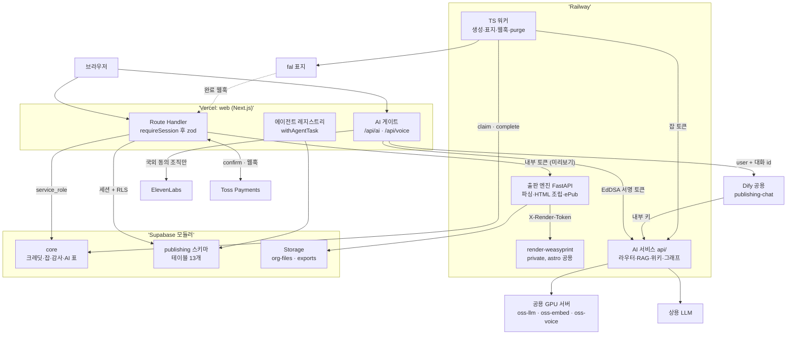

### 그림 2-b. 에이전트 실행 계층 (제품 고유 모듈)

읽는 법: 새 실행 엔진은 없습니다. 기존 Route Handler를 `withAgentTask`가 감싸 `agent_tasks` 1행을 만들고, 잡을 끝내는 쪽이 그 행을 갱신합니다. 점선은 주기 동기화와 읽기 경로입니다.

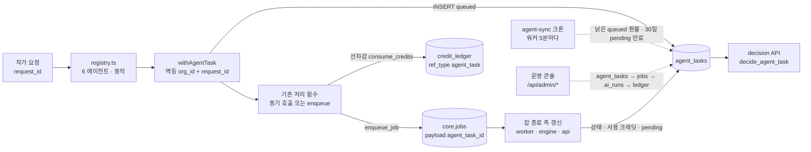

## 3. 데이터 모델

### 그림 3. publishing 스키마 핵심 테이블 11개와 코어 참조 2개

읽는 법: 화살표는 외래키 방향입니다. 모든 테넌트 테이블은 `org_id`를 갖고 하위 표는 `(book_id, org_id)` 복합 FK로 다른 조직 행을 참조할 수 없습니다. 접근 주체는 각 클래스 옆 노트에 적었습니다. 이 스키마는 테이블 13개이며 그림에서 `member_settings`와 `waitlist`는 뺐습니다(`waitlist`는 테넌트가 아니고 사용자 정책이 없습니다).

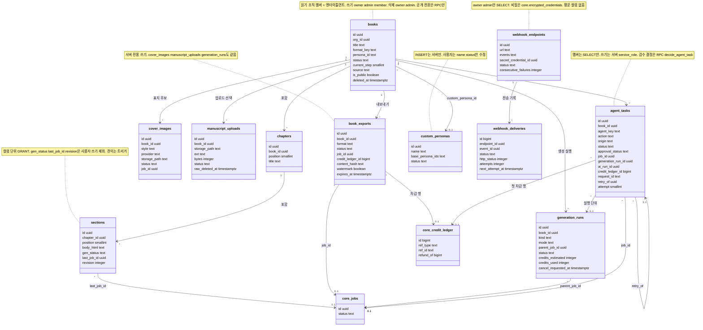

## 4. 핵심 시퀀스

### 그림 4-a. 전체 순차 생성 (PB-F-017, 047, 057)

읽는 법: 위쪽은 web이 하는 일(권한, 한도, 선차감 직전 검사)이고 아래쪽은 워커가 챕터 단위로 그래프를 돌리는 반복입니다. `request_id`는 멱등 키이며 크레딧은 소제목마다 선차감되고 실패하면 환불됩니다.

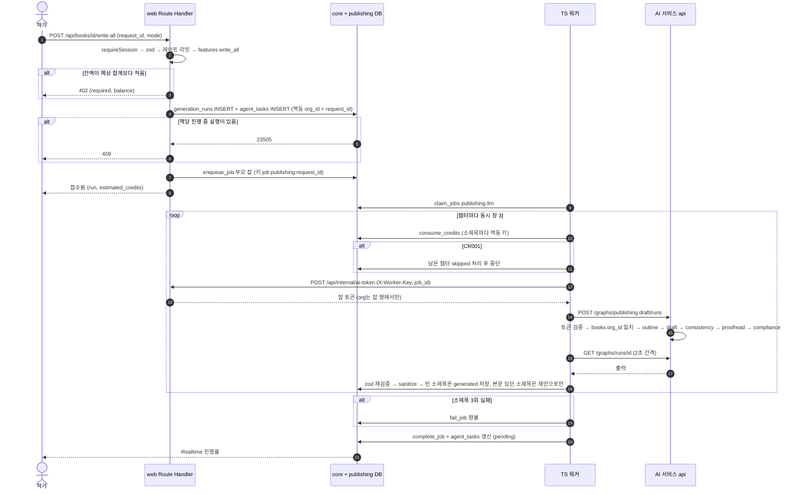

### 그림 4-b. 검수 승인 (PB-F-058)

읽는 법: 제안 본문은 새 저장소 없이 `core.jobs.result` 등 기존 위치에서 읽습니다. 반영(PATCH)은 사용자 세션과 RLS 그대로이고, 결정 기록만 RPC가 합니다.

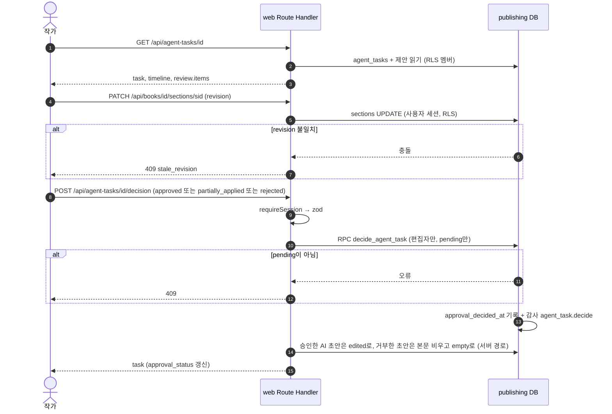

### 그림 4-c. 크레딧팩 결제 (PB-F-035)

읽는 법: 주문은 서버가 먼저 저장하고 금액의 정본은 서버 주문입니다. 지급은 confirm 경로에서만 일어나며 웹훅은 상태 동기화 보조입니다.

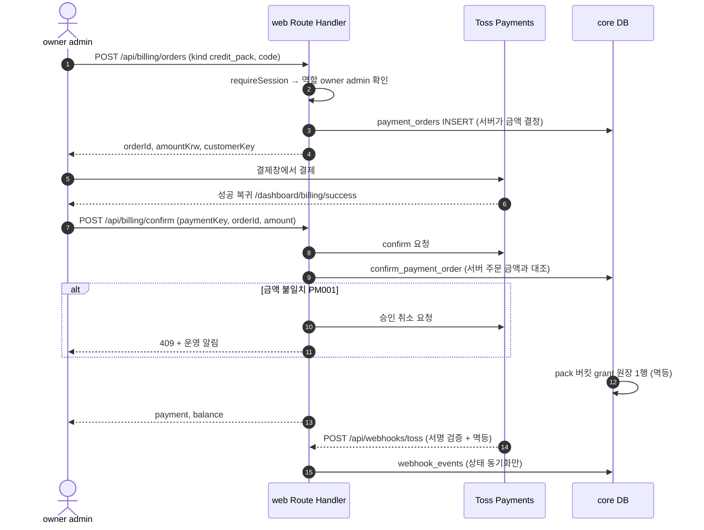

### 그림 4-d. PDF 내보내기 (PB-F-024, 026)

읽는 법: 워터마크는 서버가 `features.watermark`로 정하고 클라이언트 값은 무시합니다. 같은 내용 해시의 결과가 있으면 재사용하며 크레딧은 0입니다. 실패하면 자동 환불됩니다.

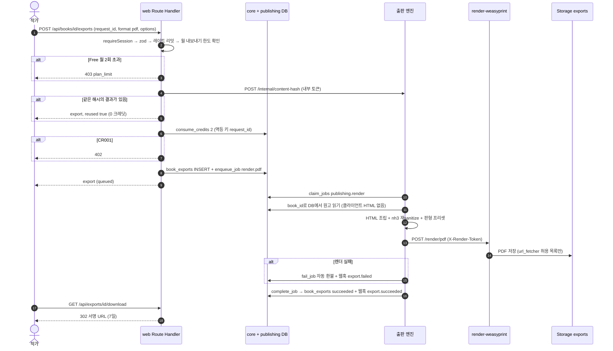

## 5. 상태 머신

모든 전이는 DB 트리거로 강제되어 service_role 쓰기에도 적용됩니다. 전이를 일으키는 주체를 화살표 라벨에 적었습니다.

### 그림 5-a. books.status

읽는 법: 사용자나 서버가 바꿉니다. writing 진입 때 서버가 Taste를 고정하고, completed가 되면 웹훅 `book.completed`가 나가며, 완성을 해제하면 `is_public=false`가 됩니다.

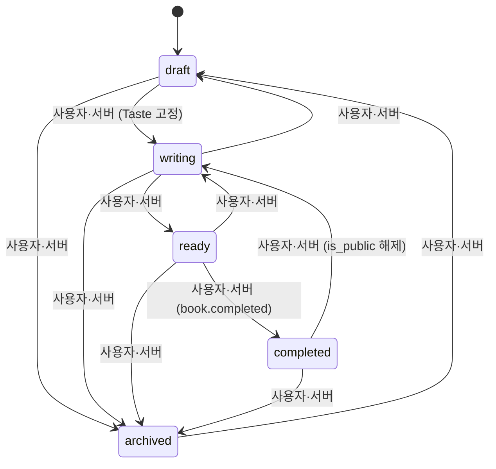

### 그림 5-b. sections.gen_status

읽는 법: 생성 흐름은 서버(워커)가 queued → generating → generated 또는 failed로 옮깁니다. 사용자가 본문을 고치면 트리거가 edited로 바꾸고, 생성 중(queued·generating)의 사용자 편집은 `PB005`로 막힙니다. 검수에서 승인한 AI 초안은 edited, 거부한 초안은 본문을 비우고 empty로 돌아갑니다.

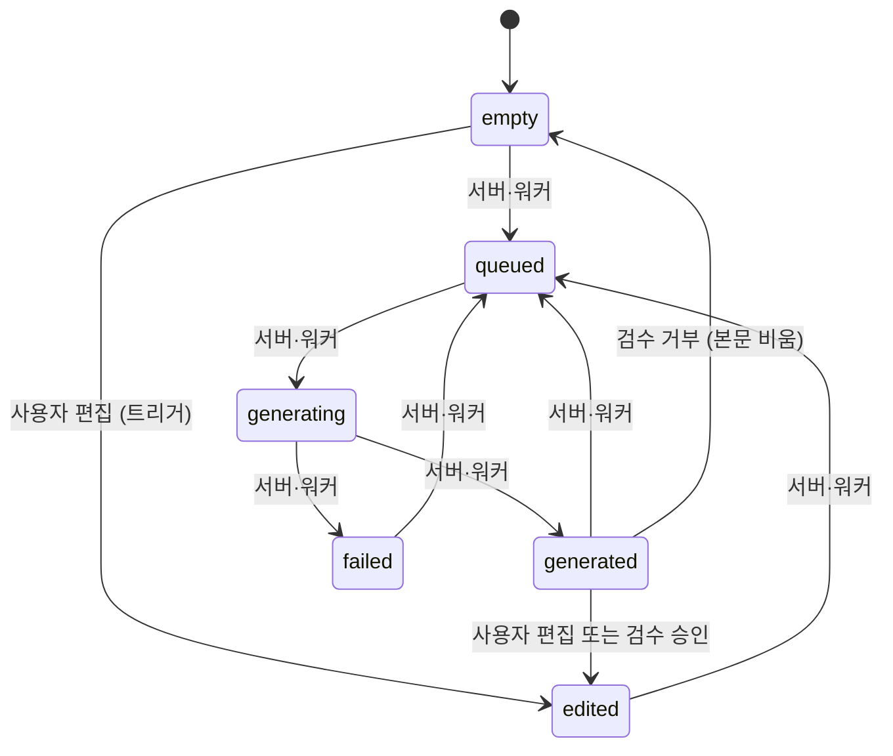

### 그림 5-c. generation_runs.status

읽는 법: 서버만 바꾸고, 취소 요청은 RPC `request_generation_cancel`이 접수합니다. 책당 진행 중 실행은 부분 유니크 인덱스로 1개입니다.

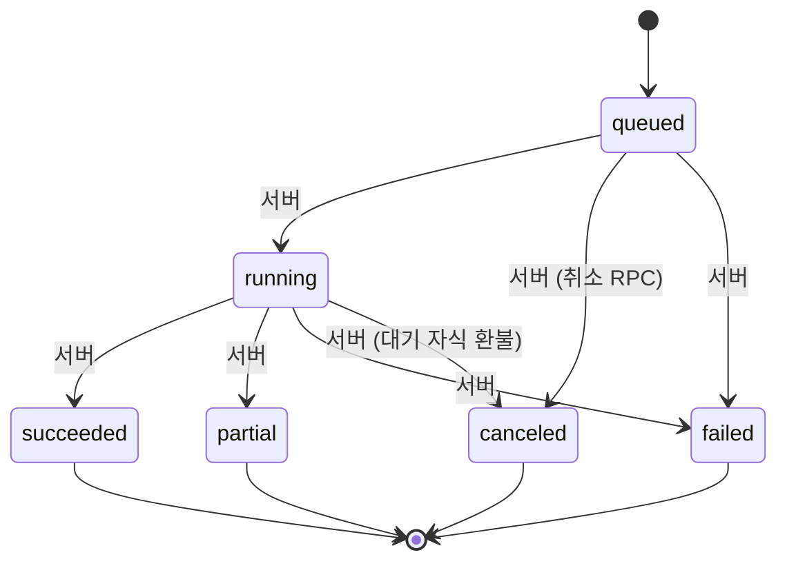

### 그림 5-d. agent_tasks.status

읽는 법: 서버가 기록기(`withAgentTask`)와 잡 종료 측에서 바꿉니다. 재시도는 상태 전이가 아니라 새 행(`retry_of`, `attempt` 증가)이며 failed, partial, canceled에서만 허용됩니다(`PB013`).

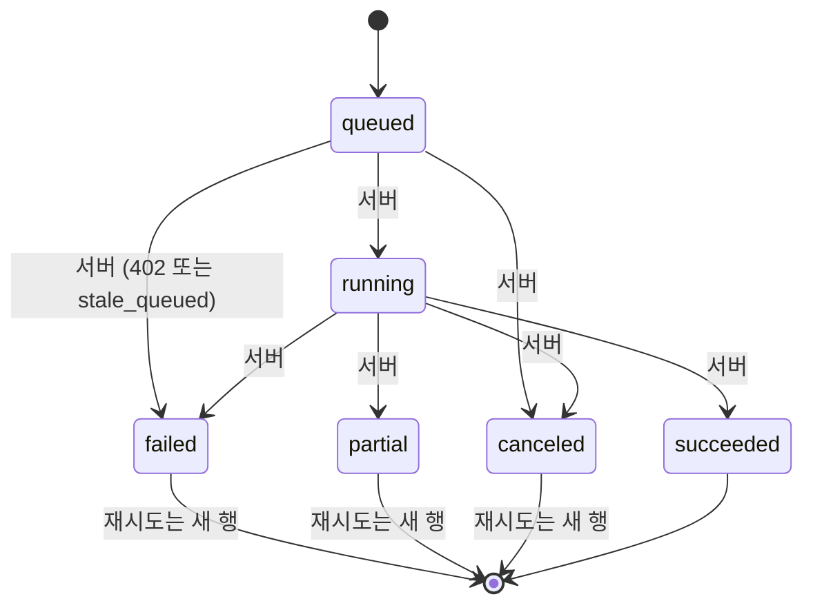

### 그림 5-e. agent_tasks.approval_status

읽는 법: pending이 되는 때는 실행 상태가 succeeded, partial, canceled일 때뿐입니다(서버). 결정 3종은 사용자가 RPC `decide_agent_task`로, 만료는 서버가 30일 뒤 처리합니다.

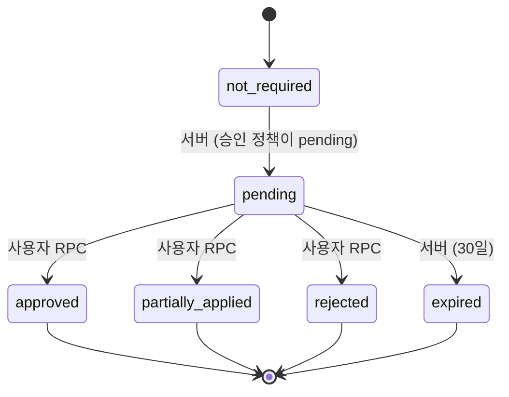

### 그림 5-f. book_exports.status

읽는 법: 서버만 바꿉니다. 성공한 파일은 정리 잡(purge)이 만료시키며 이때 파일이 삭제됩니다.

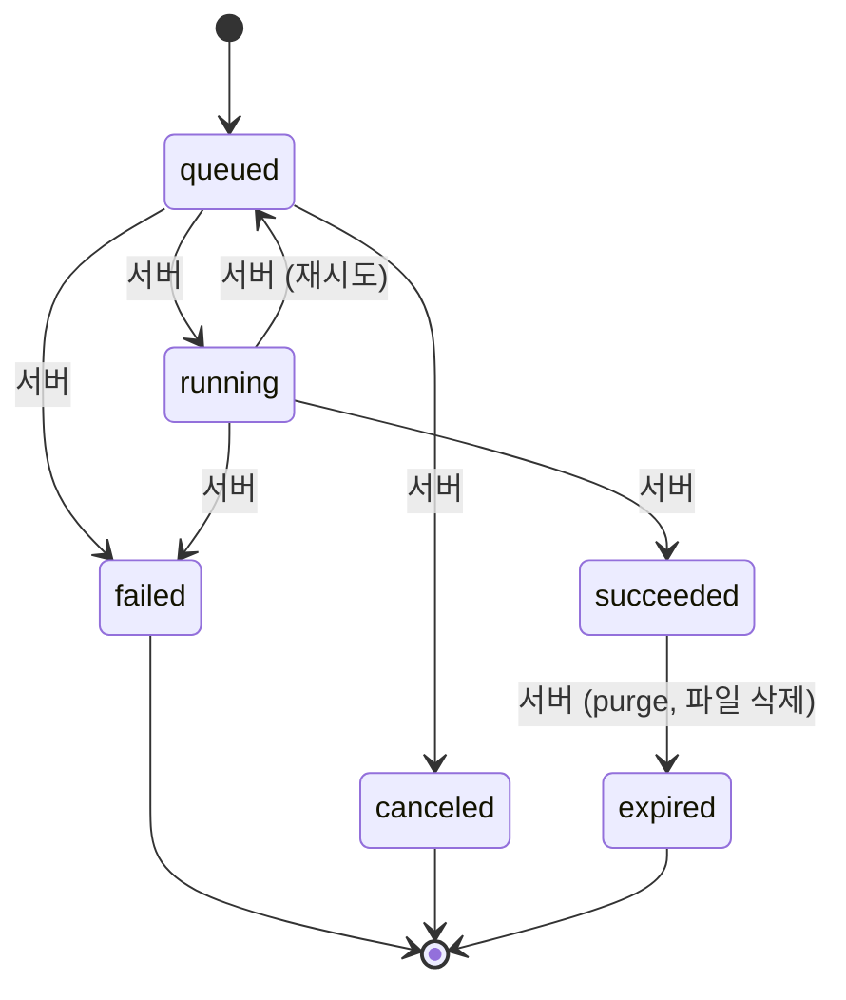

### 그림 5-g. manuscript_uploads.status

읽는 법: 서버가 옮깁니다. 파싱 24시간 뒤 원본을 삭제하고 `raw_deleted_at`을 기록합니다. 파싱 재시도는 parsing에서 uploaded로 되돌아갑니다.

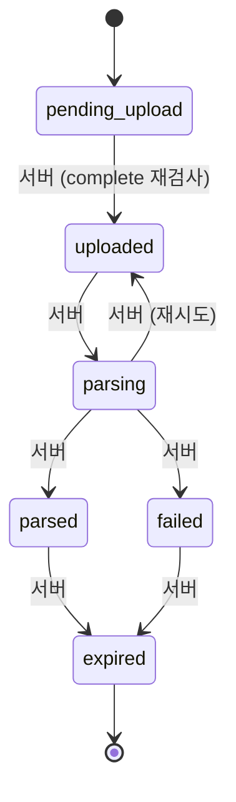

## 6. 화면 흐름

### 그림 6-a. 작가 핵심 화면 흐름

읽는 법: 실선은 사용자 이동, 점선은 조건부 이동입니다. 책 안 화면(위저드, 에디터, 설정집, 완성)은 좌측 GNB 대신 책 머리줄 셸을 씁니다(`03_SCREENS_UX.md` 10.4절, 기본값은 결정 대기 D33).

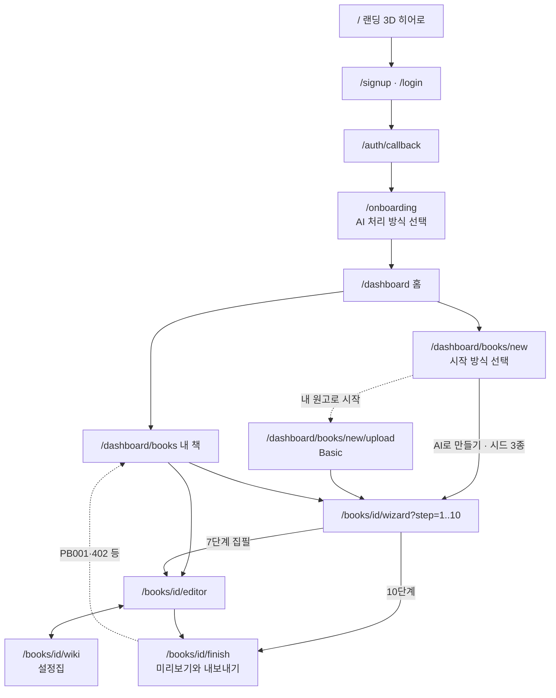

### 그림 6-b. 에이전트·결제·설정·운영 화면 흐름

읽는 법: 402를 만나면 결제 화면으로, 작업 실패나 검수는 에이전트 화면에서 처리합니다. `/admin`은 platform_admin 전용 별도 셸입니다.

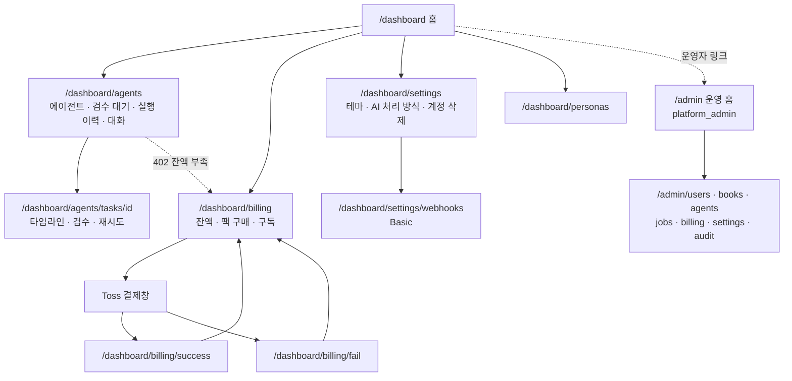

## 7. 보안 경계

`SECURITY.md`는 현재 초안(자산·위협·수치 표가 "작성 필요")이어서, 아래 그림은 `01_PRD.md` 6장, `02_ARCHITECTURE.md` 6절, `05_DATA_MODEL.md` 7절의 차단 설계에서 구성했습니다. 공통 규칙은 `SECURITY_BASELINE.md`의 장 번호로만 참조합니다.

### 그림 7-a. 보안 신뢰 경계

읽는 법: 위에서 아래로 갈수록 데이터에 가깝고, 각 구역은 앞 구역을 믿지 않고 스스로 다시 검사합니다. 지켜야 할 자산은 원고(DB·Storage), 크레딧·결제, 웹훅 비밀·빌링키(`core.encrypted_credentials`, `core.billing_keys`), 서명 개인키(Next.js만)입니다.

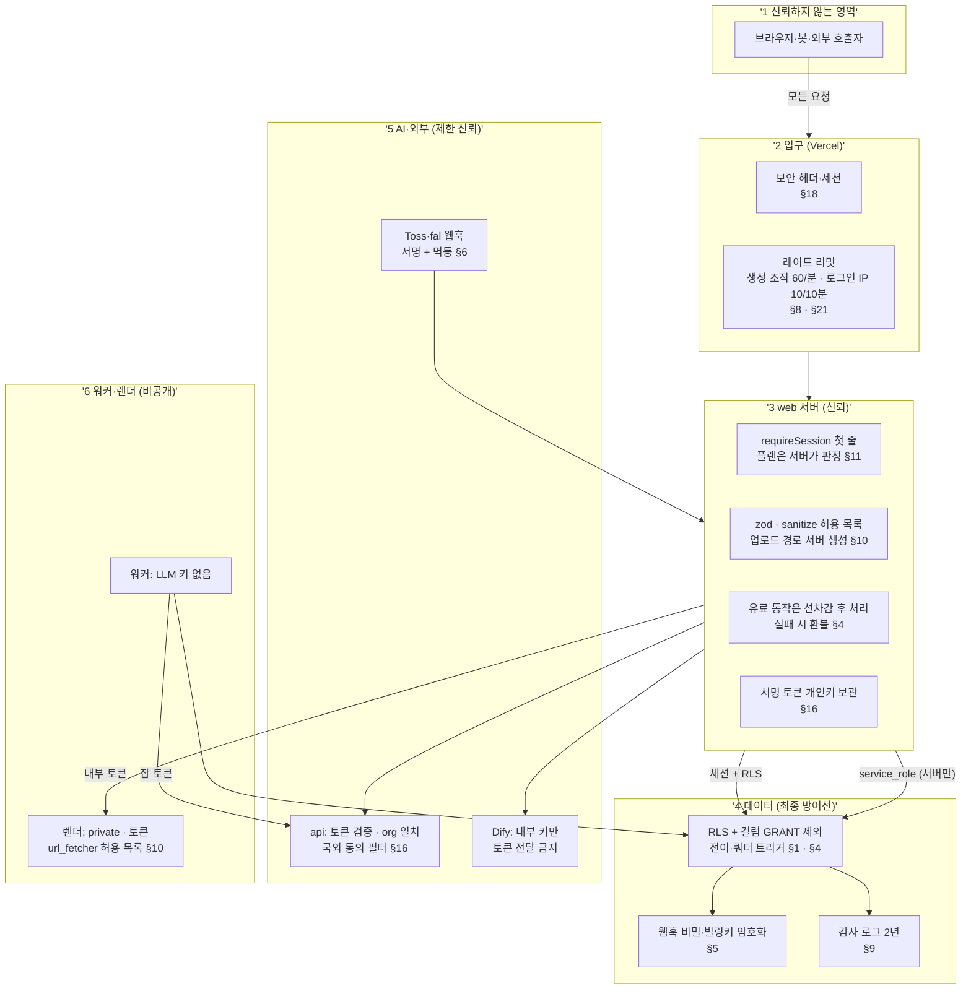

### 그림 7-b. 위협과 통제 지도

읽는 법: 왼쪽 위협은 리뷰에서 확인된 "높음" 결함이고 오른쪽이 이 제품의 차단 설계입니다(`02_ARCHITECTURE.md` 6절, `05_DATA_MODEL.md` 7절). 위협 이름 뒤 괄호는 원본 리뷰 번호입니다.

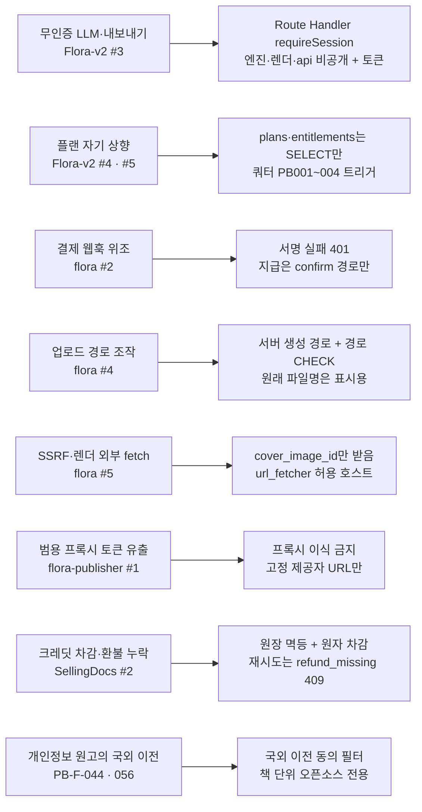

## 8. 에이전트 접근 층 (MCP)

**읽는 법:** 기존 웹 경로(위)는 그대로이고, 에이전트용 입구(아래)는 같은 서버 계층과 RLS 조회를 거칩니다. 정본은 `MCP.md`, 공통 규칙은 `../_platform-core/MCP_BASELINE.md`입니다. 점선은 Phase 1.5 이후 또는 미결정(D-M#)입니다. 이 제품은 원고 본문을 도구로 내보내지 않는 것이 기본입니다.

### 8-1. 웹 경로 위에 얹는 MCP 구성

```mermaid
flowchart LR
  subgraph U["사용자 쪽"]
    BR["브라우저 작가"]
    AG["AI 에이전트<br/>작가 비서"]
  end

  subgraph WEB["기존 웹 경로"]
    RH["Next.js Route Handler<br/>requireSession 후 zod"]
  end

  subgraph MCPL["새 MCP 층 mcp-server"]
    TR["Streamable HTTP<br/>Bearer 토큰 필수"]
    RL["레이트 리밋 사용자"]
    TL["도구 7개<br/>필드 허용 목록 출력"]
    SAN["제목 파일 이름 untrusted 처리<br/>본문 Diff 제외"]
  end

  subgraph DB["DB 최종 방어선"]
    RLS["RLS 멤버십 엔타이틀먼트<br/>books chapters sections agent_tasks"]
    CORE["core 위키 ai_documents<br/>읽기 경로 D-M5"]
  end

  subgraph NO["MCP가 부르지 않는 것"]
    CR["크레딧 차감 AI 호출<br/>렌더 내보내기 결제"]
  end

  BR --> RH
  AG --> TR
  TR --> RL
  RL --> TL
  TL --> SAN
  RH -->|"사용자 세션"| RLS
  RH --> CR
  TL -->|"사용자 토큰 D-M3"| RLS
  TL -.->|"RLS 확인 후 D-M5"| CORE
  TL -.->|"확인 링크 D-M4"| RH
```

### 8-2. 내보내기 준비와 사람 확정 (`publishing_prepare_export`)

```mermaid
sequenceDiagram
  autonumber
  actor W as 작가
  participant A as AI 에이전트
  participant M as MCP 서버
  participant D as DB RLS 조회
  participant S as 웹 내보내기 화면

  W->>A: 이 책 PDF로 내보내줘
  A->>M: publishing_prepare_export 책 id 형식
  M->>D: 책 상태 읽기 사용자 세션
  D-->>M: 상태 본문 유무
  Note over M: 저장 안 함 크레딧 차감 안 함<br/>exports 생성 호출 안 함
  M-->>A: 가능 여부 예상 크레딧 확정 전 문구 확인 링크 15분
  A-->>W: 내보낼 수 있습니다 아직 시작 전입니다 링크에서 확인하세요
  W->>S: 링크 열기 로그인 세션 일치 확인
  S-->>W: 형식 크레딧 표시
  W->>S: 내보내기 클릭
  S->>D: 기존 exports 경로 크레딧 선차감과 잡 등록
  D-->>S: 접수 또는 402 plan_limit 오류
  S-->>W: 진행 상태 안내
```

### 8-3. 도구 위험 등급과 노출 단계

```mermaid
flowchart TB
  subgraph R1["R1 로그인 읽기 MVP"]
    T1["publishing_list_books"]
    T2["publishing_get_book_outline"]
    T3["publishing_list_agent_tasks"]
    T4["publishing_get_agent_task"]
  end
  subgraph R15["R1 로그인 읽기 1.5"]
    T5["publishing_list_book_references"]
    T6["publishing_list_wiki_pages"]
  end
  subgraph PR["준비 저장 안 함 1.5"]
    T7["publishing_prepare_export"]
  end
  subgraph NO["만들지 않음"]
    N1["원고 본문 Diff 내보낸 파일"]
    N2["AI 생성 호출 크레딧 소비"]
    N3["작업 승인 출간 유통 ISBN"]
    N4["결제 삭제 공개 전환 계정"]
  end
  R1 --> R15 --> PR
  PR -.->|"사람이 웹에서 확정"| N2
```

## 문서 불일치

| # | 내용 | 그림에서 고른 쪽 |
|---|---|---|
| 1 | `SECURITY.md`가 초안(자산, 위협, 수치 모두 "작성 필요")이어서 보안 그림의 근거가 `01_PRD.md` 6장, `02_ARCHITECTURE.md` 6절, `05_DATA_MODEL.md` 7절로 대체됨. 세션·CSP·감사 보존 등 제품 수치는 `SECURITY.md`에 없음 | 그림 7은 PRD·아키텍처·데이터 모델 문서의 값만 사용. `SECURITY.md` 작성 후 7-a, 7-b를 다시 맞출 것 |
| 2 | `SECURITY.md` 머리말은 공통 규칙을 "1~21장"으로 적지만 `SECURITY_BASELINE.md`에는 22장(제품별 `SECURITY.md`)까지 있음 | 그림은 §1~§21만 참조하므로 영향 없음 |
| 3 | 인증 로그인은 단계(Mock, Google+이메일, 카카오·네이버)로 켜지는데 `03_SCREENS_UX.md` 1절은 `/signup`이 Stage B부터라고 적음 | 그림 6-a는 최종(Stage B 이상) 흐름을 그림. Stage A에서는 `/login` 개발용 패널로 바로 `/dashboard`로 감 |
| 4 | MCP 읽기 경로: `04_API.md` 2.1절의 `GET /api/books/[id]/references`는 `ai_documents`를 service_role로 읽고, 책 구조(chapters, sections)를 읽는 Route Handler는 없음(RLS 직접 조회). MCP는 service_role을 쓰지 않으므로 `MCP.md` D-M5, D-M8 | 그림 8-1은 RLS 조회를 실선, 참고 파일·설정집 읽기를 점선(미확정)으로 그림 |
| 5 | MCP 내보내기 준비: `POST /api/books/[id]/exports`가 검사와 크레딧 차감을 함께 하고 읽기 전용 점검 함수가 없음(`MCP.md` D-M4) | 그림 8-2는 "책 상태 읽기"만 그림. 점검 함수는 확인 필요 |

그림에 못 담은 것: 글쓰기 도우미 채팅·음성·낭독 시퀀스(`03_SCREENS_UX.md` 2.9~2.11절), Basic 구독 빌링키 흐름(2.4절), 웹훅 발신 재시도(5회), 계정 삭제·purge, 로그인 Stage 상세(`AUTH_ROADMAP.md`), 3D 히어로·디자인 시스템.

## 갱신 규칙

- `01_PRD.md`, `02_ARCHITECTURE.md`, `03_SCREENS_UX.md`, `04_API.md`, `05_DATA_MODEL.md`, `SECURITY.md`를 고치면 이 파일의 해당 그림도 같은 커밋에서 고친다(상태 전이는 `05_DATA_MODEL.md` 3절 표 그대로 유지).
