# DIAGRAMS: Live Poll UML 시각화

작성일 2026-10-23. 이 문서는 `live-poll`의 기획 문서를 그림으로 옮긴 것이다. 정본은 각 문서이며 그림과 문서가 다르면 문서가 우선한다. GitHub에서 Mermaid가 바로 렌더링된다. 전체 플랫폼 구조는 `../_platform-core/ARCHITECTURE_DIAGRAMS.md`와 같은 스타일로 맞췄다.

**제품 한 줄 정의**: 진행자(강연자, 행사 진행자, 방송인)가 행사(방)를 만들면 청중이 로그인 없이 6자리 코드나 QR로 들어와 투표하고 질문하며, 결과가 발표 화면과 OBS 오버레이에 실시간으로 반영되는 웹 서비스. 진행자용 AI 어시스턴트, Q&A AI 정리, 행사 위키, 음성이 MVP에 들어 있다.

**근거 문서**: `README.md`, `01_PRD.md`, `02_ARCHITECTURE.md`, `03_SCREENS_UX.md`, `04_API.md`, `05_DATA_MODEL.md`. 공통은 `../_platform-core/SECURITY_BASELINE.md`, `CORE_SPEC.md`, `AI_ARCHITECTURE.md`.

**표기**: 실선 화살표 = 호출·데이터 흐름, 점선 = 검증·참조·구독, "(제안)" = 문서가 제안이라 한 값. Phase 2·3 항목은 이름에 `P2`, `P3`를 붙였다.

| # | 그림 | UML 종류 | 근거 문서 절 |
|---|---|---|---|
| 1-A | 사용자와 기능 (MVP) | 유스케이스(flowchart) | 01_PRD 1장, 2장, 3장 |
| 1-B | 사용자와 기능 (Phase 2, 3) | 유스케이스(flowchart) | 01_PRD 2장 |
| 2-A | 구성요소: 투표와 실시간 | 컴포넌트(flowchart) | 02_ARCHITECTURE 2절, 4절, 5-1절, 7절 |
| 2-B | 구성요소: AI와 음성 | 컴포넌트(flowchart) | 02_ARCHITECTURE 2절(AI), 4절, 5-3~5-5절 |
| 3 | 데이터 모델 | 클래스(classDiagram) | 05_DATA_MODEL 1~4절 |
| 4-A | 시퀀스: 청중 입장과 투표 | 시퀀스 | 03_SCREENS_UX 2.2절, 04_API 2~3절, 02_ARCHITECTURE 5-1절 |
| 4-B | 시퀀스: 문항 진행과 결과 전파 | 시퀀스 | 03_SCREENS_UX 2.3절, 04_API 3절, 02_ARCHITECTURE 4절 |
| 4-C | 시퀀스: Q&A와 AI 정리 | 시퀀스 | 03_SCREENS_UX 2.4절, 2.8절, 01_PRD LP-F-013~015, 029, 030 |
| 4-D | 시퀀스: 청중 음성 질문 | 시퀀스 | 02_ARCHITECTURE 5-4절, 01_PRD LP-F-032 |
| 5-A | 상태: 행사 | 상태 머신 | 05_DATA_MODEL 3절 |
| 5-B | 상태: 문항 | 상태 머신 | 05_DATA_MODEL 3절 |
| 5-C | 상태: Q&A 질문 | 상태 머신 | 05_DATA_MODEL 3절, 01_PRD LP-F-013, 015 |
| 6 | 화면 흐름 | flowchart | 03_SCREENS_UX 1절, 2절 |
| 7 | 보안 신뢰 경계 | flowchart | 05_DATA_MODEL 7절, 02_ARCHITECTURE 5-1·5-4·6절, 01_PRD 6장 |

> 이 제품의 `SECURITY.md`는 아직 템플릿 상태("작성 필요")라서 7번 그림은 `05_DATA_MODEL` 7장, `02_ARCHITECTURE` 5·6장, `01_PRD` 6장을 근거로 그렸다. 맨 끝 "문서 불일치" 참고.

---

## 1. 사용자와 기능

### 그림 1-A. MVP 기능

**읽는 법**: 사람 역할 3종(진행자, 청중, 방송 시청 화면)과 기능 묶음이다. 기능 ID는 `LP-F-###`. 청중과 OBS 오버레이는 로그인이 없고(참가자 토큰, 오버레이 키) 진행자만 로그인한다.

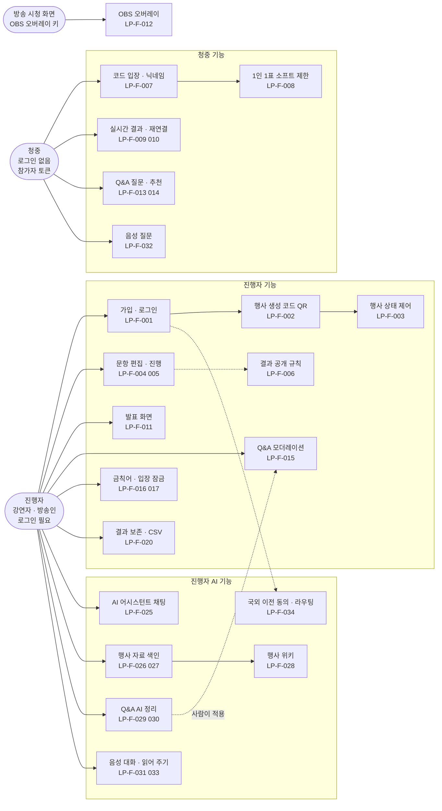

### 그림 1-B. Phase 2, Phase 3

**읽는 법**: 01_PRD 2장에서 MVP 밖으로 둔 항목이다. 점선은 선행 조건이다.

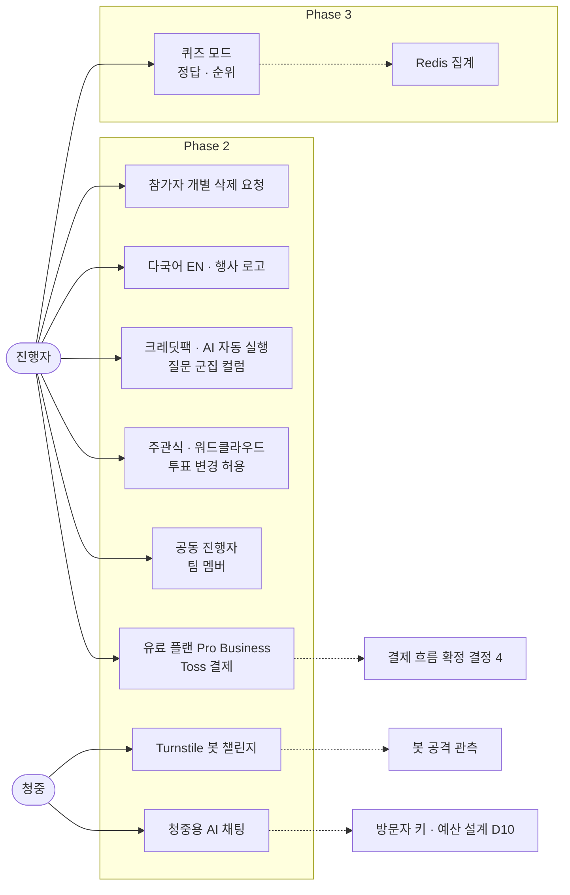

---

## 2. 구성요소

### 그림 2-A. 투표와 실시간

**읽는 법**: 투표는 Route Handler가 service_role RPC로 `votes`에 INSERT만 한다. 별도의 브로드캐스터 워커가 250ms마다 변경을 모아 Supabase Realtime의 private 채널로 보낸다. 청중과 오버레이는 DB 권한 없이 Realtime 수신만 한다.

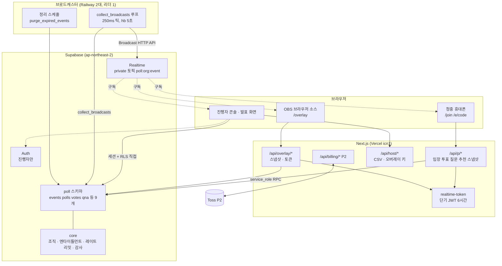

### 그림 2-B. AI와 음성

**읽는 법**: AI 경로는 투표·브로드캐스트 경로와 분리돼 있어 AI 서비스가 죽어도 투표는 정상이다. 진행자 브라우저는 `/api/ai/*`, `/api/voice/*`만, 청중은 `/api/p/voice-question`만 AI에 닿는다. Q&A 정리는 잡이 아니라 Route Handler가 그래프를 호출하고 SSE로 진행을 전달한다(로컬 측정 결과에 따라 잡으로 바꿀 수 있음, 02_ARCHITECTURE 4절).

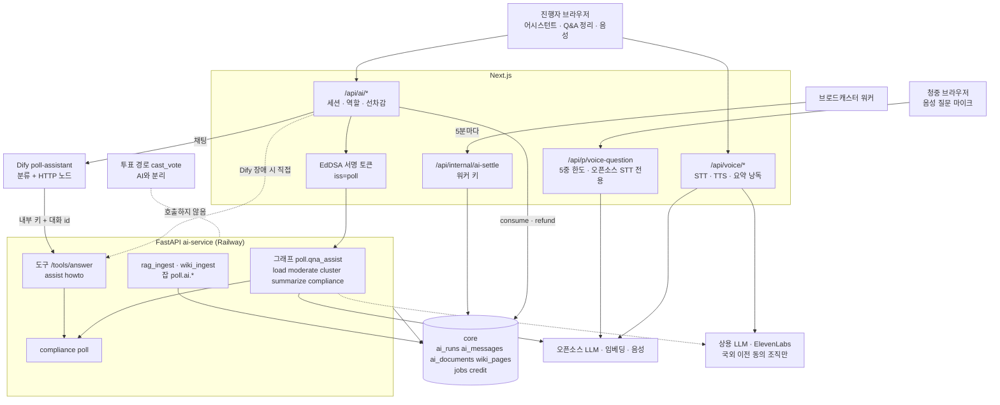

---

## 3. 데이터 모델

### 그림 3. `poll` 스키마 9개 테이블

**읽는 법**: 행사(`events`)가 중심이고 문항 계열(`polls` → `poll_options`, `votes`, `poll_results`)과 참가자 계열(`participants` → `qna_questions`, `qna_upvotes`)이 달린다. 하위 테이블은 `(event_id, org_id)` 같은 복합 FK로 다른 행사·조직의 행을 붙일 수 없다. RLS 접근 주체는 note에 적었다. 진행자 판정은 `is_org_member + has_entitlement('poll')`(읽기), `has_org_role(owner, admin, member)`(쓰기)이다.

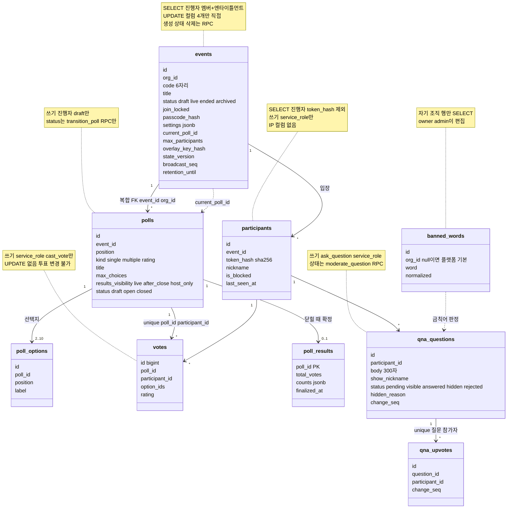

---

## 4. 핵심 시퀀스

### 그림 4-A. 청중 입장과 투표 (LP-F-007~010)

**읽는 법**: 청중에게는 로그인 대신 서버 발급 참가자 토큰(httpOnly 쿠키, DB에는 sha256만)이 있다. 중복 투표는 IP가 아니라 `unique(poll_id, participant_id)`로 막는다. IP는 HMAC으로 바꿔 입장 실패 레이트 리밋 키에만 쓴다.

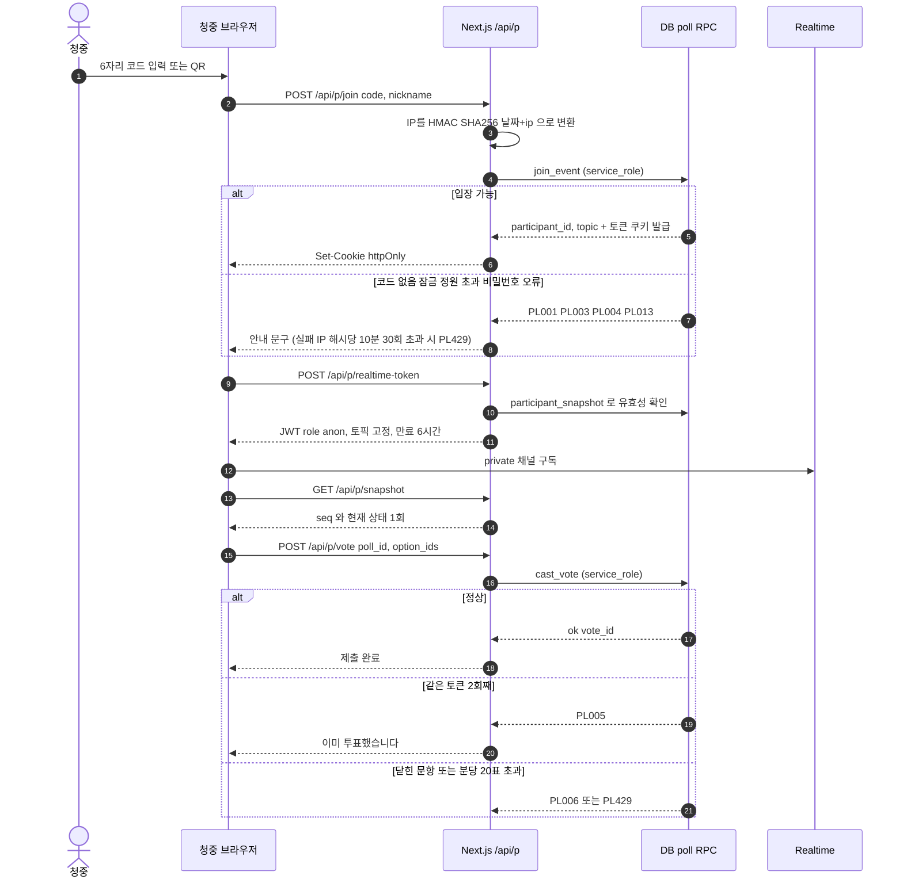

### 그림 4-B. 문항 진행과 결과 전파 (LP-F-005, 009, 011)

**읽는 법**: 진행자 쓰기는 브라우저에서 RLS와 RPC로 직접 한다. 투표 경로는 `events` 행을 건드리지 않고, 워커가 `max(votes.id)`와 `state_version` 등 변경 카운터를 비교해 묶어 보낸다. 워커가 죽어도 투표는 기록되고 클라이언트가 15초 무수신 뒤 스냅샷으로 복구한다.

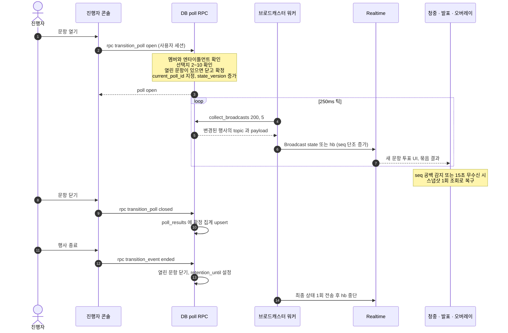

### 그림 4-C. Q&A 질문과 AI 정리 (LP-F-013~015, 029, 030)

**읽는 법**: AI는 라벨과 군집을 제안만 하고 질문 상태는 바꾸지 않는다. 진행자가 선택해 `moderate_question`을 호출해야 상태가 바뀐다. 청중 원문을 읽는 단계는 국외 이전 동의와 상관없이 오픈소스 모델만 쓴다(01_PRD 6.1절).

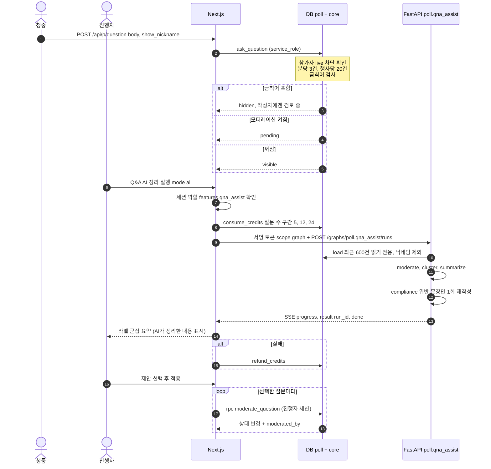

### 그림 4-D. 청중 음성 질문 (LP-F-032, 035)

**읽는 법**: 청중은 지갑이 없어 비용을 행사 소유 조직이 낸다. 그래서 STT 호출 전에 한도 5중 검사를 하고, 4건 묶음 단위로 진행자 지갑에서 선차감한다. STT 결과는 저장하지 않고 청중이 확인·수정한 뒤에야 일반 질문 경로(그림 4-C 1~3)로 들어간다.

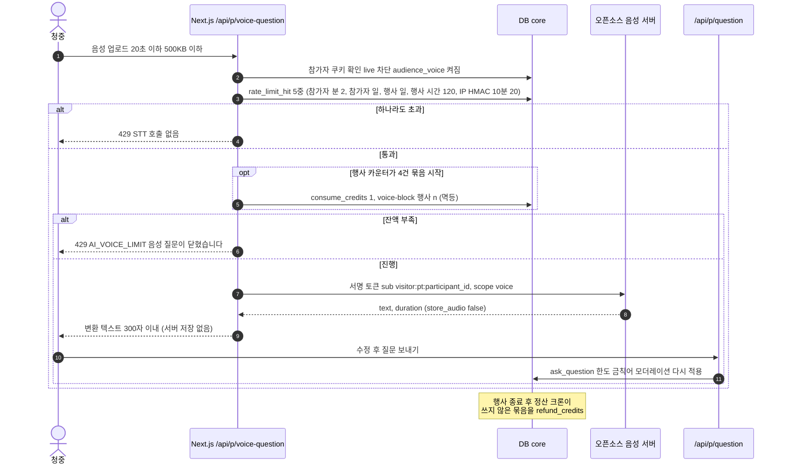

---

## 5. 상태 머신

전이는 트리거가 모든 쓰기(service_role 포함)에 강제한다. 허용되지 않은 전이는 `PL011`, 일부는 `22023`이다.

### 그림 5-A. 행사 `events.status`

**읽는 법**: 라벨은 전이를 일으키는 주체와 RPC이다. 정리 함수는 24시간 넘게 live인 행사를 종료하고 종료 7일 뒤 archived로 보내며 이때 코드를 반납한다.

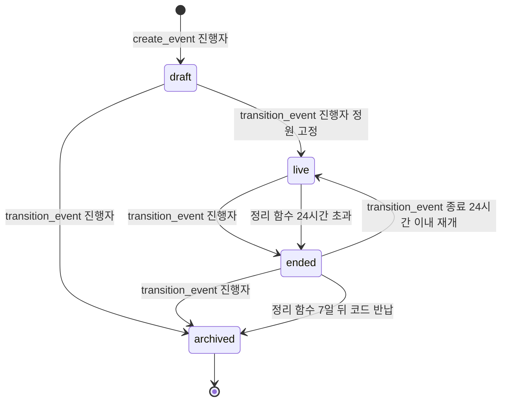

### 그림 5-B. 문항 `polls.status`

**읽는 법**: 문항을 열면 같은 행사에 열린 다른 문항은 자동으로 닫히고 확정된다. 열린 뒤에는 내용이 고정된다.

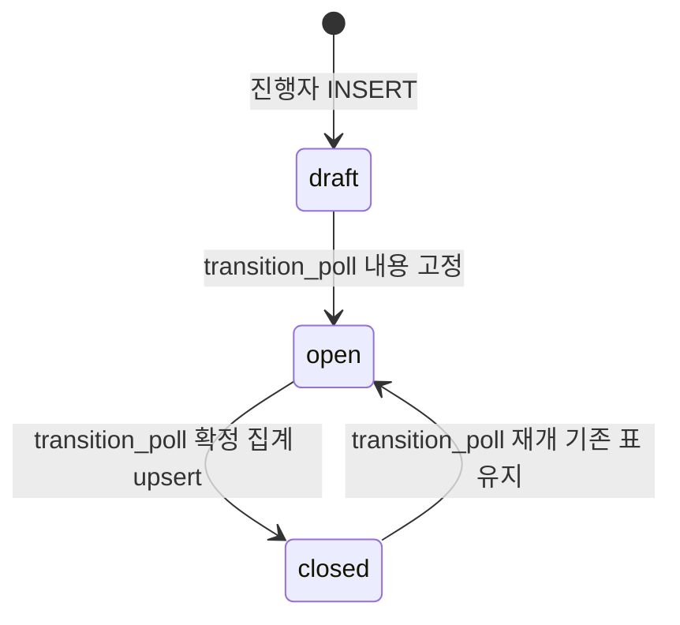

### 그림 5-C. Q&A 질문 `qna_questions.status`

**읽는 법**: 시작 상태는 입장 규칙에 따라 다르다(모더레이션 켜짐은 pending, 금칙어는 hidden, 그 외는 visible). 이후 전이는 진행자의 `moderate_question`이고, 참가자 차단 시 질문이 자동으로 숨겨진다.

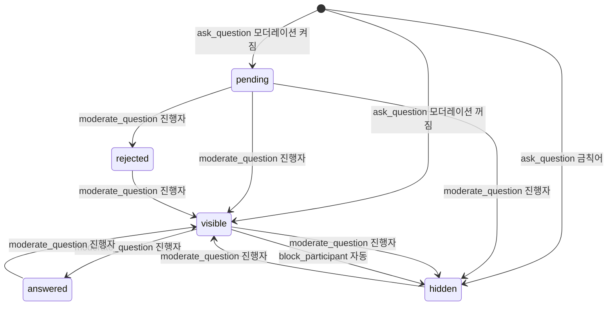

---

## 6. 화면 흐름

**읽는 법**: 세 갈래다. 가운데는 진행자(로그인), 오른쪽은 청중(로그인 없음), 아래는 방송용 오버레이(키). 점선은 새 창으로 여는 화면이다. 경로는 03_SCREENS_UX 1절 표기이다.

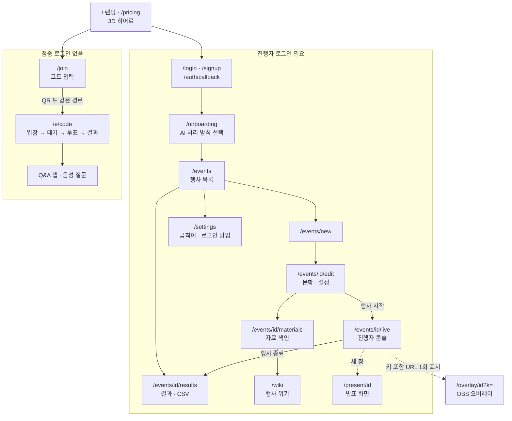

---

## 7. 보안 신뢰 경계

**읽는 법**: 신뢰 수준이 다른 세 종류의 클라이언트(진행자 세션, 청중 토큰, 오버레이 키)가 각각 다른 길로 DB에 닿는다. 청중과 오버레이는 DB 권한이 없고 Realtime 수신만 한다. `§`는 `../_platform-core/SECURITY_BASELINE.md`의 장 번호다. 이 제품의 `SECURITY.md`가 템플릿 상태라 자산·위협은 05_DATA_MODEL 7장, 02_ARCHITECTURE 5-1·5-4·6장, 01_PRD 6장에서 가져왔다.

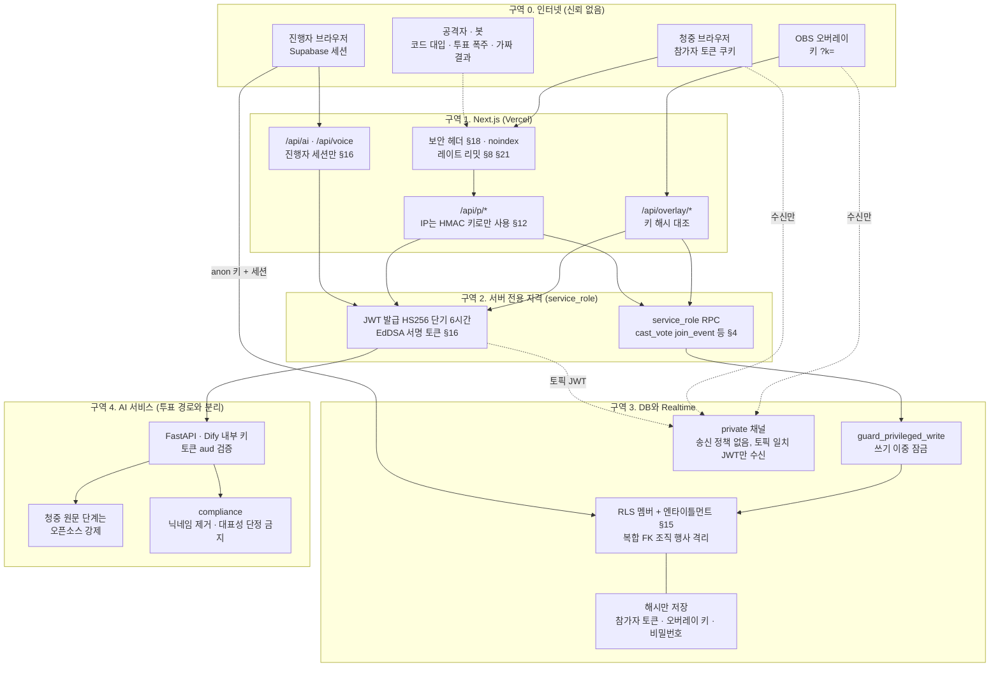

**위협과 대응 요약** (문서에 있는 것만)

| 위협 | 대응 | 근거 |
|---|---|---|
| IP 기반 1인 1표의 오차단과 우회 (리뷰 #3) | 참가자 토큰 단위 `unique(poll_id, participant_id)`, 소프트 제한 고지, 정원·잠금·비밀번호·분당 20표·참가자 차단 | 05_DATA_MODEL 7장, LP-F-008 |
| IP 해시 저장 = 개인정보 처리 (리뷰 #4) | 제품 테이블에 IP 없음, HMAC(비밀키+날짜)를 레이트 리밋 키에만, 버킷 1일 뒤 삭제 | 05_DATA_MODEL 7장 |
| 투표 폭주와 브로드캐스트 폭증 (리뷰 #1) | 투표는 INSERT만, 워커가 250ms로 묶어 전송 | 02_ARCHITECTURE 5-1·6장 |
| 가짜 결과 주입 | private 채널, 송신 정책 없음(service_role만), 토픽 일치 JWT만 수신 | 02_ARCHITECTURE 5-1절 |
| 코드 대입 | 실패만 IP 해시당 10분 30회, 초과 시 조회 자체 생략 | LP-F-019 |
| 오버레이 키 유출 | 해시 저장, 재발급 시 이전 키 즉시 무효 | LP-F-012 |
| 청중 자유 입력의 외부 모델 유출 | 청중 원문 단계 `force_open_source`, 청중은 `/api/ai/*` 통과 불가 | 01_PRD 6.1절, 02_ARCHITECTURE 2절 |
| 청중 음성 남용과 비용 | 5중 레이트 리밋, 4건 묶음 선차감, 오디오 비저장 | 02_ARCHITECTURE 5-4절 |
| AI가 질문을 임의 삭제 | AI는 제안만, 적용은 진행자의 `moderate_question` | LP-F-030 |

---

## 문서 불일치

1. **`SECURITY.md` 미작성**: 자산, 위협, 공통 규칙의 제품별 수치, 외부 서비스 이전 표가 모두 "(작성 필요)"다. 그림 7과 위 표는 다른 문서에서 가져왔으므로 SECURITY.md가 채워지면 다시 맞춘다.
2. **공동 진행자 범위**: `01_PRD` 2장은 공동 진행자(팀 멤버)를 Phase 2로 두었는데 `05_DATA_MODEL` 10절의 시드 페르소나와 `README.md`는 `host`·`cohost`를 MVP 개발용으로 둔다. 그림 1-B는 01_PRD를 따랐다. RLS의 쓰기 역할(owner, admin, member)은 MVP에 이미 있다.
3. **브로드캐스트 간격**: `01_PRD` LP-F-009는 인원별 간격(300명 이하 250ms, 1,000명 이하 500ms, 초과 1,000ms, 제안)을 말하고 `02_ARCHITECTURE` 4절은 MVP(참가자 100명 한도)는 모두 250ms 고정, 인원별 간격은 Phase 2라고 한다. 그림 4-B는 250ms 틱으로 그렸다.
4. **JWT 서명 방식 미확인**: `02_ARCHITECTURE` 5-1절은 Supabase 새 JWT 서명 체계에서 사용자 정의 JWT를 Realtime이 받는지 "미확인"이라 쓰고 대안(공개 채널 + 워커 Ed25519 서명)을 적었다. 그림 2-A와 7은 기본안(HS256 단기 JWT)으로 그렸다.

## 갱신 규칙

`01_PRD`, `02_ARCHITECTURE`, `03_SCREENS_UX`, `04_API`, `05_DATA_MODEL`, `SECURITY.md` 중 하나를 고치면 해당 그림(위 표의 근거 절)도 같은 변경에서 함께 고친다. 수정 뒤에는 Mermaid 검증을 다시 돌린다.
