# DIAGRAMS: 로컬뉴스 클라우드(가칭, local-news) UML 시각화

작성일 2026-10-23. 정본은 각 문서이며, 그림과 문서가 다르면 문서가 우선입니다. GitHub에서 Mermaid로 바로 렌더링됩니다.

**제품 한 줄 정의:** 기자 1~10명 규모의 지역신문이 기사 작성, 데스크 승인, 독자 사이트, 광고, 뉴스레터, 법정 표기를 한 곳에서 운영하도록, 신문사마다 자기 제호와 도메인으로 쓰는 멀티테넌트 뉴스룸 SaaS.

**근거 문서:** `README.md`, `01_PRD.md`, `02_ARCHITECTURE.md`, `03_SCREENS_UX.md`, `04_API.md`, `05_DATA_MODEL.md`, `MCP.md`, 공통은 `../_platform-core/ARCHITECTURE_DIAGRAMS.md`, `SECURITY_BASELINE.md`, `CORE_SPEC.md`. 주의: 이 제품의 `SECURITY.md`는 아직 빈 양식이라 그림 7은 `05_DATA_MODEL.md` 7절, `02_ARCHITECTURE.md` 6절, `01_PRD.md` 6절을 근거로 그렸습니다(문서 불일치 1).

**표기:** 실선 = 호출·데이터 흐름, 점선 = 검증·참조·Phase 2 이후, "(제안)" = 문서가 제안이라고 한 값. 우선순위는 `01_PRD.md` 2절을 따라 P0 = MVP, P1 = Phase 2, P2 = Phase 3입니다. `NW-F-###`은 기능 ID, `NW###`은 오류 코드입니다.

| # | 그림 | UML 종류 | 근거 문서 절 |
|---|---|---|---|
| 1-1 | 편집국 역할별 기능 | 유스케이스(flowchart) | 01 3절, 03 1.2절 |
| 1-2 | 독자·광고주·운영자 기능 | 유스케이스(flowchart) | 01 3절, 03 1.1·1.3절 |
| 2-1 | 웹, 호스트 분기, DB | 컴포넌트(flowchart) | 02 2·10절, 04 1절 |
| 2-2 | 워커, AI, 외부 서비스 | 컴포넌트(flowchart) | 02 3·4·7절, 04 6절 |
| 3 | 데이터 모델(핵심 14개) | 클래스 | 05 1~4절 |
| 4-1 | 기사 작성에서 게시·반영까지 | 시퀀스 | 04 2.2절·3절, 02 4절, 03 2.2절 |
| 4-2 | 보도자료 AI 초안 | 시퀀스 | 04 2.4절, 02 5절, 01 NW-F-050 |
| 4-3 | 뉴스레터 이중 동의 구독 | 시퀀스 | 04 2.1절, 03 2.4절, 05 7절 #12 |
| 4-4 | 정정·반론 청구 | 시퀀스 | 04 2.1·2.2절, 03 2.5절, 05 7절 #6 |
| 5-1 | 기사 상태 | 상태 머신 | 05 3절 |
| 5-2 | 정정 청구 상태 | 상태 머신 | 05 3절 |
| 5-3 | 개설 신청 상태 | 상태 머신 | 05 3절 |
| 5-4 | 뉴스레터 구독 상태 | 상태 머신 | 05 3절 |
| 6-1 | 독자 사이트 화면 흐름 | flowchart | 03 1.1절 |
| 6-2 | 편집국 콘솔 화면 흐름 | flowchart | 03 1.2절, 2.1~2.3절 |
| 6-3 | 개설과 운영 화면 흐름 | flowchart | 03 1.3절, 2.1절 |
| 7 | 보안 신뢰 경계 | flowchart | 05 7절, 02 6·10절, 01 6절 |
| 8-1 | API 위에 얹는 MCP 구성 | 컴포넌트(flowchart) | `MCP` 1~3절, `MCP_BASELINE` 1·7절 |
| 8-3 | 도구 위험 등급과 노출 단계 | flowchart | `MCP` 2절, `MCP_BASELINE` 2절 |

## 1. 사용자와 기능

### 1-1. 편집국 역할별 기능

**읽는 법:** 왼쪽은 `news.staff` 역할 6종, 오른쪽은 그 역할이 쓰는 기능입니다. 실선은 MVP(P0), 점선은 Phase 2(P1)입니다. 기자와 기고자의 글은 반드시 데스크 승인을 거칩니다.

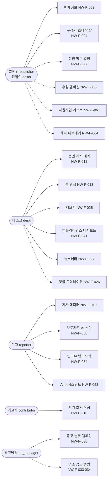

### 1-2. 독자, 광고주, 운영자

**읽는 법:** 방문자는 로그인 없이 읽고 제보·정정 청구·뉴스레터 구독을 합니다. 점선은 Phase 2(P1) 이후이고, 독자 Q&A 챗봇은 Phase 3(P2)입니다.

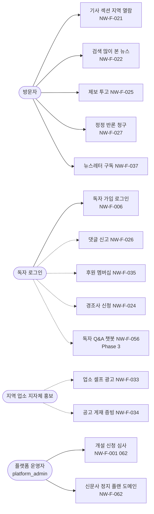

## 2. 구성요소

### 2-1. 웹, 호스트 분기, DB

**읽는 법:** 한 Next.js 앱이 Host 헤더로 독자, 편집국, 운영, 마케팅으로 갈립니다. 독자 사이트는 요청 경로에서 DB를 거의 보지 않고 ISR 캐시로 렌더하며, 편집국 쓰기는 사용자 세션으로 `news` 스키마 RPC만 부릅니다.

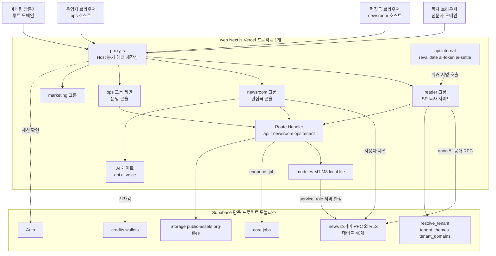

### 2-2. 워커, AI, 외부 서비스

**읽는 법:** 잡의 소유(큐, 재시도)는 TS 워커, LLM 호출은 FastAPI 그래프입니다. web과 워커에는 LLM 키가 없고, 브라우저는 Dify와 FastAPI를 직접 부르지 않습니다.

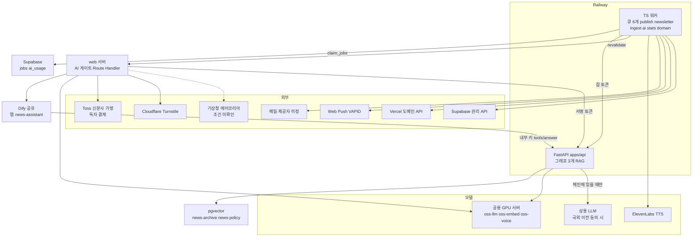

## 3. 데이터 모델

**읽는 법:** `news` 스키마 40개 중 핵심 14개입니다. 모든 테이블에 `org_id`(신문사 조직)가 있고, 하위 테이블은 `(x_id, org_id)` 복합 FK로 다른 신문사 행을 참조하지 못합니다. 사용자 INSERT·UPDATE·DELETE 권한은 어느 테이블에도 없고 쓰기는 RPC와 service_role만 합니다.

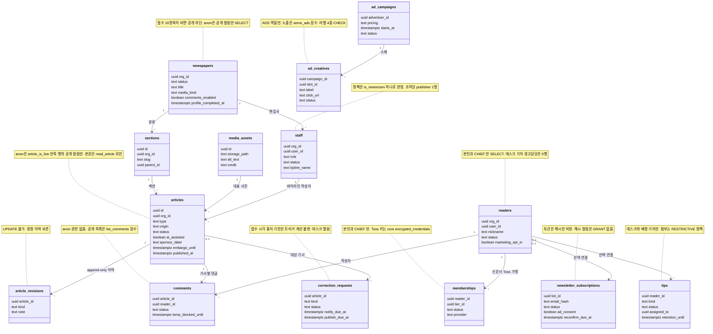

## 4. 핵심 시퀀스

### 4-1. 기사 작성에서 게시·반영까지 (NW-F-010, 012, 017)

**읽는 법:** 위에서 아래로 시간 순서입니다. 승인은 사람만 할 수 있고(서버·AI는 `NW006`), 예약 게시는 워커 크론 한 곳에서만 돌립니다. 게시 후에는 캐시 태그를 무효화하고 새 버전이 보이는지 확인합니다.

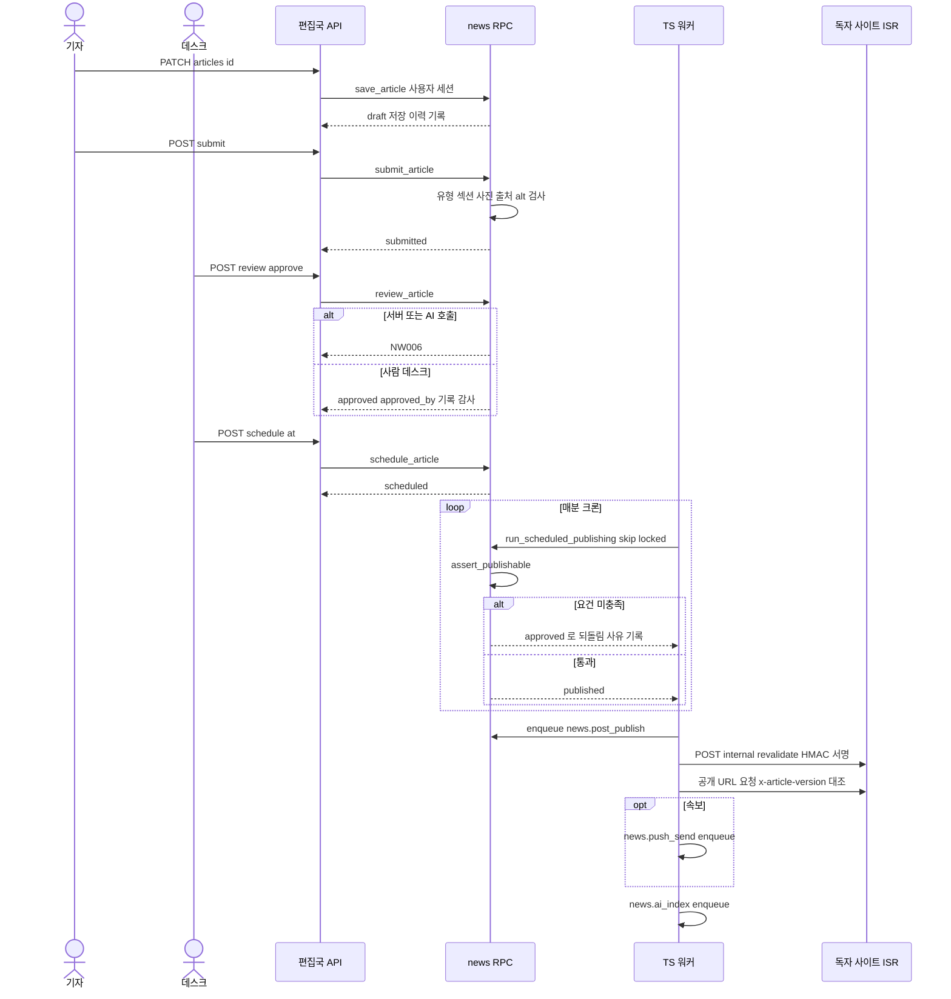

### 4-2. 보도자료 AI 초안 (NW-F-050)

**읽는 법:** 크레딧을 먼저 차감하고 잡이 돌며, 그래프는 `draft` 상태 저장까지만 하고 게시 경로가 없습니다. 실패하거나 300초를 넘으면 자동 환불되고, 게시에는 데스크의 사람 승인이 필수입니다.

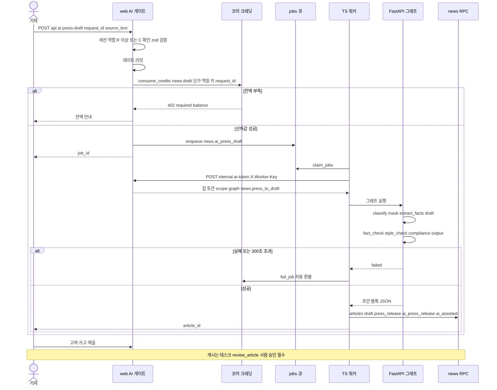

### 4-3. 뉴스레터 이중 동의 구독 (NW-F-037)

**읽는 법:** 구독 신청은 로그인 없이 가능하지만 봇 방어를 통과해야 하고, 확인 링크를 눌러야 발송 대상이 됩니다. 응답은 항상 202라서 가입된 이메일인지 알 수 없습니다.

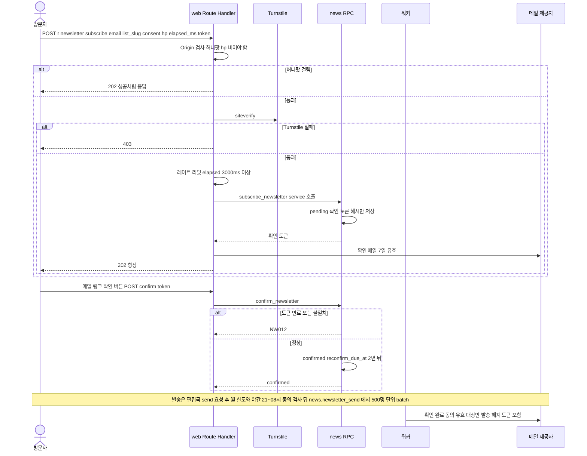

### 4-4. 정정·반론 청구 (NW-F-027)

**읽는 법:** 접수 시각과 기한은 트리거가 계산하고 바꿀 수 없습니다. 접수 후 3일 안에 수용 여부를 통지하고, 수용하면 통지 후 7일 안에 게재해야 하며, 매시간 도는 잡이 기한을 지킵니다.

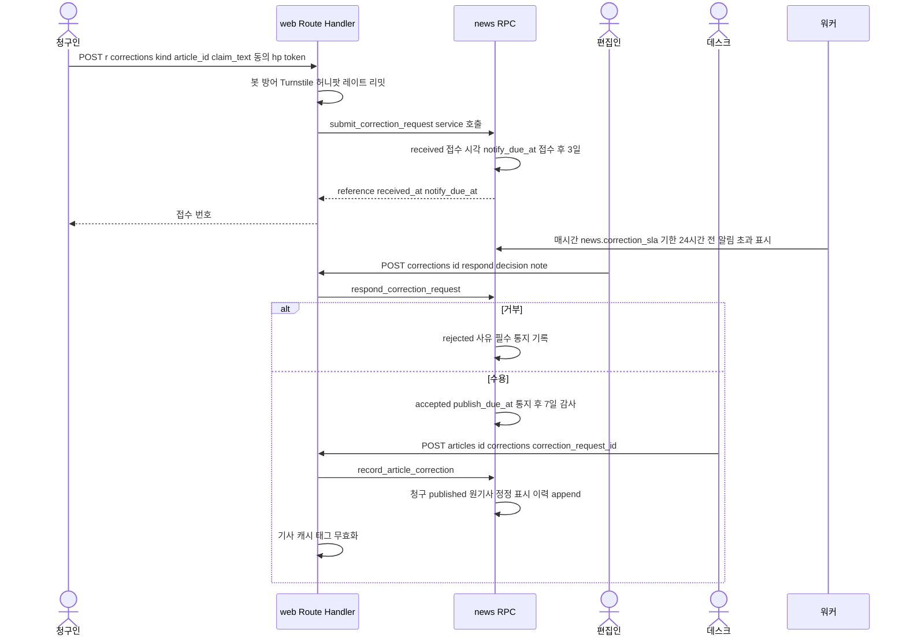

## 5. 상태 머신

### 5-1. 기사 상태 (articles.status)

**읽는 법:** 화살표 옆이 전이 주체입니다. 상태 컬럼은 직접 쓸 수 없고 DB 트리거가 허용 쌍 외 전이를 막습니다(22023). `archived`에서는 나가는 전이가 없습니다.

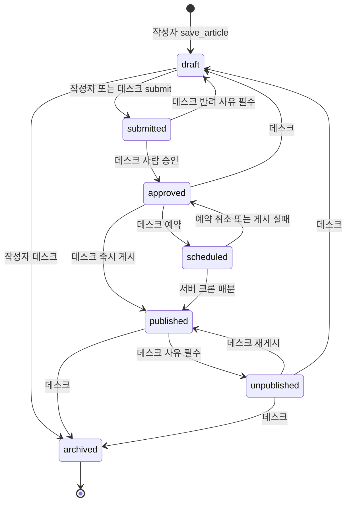

### 5-2. 정정 청구 상태 (correction_requests.status)

**읽는 법:** 거부와 철회, 게재 완료가 끝 상태입니다. 수용 결정은 편집인 이상(CHIEF)이, 게재 기록은 데스크가 합니다.

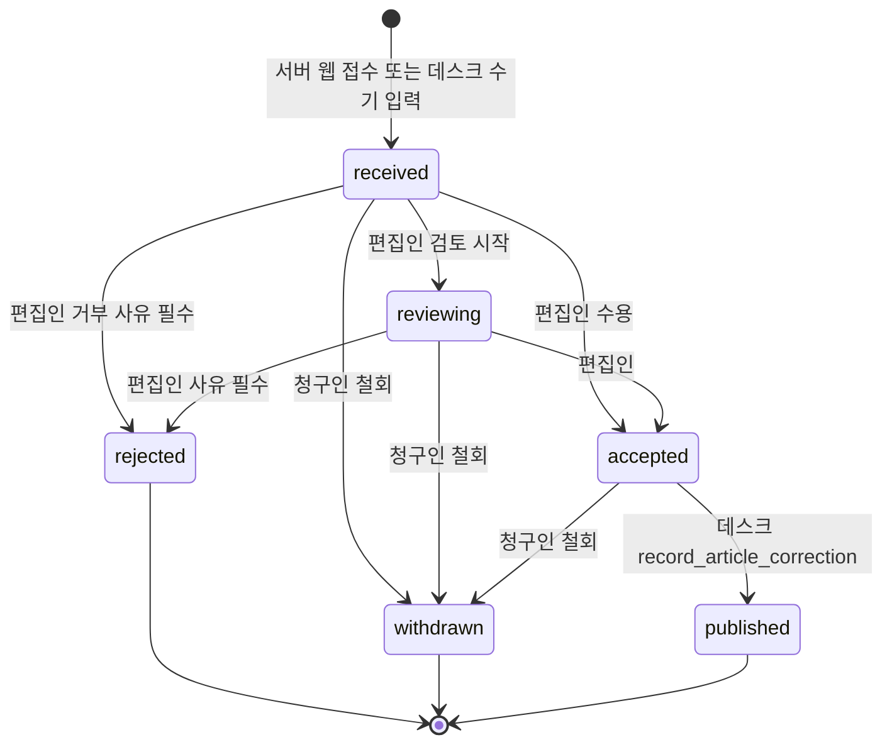

### 5-3. 개설 신청 상태 (newspaper_applications.status)

**읽는 법:** 승인하면 조직, 발행인, 구독(체험), 엔타이틀먼트(30일)가 한 번에 만들어집니다. 승인과 반려는 서버(운영자)만, 철회는 신청자만 할 수 있습니다.

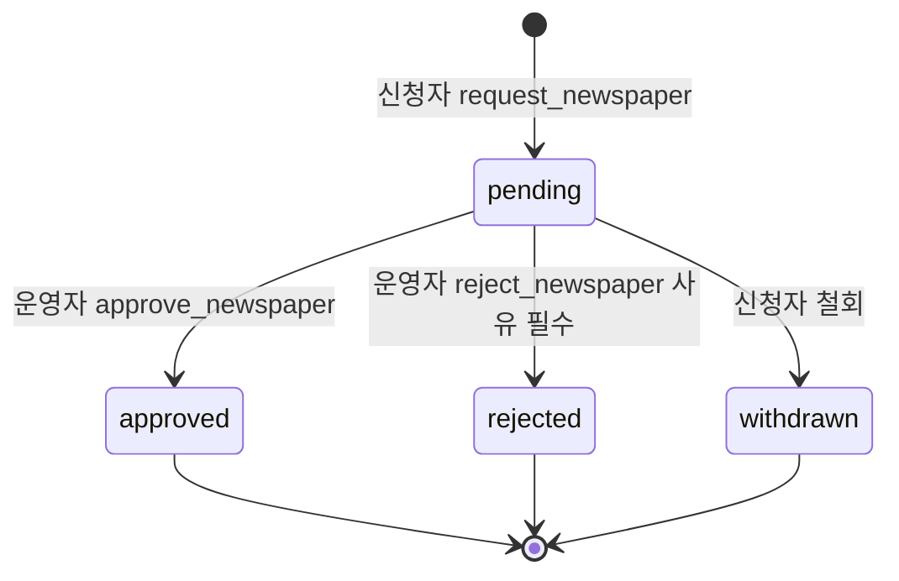

### 5-4. 뉴스레터 구독 상태 (newsletter_subscriptions.status)

**읽는 법:** `pending`은 발송 대상이 아닙니다. `confirmed`가 된 뒤 2년이 지나면 재확인 메일을 보내고 30일 무응답이면 해지됩니다.

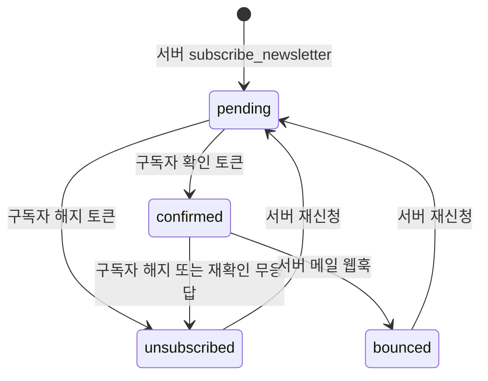

## 6. 화면 흐름

### 6-1. 독자 사이트

**읽는 법:** 독자 사이트(신문사 도메인)의 주요 화면 이동입니다. 실선은 MVP(P0), 점선은 Phase 2(P1)입니다. 매체정보가 미완성이면 모든 화면이 `/unavailable`로 막힙니다.

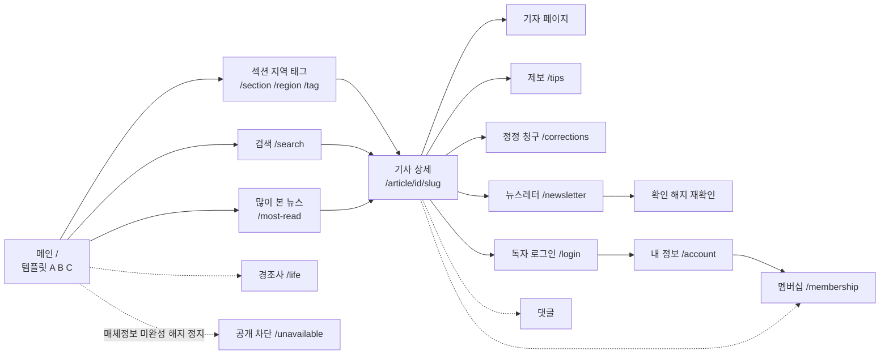

### 6-2. 편집국 콘솔

**읽는 법:** 로그인 후 대시보드에서 기사 흐름(작성, 승인, 홈 편집)과 독자·컴플라이언스 흐름으로 갈립니다. 같은 기능의 AI 화면은 보도자료함과 어시스턴트입니다.

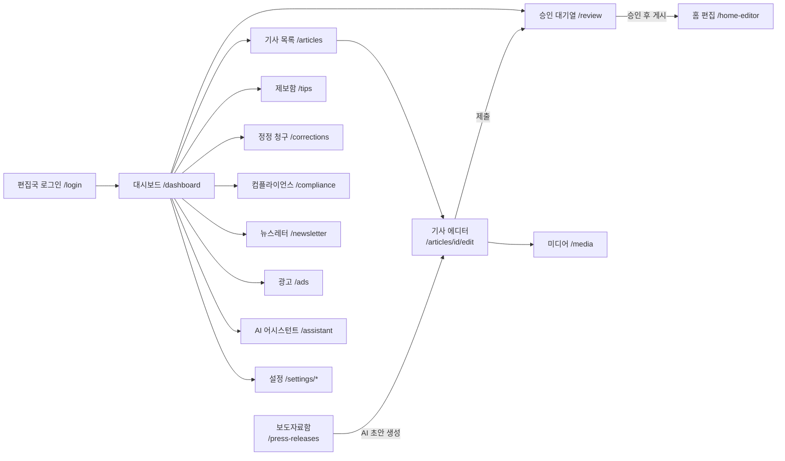

### 6-3. 개설과 운영

**읽는 법:** 신문사는 신청, 운영자 승인, 4단계 온보딩을 거쳐 첫 기사를 게시합니다. 운영 콘솔은 platform_admin이 아니면 404입니다.

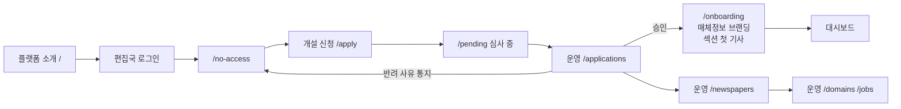

## 7. 보안 경계

**읽는 법:** 바깥에서 안쪽으로 신뢰가 커지고, 마지막 방어선은 DB입니다. `#n`은 `05_DATA_MODEL.md` 7절 위험 번호(`02_ARCHITECTURE.md` 6절 위험은 `R#n`), `§`는 `SECURITY_BASELINE.md` 장 번호입니다. 이 제품 `SECURITY.md`가 비어 있어 자산·위협 표는 아직 그림에 반영하지 못했습니다.

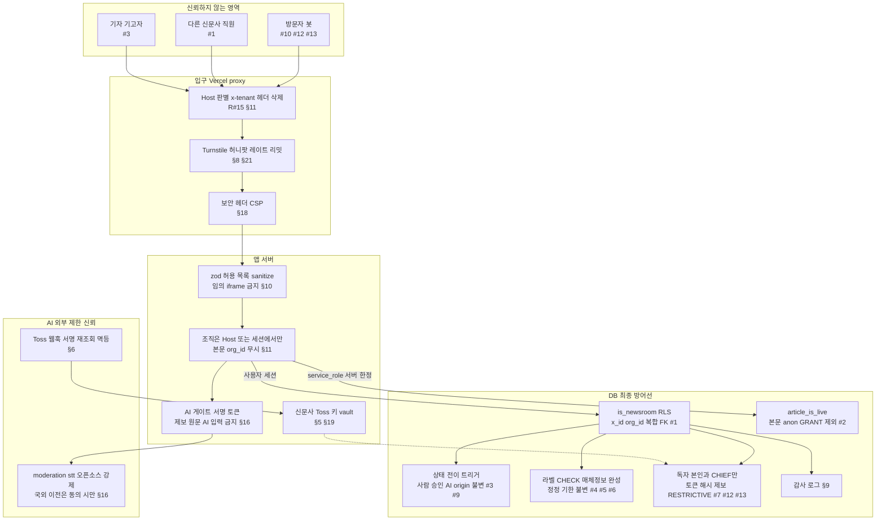

## 8. 에이전트 접근 층 (MCP)

**읽는 법:** 기존 웹 경로(위)는 그대로이고, 에이전트용 입구(아래)가 독자 사이트가 쓰는 공개 RPC를 읽기 전용으로 호출합니다. 편집국 쓰기(작성·승인·게시), 제보, 정정 청구, 댓글, 결제는 도구가 없어 승인 흐름 그림(8-2)은 없습니다. 정본은 `MCP.md`, 공통 규칙은 `../_platform-core/MCP_BASELINE.md`입니다. 점선은 미결정(D-M#) 또는 신문사 허용 설정이 필요한 부분입니다.

### 8-1. API 위에 얹는 MCP 구성

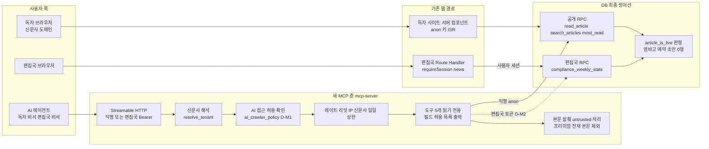

### 8-3. 도구 위험 등급과 노출 단계

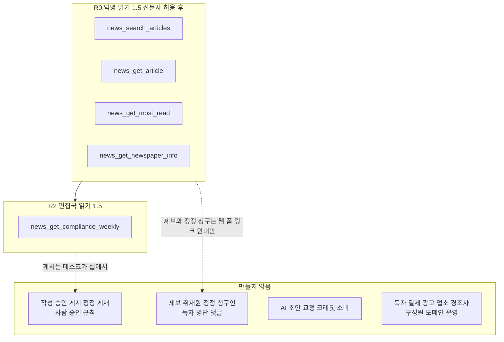

## 문서 불일치

1. **`SECURITY.md` 미작성:** 자산, 위협, 제품별 수치, 외부 서비스 표가 모두 "(작성 필요)"이고 공통 규칙 범위를 "1~21장"으로 적었는데 현재 `SECURITY_BASELINE.md`는 22장까지 있습니다. 그림 7은 05 7절, 02 6절, 01 6절을 근거로 했고 SECURITY 위협 번호(T#)는 쓰지 않았습니다.
2. **라우트 그룹 수:** `README.md` 4절은 3개(reader, newsroom, ops), `02_ARCHITECTURE.md` 1절은 4개(marketing 포함), 03 1.4절도 marketing을 둡니다. 그림 2-1은 4개로 그렸습니다.
3. **기사 URL:** `02_ARCHITECTURE.md` 2절·6절은 `news/[id]/[slug]`, `03_SCREENS_UX.md` 1.1절은 `/article/[id]/[slug]`입니다. 그림 6-1은 03장 기준입니다.
4. **광고 비컨:** `03_SCREENS_UX.md` 2.6절은 `/api/r/ad`와 일 배치 집계, `04_API.md` 2.1절과 `02_ARCHITECTURE.md` 2절은 `/api/r/ad-event`가 집계 RPC를 바로 호출합니다. 그림에는 개별 경로를 넣지 않았습니다.
5. **뉴스레터 확정 상태명:** `03_SCREENS_UX.md` 2.4절은 확정 후 `active`, `05_DATA_MODEL.md`는 `confirmed`입니다. 그림 5-4는 05장 기준입니다.
6. **편집국 경로 접두:** `03_SCREENS_UX.md` 1.2절은 모든 경로가 `/[org]` 접두 아래이고, `02_ARCHITECTURE.md` 2절 트리는 접두 없이 적었습니다. 그림 6-2는 접두를 생략했습니다.
7. **MCP 신문사 공개 정보 읽기**: `MCP.md`의 `news_get_newspaper_info`는 필요적 게재사항을 익명이 읽는 경로가 필요한데 `04_API.md` 3절의 anon 허용 RPC는 `is_public_newspaper`·`is_profile_complete`이고 공개 프로필 조회 RPC가 없습니다(독자 푸터는 서버 컴포넌트가 읽는 것으로 추정, `MCP.md` D-M4). 그림 8-1은 "공개 RPC"로 묶어 그렸습니다.
8. **MCP 기사 반환 키**: `read_article`은 jsonb를 돌려주지만 `04_API.md` 3절·`05_DATA_MODEL.md`에 키 이름이 없습니다(`locked` 외). `MCP.md`의 출력 필드는 확인 전입니다(D-M5).
9. **AI 접근 정책의 단계**: `01_PRD.md` NW-F-045(AI 크롤러 정책)는 P1(Phase 2)이고 `syndication_settings.ai_crawler_policy`는 `05_DATA_MODEL.md`에 있습니다. `MCP.md`는 이 설정이 구현되기 전에는 익명 기사 도구를 열지 않는 것으로 제안했습니다(D-M1). 그림 8-1의 "AI 접근 허용 확인"은 그 제안입니다.

## 갱신 규칙

위 근거 문서(특히 `05_DATA_MODEL.md` 상태 전이 표, `04_API.md` 엔드포인트와 RPC, `02_ARCHITECTURE.md` 잡·구성, `SECURITY.md` 작성 시 위협표)를 고치면 해당 그림도 같은 변경에서 함께 고친다.
