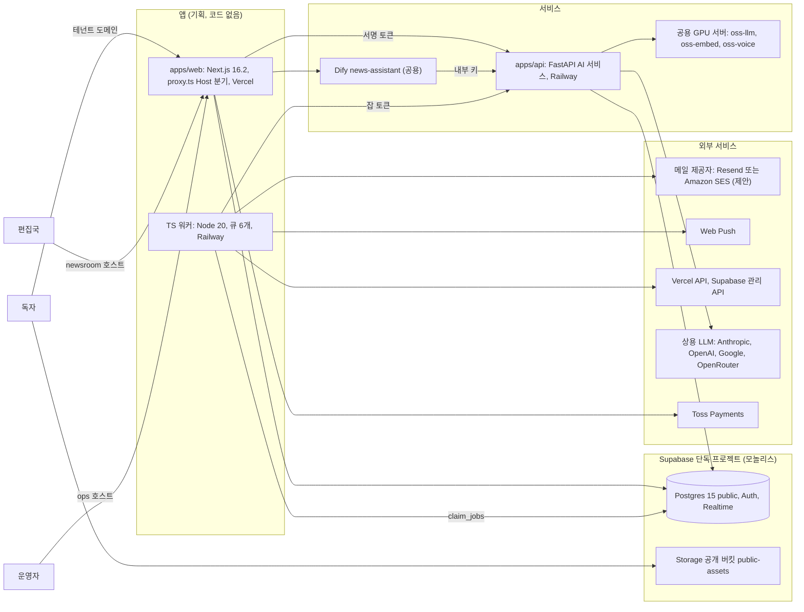

# 로컬뉴스 클라우드(가칭) (local-news)

작성일 2026-10-15. 신규 기획(원본 프로젝트·리뷰 없음). 장 구조는 `docs/products/_platform-core/DOC_TEMPLATE.md` 2.1절을 따른다. 제품 브랜드명은 열린 결정 D-1이며 그전까지 "로컬뉴스 클라우드(가칭)"로 쓴다.

## 1. 한 줄 정의

로컬뉴스 클라우드는 기자 1~10명 규모의 인터넷 지역신문과 지역 주간·일간지가 기사 작성·데스크 승인·독자 사이트·광고·뉴스레터·법정 표기를 한 곳에서 운영하도록, 신문사마다 자기 제호·도메인으로 쓰는 멀티테넌트 뉴스룸 SaaS다.

| 항목 | 내용 | 근거 |
|---|---|---|
| 대상 사용자 | (1) 편집국: 발행인·편집인·데스크·기자·기고자·광고담당 (2) 지역 독자(회원·비회원) (3) 지역 업소·지자체 홍보 담당(광고·공고 의뢰) (4) 플랫폼 운영자 | 01_PRD.md 1장 |
| 시장 규모 | 인터넷신문 등록 12,567, 일반 주간 1,274(2025-04-23). 인터넷신문 66.9%가 연 매출 1억 원 미만, 사업체당 평균 기자 4명(인터넷·주간) | https://www.kgnews.co.kr/mobile/article.html?no=842335 , https://www.journalist.or.kr/news/article.html?no=57578 |
| 테넌트 | 신문사 1곳 = `core.organizations` 1행(`is_personal=false`). 독자는 신문사 조직의 멤버가 아니라 `news.readers` 행이다 | 01_PRD.md 2장 |
| 앱 ID / 스키마 / 번호 | `core.apps.id = news`, 스키마 `news`, 모듈러 2500~2599(조각 `2500_news.sql`), 기능 ID `NW-F-###`, 작업 ID `NW-06-###`, SQLSTATE `NW001`~ | 5장 |
| 가입 정책 | `invite`. 신문사는 개설 신청 → 운영자 승인(정기간행물 등록증 확인)으로 조직·owner·엔타이틀먼트를 만든다. 독자는 엔타이틀먼트 없이 신문사별 독자 가입 | 01_PRD.md NW-F-001, NW-F-006 |
| 과금 | 신문사 B2B 월 구독(VAT 별도, 제안) + AI 월 크레딧. 독자 후원·멤버십은 신문사 자기 Toss 가맹으로 받는다 | 01_PRD.md 4장, `Price_Plans/local-news/PRICE_PLAN.md` |
| AI·음성 | 보도자료 → 기사 초안 그래프 `news.press_to_draft`(사람 승인 필수), 제목·요약·교정, 편집국 AI 어시스턴트(과거 기사·사내 규정 RAG), 인터뷰 받아쓰기(STT, 원본 미저장), 오디오 기사(TTS) | 01_PRD.md NW-F-050~056 |

## 2. 통합 근거

원본 프로젝트를 합친 제품이 아니다. 2026-10-15 사용자 요청으로 새로 기획하는 제품이며, 아래 이유로 플랫폼 코어 위에 별도 제품으로 둔다.

| 근거 | 내용 | 출처 |
|---|---|---|
| 신규 제품 | 사용자 요청(2026-10-15): 여러 지역신문사가 구독하는 멀티테넌트 SaaS. 원본 코드·리뷰가 없어 리뷰 "높음" 표는 경쟁·업계 위험 상위 항목으로 대체한다(02장 6절, 05장 7절) | 사용자 요청 2026-10-15 |
| 시장 공백 | 국내 소형 언론 CMS는 엔디소프트 임대형이 사실상 1위(거래 매체 3,644 표기, 요금 비공개)이고, 공공 대안인 언론진흥재단 통합CMS는 도입사 불만 보도가 있다. 법정 표기·자체기사 비율·정정보도 SLA를 제품이 자동으로 지켜 주는 상품은 조사 범위에서 확인되지 않았다(미확인) | https://www.ndsoft.co.kr , https://www.journalist.or.kr/m/m_article.html?no=46189 |
| 첫 화이트라벨 판매 제품 | 신문사마다 제호·로고·색·도메인이 달라야 하므로 `Multi-tenant_Theming`(`resolve_tenant`, `tenant_themes`, `tenant_domains`)을 판매 기능의 핵심으로 쓰는 첫 제품이다. 기반 검증 순서는 `Multi-tenant_Theming/06_ADOPTION_PLAN.md:47-55` 표(1순위 flora-publishing)와 함께 MT-D4에서 정리한다 | `Multi-tenant_Theming/README.md:23-36`, `Multi-tenant_Theming/05_RUNTIME_AND_DOMAINS.md:5-15` |
| 코어 재사용 | 인증·조직·엔타이틀먼트·플랜·크레딧·Toss·잡·Storage·감사·레이트 리밋·AI 계층(ai-gateway, ai-service, dify, core-voice, llm-wiki)을 `_platform-core`에서 그대로 쓴다. 제품은 `news` 스키마 도메인만 소유한다 | `docs/products/_platform-core/SHARED_MODULES.md` 19장, `docs/products/_platform-core/DB_CONVENTIONS.md:231-242` |
| 공통모듈 8개 | 뉴스룸 CMS, 독자 멤버십, 광고, 뉴스레터·푸시, 커뮤니티, 배포·SEO, 법정 준수, 검색·분석을 모듈 경계로 나눠 1차는 `news` 스키마 안 모듈별 절로 두고, 다른 제품이 쓰면 공용 스키마로 추출한다 | `docs/products/_platform-core/COMMON_MODULES_ROADMAP.md:65-81` |
| 확정 결정과의 관계 | 결정 4(Toss), 5(org 테넌시), 8(플랜 정본은 01_PRD 4장 + seed), 13~17(AI·음성 MVP 필수), 22(인증 단계 A → B → C)를 따른다. 결정 15(3D 히어로)는 독자 사이트에 적용하지 않고 플랫폼 마케팅 랜딩에만 둔다(D-11) | `docs/products/00_MERGE_ANALYSIS.md` 확정 결정 표 |

## 3. 원본 매핑

원본 없음. 이식할 원본 프로젝트와 리뷰 파일이 없으므로 같은 표 모양으로 벤치마크를 적는다. "완성도" 열은 리뷰 대신 공개 자료로 확인한 상태다.

| 벤치마크(원본 대신) | 리뷰 파일 | 완성도(공개 자료 기준) | 가져오는 것(설계 참고) | 버리는 것 |
|---|---|---|---|---|
| Newspack(WordPress 기반, 미국 지역 언론) | 해당 없음 | 운영 중. 연매출 구간별 월 $750~$2,500, 마이그레이션 무료(https://newspack.com/pricing/) | 매출 구간형 가격 앵커, 뉴스레터·후원 CTA 블록 반복 배치, 무료 이관 패턴 | WordPress 플러그인 구조, 달러 가격 그대로 |
| Ghost(Pro) | 해당 없음 | 운영 중. 월 $18~$199, 거래 수수료 0%(https://ghost.org/pricing/) | 멤버십·뉴스레터 UX, 이중 동의 구독, 유료 등급 구성 | 개인 발행인 중심 정보 구조, 지역·법정 표기 부재 |
| 엔디소프트(국내 임대형 CMS) | 해당 없음 | 운영 중. 거래 매체 3,644 표기, 요금 비공개(미확인)(https://www.ndsoft.co.kr) | 한국형 신문 홈 구성(헤드 5 + 그리드 + 인기기사), 필요적 게재사항 푸터, 지면보기 | 벤더 로고 강제 노출, 팝업 광고, 비공개 요금, 데이터 반출 불명(이관 계획은 07장) |
| 언론진흥재단 통합CMS(뉴스콘텐츠 공용인프라) | 해당 없음 | 공공 지원, 2025년 10개사 신규 선정. 도입사 불만 보도(https://www.journalist.or.kr/m/m_article.html?no=58352 , https://www.journalist.or.kr/m/m_article.html?no=46189) | 분산조판·지면 연계 요구, 공공 지원 대상 조건 | 무료 경쟁 구도를 가격으로 이기려는 시도(D-12에서 연계 영업 검토) |

## 4. 문서 목록

| 파일 | 내용 |
|---|---|
| `01_PRD.md` | 페르소나 4개, MVP/Phase 범위(인증 단계 포함), 기능 요구사항 NW-F-###와 수용 기준, B2B 플랜·AI 크레딧 단가·독자 결제 규칙, 비기능 수치(CWV, 게시 반영 시간, 뉴스레터 처리량), 법·개인정보·금지 문구(신문법, 언론중재법, 정보통신망법, 공직선거법, 정부광고법, AI기본법), KPI, 열린 결정 D-1~D-12와 8.1 인증 결정 |
| `02_ARCHITECTURE.md` | 스택, 라우트 그룹 3개(`(reader)`, `(newsroom)`, `(ops)`)와 Host 분기, 공용 모듈 사용표, 잡 큐 6개, AI 라우팅 기본값과 그래프, 경쟁·업계 위험 → 차단 설계, 배포, 환경변수, 인증 단계 절 |
| `03_SCREENS_UX.md` | 편집국 콘솔·독자 사이트·운영 콘솔 화면 목록, 핵심 플로우, 독자 메인 템플릿 3종(A 전통 신문형, B 모던 매거진형, C 모바일 피드형)과 블록 레지스트리, 상태·오류, 접근성 |
| `04_API.md` | Route Handler, `news.*` RPC, 잡 페이로드 계약, 웹훅(Toss, 도메인 검증), 외부 API 어댑터(기상청·에어코리아 미확인), 오류 코드 `NW###` |
| `05_DATA_MODEL.md` | `news` 스키마 테이블, 상태 전이(기사 워크플로, 정정 청구 SLA), RLS(편집국·독자·방문자), 인덱스, 코어 참조, 보안·데이터 위험 차단 설계, 모놀리스/모듈러 차이 |
| `06_AGENT_PLAN.md` | 작업 목록 `NW-06-###`, 소유 경계, 웨이브, 모델 비율, 인증 B·C 작업, 공용 모듈 요청 |
| `07_SOURCE_MIGRATION.md` | 이식 원천 없음 + 외부 CMS(엔디소프트 등) 기사 이관 계획(RSS·CSV·XML·사이트맵, 리디렉션 맵) + 복사 금지 패턴 |
| `CLAUDE.md` | 개발 에이전트 지침(인증 단계 규칙, 테넌트 해석 규칙 포함) |
| `supabase/` | `monolith/migrations/0001_core_lite.sql`(코어 라이트), `0002_tenant_theming.sql`(Theming 코어 변환본), `0003_local_news_domain.sql`, `seed.sql`, `tests/rls_smoke.sql` |
| `modules/` | 공통모듈 기획서 8개(M1 newsroom-cms, M2 reader-membership, M3 ad-manager, M4 notify-newsletter, M5 community, M6 distribution-seo, M7 compliance-desk, M8 search-analytics). 모듈별 책임·소유 표·추출 시 공용 스키마. 파일 이름은 폴더 목록이 정본 |
| `../_supabase-modular/migrations/2500_news.sql` | 통합 DB용 `news` 스키마 조각(모놀리스와 같은 도메인 모델) |

## 5. DB 구조 선택

| 항목 | 결정 | 근거 |
|---|---|---|
| 1차 배포 | 모놀리스(단독 Supabase 프로젝트, `public` 스키마). D-2에서 최종 확인 | 아래 이유 3개 |
| 이유 1: 트래픽 격리 | 독자 공개 트래픽은 속보·선거·재난 때 급증한다. 통합 DB에 두면 다른 제품의 로그인·결제 쿼리와 커넥션을 나눠 쓴다. live-poll도 같은 이유로 분리 검토 대상이다 | `docs/products/_supabase-modular/ARCHITECTURE.md:31-46`(live-poll 행) |
| 이유 2: 계정 풀 | 독자 계정은 SaaS 고객(신문사 편집국)과 성격이 다른 대규모 공개 가입 풀이다. 통합 DB의 "NOMAD 계정"에 섞으면 다른 제품 교차 판매 대상이 아닌 독자 수십만 명이 코어 `profiles`에 쌓인다 | `develop/_shared/auth/README.md:18`(AUTH-D1) |
| 이유 3: 데이터 경계 | 독자 개인정보의 처리자는 신문사이고 플랫폼은 수탁자다. 단독 프로젝트면 위탁 범위(독자 데이터가 있는 DB)가 한 곳으로 정리된다 | 01_PRD.md 6절 |
| 모듈러 조각 | 저장소 규칙대로 같은 도메인 모델을 `2500_news.sql`로 둔다. 통합 DB로 옮기거나 다른 제품이 공통모듈을 추출할 때 쓴다 | `docs/products/_platform-core/DB_CONVENTIONS.md:244-266`, `docs/products/_PRODUCT_AGENT_BRIEF.md:43-47` |
| 정본 관계 | 모듈러 조각이 도메인 정본이고 모놀리스 `0003_local_news_domain.sql`은 변환 규칙(`core.` → `public.`, 스키마 블록 제거, 명시 GRANT)으로 만든다. Theming은 `Multi-tenant_Theming/supabase/0011_core_tenant_theming.sql`을 같은 규칙으로 변환해 `0002`에 둔다 | `docs/products/_platform-core/DB_CONVENTIONS.md:266` |
| 엔터프라이즈 | 전용 DB가 필요한 신문사는 판매 모델 B(신문사별 프로젝트)로 같은 마이그레이션을 적용한다 | `Price_Plans/_common/PRICING_PRINCIPLES.md:63-72` |
| 번호 범위 | arch-studio가 2400~2499(제안)를 먼저 잡았으므로(`docs/products/README.md:25`) 이 제품은 다음 빈 범위 2500~2599를 쓴다 | `docs/products/_platform-core/DB_CONVENTIONS.md:42` |

## 진행 현황 (2026-11-11 기준)

| 항목 | 상태 | 근거 |
|---|---|---|
| 기획 | 01~07 작성 완료 | 이 폴더 `01_PRD.md`~`07_SOURCE_MIGRATION.md`, `modules/` |
| 개발 단계 | 기획만 | 앱 코드 없음. 원본 프로젝트·리뷰 없는 신규 기획(README.md:3) |
| 완성도 | 미확인 | 원본 리뷰가 없고 작업 완료 기록도 없다 |
| 마지막 커밋 | 2026-10-30 | platform-docs `products/local-news/` 경로의 마지막 커밋 |
| 주요 스택 | Next.js 16.2.x + React 19.2, Tailwind CSS v4(4.x), Node 20 워커, FastAPI(Python 3.12 제안), Supabase Postgres 15(단독 모놀리스) | `02_ARCHITECTURE.md` 1절 |

## 구조도

기획 문서 기준(`02_ARCHITECTURE.md` 1절 스택, 7절 배포 토폴로지). 같은 내용을 `diagrams/architecture.mmd`에 둔다.

## 화면

캡처 불가: 코드 없음(기획만 있는 제품). 화면 명세는 `03_SCREENS_UX.md`.
