# DIAGRAMS: Microweb Studio UML 시각화

작성일 2026-10-23. 이해관계자(기획·개발·운영·법무) 소통용 그림 모음입니다. 정본은 이 폴더의 각 문서이며, 그림과 문서가 다르면 문서가 우선입니다. GitHub에서 그림이 바로 렌더링됩니다(Mermaid). 전체 구조도는 `../_platform-core/ARCHITECTURE_DIAGRAMS.md`와 같은 스타일입니다.

**제품 한 줄 정의:** 하객에게 보내는 모바일 마이크로웹(1차 청첩장, 이후 돌잔치·부고장)을 템플릿 엔진으로 만들고, 같은 사이트의 쇼룸(포트폴리오, 가격표, 시뮬레이터, 견적 문의)으로 대행 제작을 파는 제품. AI 문구 제안, 문구 위키·RAG, 제작 상담 채팅, 음성 대화·인사말 음성·하객 음성 방명록이 MVP에 들어 있습니다 (`README.md` 1절).

**근거 문서:** `README.md`, `01_PRD.md`, `02_ARCHITECTURE.md`, `03_SCREENS_UX.md`, `04_API.md`, `05_DATA_MODEL.md`, `SECURITY.md`(미작성, 아래 7절 참조), 공통 `../_platform-core/SECURITY_BASELINE.md`, `CORE_SPEC.md`.

**표기:** 실선 화살표 = 호출·데이터 흐름, 점선 = 검증·참조·예약 실행, "(제안)" = 문서가 제안이라고 밝힌 값, "Phase 2" = MVP 이후. 숫자 MW-F-nnn은 `01_PRD.md` 기능 ID.

| # | 그림 | UML 종류 | 근거 문서 절 |
|---|---|---|---|
| 1-1 | 사용자와 MVP 기능 | 유스케이스(flowchart) | `01_PRD.md` 1절, 2절 |
| 1-2 | Phase 2·3 기능 | 유스케이스(flowchart) | `01_PRD.md` 2절 |
| 2-1 | 구성요소: 웹·워커·저장소 | 컴포넌트 | `02_ARCHITECTURE.md` 2~4절, 7절 |
| 2-2 | 구성요소: AI 계층 | 컴포넌트 | `02_ARCHITECTURE.md` 2절, 5절, `04_API.md` 6절 |
| 3 | 데이터 모델 | 클래스 | `05_DATA_MODEL.md` 1~4절 |
| 4-1 | 대행 제작 게시 | 시퀀스 | `03_SCREENS_UX.md` F1, `04_API.md` 2절, `02_ARCHITECTURE.md` 4절 |
| 4-2 | 하객 음성 방명록 | 시퀀스 | `03_SCREENS_UX.md` F8, `04_API.md` 2절 |
| 4-3 | AI 문구·구성 제안 | 시퀀스 | `03_SCREENS_UX.md` F5, `04_API.md` 2절 |
| 4-4 | 셀프 결제와 발행 (Phase 2) | 시퀀스 | `03_SCREENS_UX.md` F4, `04_API.md` 2절 |
| 5-1 | 사이트 상태 | 상태 머신 | `05_DATA_MODEL.md` 3절 |
| 5-2 | 문의(lead) 상태 | 상태 머신 | `05_DATA_MODEL.md` 3절 |
| 5-3 | 제작 주문 상태 | 상태 머신 | `05_DATA_MODEL.md` 3절 |
| 6-1 | 화면 흐름: 공개 영역 | flowchart | `03_SCREENS_UX.md` 1절, F1~F3 |
| 6-2 | 화면 흐름: 스튜디오 | flowchart | `03_SCREENS_UX.md` 1절, 8절 |
| 7 | 보안 신뢰 경계 | flowchart | `04_API.md` 1절, `05_DATA_MODEL.md` 4절·7절, `01_PRD.md` 6절 |

## 1. 사용자와 기능

### 그림 1-1. 사용자와 MVP 기능

읽는 법: 왼쪽은 역할, 오른쪽은 MVP 기능입니다. 하객과 대행 고객은 로그인하지 않습니다(`02_ARCHITECTURE.md` 9.5절). 운영자만 초대제로 로그인합니다.

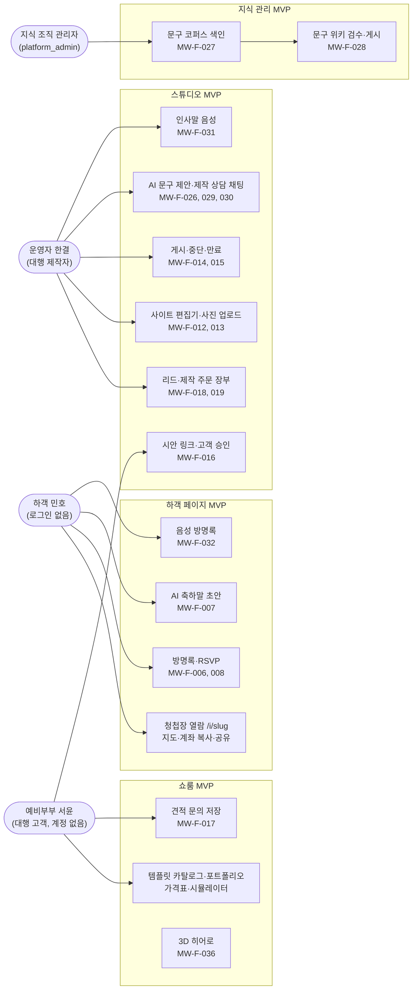

### 그림 1-2. Phase 2·3 기능

읽는 법: `01_PRD.md` 2절 표에서 MVP 밖으로 둔 기능을 구분 그대로 모았습니다.

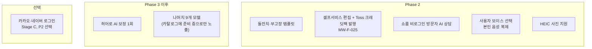

## 2. 구성요소

### 그림 2-1. 웹·워커·저장소

읽는 법: 하객 쓰기는 anon이 DB에 직접 쓰지 못하고 Route Handler가 service_role 전용 DB 함수를 부릅니다. 운영자 쓰기는 사용자 세션과 RLS, 게시 같은 무거운 작업은 `microweb.media` 큐의 워커가 맡습니다. AI 계층은 그림 2-2.

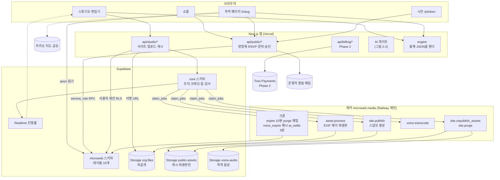

### 그림 2-2. AI 계층

읽는 법: 스튜디오는 `/api/ai/*`, `/api/voice/*`, 하객은 `/api/public/[slug]/*`만 부릅니다. Dify, FastAPI, 제공자는 직접 부르지 않습니다. 워커는 FastAPI를 호출하지 않고 AI 제공자 키도 없습니다(`02_ARCHITECTURE.md` 2절). 하객 음성 방명록은 오픈소스 STT만 씁니다.

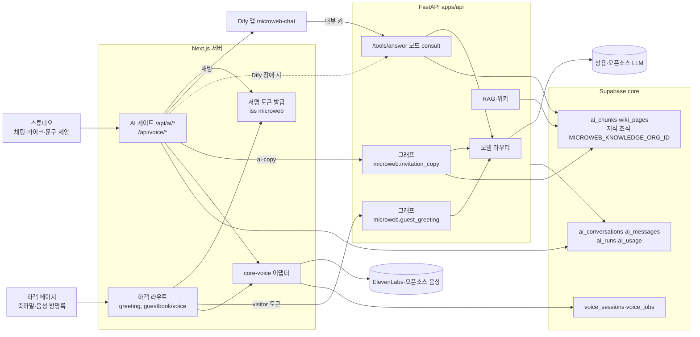

## 3. 데이터 모델

### 그림 3. 핵심 테이블과 관계

읽는 법: `microweb` 스키마 10개 테이블 전부와 참조하는 코어 4개입니다. 선 위 글자는 관계입니다.
접근 주체: 하객 쓰기(`guestbook_entries`, `rsvp_responses`)와 `leads` 생성은 service_role 전용 RPC만 합니다. `sites`는 콘텐츠 컬럼만 운영자 세션이 UPDATE하고 상태·과금·게시 컬럼은 RPC·트리거만 바꿉니다. `site_publications`는 anon이 공개 9컬럼만 읽습니다(게시 중, 만료 전). `templates`, `portfolio_items`는 전역으로 anon이 읽고 쓰기는 service뿐입니다. 운영자 읽기 조건은 `has_studio_access`(멤버 + 엔타이틀먼트 + `studio_access` 허용 목록).

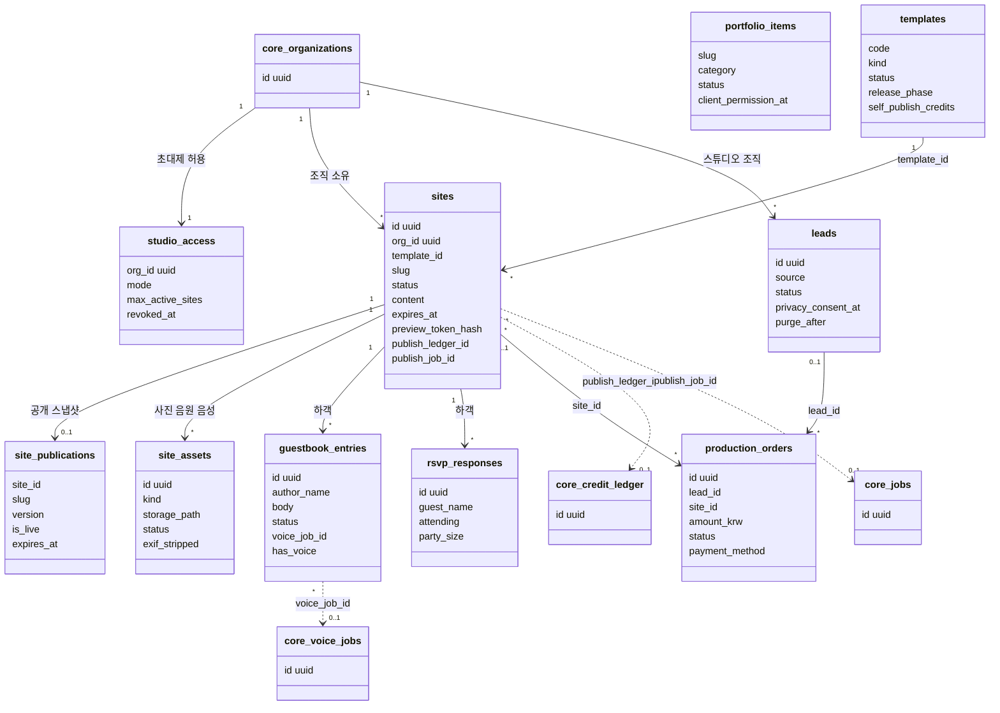

`portfolio_items`는 다른 테이블과 FK가 없는 전역 쇼룸 데이터라 관계선이 없습니다.

## 4. 핵심 시퀀스

### 그림 4-1. 대행 제작 게시 (MW-F-014, 016, 019)

읽는 법: 대행 모드는 결제된 제작 주문과 고객 승인이 있어야 `request_publish`가 통과합니다(재게시는 승인 면제). 게시 잡이 실패하면 이전 상태로 복구됩니다. 셀프 모드의 크레딧 선차감은 그림 4-4.

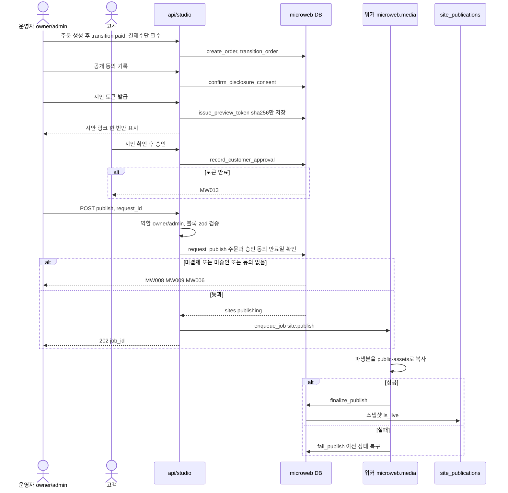

### 그림 4-2. 하객 음성 방명록 (MW-F-006, 032)

읽는 법: 하객은 로그인이 없어서 서명된 방문자 쿠키와 IP 해시로 식별합니다. 음성은 오픈소스 STT만 쓰고 상용으로 대체하지 않습니다. 녹음 전 고지 확인이 먼저입니다.

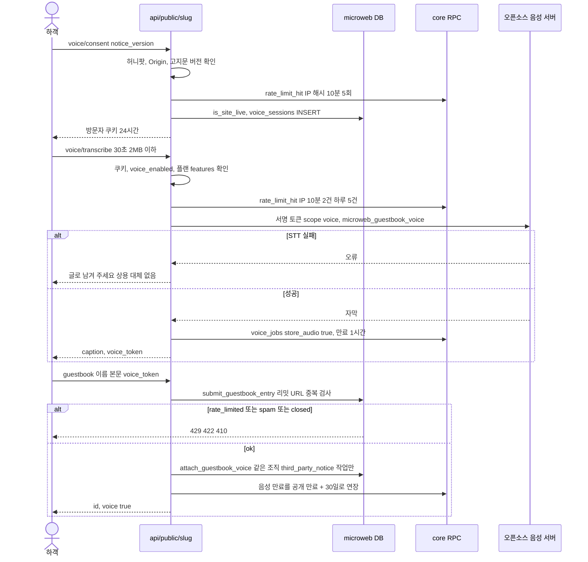

### 그림 4-3. AI 문구·구성 제안 (MW-F-026, 034, 035)

읽는 법: 셀프 모드는 시작 전 2크레딧을 선차감하고 대행 모드는 0크레딧에 사용량 기록과 공정 사용 상한입니다. 결과는 저장되지 않고 운영자가 "적용"을 눌러야 `sites.content`에 병합됩니다. 호출은 서명 토큰 1회용(`jti`)입니다.

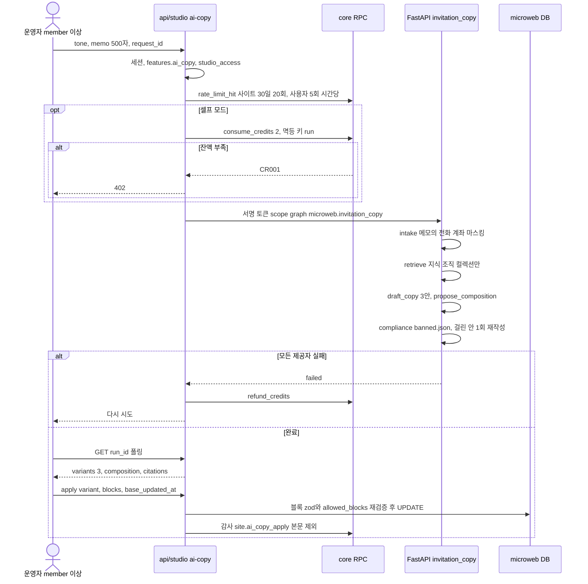

### 그림 4-4. 셀프 결제와 발행 (Phase 2, MW-F-025)

읽는 법: 결제 금액은 `credit_packs`의 값이고 클라이언트 금액은 대조만 합니다. 금액 불일치(PM001)는 Toss 승인을 취소하고 주문을 `failed`로 기록합니다. 발행 시 크레딧을 선차감하고 잡 실패는 자동 환불입니다.

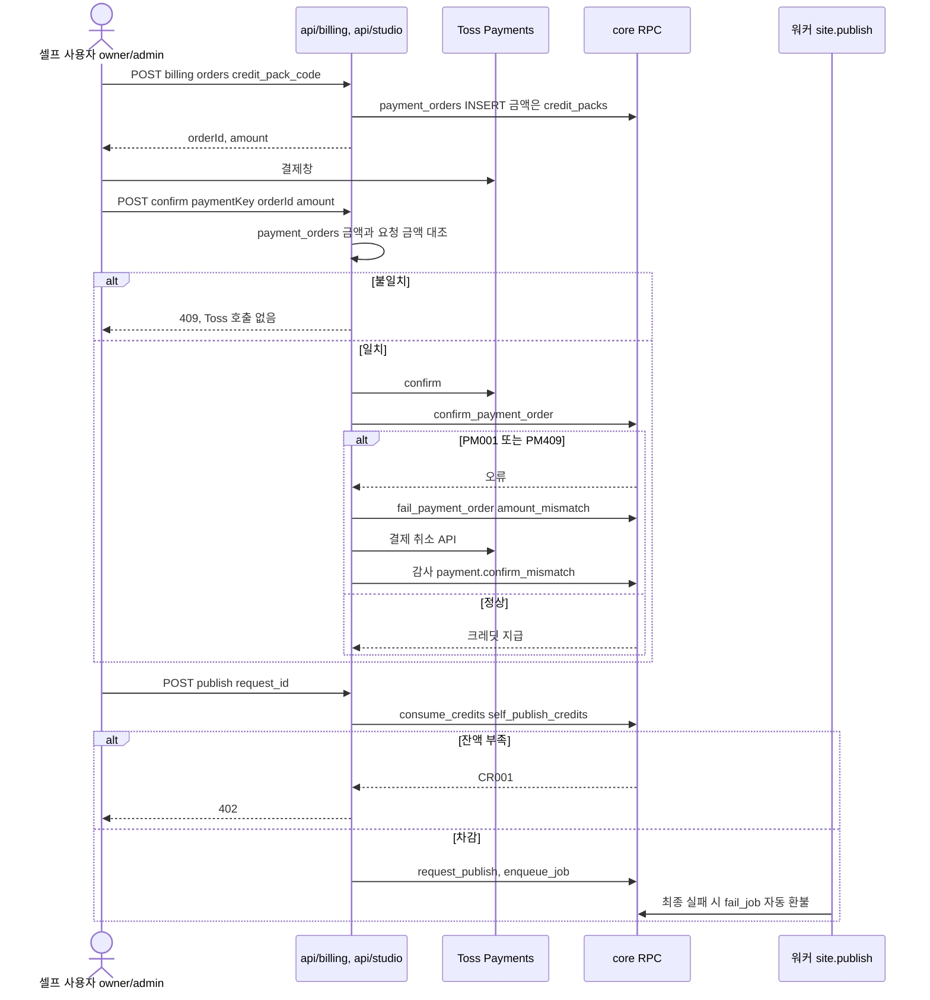

## 5. 상태 머신

### 그림 5-1. 사이트 `sites`

읽는 법: 전이는 트리거가 강제하며 service_role 쓰기에도 적용됩니다(위반 MW001). 괄호 아닌 라벨의 주체가 전이를 일으킵니다. `archived`는 종단이며 30일 뒤 `site.purge`가 지웁니다. publishing 30분 초과는 `expire_sites`가 실패 처리합니다.

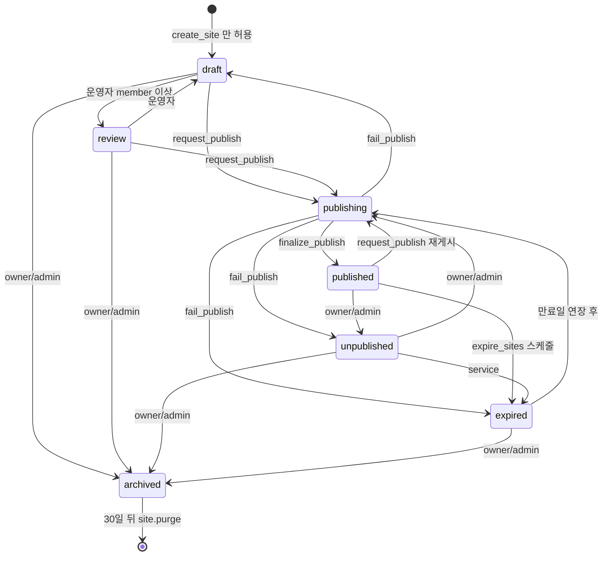

### 그림 5-2. 문의 `leads`

읽는 법: 전이는 `set_lead_status`로만 하고 member 이상이 호출합니다. `won`, `spam`은 종단입니다. 문의는 1년 뒤 자동 삭제, 삭제 요청은 즉시 삭제합니다.

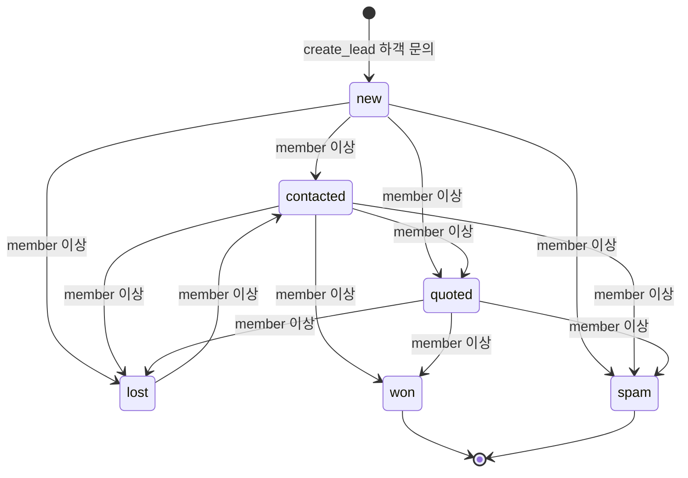

### 그림 5-3. 제작 주문 `production_orders`

읽는 법: 모든 전이는 owner/admin이 합니다. `paid`로 가려면 결제수단이 필수이고 참조에 12자리 이상 숫자열은 거부됩니다(카드번호 저장 금지). `closed`, `canceled`, `refunded`는 종단입니다.

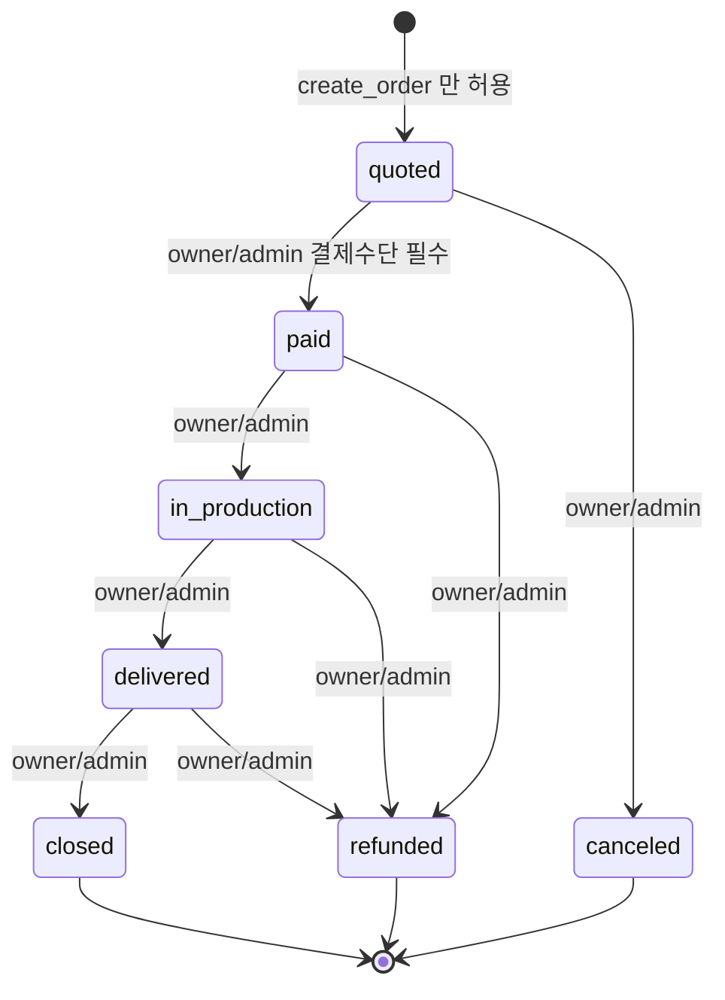

`guestbook_entries.status`(visible, hidden, spam)는 `moderate_guestbook_entry`로만 바뀌어 상태 머신으로 그리지 않았습니다.

## 6. 화면 흐름

### 그림 6-1. 공개 영역 (쇼룸, 하객, 시안)

읽는 법: 이 화면들은 로그인이 필요 없고 인증 단계(A/B/C)와 무관합니다. 쇼룸 헤더에 운영자 로그인 링크를 새로 넣지 않습니다(`02_ARCHITECTURE.md` 9.5절).

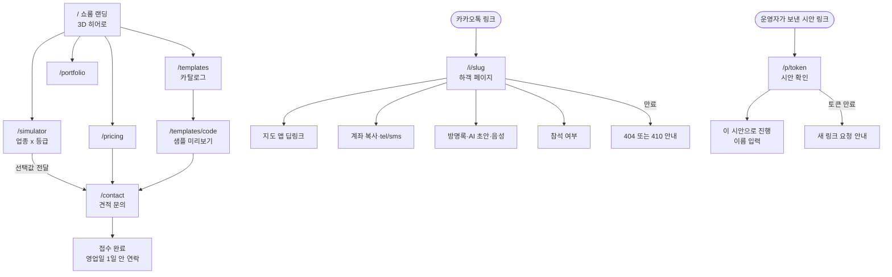

### 그림 6-2. 스튜디오 (운영자)

읽는 법: 초대 메일로 들어와 약관과 AI 처리 방식을 고른 뒤 `/studio`에서 시작합니다. `/pending`, `/no-access`는 허용 목록과 엔타이틀먼트가 없을 때 가는 안내 화면입니다. 대시보드 셸·GNB의 관리자 화면과 하객 관리 모아 보기는 결정 대기(`01_PRD.md` D-22, D-23)라 그리지 않았습니다.

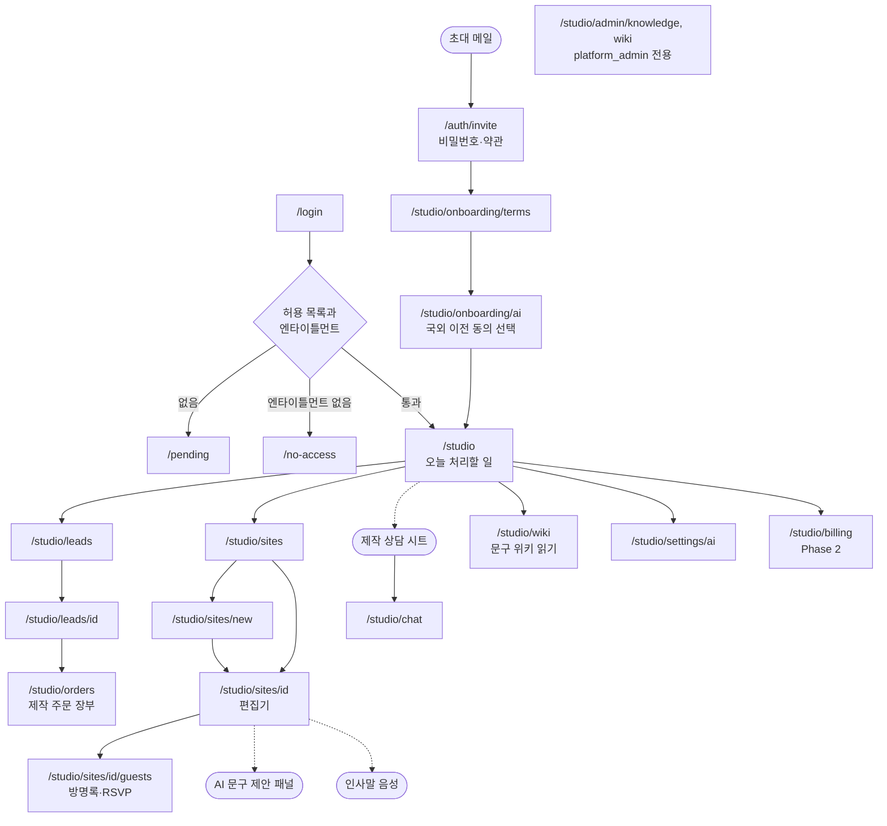

## 7. 보안 경계

읽는 법: `SECURITY.md`는 아직 템플릿 상태(자산·위협·외부 서비스 표가 "작성 필요")라서, 이 그림은 같은 제품의 `04_API.md` 1절, `05_DATA_MODEL.md` 4절·7절, `01_PRD.md` 6절, `02_ARCHITECTURE.md` 5절에 적힌 통제를 신뢰 경계로 모은 것입니다. SECURITY.md가 채워지면 위협 번호(T)를 붙여 다시 그립니다. §는 `../_platform-core/SECURITY_BASELINE.md` 장 번호입니다.

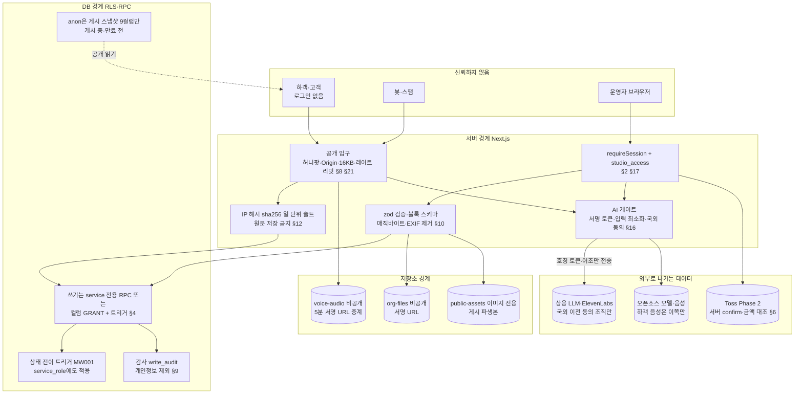

| 제품 고유 위험(문서에 적힌 것) | 대응(그림 7의 어느 상자) | 근거 |
|---|---|---|
| 하객 수만큼 늘어나는 AI 비용·오픈 프록시 | 범용 프록시 없음, 하객 AI 라우트 2개만, 게시 중 사이트만, 사이트 30일 한도 | `05_DATA_MODEL.md` 7절, `04_API.md` 2절 |
| 계좌·전화 공개 | 공개 동의 기록 전 게시 불가(MW006), noindex 기본, 만료 후 파생본 삭제 | `01_PRD.md` 6절, MW-F-004, MW-F-011 |
| 제3자(하객) 음성 | 고지 확인, 오픈소스 강제, 만료·삭제 경로, 14세 미만 보호자 안내(법무 확인 D-12) | `01_PRD.md` 6절, `02_ARCHITECTURE.md` 5.1절 |
| 시안 토큰 유출 | 토큰은 sha256만 저장, TTL 기본 7일 최대 14일 | MW-F-016 |
| 결제 기록의 카드번호 | 12자리 이상 숫자열 참조 거부 | MW-F-019 |
| 원본 프로젝트의 노출된 `.env.local` | 폐기·회전, gitleaks 시크릿 스캔 | `05_DATA_MODEL.md` 7절, `07_SOURCE_MIGRATION.md` |

SECURITY.md 3절(세션 만료, CSP 도메인, 레이트 리밋 수치, 감사 보존, 백업, 알림 수신자)은 전부 "(작성 필요)"라서 그림에 수치를 넣지 않았습니다. 세션·헤더 §18, 공급망 §19, 운영 §20은 공통 규칙을 참조합니다.

## 문서 불일치

- `SECURITY.md`가 템플릿 그대로(자산·위협·외부 서비스·고유 위험 모두 "작성 필요")인데, 같은 제품의 `01_PRD.md` 6절·`05_DATA_MODEL.md` 7절에는 보안 설계가 이미 구체적으로 있습니다. 그림 7은 후자를 따랐습니다. 또 SECURITY.md는 공통 규칙을 "1~21장"이라 하나 SECURITY_BASELINE은 22장까지 있습니다(22장은 제품별 SECURITY.md 규정).
- 그 밖의 모순은 확인하지 못했습니다. 참고: `04_API.md` 2절의 관리자 행(studio_access 부여, 템플릿·포트폴리오 편집)은 라우트만 있고 화면이 없습니다(`03_SCREENS_UX.md` 8.1절 D-22 결정 대기).

## 갱신 규칙

`01_PRD.md`~`05_DATA_MODEL.md`, `SECURITY.md`를 고치면 이 그림도 같은 변경에서 함께 고칩니다. SECURITY.md를 채우면 7절 그림을 위협 번호 기준으로 다시 그립니다.
