# DIAGRAMS: NOMAD Blog (nomad-blog) UML 시각화

작성일 2026-10-23. 이해관계자(기획·개발·운영·법무) 소통용 그림 모음입니다. 정본은 각 문서이며, 그림과 문서가 다르면 문서가 우선입니다. GitHub에서 그림이 바로 렌더링됩니다(Mermaid).

**제품 한 줄 정의**: 키워드 하나로 AI가 블로그 원고를 쓰고, 제휴 상품 카드와 대가성 문구를 자동으로 넣은 뒤, 네이버 블로그·티스토리·워드프레스에 예약 발행까지 해 주며, 네이버 브랜드커넥트 지원도 자동 제출하는 조직 단위 SaaS입니다(`README.md` 1절).

**근거 문서**: `README.md`, `01_PRD.md`, `02_ARCHITECTURE.md`, `03_SCREENS_UX.md`, `04_API.md`, `05_DATA_MODEL.md`, `SECURITY.md`, `MCP.md`(미작성 초안, 아래 "문서 불일치" 참조), 공통 맥락은 `../_platform-core/ARCHITECTURE_DIAGRAMS.md`, `SECURITY_BASELINE.md`, `CORE_SPEC.md`.

**표기**: 실선 화살표 = 호출·데이터 흐름, 점선 = 검증·참조·조건부, "(제안)" = 문서가 확정 전이라고 적은 값. `01_PRD.md` 2절의 범위 표가 "제안"이라 적혀 있어, MVP/Phase 구분은 그 표를 그대로 따랐습니다.

| # | 그림 | UML 종류 | 근거 문서 절 |
|---|---|---|---|
| 1 | 사용자와 기능 | 유스케이스(flowchart) | `01_PRD.md` 1절, 2절, 3장 |
| 2 | 구성요소 | 컴포넌트(flowchart) | `02_ARCHITECTURE.md` 2절, 4절, 7절 |
| 3 | 데이터 모델 | 클래스 | `05_DATA_MODEL.md` 1~4절, 6절 |
| 4-1 | AI 원고 생성과 사람 승인 | 시퀀스 | `04_API.md` 2절, 2.1절, 4절, `01_PRD.md` BL-F-051~052 |
| 4-2 | 검사와 발행 | 시퀀스 | `04_API.md` 2절, 4절, `01_PRD.md` BL-F-043~048 |
| 4-3 | 브랜드커넥트 동의·탐색·지원 | 시퀀스 | `04_API.md` 2절, `01_PRD.md` BL-F-030~036 |
| 4-4 | AI 도우미 채팅 한 턴 | 시퀀스 | `04_API.md` 2.1절, 6.2절, `01_PRD.md` BL-F-055 |
| 5-1 | 원고 상태 | 상태 머신 | `05_DATA_MODEL.md` 3.1절 |
| 5-2 | 발행 상태 | 상태 머신 | `05_DATA_MODEL.md` 3.2절 |
| 5-3 | 채널 계정 상태 | 상태 머신 | `05_DATA_MODEL.md` 3.3절 |
| 5-4 | AI 초안 실행(run)과 승인 | 상태 머신 | `02_ARCHITECTURE.md` 5.2절 |
| 6 | 화면 흐름 | flowchart | `03_SCREENS_UX.md` 1절, 2장 |
| 7 | 보안 경계 | flowchart | `04_API.md` 1절, `05_DATA_MODEL.md` 4절, 7절, `01_PRD.md` 6.4절, `SECURITY_BASELINE.md` |
| 8-1 | 웹 경로와 MCP 층 (제안) | 컴포넌트 | `MCP.md` 2·3절, `04_API.md` 1절 |
| 8-2 | 발행 준비와 사람 확정 | 시퀀스 | `MCP.md` 6절, `04_API.md` 2절 |
| 8-3 | 도구 위험 등급과 노출 단계 | 블록 | `MCP.md` 1·2절 |

## 1. 사용자와 기능

읽는 법: 왼쪽은 사람, 가운데는 MVP 기능, 오른쪽은 Phase 2입니다. 기능 옆 번호는 `01_PRD.md`의 기능 ID입니다. 이 제품의 MVP 범위는 문서가 "제안"이라고 밝힌 값입니다.

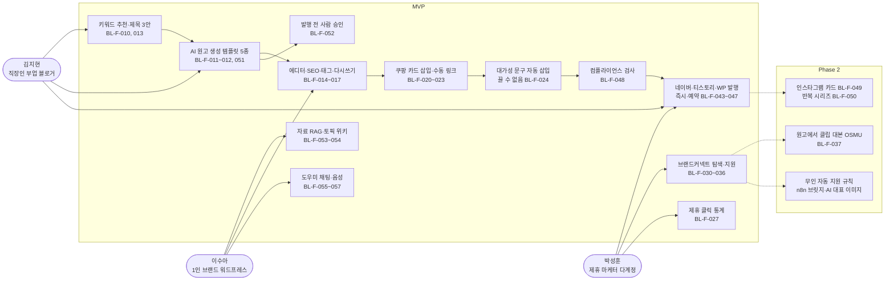

## 2. 구성요소

읽는 법: Redis 없이 `core.jobs`가 큐입니다. 웹(Vercel)은 Playwright를 돌리지 않고 잡만 넣으며, 브라우저 자동 조작은 모두 Railway의 `blog-worker`가 합니다. FastAPI는 텍스트와 그래프만 다루고 원고 저장은 워커가 합니다.

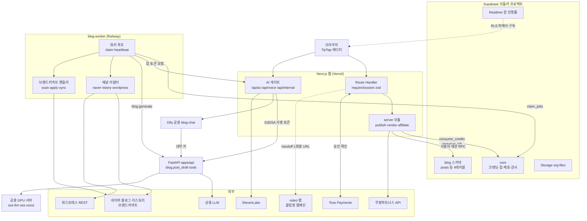

## 3. 데이터 모델

읽는 법: `blog` 스키마에는 테이블이 4개뿐이고(위쪽 4개), 제휴·잡·자격증명·AI 실행은 `core`의 테이블을 참조합니다(아래쪽, 열은 문서에 이름이 나온 것만 적었습니다). 사용자는 원고 콘텐츠 열만 직접 쓰고 나머지는 서버·워커·RPC가 씁니다. 별도 AI 테이블은 만들지 않았습니다(`05` 6절).

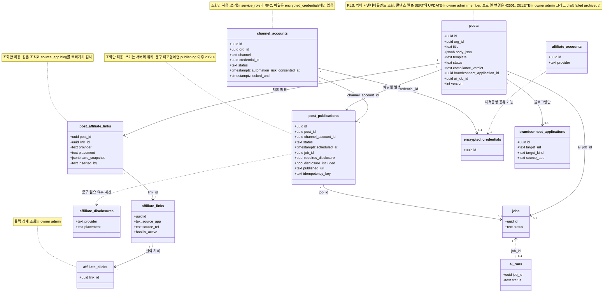

## 4. 핵심 시퀀스

### 4-1. AI 원고 생성과 사람 승인 (BL-F-051, 052)

읽는 법: 크레딧은 먼저 차감하고(`request_id` 멱등) 생성은 잡으로 넘깁니다. 그래프는 `approve` 노드에서 멈춰 사용자 승인을 기다리며, 승인 전에는 발행할 수 없습니다. 이 승인 확인은 DB 불변식이 아니라 서버 규칙입니다.

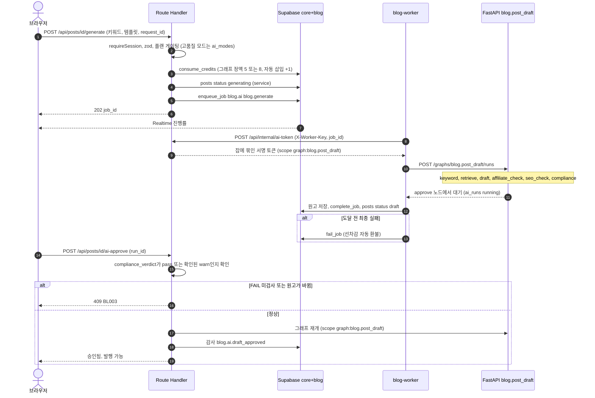

### 4-2. 검사와 발행 (BL-F-043~048)

읽는 법: 발행 요청은 서버가 여러 단계를 순서대로 확인한 뒤 발행 행을 만들고, DB 트리거가 마지막 관문(대가성 문구 불변식)을 맡습니다. 발행 버튼을 누른 뒤 결과가 불확실하면 자동 재시도하지 않습니다.

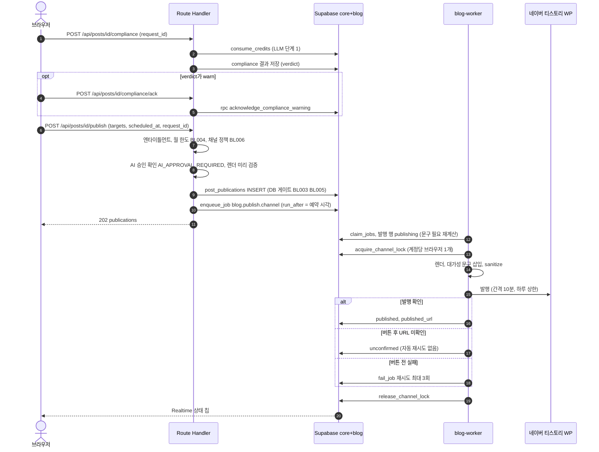

### 4-3. 브랜드커넥트 동의·탐색·지원 (BL-F-030~036)

읽는 법: 공식 API가 없어 Playwright로 진행하므로 위험 동의 없이는 지원 잡이 만들어지지 않습니다. 클립형 캠페인은 blog가 지원하지 않고 video로 넘깁니다.

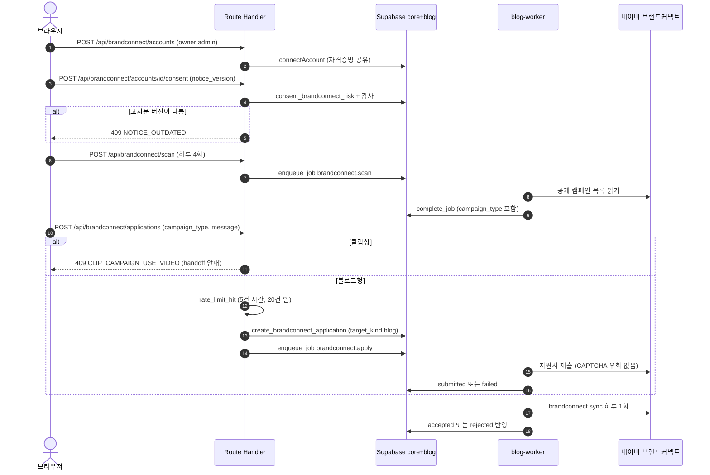

### 4-4. AI 도우미 채팅 한 턴 (BL-F-055, BL-F-059)

읽는 법: 브라우저는 `/api/ai/chat`만 부르고 Dify와 FastAPI는 서버 사이에서만 호출됩니다. 턴 시작 전에 선차감하고 끝나면 실제 사용량으로 정산하며, 결과가 전달되지 않으면 환불합니다.

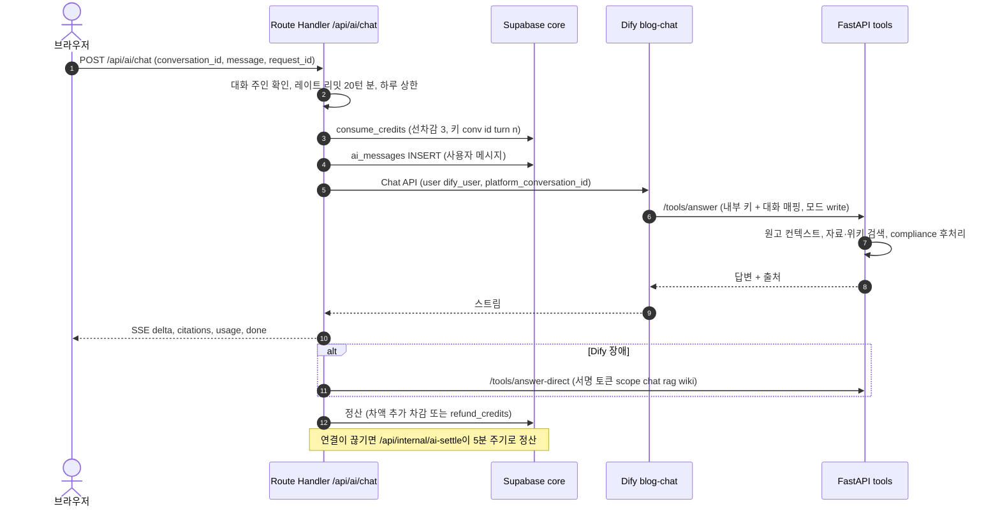

## 5. 상태 머신

읽는 법: 허용되지 않은 전이는 DB 트리거가 22023으로 막습니다. 화살표 옆 글자는 전이를 일으키는 주체입니다.

### 5-1. 원고 `posts.status` (05장 3.1절)

발행 중심 상태(예약, 발행 중, 게시, 일부 게시, 실패)는 발행 행(`post_publications`)의 집계로 정해집니다. 집계 규칙은 진행 중이 있으면 publishing, 예약만 있으면 scheduled, 성공과 실패가 섞이면 partially_published, 성공만이면 published, 실패만이면 failed, 전부 취소면 draft입니다. 집계 상태끼리는 서로 오갈 수 있어 그림에는 대표 경로만 그렸습니다.

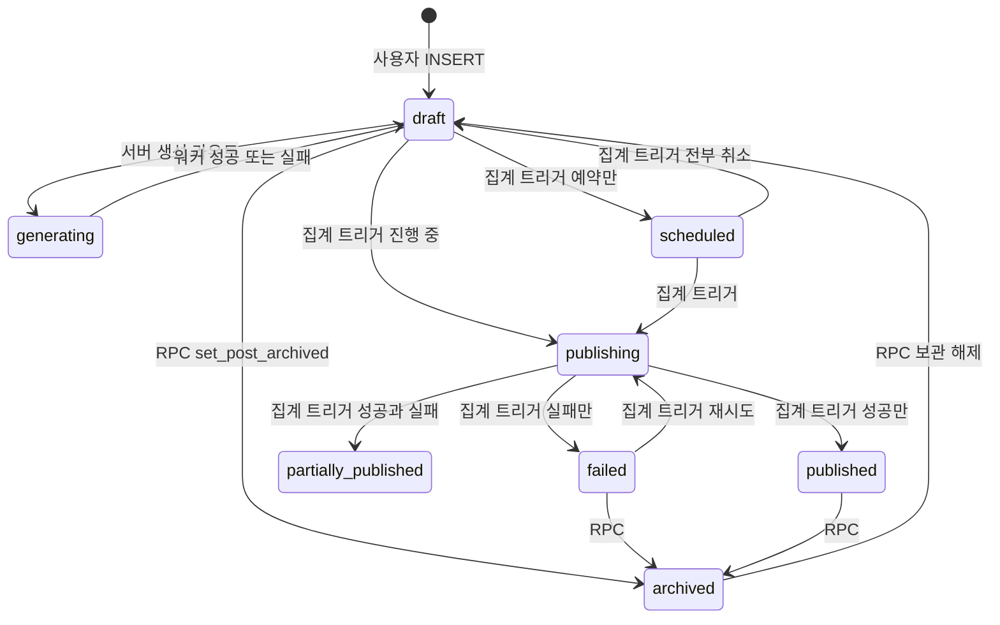

### 5-2. 발행 `post_publications.status` (05장 3.2절)

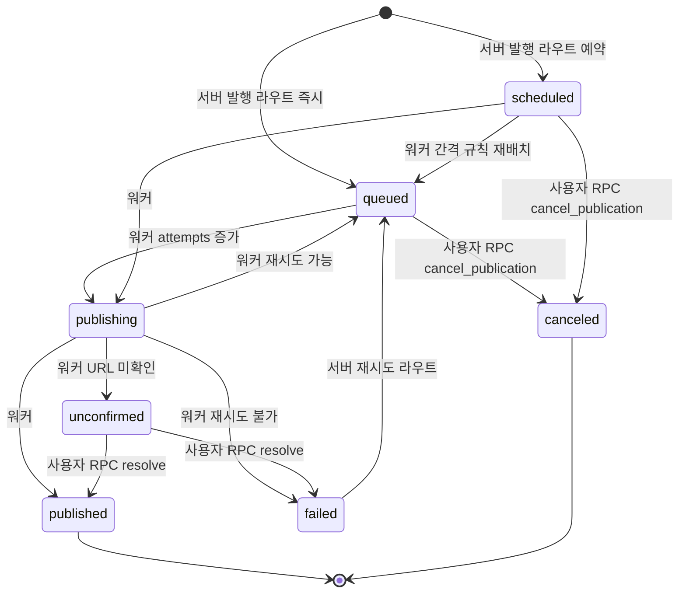

### 5-3. 채널 계정 `channel_accounts.status` (05장 3.3절)

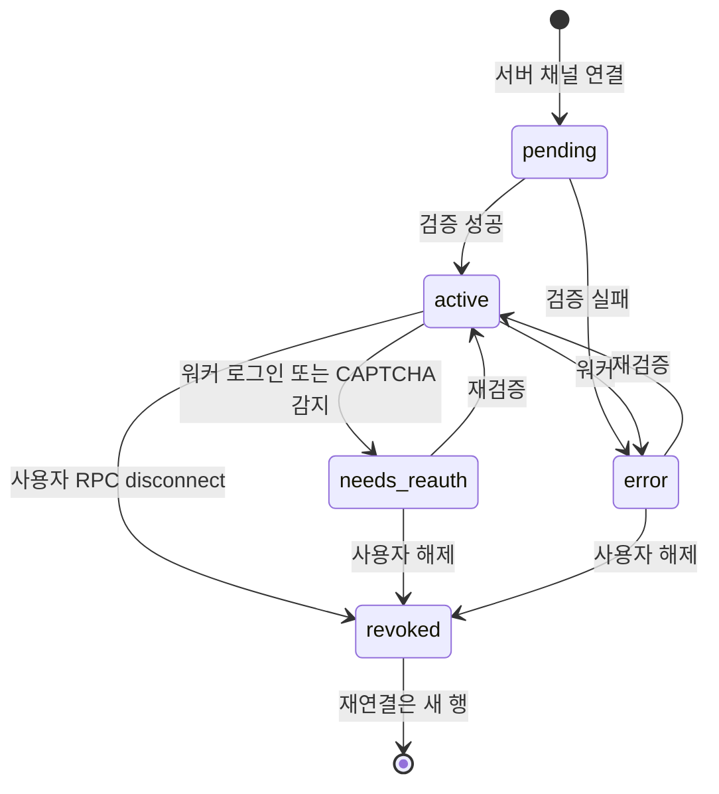

### 5-4. AI 초안 실행 `core.ai_runs`와 승인 (02장 5.2절)

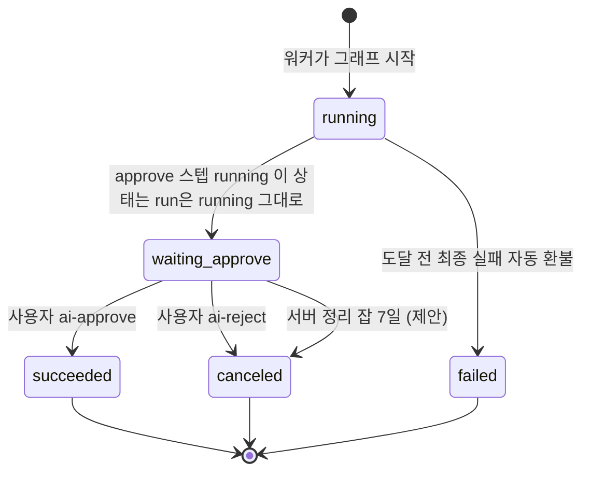

## 6. 화면 흐름

읽는 법: 화살표는 사용자의 실제 이동 순서입니다. 점선은 서버가 막고 안내하는 분기입니다. 대시보드 영역은 모두 로그인 뒤 화면입니다.

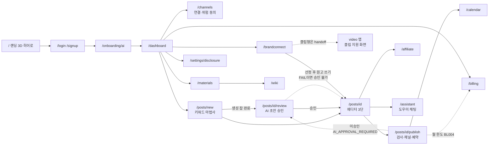

## 7. 보안 경계

읽는 법: 바깥에서 안쪽으로 갈수록 신뢰가 높아지고, 마지막 방어선은 DB입니다. 이 제품의 특징은 공식 API가 없는 채널에 사용자 계정으로 로그인해 자동 조작하는 워커가 있다는 점이라, 워커와 외부 채널 경계를 따로 그렸습니다. 공통 규칙은 `SECURITY_BASELINE.md` 장 번호(§)로 표시했습니다. 이 제품의 `SECURITY.md`는 비어 있어 `04_API.md`, `05_DATA_MODEL.md`, `01_PRD.md` 6.4절, `02_ARCHITECTURE.md`에서 가져왔습니다.

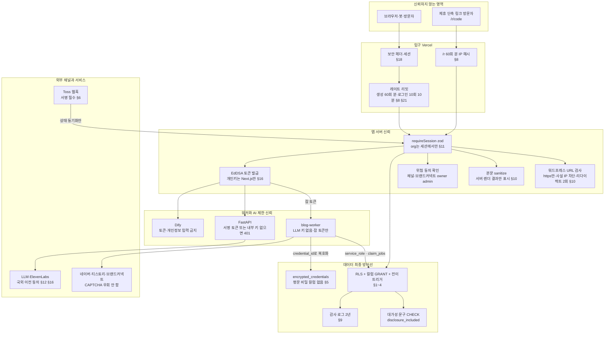

이 제품의 주요 위협과 대응(문서에 적힌 것만 모음. 정식 위협표는 `SECURITY.md` 작성 후 대체해야 합니다):

| 위협 | 대응(출처) | 공통 규칙 |
|---|---|---|
| 대가성 문구 누락으로 표시광고법 위반 | 문구 끌 수 없음, 발행 행 CHECK(`post_publications_disclosure_check`), 누락은 23514 + 운영 알림(`05` 2.4절, `04` 7절) | §4 |
| 채널 비밀(비밀번호·세션) 유출 | 모든 비밀은 `encrypted_credentials` 암호문에만, 키 `CREDENTIALS_KEY_V<n>` 없으면 기동 실패, 페이로드엔 `credential_id`만(`05` 7절, `02` 4절) | §5 |
| 워드프레스 URL을 이용한 서버 요청 위조(SSRF) | https만, 사설 IP·로컬 차단, 리다이렉트 2회, 응답 5MB(`01` BL-F-040) | §10 |
| 본문에 악성 HTML 삽입 | 서버 허용 목록 sanitize, 미리보기는 서버 렌더 결과만(`02` 1절, `01` BL-F-017) | §10 |
| 자동 게시로 인한 계정 제한 | 위험 고지·동의(버전 관리), 시간당·일일 한도, 계정당 브라우저 1개, 간격 10분, CAPTCHA 우회 금지(`01` 6.4절, BL-F-047) | §8 |
| 타 조직 채널·원고 접근 | RLS 멤버 + 엔타이틀먼트, org는 세션에서만, 교차 조직 참조 트리거(`05` 4절, `04` 1절) | §1, §11 |
| 브라우저가 AI 제공자를 직접 호출 | 브라우저는 `/api/ai/*`, `/api/voice/*`만, 워커에는 LLM 키 없음(`02` 2절) | §11, §16 |
| 결제 위조 | 주문 선저장 + `confirm_payment_order` 금액 대조, 웹훅은 상태 동기화만(`05` 7절) | §6 |
| 승인 없는 AI 초안 발행 | 발행 라우트가 `ai_runs` 상태를 읽어 `AI_APPROVAL_REQUIRED` 409. 단 DB 불변식이 아닌 서버 규칙이라 회귀 테스트로 보장(`05` 6절) | §16 |

## 8. 에이전트 접근 층 (MCP)

**읽는 법:** 기존 웹 경로(위)는 그대로이고, 에이전트용 입구(아래)는 같은 서버 계층과 RLS 조회를 거칩니다. 정본은 `MCP.md`, 공통 규칙은 `../_platform-core/MCP_BASELINE.md`입니다. 점선은 Phase 1.5 이후 또는 미결정(D-M#)입니다. 이 제품에는 익명 공개 읽기가 없어 모든 도구가 로그인 후 읽기입니다.

### 8-1. 웹 경로 위에 얹는 MCP 구성

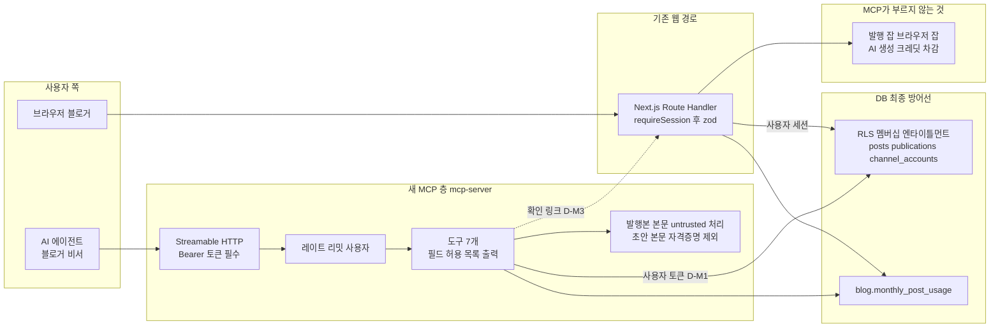

### 8-2. 발행 준비와 사람 확정 (`blog_prepare_publish`)

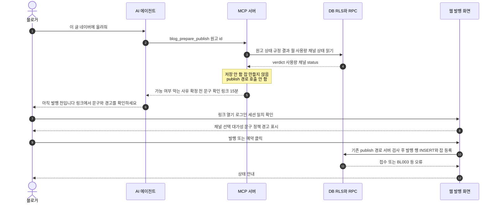

### 8-3. 도구 위험 등급과 노출 단계

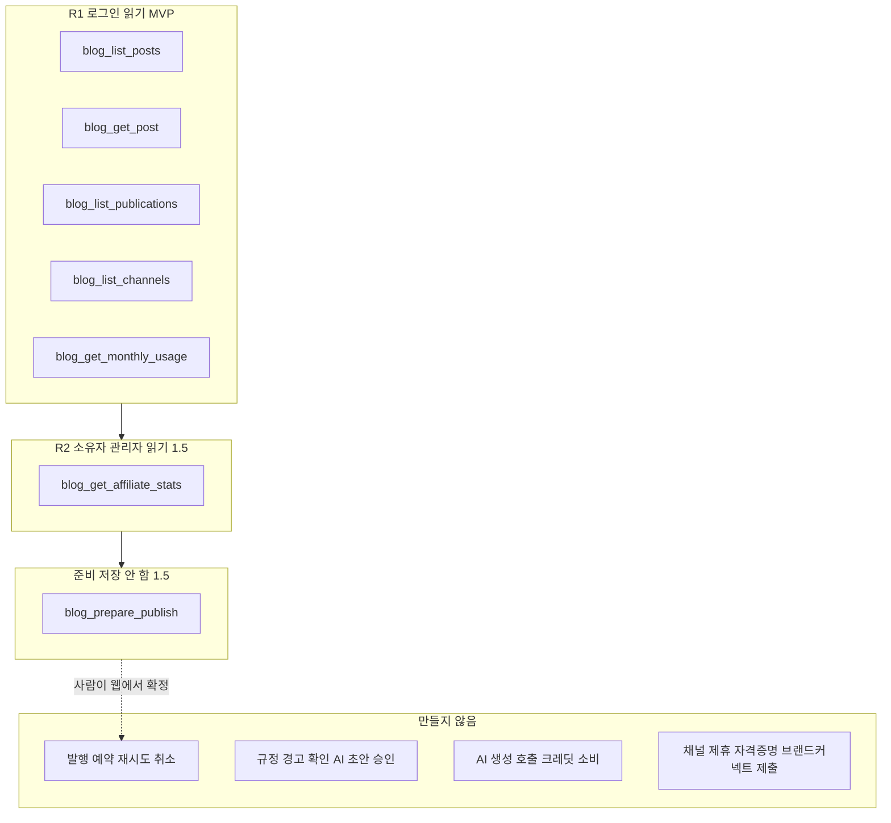

## 문서 불일치

1. **`SECURITY.md`가 미작성 초안**입니다(자산, 위협, 제품별 수치가 모두 "작성 필요"). 7장 그림과 위협표는 다른 문서에서 모은 임시본이며, 세션 만료·CSP 도메인·백업 주기 등 제품별 수치는 담지 못했습니다.
2. **발행 서버 검사 순서**: `01_PRD.md` BL-F-043은 "엔타이틀먼트 → 월 한도 → 채널 한도 → 컴플라이언스 상태 → 채널 정책 경고 확인 → 발행 행 INSERT"이고 AI 승인 확인은 컴플라이언스 상태 다음(3.7절 덧붙임)이라 적습니다. `04_API.md` 2절 publish 행은 "엔타이틀먼트 → 월 한도 → 채널 정책 경고 → AI 승인 → 렌더 검증 → INSERT"이며 컴플라이언스는 INSERT 때 DB 게이트가 판정합니다. 그림 4-2는 `04`(실행 순서 정본)를 따랐습니다.
3. **AI 초안 실행의 "대기" 상태**: `02_ARCHITECTURE.md` 5.2절은 `approve` 스텝이 running이고 run도 running이라고 적어, 별도 상태 이름이 없습니다. 그림 5-4의 `waiting_approve`는 읽기 쉽게 붙인 이름이며 실제 컬럼 값이 아닙니다.
4. **MVP 범위가 제안**: `01_PRD.md` 2절은 확정 결정 7이 blog의 MVP를 따로 정하지 않아 범위가 제안이라고 밝힙니다. 그림 1의 MVP/Phase 구분도 그 제안을 따랐습니다.
5. **원고 상태 집계 전이**: `05_DATA_MODEL.md` 3.1절은 집계 상태 사이 전이를 개별 쌍으로 나열하지 않고 규칙으로 서술합니다. 그림 5-1의 집계 상태 간 화살표는 그 규칙에서 읽어 낸 대표 경로입니다.
6. **MCP 읽기 경로**: `04_API.md`에는 원고·발행·채널 목록을 읽는 GET Route Handler가 없고 RLS 직접 조회만 있습니다(`MCP.md` D-M5). `GET /api/affiliate/stats`가 service_role로 집계하는지도 문서에 없습니다(D-M4). 그림 8-1은 RLS 조회를 실선으로 그렸고 통계 도구의 경로는 확정하지 않았습니다.
7. **MCP 플랜 한도**: `blog.monthly_post_usage`는 사용 건수만 반환하고 플랜 한도 값을 읽는 방법이 `04_API.md`에 없습니다(`MCP.md` D-M6). 그림은 "월 사용량 읽기"만 그렸습니다.

## 갱신 규칙

`README.md`, `01_PRD.md`~`05_DATA_MODEL.md`, `SECURITY.md` 중 이 그림의 근거 절을 고치면 이 파일의 해당 그림도 같은 변경에서 함께 고칩니다.
