# DIAGRAMS: NOMAD Commerce UML 시각화

작성일 2026-10-23. 이해관계자(기획·개발·운영·법무) 소통용 그림 모음입니다. 정본은 이 폴더의 각 문서이며, 그림과 문서가 다르면 문서가 우선입니다. GitHub에서 그림이 바로 렌더링됩니다(Mermaid). 전체 구조도는 `../_platform-core/ARCHITECTURE_DIAGRAMS.md`와 같은 스타일입니다.

**제품 한 줄 정의:** 쿠팡·스마트스토어 셀러가 아마존·국내 도매 상품을 상품DB에 모으고, AI로 슬롯형 상세페이지(이미지 10장/15장, 카피, 금지어 검사)를 만든 뒤 마켓 규격으로 변환해 API 업로드하거나 엑셀/ZIP으로 내려받는 SaaS (`README.md` 1절).

**근거 문서:** `README.md`, `01_PRD.md`, `02_ARCHITECTURE.md`, `03_SCREENS_UX.md`, `04_API.md`, `05_DATA_MODEL.md`, `SECURITY.md`, `MCP.md`, 공통 `../_platform-core/SECURITY_BASELINE.md`, `CORE_SPEC.md`.

**표기:** 실선 화살표 = 호출·데이터 흐름, 점선 = 검증·참조·비동기 폴링, "(제안)" = 문서가 제안이라고 밝힌 값. 숫자 CM-F-nnn은 `01_PRD.md` 기능 ID.

| # | 그림 | UML 종류 | 근거 문서 절 |
|---|---|---|---|
| 1-1 | 사용자와 MVP 기능 | 유스케이스(flowchart) | `01_PRD.md` 1절, 2절 |
| 1-2 | Phase 2·3 기능과 범위 밖 | 유스케이스(flowchart) | `01_PRD.md` 2절 |
| 2-1 | 구성요소: 웹·워커·코어·외부 | 컴포넌트 | `02_ARCHITECTURE.md` 2~4절, 6절 |
| 2-2 | 구성요소: AI 계층 | 컴포넌트 | `02_ARCHITECTURE.md` 개정표, `04_API.md` 6.1절 |
| 3 | 데이터 모델 | 클래스 | `05_DATA_MODEL.md` 1~4절 |
| 4-1 | 상세페이지 생성과 크레딧 | 시퀀스 | `04_API.md` 2절, `02_ARCHITECTURE.md` 4.1절 |
| 4-2 | 크레딧팩 결제 확인 | 시퀀스 | `04_API.md` 2절, `03_SCREENS_UX.md` 2.2절 |
| 4-3 | 마켓 업로드 | 시퀀스 | `04_API.md` 2절, `03_SCREENS_UX.md` 2.4절 |
| 4-4 | 셀러 어시스턴트 채팅 | 시퀀스 | `04_API.md` 2.1절, 6.2절 |
| 5-1 | 상세페이지 상태 | 상태 머신 | `05_DATA_MODEL.md` 3절 |
| 5-2 | 슬롯 상태 | 상태 머신 | `05_DATA_MODEL.md` 3절 |
| 5-3 | 마켓 업로드 상태 | 상태 머신 | `05_DATA_MODEL.md` 3절 |
| 6 | 화면 흐름 | flowchart | `03_SCREENS_UX.md` 1절, 2절 |
| 7 | 보안 신뢰 경계 | flowchart | `SECURITY.md` 1~4절 |
| 8-1 | API 위에 얹는 MCP 구성 | 컴포넌트(flowchart) | `MCP.md` 1~3절, `MCP_BASELINE.md` 1·7절 |
| 8-2 | 상세페이지 생성 준비와 사람 확정 | 시퀀스 | `MCP.md` 2·6절, `04_API.md` 2절 |
| 8-3 | 도구 위험 등급과 노출 단계 | flowchart | `MCP.md` 2절, `MCP_BASELINE.md` 2절 |

## 1. 사용자와 기능

### 그림 1-1. 사용자와 MVP 기능

읽는 법: 왼쪽은 사용자 역할(페르소나), 오른쪽은 MVP 기능입니다. 선은 "누가 주로 쓰는가"를 뜻합니다. 역할 권한은 `04_API.md` 1절(쓰기 owner/admin/member, 계정·결제 owner/admin)을 따릅니다.

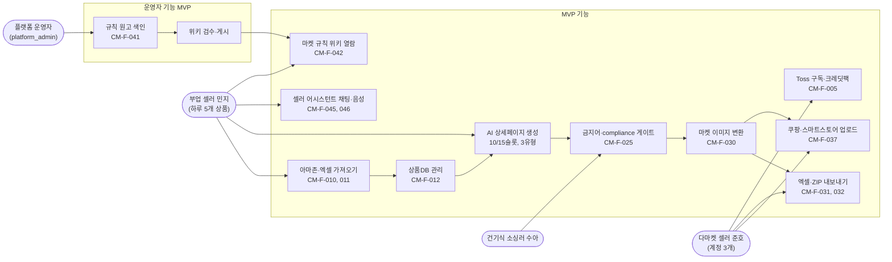

### 그림 1-2. Phase 2·3 기능과 범위 밖

읽는 법: MVP 이후로 미룬 기능과 이 제품 범위 밖인 기능을 `01_PRD.md` 2절 표의 구분 그대로 모았습니다.

```mermaid
flowchart TB
  subgraph P2["Phase 2"]
    direction TB
    X1["유형 5종 추가<br/>(리뷰형은 실제 리뷰 입력 시만)"]
    X2["이미지로 생성 모드"]
    X3["도매꾹·온채널·아마존 CSV 파서"]
    X4["와디즈·11번가 규격 출력"]
    X5["지마켓·옥션·11번가·롯데온<br/>카페24·아임웹"]
    X6["상품 쇼츠 영상<br/>(sceneflow 워커 API)"]
    X7["카드뉴스·SNS 배포"]
    X8["자동화 캔버스·웹훅 발신"]
    X9["비회원 AI 상담"]
    X10["외부용 API Key·Capacitor 앱"]
  end
  subgraph P3["Phase 3"]
    direction TB
    Y1["판매관리<br/>(주문·정산·CS)"]
    Y2["브랜드킷·분석 대시보드"]
  end
  subgraph OUT["범위 밖"]
    direction TB
    Z1["블로그 원고·발행<br/>(nomad-blog 소유)"]
    Z2["제휴 링크·쿠팡파트너스<br/>(core affiliate)"]
  end
```

## 2. 구성요소

### 그림 2-1. 웹·워커·코어·외부 서비스

읽는 법: 브라우저의 요청은 Next.js Route Handler가 인증·크레딧·검증을 한 뒤 DB에 쓰고, 오래 걸리는 일은 `core.jobs`로 넘깁니다. 워커가 그 잡을 집어 외부 서비스와 통신합니다. AI 계층은 그림 2-2에서 따로 그립니다.

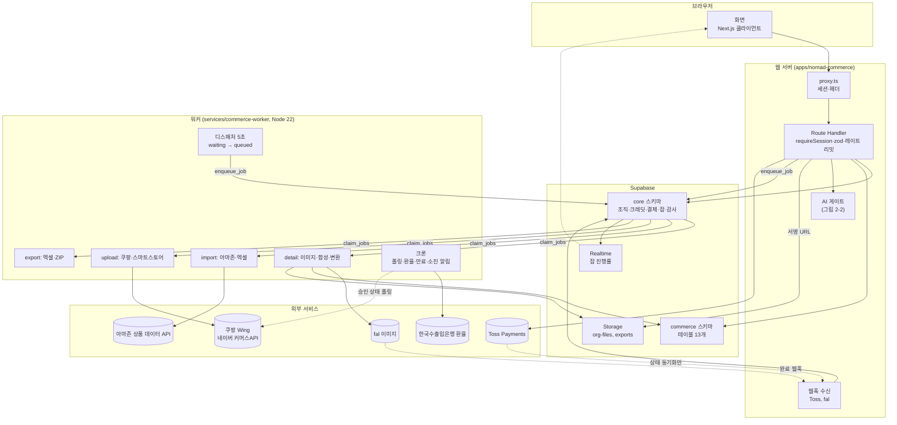

### 그림 2-2. AI 계층

읽는 법: 브라우저는 `/api/ai/*`, `/api/voice/*`만 부릅니다. Dify, FastAPI, LLM·음성 제공자는 직접 부르지 않습니다(`04_API.md` 1절). 상세페이지 텍스트 생성은 워커가 잡 토큰으로, 보조 AI는 Route Handler가 서명 토큰으로 FastAPI 그래프를 실행합니다.

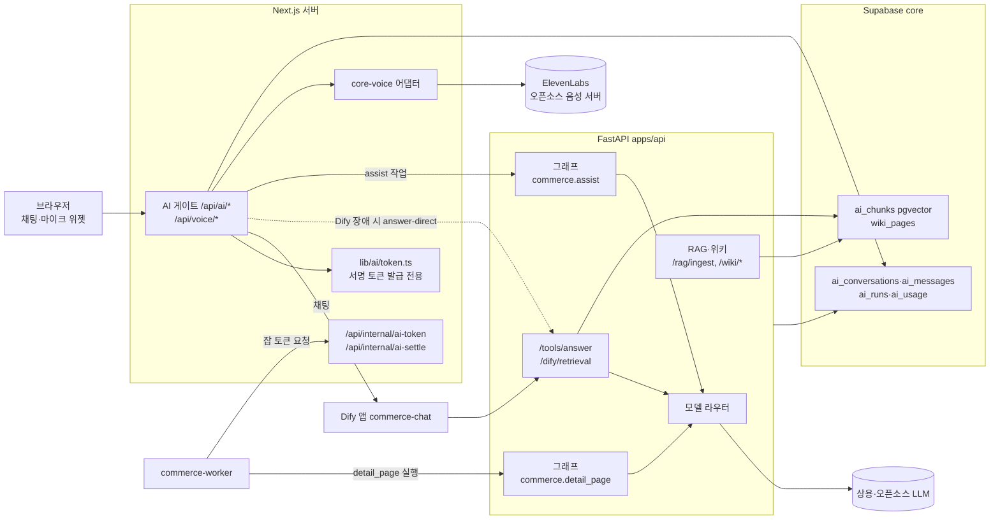

## 3. 데이터 모델

### 그림 3. 핵심 테이블과 관계

읽는 법: `commerce` 스키마 13개 테이블 중 핵심 11개와 참조하는 코어 3개입니다. 선 위 글자는 관계입니다. 모든 테이블은 `org_id`로 조직에 묶이고, 자식은 `(org_id, parent_id)` 복합 FK로 다른 조직 참조를 막습니다. `exchange_rates`, `market_categories`(전역, 로그인 사용자 SELECT만)는 생략했습니다.
접근 주체: 사용자가 직접 쓰는 테이블은 products, shipping_templates, listing_drafts(콘텐츠 컬럼만), banned_words(조직 행, owner/admin)뿐이고 나머지는 service_role 또는 RPC만 씁니다(`05_DATA_MODEL.md` 4절).

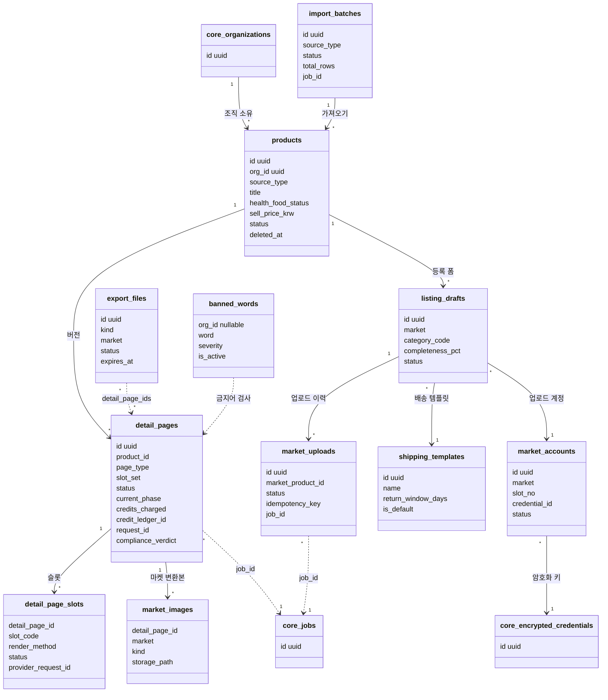

## 4. 핵심 시퀀스

### 그림 4-1. 상세페이지 생성과 크레딧 (CM-F-003, 020~023, 043)

읽는 법: 요청 한 번에 크레딧 선차감, `detail_pages` waiting 저장, 큐 등록이 한 Route Handler에서 이뤄집니다. 실패하면 core가 자동 환불합니다. 텍스트 단계는 FastAPI 그래프, 이미지 단계는 워커입니다.

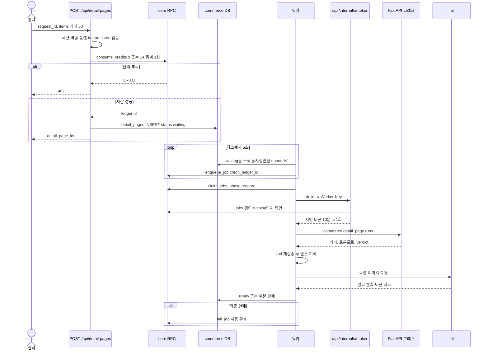

### 그림 4-2. 크레딧팩 결제 확인 (CM-F-005)

읽는 법: 금액은 클라이언트가 아니라 DB의 주문이 정합니다. 지급은 서버 confirm 경로에서만 일어나고, 웹훅은 상태 동기화만 합니다.

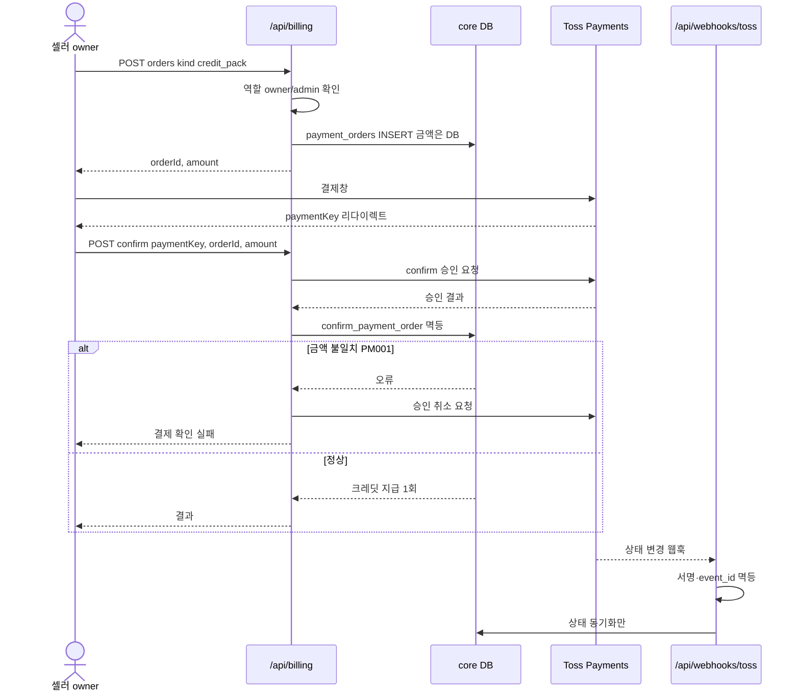

### 그림 4-3. 마켓 업로드 (CM-F-025, 033, 037)

읽는 법: compliance FAIL이나 WARN 미확인이면 INSERT 시점의 게이트 트리거가 막습니다(CM004~CM008). 같은 `request_id` 재전송은 업로드 1건으로 합쳐집니다(멱등 키). 마켓 키는 워커가 잡 실행 때만 복호화합니다.

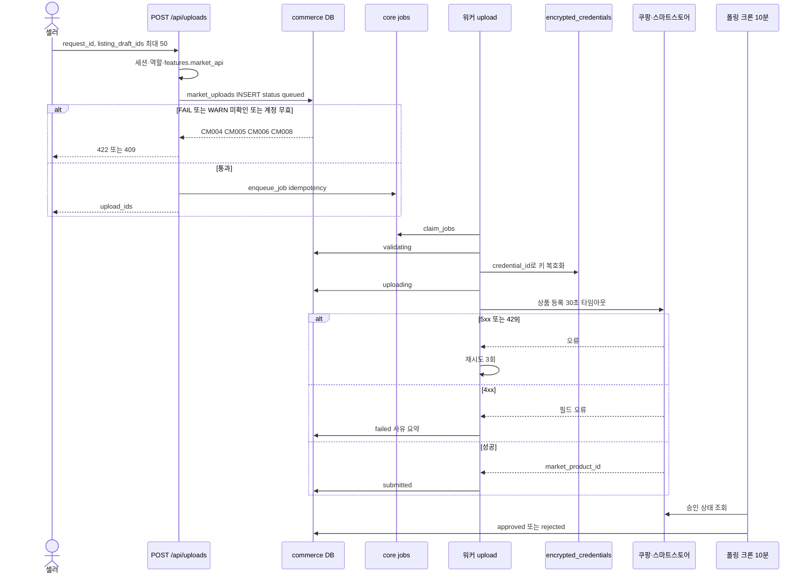

### 그림 4-4. 셀러 어시스턴트 채팅 (CM-F-045, 050)

읽는 법: 질문은 마스킹 후 Dify로 가고, 상품 질문은 FastAPI `/tools/answer`가 같은 조직 행인지 대조해 답합니다. Dify가 죽으면 Next.js가 FastAPI 직접 경로로 우회합니다. 크레딧은 먼저 3 차감하고 실제 사용량(1~5)으로 정산합니다.

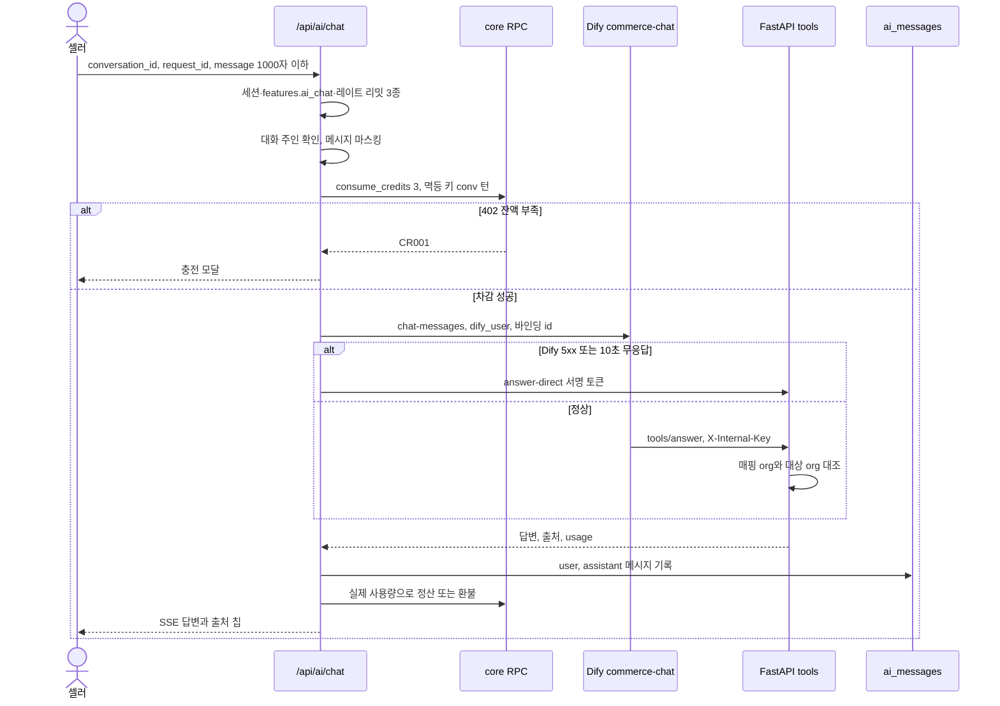

## 5. 상태 머신

### 그림 5-1. 상세페이지 `detail_pages`

읽는 법: 전이는 `commerce_status_guard()` 트리거가 강제하며 service_role도 예외가 아닙니다(위반 CM001). 괄호의 주체가 전이를 일으킵니다.

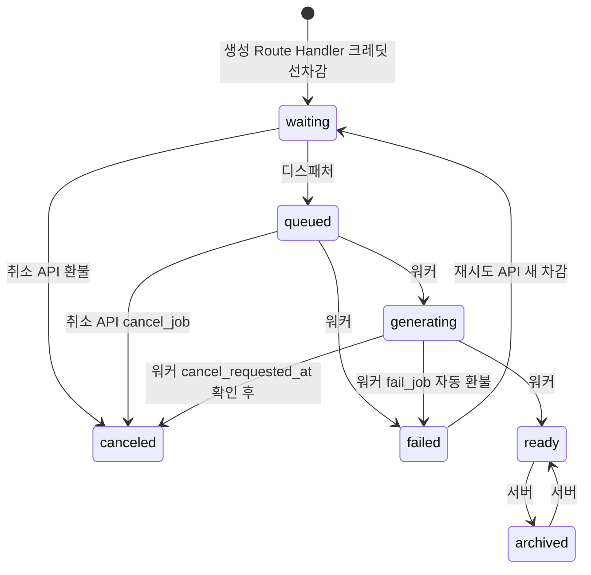

### 그림 5-2. 슬롯 `detail_page_slots`

읽는 법: 슬롯 단위 상태입니다. 일부 슬롯만 실패하면 페이지는 ready가 되고 실패 슬롯 수만큼 부분 환불됩니다. 다시 생성은 1크레딧(고화질 3).

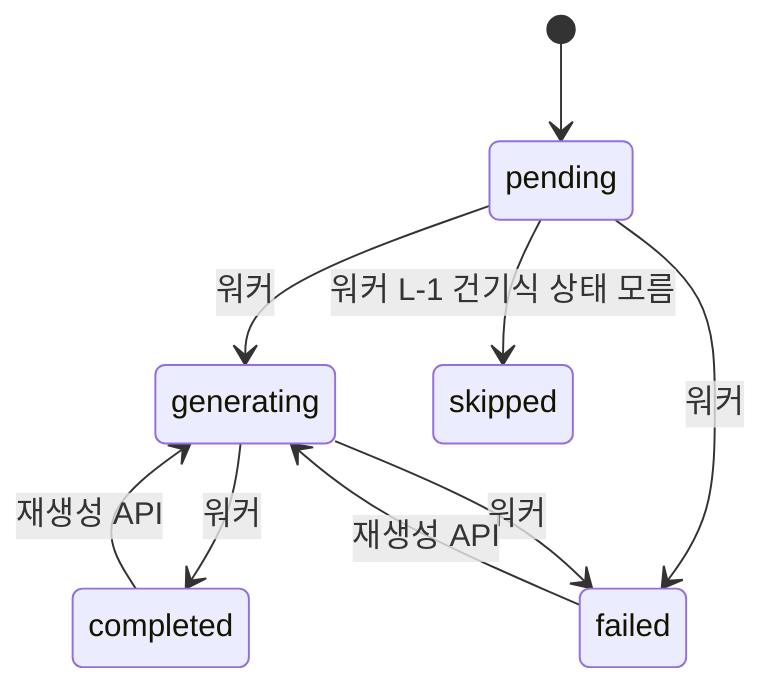

### 그림 5-3. 마켓 업로드 `market_uploads`

읽는 법: INSERT 때 게이트 트리거(CM004~CM008)를 먼저 통과해야 queued가 됩니다. submitted 이후는 폴링 크론이 결과를 정합니다.

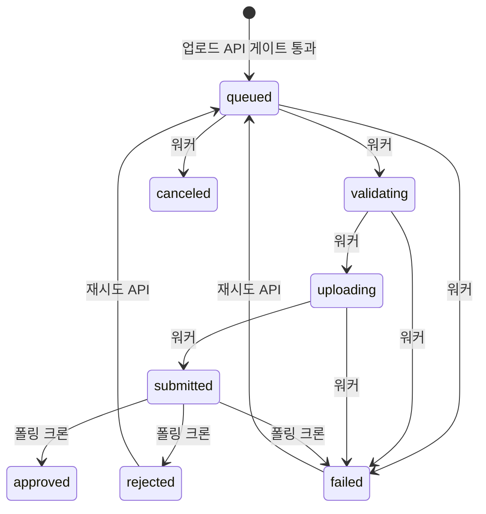

그림으로 그리지 않은 나머지 상태 전이(`05_DATA_MODEL.md` 3절 그대로):

| 테이블 | 전이 | 주체 |
|---|---|---|
| import_batches | uploaded → parsing → completed, 각 단계에서 failed | 워커 |
| listing_drafts | draft ↔ ready(완성도 100이면 ready), draft/ready → archived, archived → draft | 서버 |
| export_files | queued → running → succeeded → expired, 각 단계에서 failed, queued → canceled | 워커, 만료는 크론(+7일) |

## 6. 화면 흐름

읽는 법: 로그인 후 `/dashboard`에서 시작해 가져오기, 상품DB, 생성, 결과 뷰어, 내보내기·업로드 순으로 이동합니다. 점선은 어느 화면에서나 여는 보조 패널입니다. 대시보드 셸·GNB 구성은 결정 대기(`01_PRD.md` 9절)라 메뉴 구조는 그리지 않았습니다.

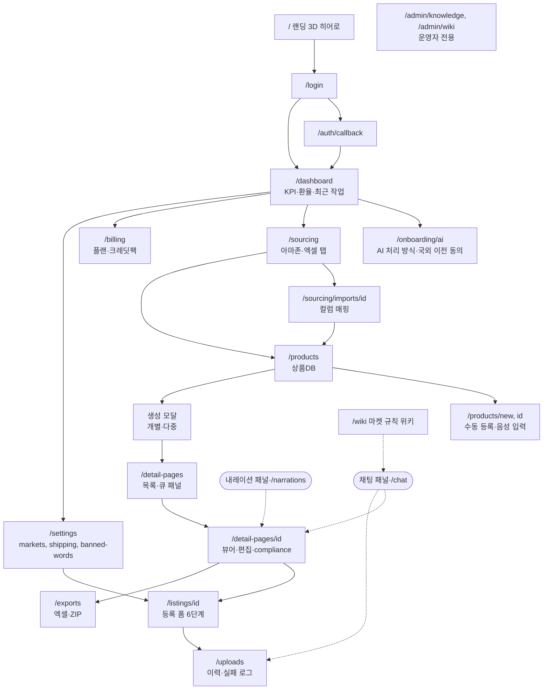

## 7. 보안 경계

읽는 법: 점선 네모는 신뢰 경계입니다. 자산(마켓 키, 결제, 크레딧)은 경계 안쪽 서버에만 있고 브라우저에 평문이 내려가지 않습니다. T번호는 `SECURITY.md` 2절 위협, §는 `../_platform-core/SECURITY_BASELINE.md` 장 번호입니다.

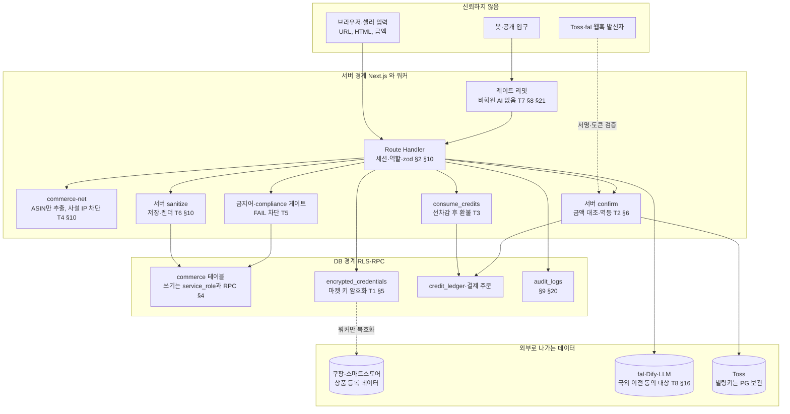

SECURITY.md 3절의 세션 만료, CSP 도메인, 레이트 리밋 수치, 감사 로그 보존, 백업, 알림 수신자는 "(작성 필요)"라서 그림에 수치를 넣지 않았습니다. 세션·헤더는 §18, 공급망은 §19, 운영은 §20, 계정 보호는 §21을 참조합니다.

## 8. 에이전트 접근 층 (MCP)

**읽는 법:** 기존 웹 경로(위)는 그대로이고, 에이전트용 입구(아래)가 같은 DB와 같은 확정 경로를 씁니다. 정본은 `MCP.md`, 공통 규칙은 `../_platform-core/MCP_BASELINE.md`입니다. 점선은 Phase 1.5 이후 또는 미결정(D-M#)입니다. 이 제품은 읽는 전용 RPC가 없어 읽기 도구가 테이블 SELECT(RLS)를 씁니다.

### 8-1. API 위에 얹는 MCP 구성

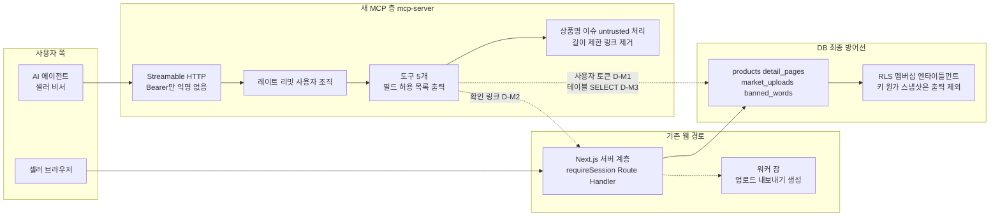

### 8-2. 상세페이지 생성 준비와 사람 확정 (`commerce_prepare_detail_page`)

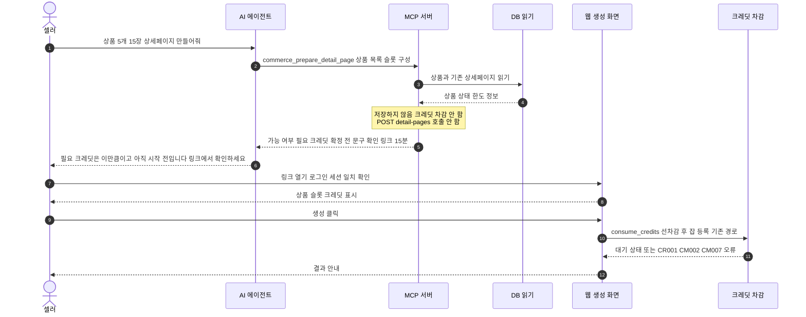

### 8-3. 도구 위험 등급과 노출 단계

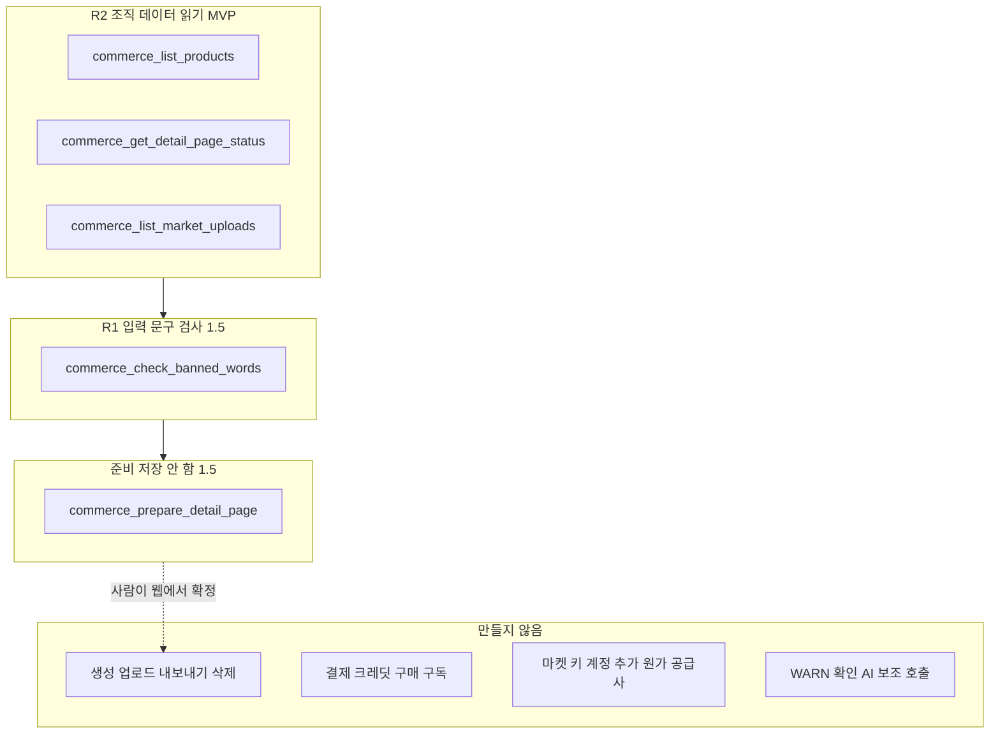

## 문서 불일치

- 해당하는 모순은 확인하지 못했습니다(없음). 다만 `SECURITY.md` 3절에 값이 비어 있는 항목이 있고, 마켓 API 약관·업로드 승인 조회 방식·환율 API 키는 문서가 "미확인"으로 둔 상태라 그림에서도 확정값으로 그리지 않았습니다.
- 참고(모순 아님): `README.md`는 AI·음성·3D 히어로를 MVP로 적고, `01_PRD.md` 2절은 카카오·네이버 로그인을 Stage C(P1, G2 후)로, 비회원 AI 상담을 Phase 2로 적습니다. 그림 1-1은 후자를 따랐습니다.
- MCP 작성 중 발견(`MCP.md` D-M3): `04_API.md`에는 상품·상세페이지·업로드를 읽는 전용 RPC나 GET Route Handler가 없고 화면은 서버 컴포넌트가 테이블을 직접 읽습니다. 그림 8-1은 MCP 읽기 도구가 같은 테이블을 사용자 세션 RLS로 SELECT하는 것으로 그렸습니다.
- MCP 작성 중 발견(`MCP.md` D-M4, D-M6): 금지어 매처의 외부 호출 함수 이름(`CM-06-017`)과 크레딧 잔액 조회 경로가 `04_API.md`에 없어 해당 도구는 "확인 필요"로 두었습니다.

## 갱신 규칙

`01_PRD.md`~`05_DATA_MODEL.md`, `SECURITY.md`를 고치면 이 그림도 같은 변경에서 함께 고칩니다. 검증은 `validate.py`로 모든 Mermaid 블록이 렌더링되는지 확인합니다.
