# DIAGRAMS: NOMAD Docs UML 시각화

작성일 2026-10-23. 정본은 이 폴더의 각 문서이며, 그림과 문서가 다르면 문서가 우선입니다. GitHub에서 그림이 바로 렌더링됩니다(Mermaid).

**제품 한 줄 정의**: 회사·거래처·프로젝트 정보를 한 번 입력하고 체크리스트에 체크하면, 체크 하나가 요구사항·화면·비용·계약 조항·검수 항목까지 연결되어 실무 문서 묶음(견적서, 과업지시서, 요구사항정의서, WBS, 화면목록, 개발용역계약서, 검수확인서, 회의록)을 한 번에 만들고, 버전·요구사항 추적표·PDF/DOCX 내보내기와 CRM·ERP 연동까지 이어지는 문서 자동화 SaaS(`README.md` 1절).

**근거 문서**: `README.md`, `01_PRD.md`, `02_ARCHITECTURE.md`, `03_SCREENS_UX.md`, `04_API.md`, `05_DATA_MODEL.md`, `SECURITY.md`, `MCP.md`, 공통 맥락은 `../_platform-core/ARCHITECTURE_DIAGRAMS.md`, `SECURITY_BASELINE.md`, `CORE_SPEC.md`.

**표기**: 실선 화살표는 호출·데이터 흐름, 점선은 검증·참조·주기 실행·아직 만들지 않은 Phase입니다. "(제안)"은 문서가 제안이라고 밝힌 값입니다. 기능 ID `DC-F-###`는 `01_PRD.md` 2·3장, 보안 규칙 `§n`은 `SECURITY_BASELINE.md` 장 번호입니다. 역할은 owner, admin, member, viewer와 운영자 platform_admin이며, 04장의 `oa`는 owner/admin입니다.

| # | 그림 | UML 종류 | 근거 문서 절 |
|---|---|---|---|
| 1-a | 정본 입력과 문서 생성 기능 (MVP) | 유스케이스 | `01_PRD.md` 2장, `03_SCREENS_UX.md` 1절 |
| 1-b | AI·내보내기·운영 기능 (MVP) | 유스케이스 | `01_PRD.md` 2장 |
| 1-c | Phase 2·3 기능 | 유스케이스 | `01_PRD.md` 2장 |
| 2-a | 배포 단위와 호출 관계 | 컴포넌트 | `02_ARCHITECTURE.md` 2·3·7절 |
| 2-b | 문서 조립 파이프라인 | 컴포넌트 | `02_ARCHITECTURE.md` 2.1~2.3절, 5.2절 |
| 2-c | 연동 어댑터 (Phase 2) | 컴포넌트 | `02_ARCHITECTURE.md` 2.4절 |
| 3 | 데이터 모델 | 클래스 | `05_DATA_MODEL.md` 1·2·4절 |
| 4-a | 체크리스트 효과 적용 | 시퀀스 | `01_PRD.md` DC-F-006, `04_API.md` 2절 |
| 4-b | 패키지 생성 | 시퀀스 | `01_PRD.md` DC-F-012·039, `02_ARCHITECTURE.md` 4절, `04_API.md` 2·3절 |
| 4-c | 문서 확정과 개정 | 시퀀스 | `01_PRD.md` DC-F-015, `04_API.md` 3절 |
| 4-d | RFP 추출과 후보 확정 | 시퀀스 | `01_PRD.md` DC-F-021·022, `04_API.md` 2절 |
| 5-a | projects 상태 | 상태 머신 | `05_DATA_MODEL.md` 3.1절 |
| 5-b | documents 상태 | 상태 머신 | `05_DATA_MODEL.md` 3.2절 |
| 5-c | generation_runs 상태 | 상태 머신 | `05_DATA_MODEL.md` 3.3절 |
| 5-d | doc_exports 상태 | 상태 머신 | `05_DATA_MODEL.md` 3.4절 |
| 5-e | integration_connections 상태 (Phase 2) | 상태 머신 | `05_DATA_MODEL.md` 3.5절 |
| 6-a | 작업 공간 화면 흐름 | 화면 흐름 | `03_SCREENS_UX.md` 1·2·9절 |
| 6-b | 연동·설정·결제·운영 화면 흐름 | 화면 흐름 | `03_SCREENS_UX.md` 1.3절, 9절 |
| 7-a | 보안 신뢰 경계 | 배치+흐름 | `01_PRD.md` 5·6장, `02_ARCHITECTURE.md` 6절, `05_DATA_MODEL.md` 7절 |
| 7-b | 위협과 통제 지도 | 블록 | `02_ARCHITECTURE.md` 6절, `05_DATA_MODEL.md` 7절 |
| 8-1 | 웹 경로와 MCP 층 (제안) | 컴포넌트 | `MCP.md` 2·3절, `04_API.md` 1·2절 |
| 8-2 | 문서 생성 준비와 사람 확정 | 시퀀스 | `MCP.md` 6절, `04_API.md` 2절 |
| 8-3 | 도구 위험 등급과 노출 단계 | 블록 | `MCP.md` 1·2절 |

## 1. 사용자와 기능

대상은 1인 개발자·프리랜서, 5~30인 에이전시 PM, 사내 PM(MVP)과 정부지원사업 준비 스타트업(Phase 2, `biz_plan`)입니다(`README.md` 1절). 플랜은 free, pro, team이며 team은 Phase 2입니다.

### 그림 1-a. 정본 입력과 문서 생성 기능 (MVP)

읽는 법: 왼쪽 역할이 오른쪽 기능을 씁니다. 정본(요구사항·산출물·비용)에서 문서가 만들어지고, 확정은 owner/admin이 합니다(`04_API.md` 기준, 불일치는 끝 절 참조). viewer는 읽기만 합니다.

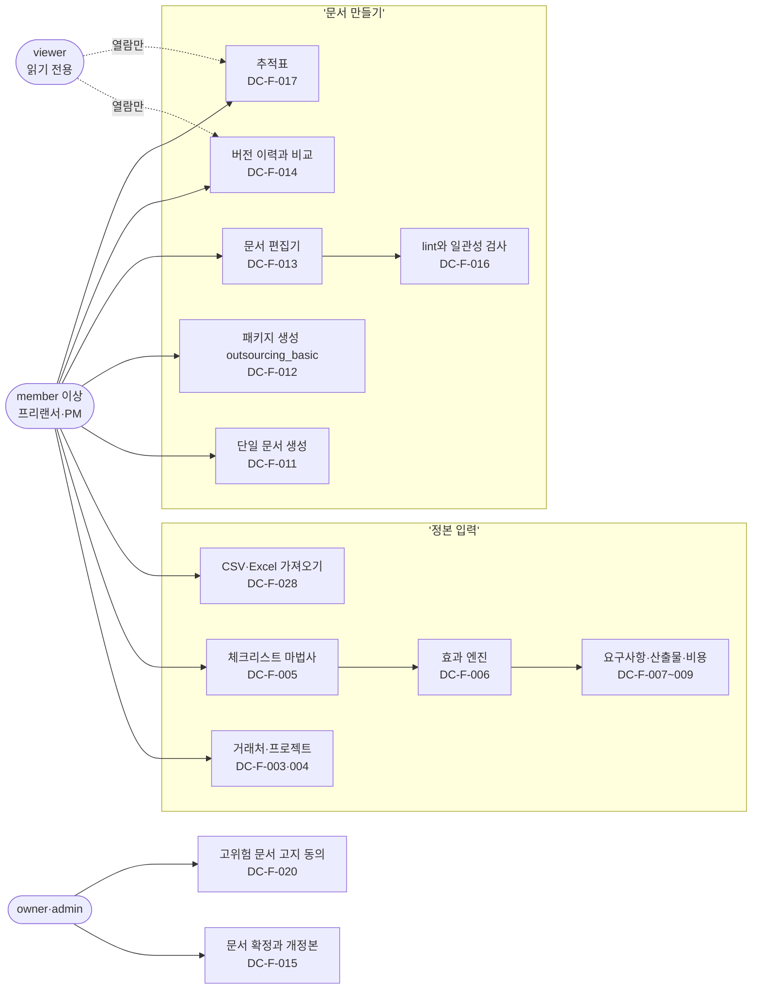

### 그림 1-b. AI·내보내기·운영 기능 (MVP)

읽는 법: AI 기능은 모두 MVP 필수(확정 결정 13~17)입니다. 금액·번호는 서버가 계산하고 AI는 서술 섹션만 씁니다.

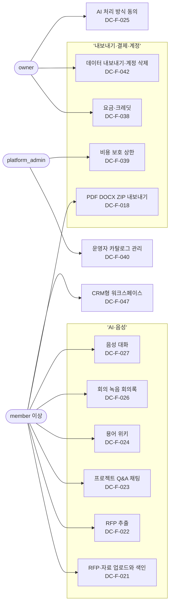

### 그림 1-c. Phase 2·3 기능

읽는 법: 문서가 정한 Phase 구분 그대로입니다. 모두 점선(아직 만들지 않음)입니다.

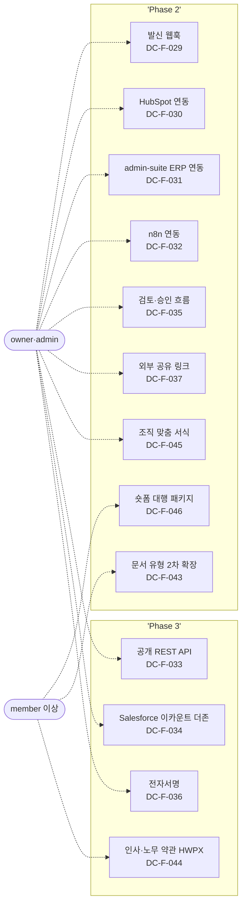

## 2. 구성요소

### 그림 2-a. 배포 단위와 호출 관계

읽는 법: 브라우저는 web만 부르고 Dify·ai-service·제공자는 web이나 워커가 대신 부릅니다. 렌더 서비스는 공용(flora-publishing 소유)이며 private network 전용입니다. DOCX 렌더는 코어 요청 C-1 선행입니다.

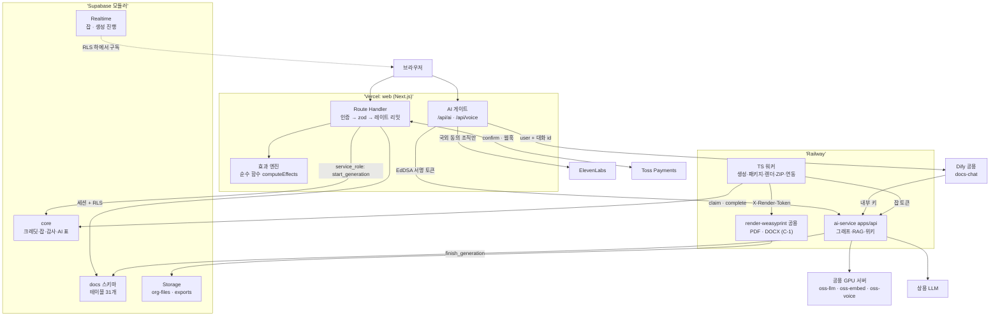

### 그림 2-b. 문서 조립 파이프라인

읽는 법: 위 줄은 정본이 만들어지는 길(결정적, LLM 0회), 아래 줄은 그래프 `docs.generate`의 노드 순서입니다. 고위험 유형(`dev_contract`)은 AI 섹션 노드를 건너뛰고 조항 본문을 수정하지 않습니다.

```mermaid
flowchart LR
  ANS["체크리스트 답<br/>확정된 것만"]
  ENG["효과 엔진<br/>diff 적용"]
  CAN["정본<br/>요구사항·산출물·비용·조항"]
  TOT["서버 계산<br/>금액·VAT·번호"]
  N1["load_context"]
  N2["plan_sections"]
  N3["fill_template"]
  N4["draft_ai_sections<br/>LLM, 고위험은 건너뜀"]
  N5["consistency_check"]
  N6["lint"]
  N7["compliance"]
  N8["output<br/>nh3 sanitize 2MB 이하"]
  VER[("document_versions<br/>append-only")]

  ANS --> ENG --> CAN
  CAN --> TOT
  CAN --> N1
  TOT --> N1
  N1 --> N2 --> N3 --> N4 --> N5 --> N6 --> N7 --> N8
  N8 -->|"docs.finish_generation"| VER
```

### 그림 2-c. 연동 어댑터 (Phase 2)

읽는 법: 어댑터는 정본 타입으로만 주고받고, 정본 쓰기는 워커의 서비스 함수가 필드 매핑 변환 뒤에 합니다. 자격증명은 코어 vault에만 둡니다. 전부 Phase 2이거나 Phase 3입니다.

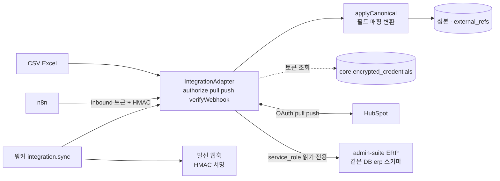

## 3. 데이터 모델

### 그림 3. docs 스키마 핵심 테이블 14개

읽는 법: 화살표는 외래키 방향이고 모든 자식은 `(parent_id, org_id)` 복합 FK로 다른 조직 부모를 가리킬 수 없습니다. 접근 주체는 노트에 적었습니다. 이 스키마는 테이블 31개(카탈로그 7, 워크스페이스 2, 프로젝트 정본 7, 문서 9, 연동 6)이며, 그림은 핵심만 담았습니다.

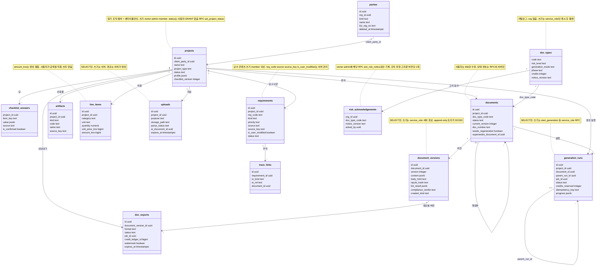

## 4. 핵심 시퀀스

### 그림 4-a. 체크리스트 효과 적용 (DC-F-006)

읽는 법: 답 저장은 가볍고(크레딧 0), 효과는 미리보기 → 적용 두 단계입니다. 적용은 기대 해시를 확인하고 프로젝트 advisory lock 안에서 한 트랜잭션으로 일어납니다. 사용자가 고친 행(`is_user_modified`)은 건드리지 않습니다.

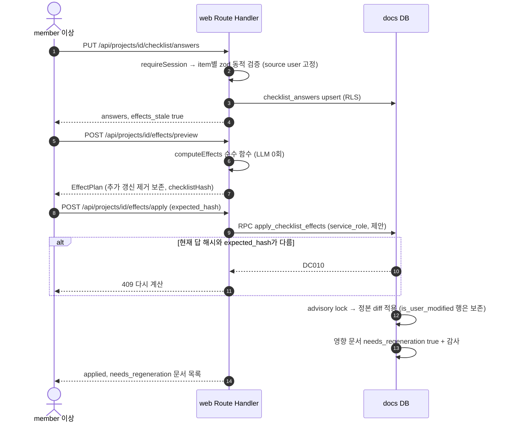

### 그림 4-b. 패키지 생성 (DC-F-012, 039)

읽는 법: 위쪽은 web의 사전 검사와 선차감, 아래쪽은 부모 잡이 의존 순서대로 자식 `docs.generate` 잡을 돌리는 반복입니다. 크레딧은 자식 단위로 차감되고, 실패한 자식은 환불되며 하류 문서는 취소됩니다.

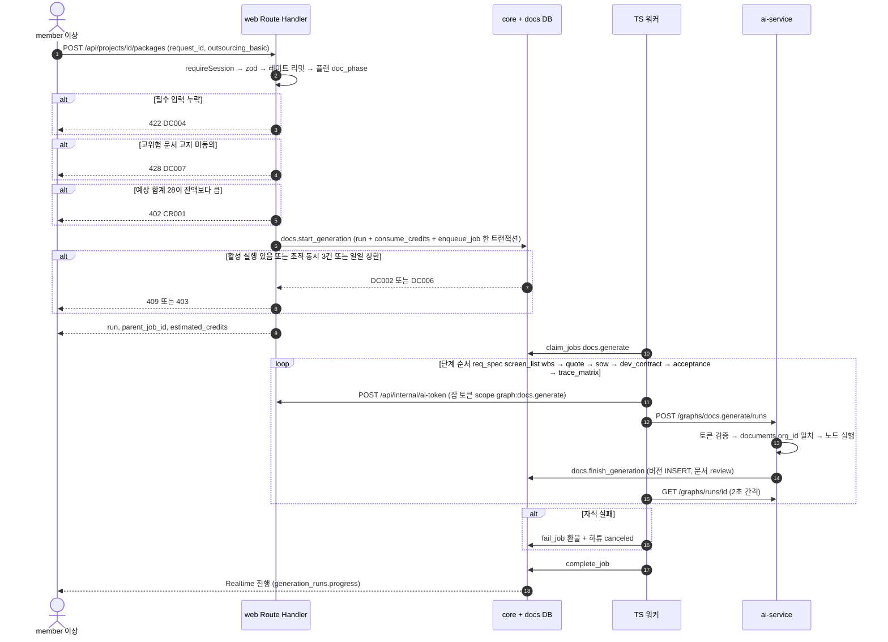

### 그림 4-c. 문서 확정과 개정 (DC-F-015)

읽는 법: 확정은 RPC `finalize_document` 한 곳에서 모든 게이트를 검사합니다. 확정 뒤에는 고칠 수 없고 개정본(새 draft 문서)만 만들 수 있습니다.

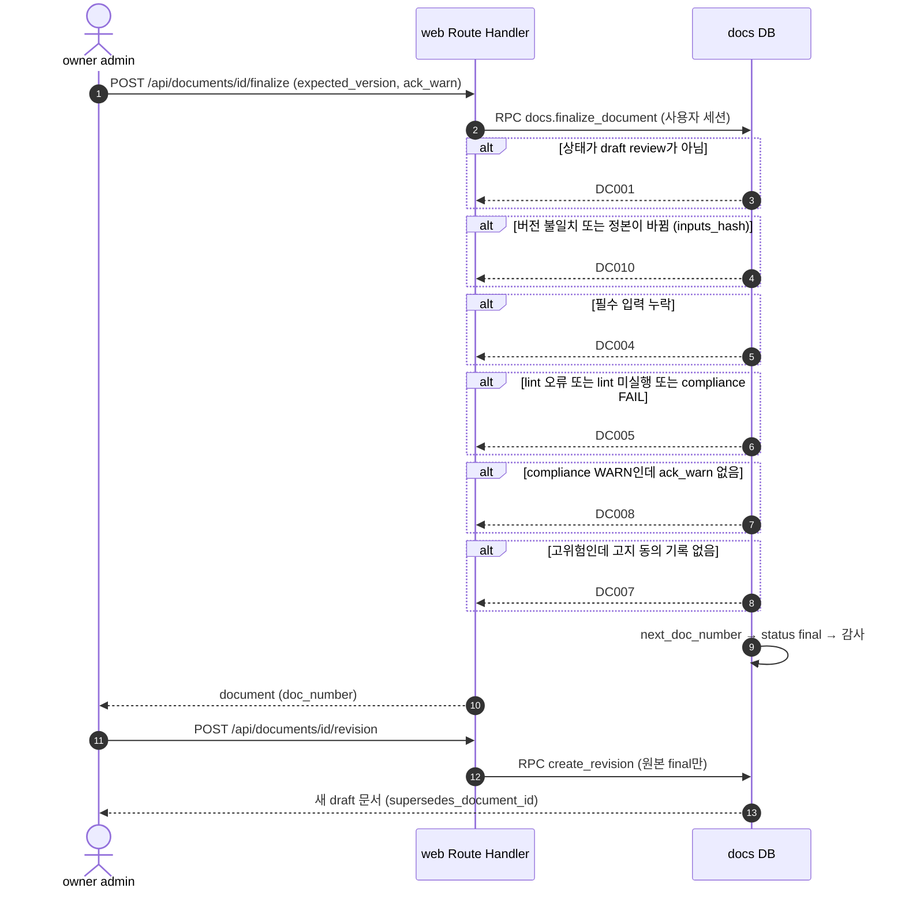

### 그림 4-d. RFP 추출과 후보 확정 (DC-F-021, 022)

읽는 법: 추출 결과는 `is_confirmed=false` 후보로만 저장되고 사용자가 채택해야 정본에 반영됩니다. 자료 안의 지시는 따르지 않도록 고정되어 있습니다(인젝션 방어).

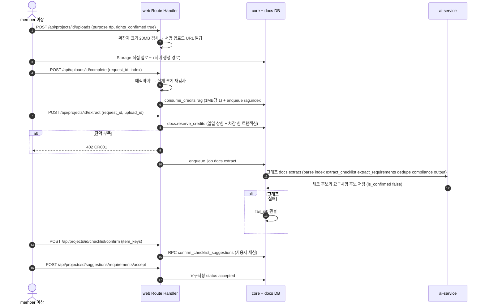

## 5. 상태 머신

모든 전이는 트리거로 강제되어 service_role 쓰기에도 적용됩니다(`05_DATA_MODEL.md` 3절). 전이를 일으키는 주체를 라벨에 적었습니다.

### 그림 5-a. projects.status

읽는 법: owner/admin이 RPC `set_project_status`로만 바꿉니다. archived에서 다시 활성화할 때 `projects_max`를 재검사합니다(`DC006`). 위반은 `DC001`입니다.

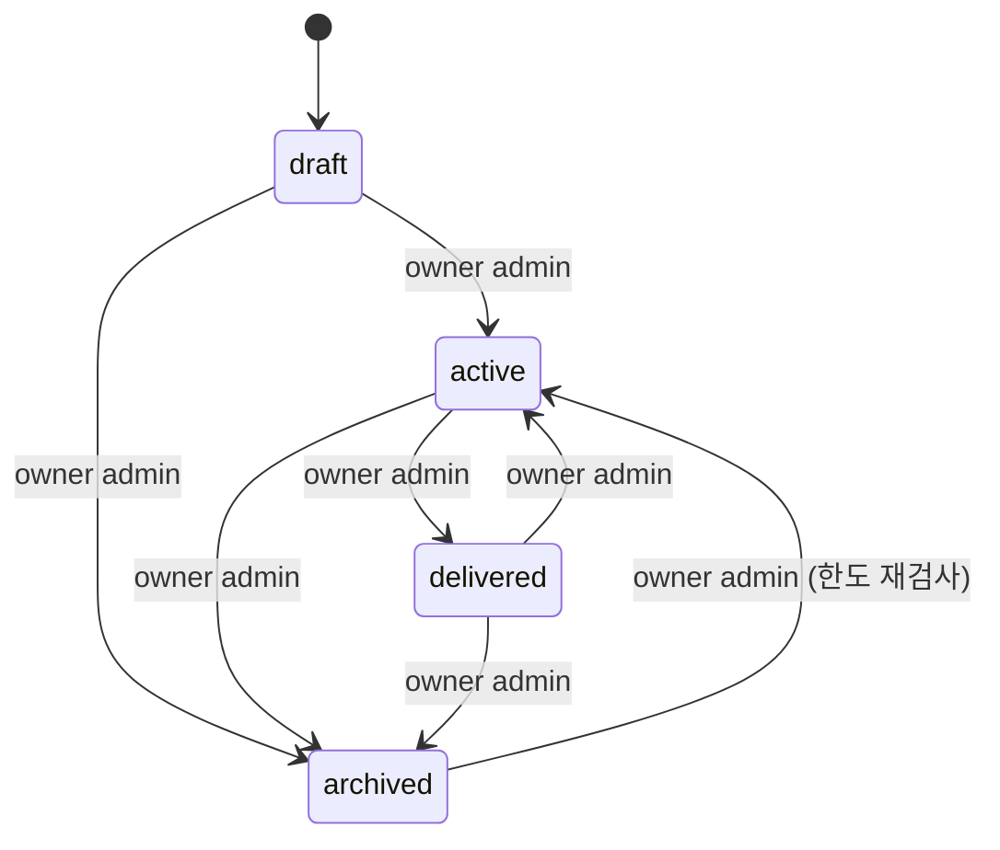

### 그림 5-b. documents.status

읽는 법: 생성은 서버(`start_generation`, `finish_generation`, `fail_generation`)가 옮기고 확정과 보관은 RPC가 합니다. final이 되면 문서번호가 붙고 이후 변경은 `DC003`이며 수정은 개정본으로만 합니다.

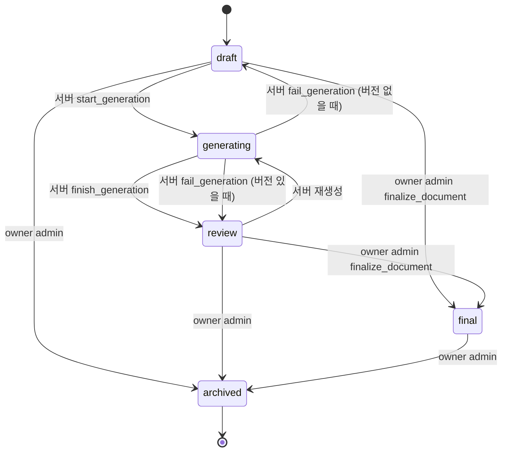

### 그림 5-c. generation_runs.status

읽는 법: 워커(service)만 바꿉니다. 실패 환불은 `core.fail_job`이 원장 행으로 한 번만 합니다. 문서당 활성 실행 1개, 패키지당 활성 1개는 부분 유니크 인덱스입니다(`DC002`).

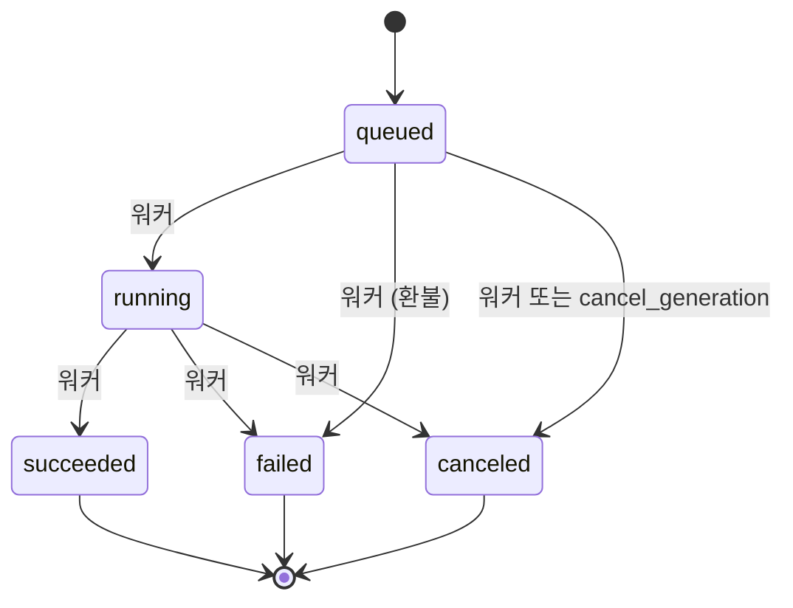

### 그림 5-d. doc_exports.status

읽는 법: 워커가 렌더 서비스 응답에 따라 바꿉니다. ready에는 `storage_path`가 필수이며, 파일은 정리 스케줄이 30일(제안) 뒤 만료시키고 Storage 객체를 지웁니다.

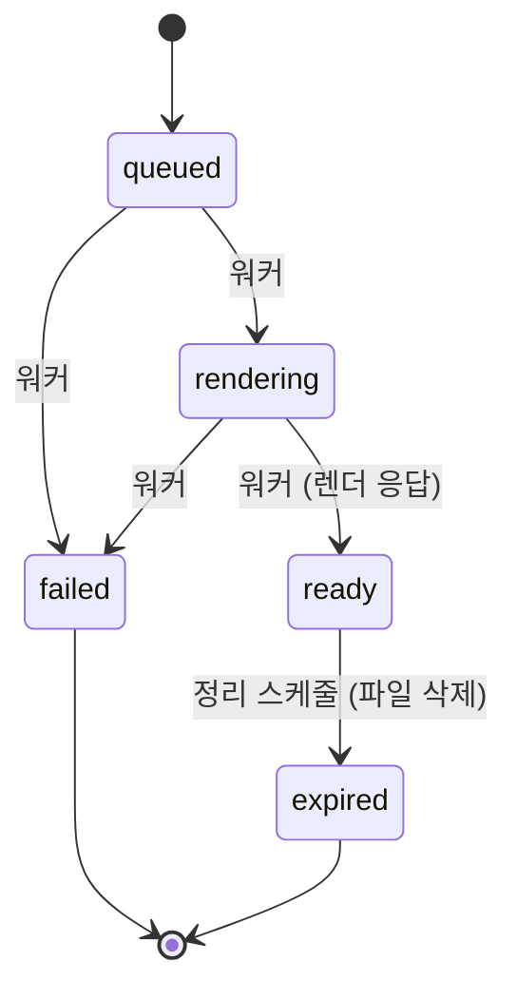

### 그림 5-e. integration_connections.status (Phase 2)

읽는 법: OAuth 콜백과 어댑터(service)가 옮기고, 해지는 owner/admin의 RPC `revoke_integration`입니다. 해지(revoked)하면 자격증명을 폐기하고 대기 동기화 잡을 취소하며 되돌릴 수 없습니다(재연결은 새 행). 위반은 `DC009`입니다.

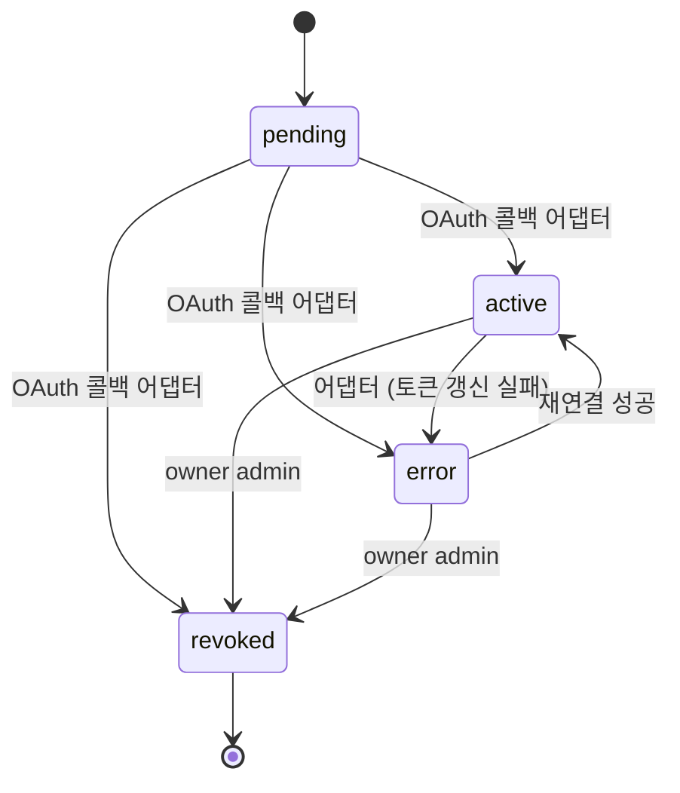

## 6. 화면 흐름

### 그림 6-a. 작업 공간 화면 흐름

읽는 법: 경로는 `03_SCREENS_UX.md` 1절 기준입니다. 점선은 조건부 이동(402, 재생성 필요 등)입니다. 앱 셸(좌측 GNB의 "현재 프로젝트" 묶음 등)의 메뉴 구성은 문서에서 아직 결정 대기입니다(9.1절 D-28~D-31).

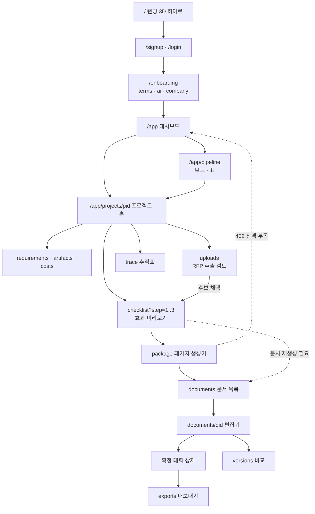

### 그림 6-b. 연동·설정·결제·운영 화면 흐름

읽는 법: 연동 하위 화면은 team 플랜(Phase 2)이고 CSV 가져오기만 전 플랜입니다. `/admin/*`는 platform_admin 전용 별도 화면입니다.

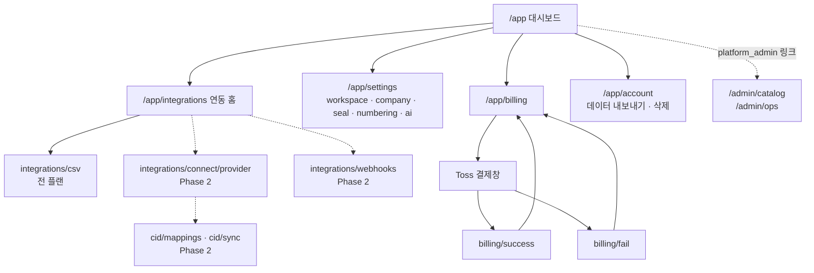

## 7. 보안 경계

`SECURITY.md`는 현재 초안(자산, 위협, 수치 표가 "작성 필요")이어서, 아래 그림은 `01_PRD.md` 5·6장, `02_ARCHITECTURE.md` 6절, `05_DATA_MODEL.md` 7절의 차단 설계에서 구성했습니다. 공통 규칙은 `SECURITY_BASELINE.md` 장 번호로만 참조합니다.

### 그림 7-a. 보안 신뢰 경계

읽는 법: 위에서 아래로 데이터에 가까워지며 각 구역은 앞 구역을 믿지 않습니다. 지켜야 할 자산은 기밀 RFP·계약 문서(DB·Storage), 크레딧·결제, 연동 토큰·웹훅 비밀(`core.encrypted_credentials`), 서명 개인키(web 서버만)입니다.

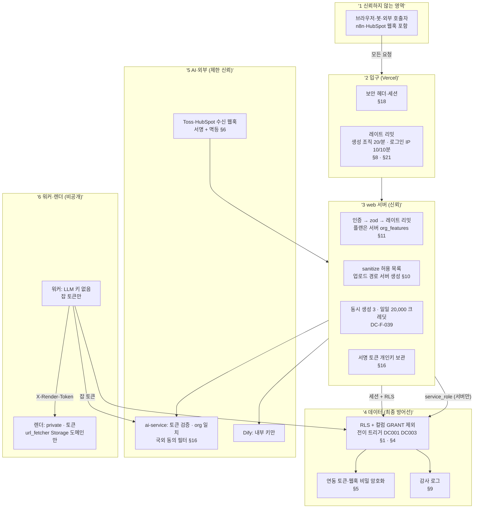

### 그림 7-b. 위협과 통제 지도

읽는 법: 왼쪽은 이식 원천 리뷰의 "높음" 결함(괄호는 원본 리뷰 번호)과 이 제품 고유 위험, 오른쪽이 문서의 차단 설계입니다(`02_ARCHITECTURE.md` 6절, `05_DATA_MODEL.md` 7절, `01_PRD.md` 6장, `02_ARCHITECTURE.md` 2.2·2.3절).

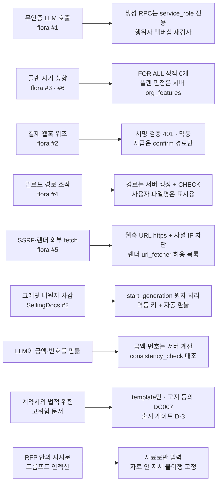

## 8. 에이전트 접근 층 (MCP)

**읽는 법:** 기존 웹 경로(위)는 그대로이고, 에이전트용 입구(아래)는 같은 서버 계층과 RLS 조회를 거칩니다. 정본은 `MCP.md`, 공통 규칙은 `../_platform-core/MCP_BASELINE.md`입니다. 점선은 Phase 1.5 이후 또는 미결정(D-M#)입니다. 이 제품은 문서 본문, 금액, 거래처 연락처를 도구로 내보내지 않고, 확정·채택·서명·전송 도구를 만들지 않습니다.

### 8-1. 웹 경로 위에 얹는 MCP 구성

```mermaid
flowchart LR
  subgraph U["사용자 쪽"]
    BR["브라우저 PM 프리랜서"]
    AG["AI 에이전트<br/>업무 비서"]
  end

  subgraph WEB["기존 웹 경로"]
    RH["Next.js Route Handler<br/>requireSession 후 zod"]
  end

  subgraph MCPL["새 MCP 층 mcp-server"]
    TR["Streamable HTTP<br/>Bearer 토큰 필수"]
    RL["레이트 리밋 사용자"]
    TL["도구 7개<br/>필드 허용 목록 출력"]
    SAN["제목 untrusted 처리<br/>본문 금액 연락처 제거"]
  end

  subgraph DB["DB 최종 방어선"]
    RLS["RLS 멤버십 엔타이틀먼트<br/>projects documents requirements"]
    VW["security_invoker 뷰<br/>project_pipeline"]
  end

  subgraph NO["MCP가 부르지 않는 것"]
    GEN["문서 생성 확정 채택<br/>서명 전송 크레딧 차감 연동"]
  end

  BR --> RH
  AG --> TR
  TR --> RL
  RL --> TL
  TL --> SAN
  RH -->|"사용자 세션"| RLS
  RH --> VW
  RH --> GEN
  TL -->|"사용자 토큰 D-M1"| RLS
  TL --> VW
  TL -.->|"확인 링크 D-M3"| RH
```

### 8-2. 문서 생성 준비와 사람 확정 (`docs_prepare_generate`)

```mermaid
sequenceDiagram
  autonumber
  actor U as PM
  participant A as AI 에이전트
  participant M as MCP 서버
  participant D as DB RLS 조회
  participant W as 웹 문서 생성 화면

  U->>A: 개발용역계약서 만들어줘
  A->>M: docs_prepare_generate 프로젝트 문서 유형
  M->>D: 문서 유형 카탈로그와 체크리스트 진행 읽기
  D-->>M: 단가 위험 등급 필수 누락
  Note over M: 저장 안 함 크레딧 차감 안 함<br/>start_generation 호출 안 함
  M-->>A: 가능 여부 누락 목록 예상 크레딧 고위험이면 웹 고지 필요 확인 링크 15분
  A-->>U: 아직 생성 전입니다 링크에서 입력 확인과 고지 동의가 필요합니다
  U->>W: 링크 열기 로그인 세션 일치 확인
  W-->>U: 누락 입력 크레딧 고지 표시
  U->>W: 생성 클릭
  W->>D: 기존 documents 경로 start_generation 크레딧 선차감
  D-->>W: 접수 또는 CR001 DC007 오류
  W-->>U: 진행 상태 안내 검토와 확정은 웹에서
```

### 8-3. 도구 위험 등급과 노출 단계

```mermaid
flowchart TB
  subgraph R1["R1 로그인 읽기 MVP"]
    T1["docs_list_projects"]
    T2["docs_get_project_progress"]
    T3["docs_get_pipeline"]
    T4["docs_search"]
    T5["docs_get_document_status"]
    T6["docs_list_requirements"]
  end
  subgraph PR["준비 저장 안 함 1.5"]
    T7["docs_prepare_generate"]
  end
  subgraph NO["만들지 않음"]
    N1["문서 확정 보관 개정"]
    N2["체크리스트 요구사항 채택"]
    N3["서명 승인 요청 전송"]
    N4["본문 금액 거래처 연락처"]
    N5["AI 생성 연동 결제"]
  end
  R1 --> PR
  PR -.->|"사람이 웹에서 확정"| N1
```

## 문서 불일치

| # | 내용 | 그림에서 고른 쪽 |
|---|---|---|
| 1 | 문서 확정 권한: `04_API.md`는 `POST /api/documents/[id]/finalize`와 RPC `finalize_document`를 owner/admin(`oa`)로 적었고, `03_SCREENS_UX.md` 3.13절 표(1.2절)는 "member 이상(제안: Phase 2 승인 흐름이 켜지면 승인자)"로 적음 | 04장(owner/admin) 기준으로 그림 1-a, 4-c, 5-b를 그림 |
| 2 | `05_DATA_MODEL.md` 1절은 "테이블 28개(카탈로그 5, 워크스페이스 2, 프로젝트 정본 6, 문서 9, 연동 6)"라 적지만 2절의 실제 `docs.` 테이블 소절은 31개(카탈로그 7, 프로젝트 정본 7) | 실제 소절 수 31을 그림 2-a에 사용 |
| 3 | `SECURITY.md`가 초안(자산, 위협, 수치 모두 "작성 필요")이고 "1~21장"이라 적지만 `SECURITY_BASELINE.md`는 22장까지 있음 | 그림 7은 PRD·아키텍처·데이터 모델의 값만 사용. `SECURITY.md` 작성 후 7-a, 7-b를 다시 맞출 것 |
| 4 | 앱 내비 목록이 `03_SCREENS_UX.md` 1절, 3.1절, 3.26절, 9.3절에서 서로 다름(9.1절이 스스로 인정, 정본은 9.3절 표) | 그림 6은 메뉴 구성을 그리지 않고 1절의 경로 이동만 그림 |
| 5 | `02_ARCHITECTURE.md` 2절 폴더 트리는 `(app)/dashboard/`, `(app)/projects/[id]/`를 쓰지만 `03_SCREENS_UX.md` 1절은 `/app/...`(02장이 "경로는 03장이 정본"이라 명시) | 03장 경로 사용 |
| 6 | MCP 읽기 경로: `04_API.md`에는 프로젝트별 문서 목록 GET과 `generation_runs` 상태 GET이 없고(`GET /api/search`로만 문서를 찾음), `GET /api/documents/[id]`는 응답에 `version` 본문을 포함해 MCP가 서버에서 걸러야 함. `CLAUDE.md` 셸 규칙의 `GET /api/documents`는 D-28 대기(`MCP.md` D-M5, D-M6) | 그림 8-1은 문서 상태 읽기를 RLS 조회로 그림. 목록 경로는 확정하지 않음 |

그림에 못 담은 것: 회의록(`docs.minutes`)·음성 대화·채팅 시퀀스, 결제 시퀀스(코어 공통, `flora-publishing` 4-c와 같음), PDF/DOCX 내보내기 시퀀스, shorts_agency 패키지, CRM형 보드의 단계 계산(뷰 `project_pipeline`), 생성 진행 애니메이션, 연동 동기화 시퀀스, 3D 히어로.

## 갱신 규칙

- `01_PRD.md`, `02_ARCHITECTURE.md`, `03_SCREENS_UX.md`, `04_API.md`, `05_DATA_MODEL.md`, `SECURITY.md`를 고치면 이 파일의 해당 그림도 같은 커밋에서 고친다(상태 전이는 `05_DATA_MODEL.md` 3절 표 그대로 유지).
