# DIAGRAMS: SceneFlow (sceneflow) UML 시각화

작성일 2026-10-23. 이해관계자(기획·개발·운영·법무) 소통용 그림 모음입니다. 정본은 각 문서이며, 그림과 문서가 다르면 문서가 우선입니다. GitHub에서 그림이 바로 렌더링됩니다(Mermaid).

**제품 한 줄 정의**: 말로 지시하면 AI가 편집안을 만들고 승인하면 실행하는 AI 자동편집(주력, SF-5)으로, 스토리보드 하나에서 롱폼 1편 + 장면 단위 쇼츠 + 언어판(KO/JA/EN)을 만들어 다채널에 배포하는 조직 단위 영상 SaaS입니다(`README.md` 1절).

**근거 문서**: `README.md`, `01_PRD.md`, `02_ARCHITECTURE.md`, `03_SCREENS_UX.md`, `04_API.md`, `05_DATA_MODEL.md`, `08_AGENCY_OPERATIONS.md`(참고), `SECURITY.md`(미작성 초안, 아래 "문서 불일치" 참조), 공통 맥락은 `../_platform-core/ARCHITECTURE_DIAGRAMS.md`, `SECURITY_BASELINE.md`, `CORE_SPEC.md`.

**표기**: 실선 화살표 = 호출·데이터 흐름, 점선 = 검증·참조·조건부, "(제안)" = 문서가 확정 전이라고 적은 값. 스토리보드 트랙(Track S, 2026-10-18)과 AI 자동편집(2026-10-18) 이후의 정본 장(01장 10~11장, 02장 10~11장, 03장 8~9장, 04장 9~10장, 05장 11~12장)을 기준으로 그렸습니다. Track E·F(Lofi, 플레이리스트)는 Phase 2라 그림에서 흐릿하게만 표시합니다.

| # | 그림 | UML 종류 | 근거 문서 절 |
|---|---|---|---|
| 1 | 사용자와 기능 | 유스케이스(flowchart) | `01_PRD.md` 1절, 2절, 3.1절, 10~11장 |
| 2 | 구성요소 | 컴포넌트(flowchart) | `02_ARCHITECTURE.md` 2절, 7절, 10.1절, 11.1절 |
| 3 | 데이터 모델 | 클래스 | `05_DATA_MODEL.md` 2.1절, 2.13절, 2.16절, 2.19~2.21절, 11~12장 |
| 4-1 | 스토리보드 생성 | 시퀀스 | `04_API.md` 9.1절, 9.4절, 9.5절, `01_PRD.md` VD-F-130~131 |
| 4-2 | AI 편집안 적용과 되돌리기 | 시퀀스 | `04_API.md` 10.1~10.2절, `01_PRD.md` VD-F-146~151 |
| 4-3 | 마스터 컷 렌더와 쇼츠 추출 | 시퀀스 | `04_API.md` 9.1절, 9.4절, `02_ARCHITECTURE.md` 10.3절, VD-F-136~137 |
| 4-4 | 업로드 검사와 고객 승인 | 시퀀스 | `04_API.md` 2절 업로드 행, `03_SCREENS_UX.md` 2.2.2절 |
| 5-1 | 스토리보드 상태 | 상태 머신 | `05_DATA_MODEL.md` 11.3절, 12.4절 |
| 5-2 | 쇼츠·변형본 컷 상태 | 상태 머신 | `05_DATA_MODEL.md` 11.3절 |
| 5-3 | 편집안 상태 | 상태 머신 | `05_DATA_MODEL.md` 12.4절 |
| 5-4 | 업로드 상태 | 상태 머신 | `05_DATA_MODEL.md` 3절 |
| 5-5 | 고객 승인 상태 | 상태 머신 | `05_DATA_MODEL.md` 3절 |
| 6 | 화면 흐름 | flowchart | `03_SCREENS_UX.md` 1절, 7.3절, 8~9장 |
| 7 | 보안 경계 | flowchart | `04_API.md` 1절, `05_DATA_MODEL.md` 4절, 7절, `02_ARCHITECTURE.md` 2절, 7절, `SECURITY_BASELINE.md` |

## 1. 사용자와 기능

읽는 법: 왼쪽은 사람, 가운데는 MVP 기능, 오른쪽은 P1과 Phase 2입니다. 첫 고객은 현우(SF-4)이고, 지훈(대행)은 그다음입니다. 기능 옆 번호는 `01_PRD.md`의 기능 ID입니다.

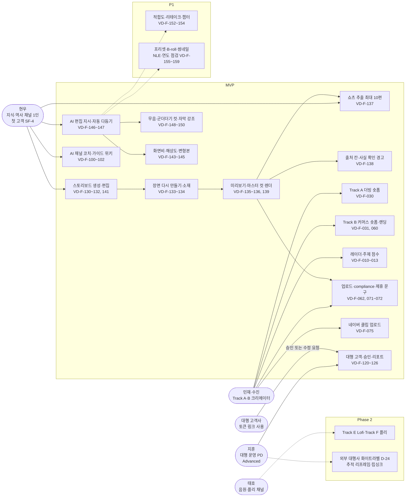

## 2. 구성요소

읽는 법: 브라우저는 Next.js(Route Handler)만 부르고, 무거운 일은 `core.jobs` 큐를 거쳐 오케스트레이터와 미디어 워커가 합니다. FastAPI(텍스트·그래프)와 미디어 워커(영상·오디오)는 서로 호출하지 않으며, 둘을 이어 주는 것은 오케스트레이터와 `core.jobs`입니다.

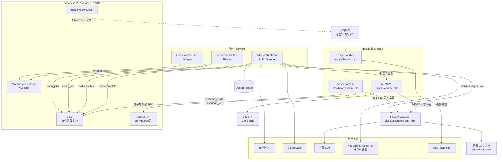

## 3. 데이터 모델

읽는 법: Track S의 중심은 `storyboards`이고, 렌더 결과는 기존 `outputs`와 `uploads` 경로를 그대로 탑니다. 사용자는 대부분 읽기(SELECT)만 하고 쓰기는 서버 또는 RPC입니다. 편집안 테이블 `edit_presets`, `pronunciation_lexicon`과 `video.productions`(Track A·B)는 그림 크기 때문에 뺐습니다. `outputs`, `uploads`, `channels`는 자주 쓰는 열만 적었습니다.

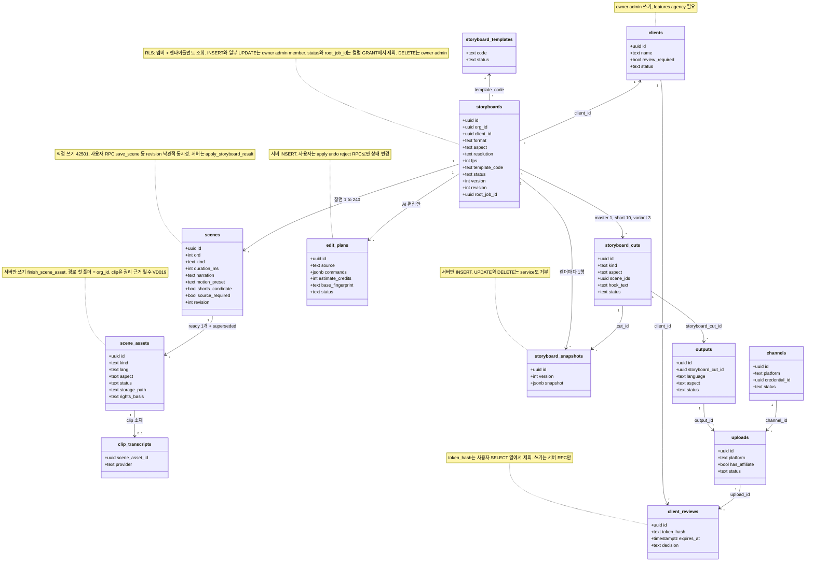

## 4. 핵심 시퀀스

### 4-1. 스토리보드 생성 (VD-F-130, 131)

읽는 법: 크레딧은 Route Handler가 먼저 차감하고(`request_id` 멱등), 생성은 잡으로 넘어갑니다. 그래프 결과는 FastAPI가 서버 RPC로 한 번에 저장하며, 길이와 장면 수를 DB가 다시 검사합니다.

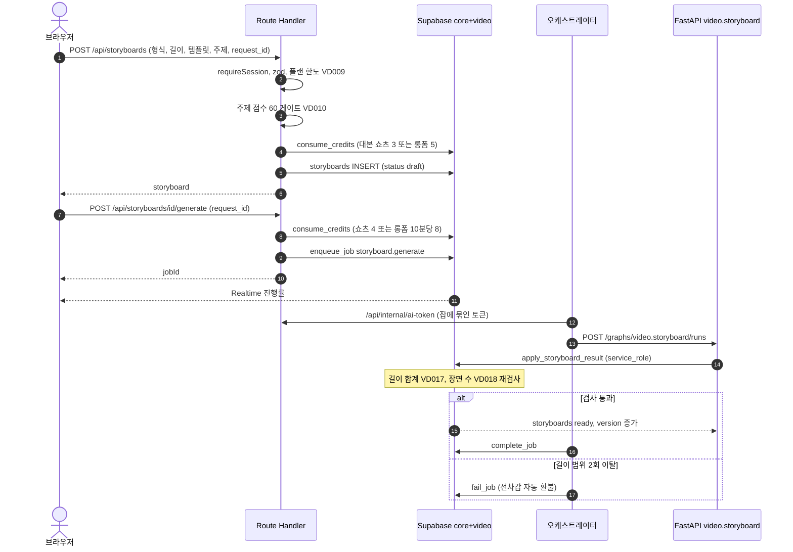

### 4-2. AI 편집안 적용과 되돌리기 (VD-F-146, 151)

읽는 법: AI는 허용 명령 17종의 목록(EDL)만 만들고 서버가 검사합니다. 승인 전에는 장면이 바뀌지 않으며, 적용은 한 트랜잭션입니다. 편집안을 만든 뒤 스토리보드가 바뀌었으면 지문 불일치로 `VD409`가 납니다.

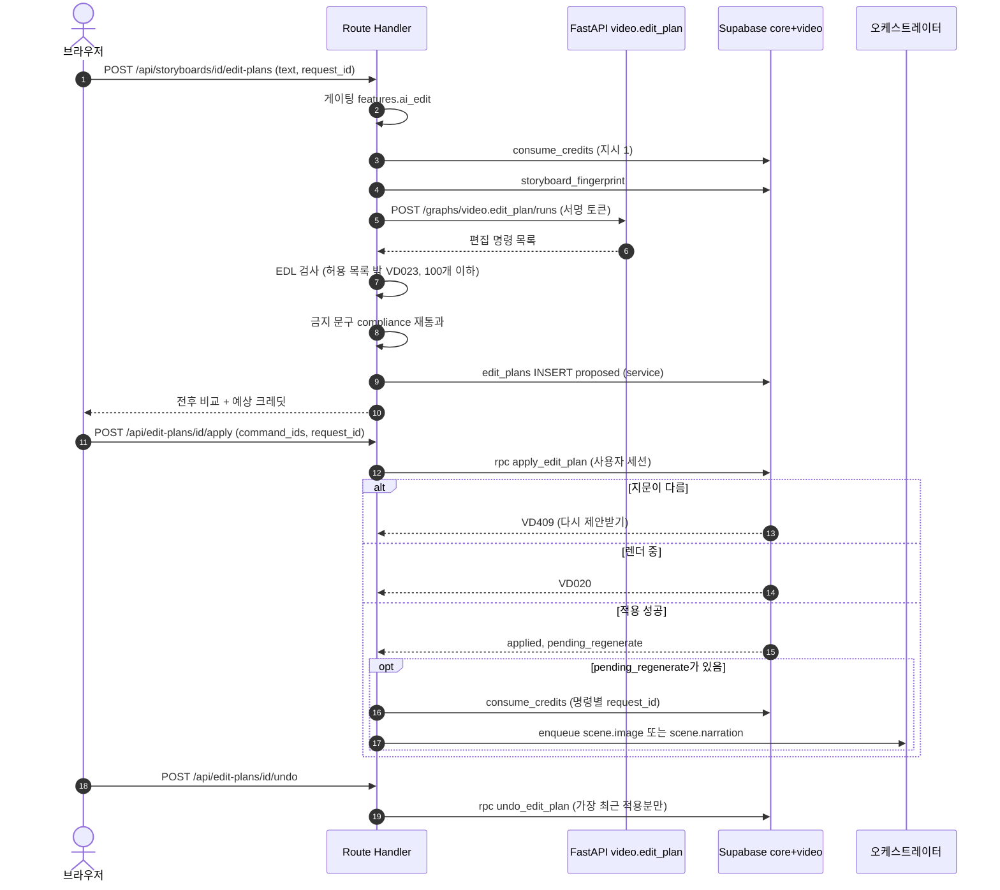

### 4-3. 마스터 컷 렌더와 쇼츠 추출 (VD-F-136, 137)

읽는 법: 렌더는 요청 시점의 스냅샷 하나만 읽습니다. 서버 검사에 통과해야 크레딧이 빠지고 스냅샷이 생기며, 워커는 테이블에 직접 쓰지 않고 완료 보고만 합니다. 쇼츠는 같은 마스터 컷에서 후보를 고른 뒤 컷마다 스냅샷을 만들어 렌더합니다.

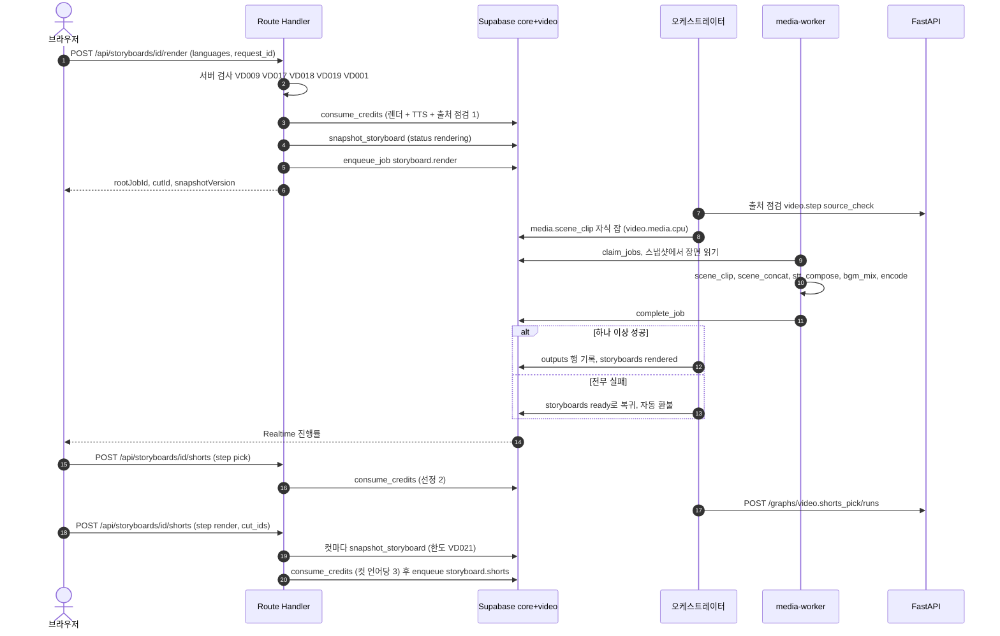

### 4-4. 업로드 검사와 고객 승인 (VD-F-071, 072, 123)

읽는 법: 대가성 문구는 업로드 생성 때 서버가 넣고(끌 수 없음), 검사에서 차단·경고·통과가 갈립니다. 대행 고객 채널이면 고객 승인이 있어야 예약할 수 있습니다. 고객은 로그인 없이 토큰 링크로만 접근합니다.

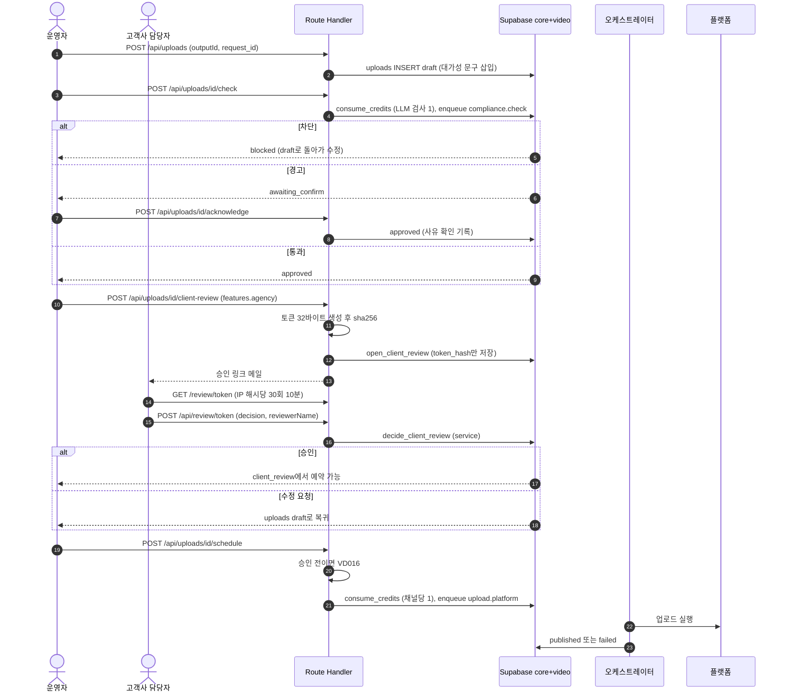

## 5. 상태 머신

읽는 법: 허용되지 않은 전이는 DB 트리거가 22023으로 막으며 service_role에도 적용됩니다. 화살표 옆 글자는 전이를 일으키는 주체입니다.

### 5-1. 스토리보드 `storyboards.status` (05장 11.3절)

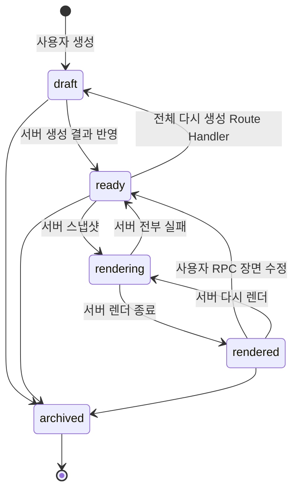

### 5-2. 컷 `storyboard_cuts.status` (05장 11.3절)

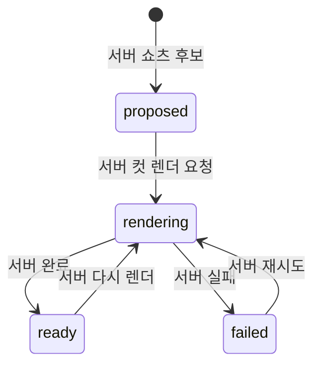

### 5-3. 편집안 `edit_plans.status` (05장 12.4절)

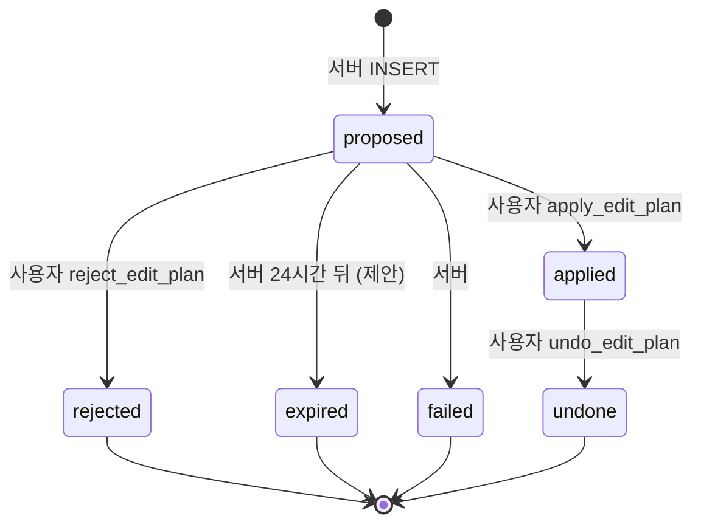

### 5-4. 업로드 `uploads.status` (05장 3절)

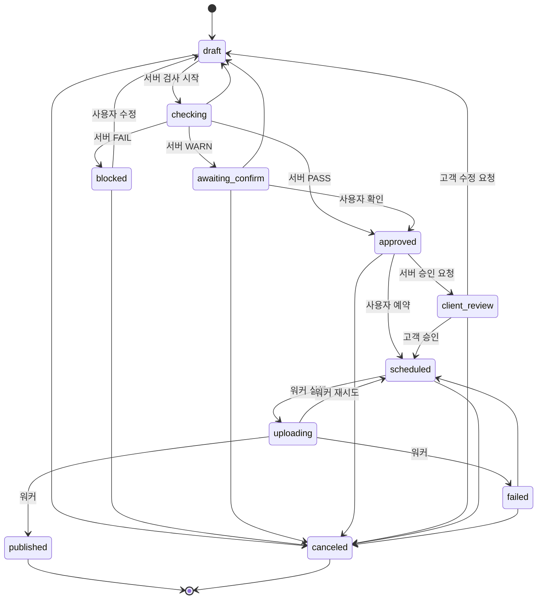

### 5-5. 고객 승인 `client_reviews.decision` (05장 3절)

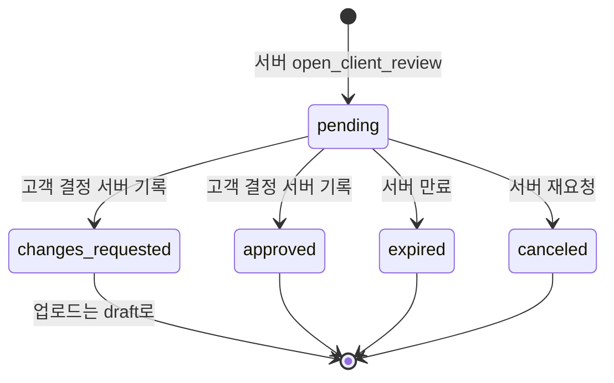

## 6. 화면 흐름

읽는 법: 화살표는 사용자가 실제로 이동하는 순서입니다. 점선은 서버가 막거나 안내하는 분기(플랜·권한)입니다. 대시보드는 모두 `/dashboard/**` 아래에 있고, 편집기의 AI 패널과 검토 시트는 같은 경로 안에서 쿼리로 엽니다.

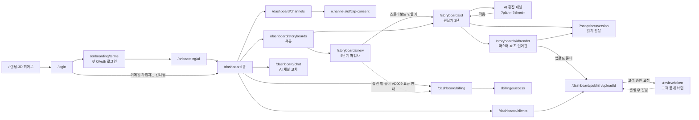

## 7. 보안 경계

읽는 법: 바깥에서 안쪽으로 갈수록 신뢰가 높아지고, 마지막 방어선은 DB(RLS와 서버 RPC)입니다. 비밀키와 서명 개인키는 가장 안쪽 서버에만 있습니다. 공통 규칙은 `SECURITY_BASELINE.md`의 장 번호(§)로 표시했습니다. 이 제품의 `SECURITY.md`는 아직 비어 있어, 아래 값은 `04_API.md`, `05_DATA_MODEL.md`, `02_ARCHITECTURE.md`, `01_PRD.md`에서 가져왔습니다.

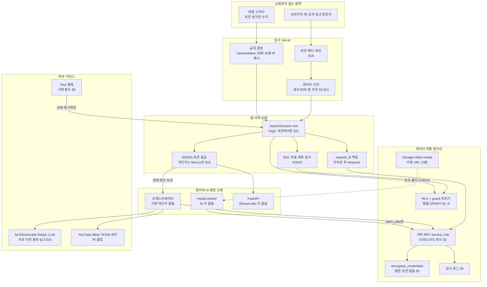

이 제품의 주요 위협과 대응(문서에 적힌 것만 모음. 정식 위협표는 `SECURITY.md` 작성 후 대체해야 합니다):

| 위협 | 대응(출처) | 공통 규칙 |
|---|---|---|
| 브라우저에서 크레딧·플랜 직접 변경 | 잔액은 `core.wallets`, 플랜은 엔타이틀먼트(SELECT만). 서버 함수 EXECUTE 회수(`05` 7절) | §3, §4 |
| 타 조직 채널 연결(OAuth state 위조) | `create_oauth_state` / `consume_oauth_state`가 org·user 확정(`05` 7절) | §7 |
| 웹훅 위조·결제 금액 조작 | 서명 필수, `payment_orders` 선저장 + `confirm_payment_order` 금액 대조(`05` 7절) | §6 |
| AI가 임의 명령 실행 | AI는 EDL만 만들고 서버가 허용 17종·권한·한도를 검사, 승인 전 변경 0(`01` SF-6) | §16 |
| 고객 승인 링크 탈취·추측 | 토큰은 32바이트, DB에는 sha256만, 사용자 SELECT에서 제외, 만료 1~336시간, IP 해시 30회/10분(`04` 2절, `05` 2.21절) | §8 |
| 브라우저가 AI·음성 제공자를 직접 호출 | 브라우저는 `/api/ai/*`, `/api/voice/*`만 호출(`04` 1절) | §11, §16 |
| 타 조직 소재 경로 참조 | `storage_path` 첫 폴더 = org_id CHECK, `check_refs`가 교차 조직 참조를 VD002로 거부(`05` 4절, 11.2절) | §1, §4 |
| 원본 저작권·대가성 문구 누락 | clip은 `rights_basis` 필수(VD019), 제휴 링크가 있으면 문구 CHECK로 끌 수 없음(`01` 6절) | §12 |
| 개발용 로그인 노출 | 배포 빌드에서 `/api/dev/login` 404, 쿠키 역할 Mock 금지(`05` 7절 SM #6) | §17 |

## 문서 불일치

1. **`SECURITY.md`가 미작성 초안**입니다(자산, 위협, 제품별 수치가 모두 "작성 필요"). 7장 그림과 위협표는 다른 문서에서 모은 임시본이며, 세션 만료·CSP 도메인·감사 보존 기간 등 제품별 수치는 그림에 담지 못했습니다.
2. **서버 RPC 시그니처 차이**: `apply_storyboard_result`는 `04_API.md` 9.2절이 `(p_storyboard_id, p_ai_run_id, p_scenes, p_expected_version)`, `05_DATA_MODEL.md` 11.5절이 `(p_storyboard_id, p_scenes, p_ai_run_id)`입니다. `snapshot_storyboard`도 `04`는 `(p_storyboard_id, p_cut_kind, p_scene_ids, p_hook_text)`, `05`는 `(p_storyboard_id, p_cut_id)`이고, `delete_scene`의 인자도 다릅니다. 그림은 함수 이름만 썼고, `04`가 "(제안)", `05`가 SQL 정본(`1200_video.sql`)을 인용하므로 `05`를 우선으로 봅니다.
3. **`storyboards.version` 초깃값**: `04_API.md` 9.1절은 생성 직후 "version 1"이라 하고 `05_DATA_MODEL.md` 11.2절은 기본값 0입니다. 그림 4-1에는 숫자를 쓰지 않았습니다.
4. **`VD001`의 의미**: `04_API.md` 7절은 "필요한 연결 없음"인데 렌더 검사(9.2절)와 `02_ARCHITECTURE.md` 10.3절은 "모든 장면 소재 ready"에 씁니다. 그림 4-3은 후자(렌더 검사)를 따랐습니다.
5. **컷 종류와 화면비**: `05` 11장은 컷 `master`/`short`와 화면비 2종, 12장은 `variant`와 화면비 4종으로 넓혔습니다. 12장이 11장을 대체한다고 적혀 있어 그림 3·5-2는 12장 기준입니다.
6. **`/command` 경로**: `04` 9.1절의 `POST /api/storyboards/[id]/command`는 10.1절에서 `edit-plans`로 대체되었습니다. 그림은 `edit-plans`만 썼습니다.
7. **`Track` 값**: `04` 1절 "Track `A-F`"와 `/api/ai/script`의 `'B'|'C'|'D'`는 9장에서 `S`로 바뀐다고 적혀 있으나 앞 장 표는 그대로입니다(문서가 이미 인정). 그림은 S 기준입니다.

## 갱신 규칙

`README.md`, `01_PRD.md`~`05_DATA_MODEL.md`, `SECURITY.md` 중 이 그림의 근거 절을 고치면 이 파일의 해당 그림도 같은 변경에서 함께 고칩니다.
