# DIAGRAMS: Stock Dashboard UML 시각화

작성일 2026-10-23. 이 문서는 `stock-dashboard`의 기획 문서를 그림으로 옮긴 것이다. 정본은 각 문서이며 그림과 문서가 다르면 문서가 우선한다. GitHub에서 Mermaid가 바로 렌더링된다. 전체 플랫폼 구조는 `../_platform-core/ARCHITECTURE_DIAGRAMS.md`와 같은 스타일로 맞췄다.

**제품 한 줄 정의**: 본인이 직접 연결한 증권사 계좌(1차는 모의투자)의 잔고·보유·체결을 한 화면에서 조회하고, AI가 포트폴리오의 분산과 위험 요인을 "진단"해 주는 초대제 개인 투자 대시보드. 종목 추천과 매수가·목표가·손절가는 제시하지 않는다.

**근거 문서**: `README.md`, `01_PRD.md`, `02_ARCHITECTURE.md`, `03_SCREENS_UX.md`, `04_API.md`, `05_DATA_MODEL.md`. 공통은 `../_platform-core/SECURITY_BASELINE.md`, `CORE_SPEC.md`, `AI_ARCHITECTURE.md`.

**표기**: 실선 화살표 = 호출·데이터 흐름, 점선 = 검증·참조·구독, "(제안)" = 문서가 제안이라 한 값(확정 전). Phase 2·3 항목은 노드 이름에 `P2`, `P3`를 붙였다.

| # | 그림 | UML 종류 | 근거 문서 절 |
|---|---|---|---|
| 1-A | 사용자와 기능 (MVP) | 유스케이스(flowchart) | 01_PRD 1장, 2장, 3.1절 |
| 1-B | 사용자와 기능 (Phase 2, 3, 보류) | 유스케이스(flowchart) | 01_PRD 2장, 3.2~3.3절 |
| 2-A | 구성요소: 웹, 워커, 코어 | 컴포넌트(flowchart) | 02_ARCHITECTURE 2~4절, 7절 |
| 2-B | 구성요소: AI 경로 | 컴포넌트(flowchart) | 02_ARCHITECTURE 2절(AI 경계), 5절 |
| 3-A | 데이터 모델: 베타, 연결, 동기화 | 클래스(classDiagram) | 05_DATA_MODEL 1~2절, 4절 |
| 3-B | 데이터 모델: AI 리포트, 모의주문 | 클래스(classDiagram) | 05_DATA_MODEL 2.7~2.8절, 4절 |
| 4-A | 시퀀스: 초대 수락과 부트스트랩 | 시퀀스 | 03_SCREENS_UX 2.1절, 04_API 2~3절 |
| 4-B | 시퀀스: 계좌 연결과 동기화 | 시퀀스 | 01_PRD ST-F-003~005, 04_API 2절, 02_ARCHITECTURE 4절 |
| 4-C | 시퀀스: AI 포트폴리오 진단 | 시퀀스 | 02_ARCHITECTURE 5.4절, 01_PRD ST-F-011, 022, 030 |
| 4-D | 시퀀스: 모의주문 확인 (P3) | 시퀀스 | 03_SCREENS_UX 2.5절, 04_API 2~3절, 01_PRD ST-F-018~021 |
| 5-A | 상태: 초대와 베타 접근 | 상태 머신 | 05_DATA_MODEL 3절 |
| 5-B | 상태: 증권사 연결 | 상태 머신 | 05_DATA_MODEL 3절 |
| 5-C | 상태: AI 리포트 | 상태 머신 | 05_DATA_MODEL 3절 |
| 5-D | 상태: 모의주문 (P3) | 상태 머신 | 05_DATA_MODEL 3절 |
| 6 | 화면 흐름 | flowchart | 03_SCREENS_UX 1절, 2절, 8절 |
| 7 | 보안 신뢰 경계 | flowchart | 05_DATA_MODEL 7절, 02_ARCHITECTURE 2절·6절, 01_PRD 6장, SECURITY_BASELINE |

> 이 제품의 `SECURITY.md`는 아직 템플릿 상태(자산, 위협, 수치가 "작성 필요")라서 7번 그림은 `05_DATA_MODEL` 7장, `02_ARCHITECTURE` 2·6장, `01_PRD` 6장의 보안 서술을 근거로 그렸다. 자세한 내용은 맨 끝 "문서 불일치"에 있다.

---

## 1. 사용자와 기능

### 그림 1-A. MVP 기능

**읽는 법**: 왼쪽이 역할, 오른쪽이 기능 묶음이다. 기능 노드에 문서의 기능 ID(`ST-F-###`)를 붙였다. 초대받은 투자자(베타 사용자)가 쓰는 기능과 운영자 기능을 나눴다.

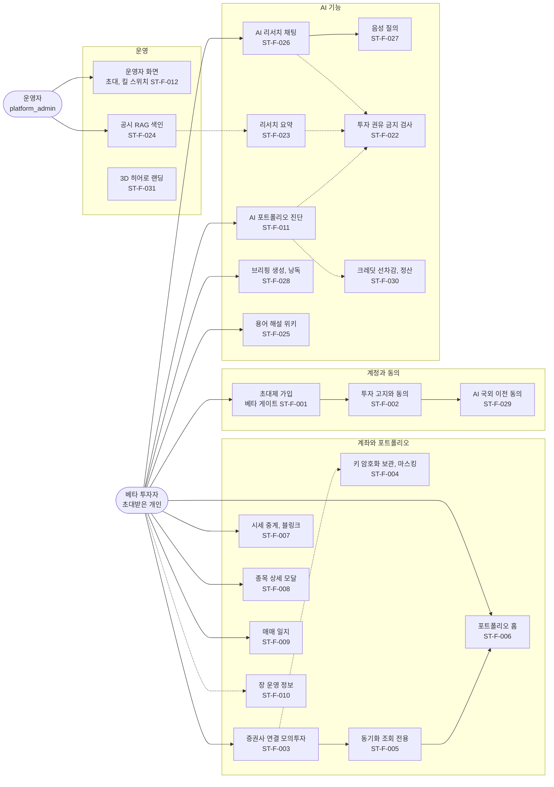

### 그림 1-B. Phase 2, Phase 3, 보류와 폐기

**읽는 법**: 문서의 범위 표(01_PRD 2장)에서 MVP 밖에 있는 항목이다. 실선은 해당 Phase에서 열리는 기능, 점선은 선행 조건이다. 보류·폐기 항목은 오른쪽에 모았다.

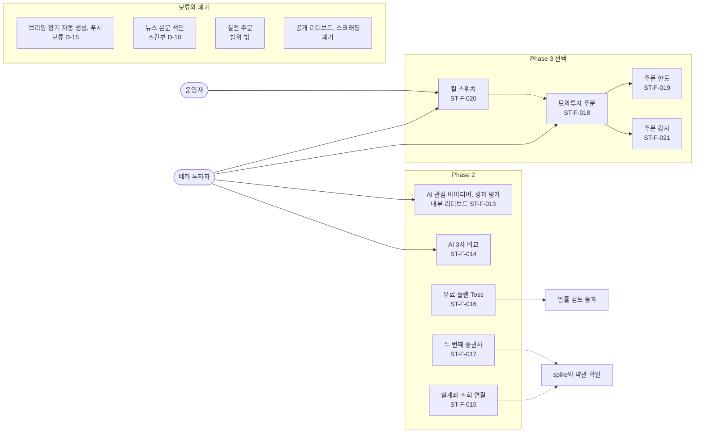

---

## 2. 구성요소

### 그림 2-A. 웹, 워커, 코어

**읽는 법**: 브라우저는 Next.js 앱(Route Handler)과 시세 중계 워커의 SSE만 부른다. 증권사와 AI 제공자는 서버와 워커만 호출한다. 이 제품은 모놀리스(전용 Supabase 프로젝트)이므로 코어는 `core-lite`로 같은 DB 안에 있다.

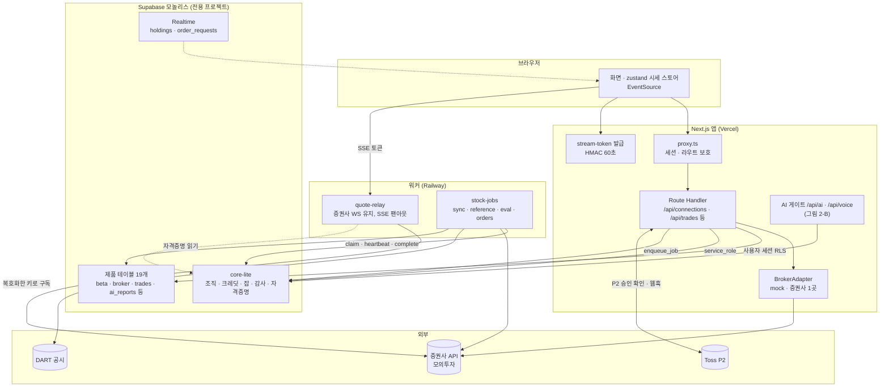

### 그림 2-B. AI 경로

**읽는 법**: 브라우저는 `/api/ai/*`와 `/api/voice/*`만 부른다. Next.js가 크레딧을 선차감하고 EdDSA 서명 토큰으로 FastAPI를 호출한다. 진단·요약·브리핑은 LangGraph 그래프, 채팅은 Dify를 거쳐 FastAPI 도구 경로로 간다. 모든 사용자 노출 텍스트는 `advice_check`와 `compliance`를 통과해야 한다.

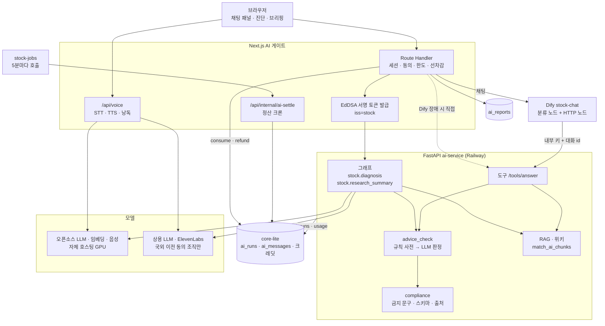

---

## 3. 데이터 모델

모든 테이블은 RLS ON이고 `FOR ALL` 정책이 없다. 도메인 테이블 읽기는 `stock.has_stock_access(org_id)`(멤버 + 엔타이틀먼트 + 베타 활성)이며 사용자 쓰기 정책은 `trade_notes`만 있다. 정본 SQL은 `_supabase-modular/migrations/1900_stock.sql`이다.

### 그림 3-A. 베타, 연결, 동기화

**읽는 법**: 조직(`core.organizations`, 참조만) 아래에 베타 접근과 증권사 연결이 달리고, 연결 아래에 시계열·보유·체결·메모가 달린다. 하위 테이블은 `(parent_id, org_id)` 복합 FK로 다른 조직의 행을 붙일 수 없다. 각 클래스의 note가 RLS 접근 주체다.

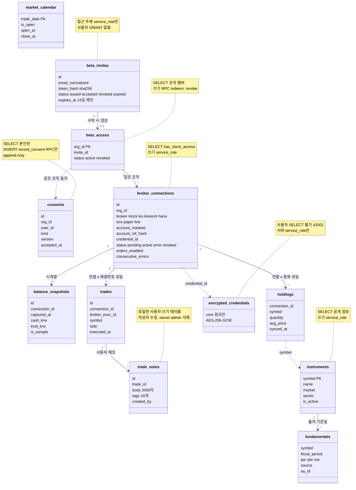

### 그림 3-B. AI 리포트와 모의주문

**읽는 법**: 위쪽은 AI 결과(진단·아이디어·리서치·브리핑이 `ai_reports` 한 표를 공유), 아래쪽은 Phase 3 모의주문 테이블이다. 제품 전용 AI 대화·위키·음성 표는 없고 코어 `core.ai_*`를 쓴다. 주문 표는 별도 마이그레이션(`0003_stock_orders_paper.sql`)이다.

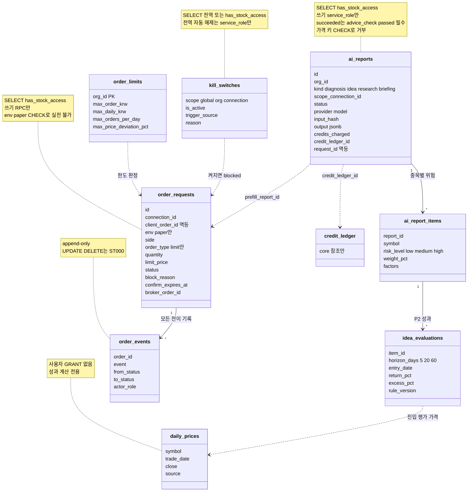

---

## 4. 핵심 시퀀스

### 그림 4-A. 초대 수락과 부트스트랩 (ST-F-001)

**읽는 법**: 초대 토큰 원문은 링크에만 있고 DB에는 sha256만 있다. 서버가 service_role로 수락 RPC를 부르며, 만료(14일), 이메일 불일치, 이미 사용된 초대를 각각 다른 코드로 거절한다.

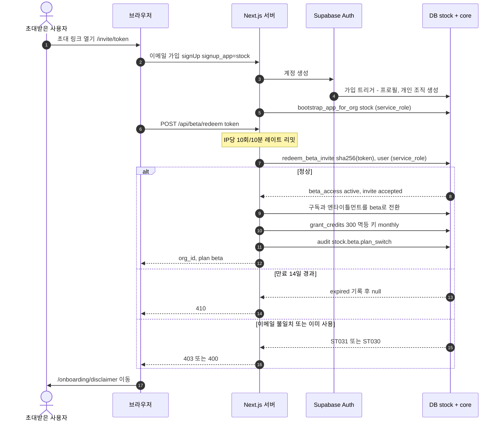

### 그림 4-B. 계좌 연결과 동기화 (ST-F-003, 004, 005)

**읽는 법**: 키는 서버에서 `verify`를 통과한 뒤에만 암호화 저장된다. 계좌번호는 마스킹 값과 HMAC만 저장한다. 동기화는 `stock.sync` 잡이며 체결은 `(connection_id, broker_exec_id)` 유니크로 중복 없이 upsert한다.

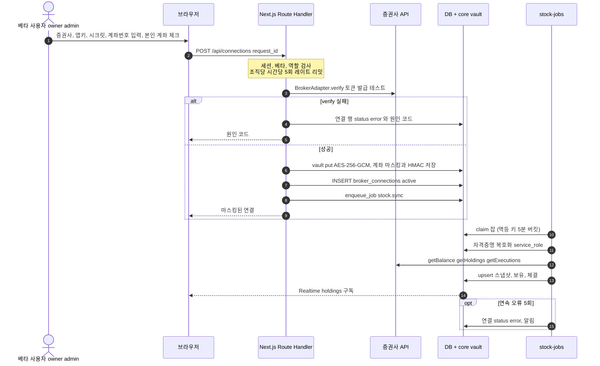

### 그림 4-C. AI 포트폴리오 진단 (ST-F-011, 022, 030)

**읽는 법**: 크레딧은 호출 전에 선차감하고, 검사에 실패하거나 시간 초과면 전액 환불한다. 모델에는 비율 스냅샷만 보내고 수량·금액·계좌번호는 보내지 않는다. 결과는 투자 권유 금지 검사를 통과한 뒤에만 저장·표시된다.

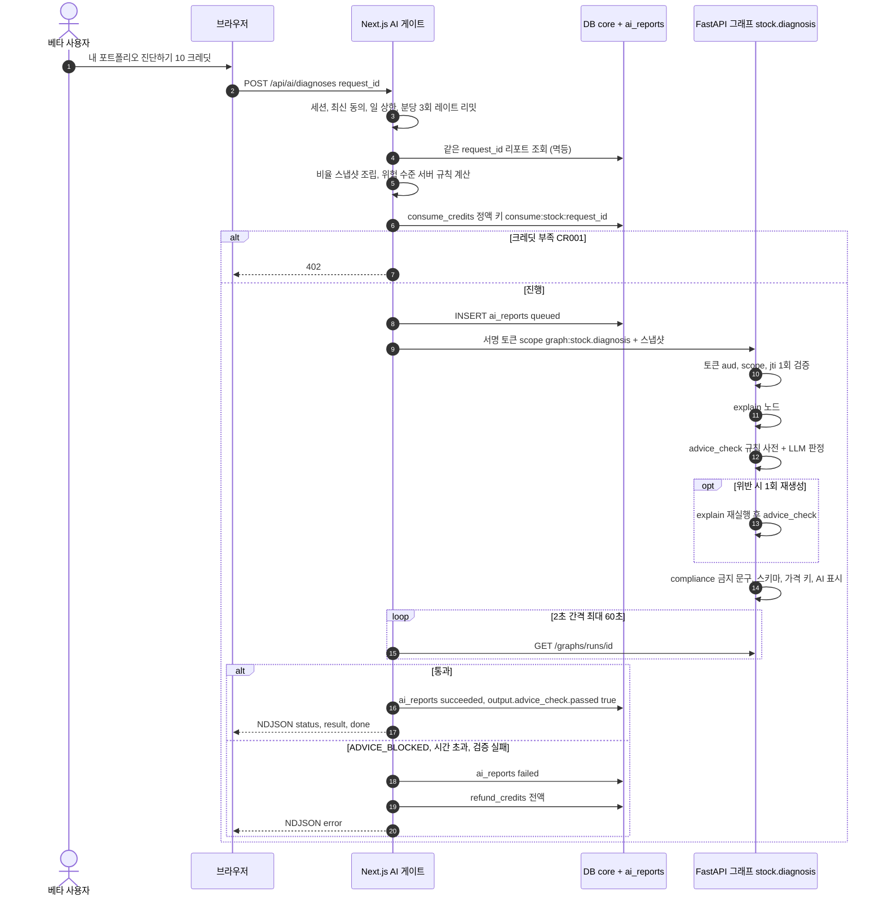

### 그림 4-D. 모의주문 확인 (Phase 3, ST-F-018~021)

**읽는 법**: 한도 위반과 킬 스위치는 예외가 아니라 `blocked` 상태 행으로 남는다. 사용자는 60초 안에 수량·가격·예상 금액을 보고 직접 확인해야 하고, 워커는 제출 직전에 킬 스위치를 다시 확인한다. 실전 주문 경로는 없다(DB에서 `env=paper`만 허용).

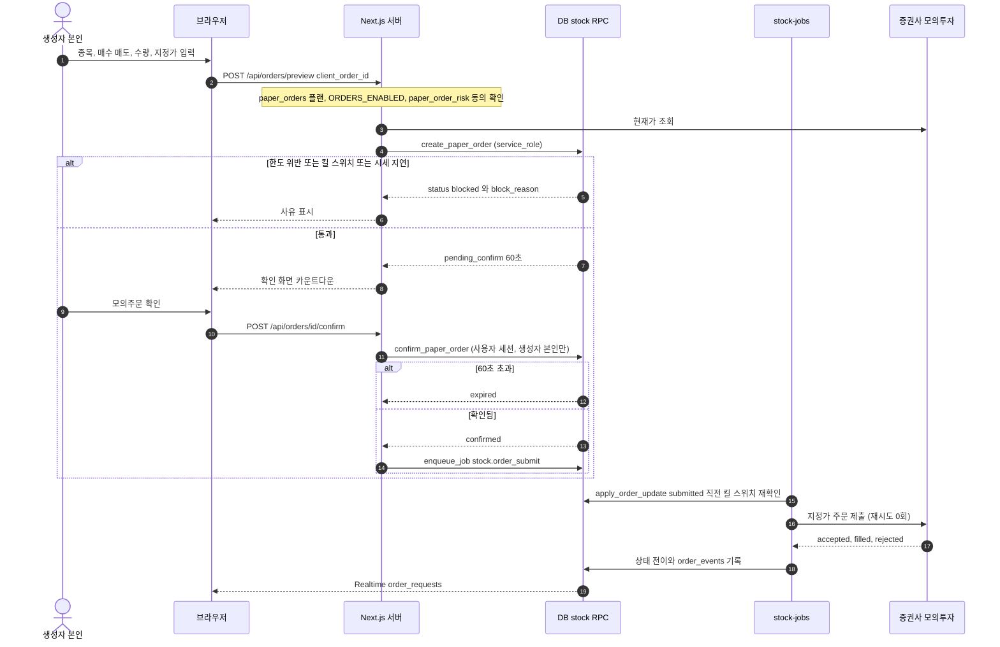

---

## 5. 상태 머신

전이는 모두 `stock.enforce_status_transition()` 트리거가 강제한다(위반 `22023`, service_role도 동일). 전이를 일으키는 주체를 화살표 라벨에 적었다.

### 그림 5-A. 초대와 베타 접근

**읽는 법**: 위 블록은 초대(`beta_invites`), 아래 블록은 베타 접근(`beta_access`)이다. 수락 RPC가 두 상태를 함께 움직인다.

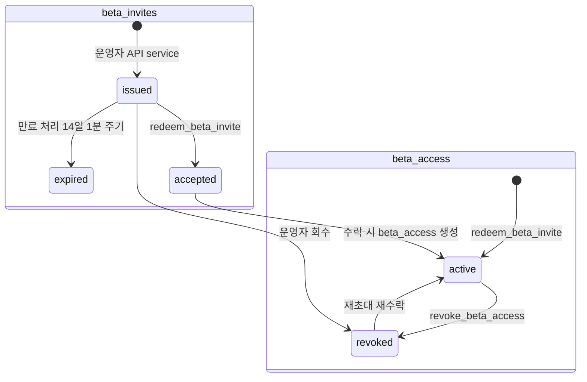

### 그림 5-B. 증권사 연결 `broker_connections`

**읽는 법**: mock 연결은 처음부터 `active`다. 워커가 연속 오류 5회를 감지하면 `error`로 바꾸고, 사용자가 다시 연결하면 `active`로 돌아온다. 해제하면 `revoked`이며 자격증명 암호문이 즉시 비워진다.

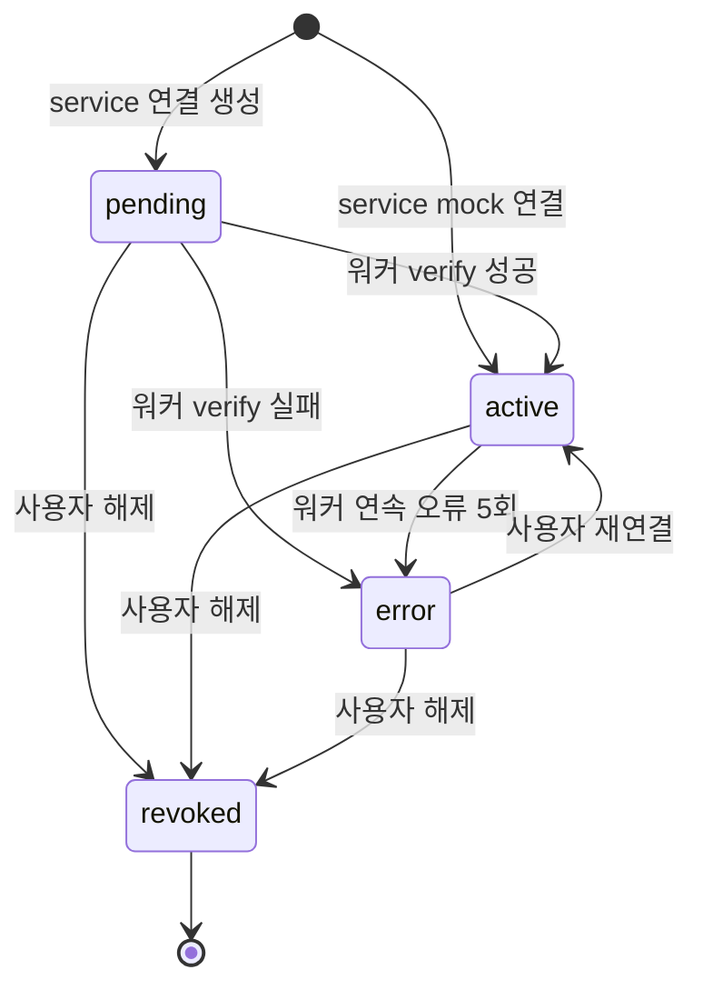

### 그림 5-C. AI 리포트 `ai_reports`

**읽는 법**: 서버(Route Handler)가 모든 전이를 일으킨다. `queued` 생성 때 크레딧을 선차감하고 `failed` 또는 `canceled`로 가면 환불한다. 3분 넘게 `running`이면 정산 크론이 마무리하거나 환불한다.

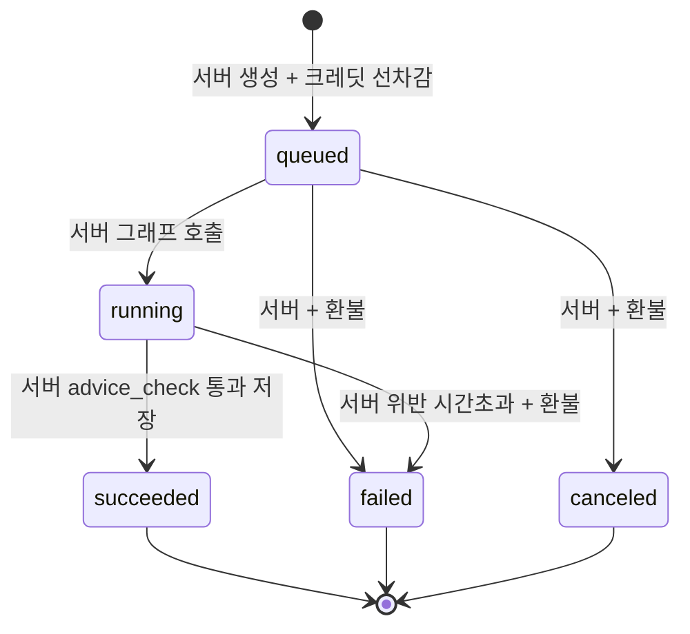

### 그림 5-D. 모의주문 `order_requests` (Phase 3)

**읽는 법**: 괄호 없이 RPC 이름을 적었다. `create_paper_order`는 한도 위반이면 예외 대신 `blocked`를 반환한다. `submitted` 이후는 워커가 증권사 응답을 반영한다.

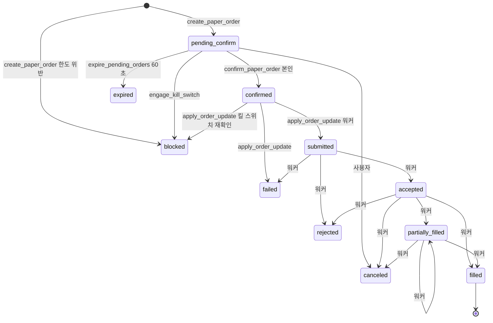

---

## 6. 화면 흐름

**읽는 법**: 위에서 아래로 첫 사용 여정(초대 → 동의 → 연결 → 진단)이고, 점선 박스는 Phase 2·3 화면이다. 경로는 03_SCREENS_UX 1절의 표기를 따랐다. 운영자 화면은 `platform_admin`만 들어간다.

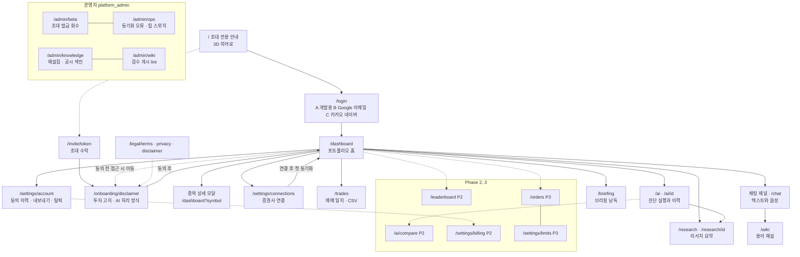

---

## 7. 보안 신뢰 경계

**읽는 법**: 바깥에서 안쪽으로 신뢰가 올라간다. 브라우저는 Next.js 앱과 시세 중계 SSE만 부른다. 비밀(증권사 키)과 service_role은 서버·워커 구역 안에만 있고, 보유 수량·금액은 AI 구역으로 넘어가지 않는다. 노드 옆 `§`는 `../_platform-core/SECURITY_BASELINE.md`의 장 번호다. 이 제품의 `SECURITY.md`가 템플릿 상태라 자산·위협은 05_DATA_MODEL 7장, 02_ARCHITECTURE 6장, 01_PRD 6장에서 가져왔다.

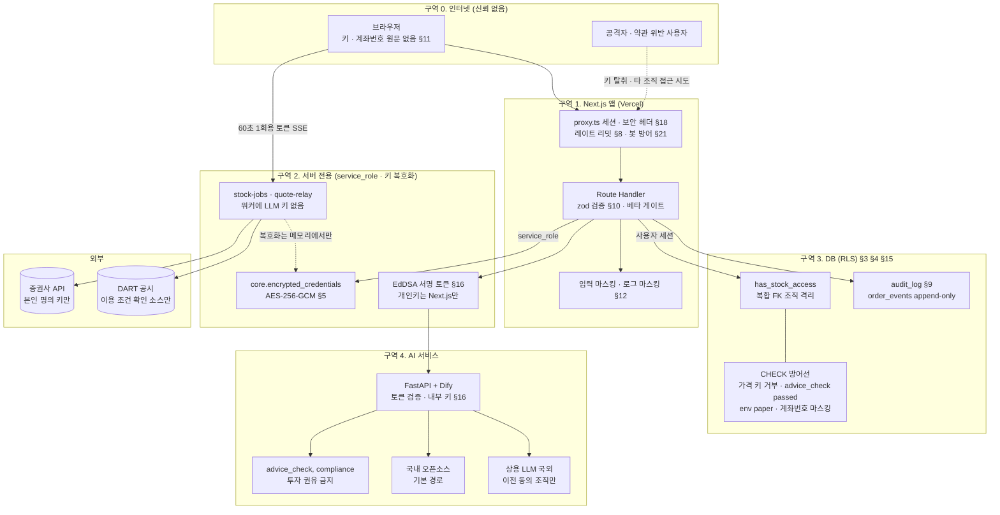

**위협과 대응 요약** (문서에 있는 것만; 번호는 리뷰 "높음" 결함 번호)

| 자산·위협 | 대응 | 근거 |
|---|---|---|
| 증권사 키·토큰·계좌번호 유출 (#1) | `encrypted_credentials`만 사용, 계좌번호는 마스킹과 HMAC만, 로그 마스킹, 사용자 SELECT 불가 | 05_DATA_MODEL 7장, SECURITY_BASELINE §5 |
| 주문 범위 확대·실전 주문 (#2) | MVP·P2는 조회 전용, `order_requests.env='paper'` CHECK, 사람 확인 60초, 킬 스위치 | 05_DATA_MODEL 7장, 01_PRD 3.3절 |
| 투자 권유·가격 제시 (#3) | 서버 규칙 위험 수준, 가격 키 CHECK, `advice_check` 후 compliance, 실패 시 환불 | 02_ARCHITECTURE 5.3절 |
| 마이데이터 해당·타인 계좌 (#4) | 초대제 + `has_stock_access`, 본인 명의 키만, 스크래핑 영구 제외 | 01_PRD 6.1절 |
| 시세 재배포 (#6) | 공용 피드 없음, 사용자 본인 연결로만 SSE, 틱 비저장 | 02_ARCHITECTURE 6장 |
| 보유 내역의 AI 유출 | 진단 입력은 비율 스냅샷만, 채팅에 수량·금액 미포함 | 02_ARCHITECTURE 2절 AI 경계 |

---

## 문서 불일치

1. **`SECURITY.md` 미작성**: 자산, 위협(T1~), 공통 규칙 제품별 수치(세션 만료, CSP 도메인, 2단계 인증 역할, 감사 보존 등), 외부 서비스 이전 표가 모두 "(작성 필요)"다. 그림 7과 위 요약 표는 `05_DATA_MODEL` 7장, `02_ARCHITECTURE` 2·6장, `01_PRD` 6장에서 가져왔고 SECURITY.md 값이 채워지면 다시 맞춰야 한다. 한편 `01_PRD` 5장은 감사 로그 2년, `order_events` 3년을 이미 적고 있어 SECURITY.md 3절 수치와 맞춰야 한다.
2. **상태 전이의 부분 기재**: `05_DATA_MODEL` 3절은 `ai_reports`에 `queued`, `running`, `succeeded`, `failed`, `canceled`가 나오지만 `succeeded` 이후 전이를 따로 적지 않았다(종료 상태로 그렸다). `beta_invites`의 `expired` 처리 주체는 "만료 처리"로만 쓰여 있고 02_ARCHITECTURE 4절의 "매 1분 초대 만료 처리"를 근거로 연결했다.
3. **GNB와 3.1절 와이어프레임**: `03_SCREENS_UX` 8.7절이 스스로 밝히듯 1절 화면 표와 3.1절 와이어프레임은 8.3절 GNB 정본과 다르다(헤더 상단 내비 → 좌측 GNB, 채팅 패널은 헤더 버튼). 그림 6은 1절 경로 기준이고 GNB 배치는 그리지 않았다. 결정 대기 D-24~D-27(Phase 2·3 메뉴, 운영자 셸, 설정 위치, 색)은 미정이다.

## 갱신 규칙

`01_PRD`, `02_ARCHITECTURE`, `03_SCREENS_UX`, `04_API`, `05_DATA_MODEL`, `SECURITY.md` 중 하나를 고치면 해당 그림(위 표의 근거 절)도 같은 변경에서 함께 고친다. 수정 뒤에는 Mermaid 검증을 다시 돌린다.
