# Study Note (study-note) UML 다이어그램

작성일 2026-10-23. 제품 한 줄 정의: 수업이나 회의 원문을 붙여넣으면 서버가 AI 모델 2개로 병렬 정리한 뒤 통합 모델이 하나의 "학습 일지"로 합쳐 주고 TXT와 보관함에 남기며, 노트·교재를 과목별로 색인(RAG)해 개념 위키·퀴즈·Q&A 채팅·강의 녹음 노트 생성까지 제공하는 학습 노트 정리 서비스입니다(`README.md` 1절).

근거 문서: `README.md`, `01_PRD.md`, `02_ARCHITECTURE.md`, `03_SCREENS_UX.md`, `04_API.md`, `05_DATA_MODEL.md`, `SECURITY.md`, `MCP.md`, 공통 맥락은 `../_platform-core/ARCHITECTURE_DIAGRAMS.md`, `SECURITY_BASELINE.md`, `CORE_SPEC.md`. 정본은 각 문서이며, 그림과 문서가 다르면 문서가 우선입니다. 어긋난 곳은 파일 끝 "문서 불일치"에 적었습니다. GitHub에서 그림이 바로 렌더링됩니다(Mermaid).

표기: **실선 화살표** = 호출·데이터 흐름, **점선** = 검증·참조·구독, "(제안)" = 문서가 제안값이라고 밝힌 것. 기능 ID(NT-F-###)는 `01_PRD.md` 3절의 ID입니다.

`SECURITY.md`는 아직 템플릿 상태("작성 필요")라서, 7절 보안 그림은 `01_PRD` 6장, `02` 6절, `04` 1절, `05` 7절에 흩어진 보안 설계를 모은 것입니다. `06_AGENT_PLAN.md`와 `07_SOURCE_MIGRATION.md`는 작업 관리 문서라 그림에서 뺐습니다.

| 번호 | 그림 | UML 종류 | 근거 문서 절 |
|---|---|---|---|
| 1-1 | 사용자와 기능: 일지 정리 | 유스케이스 관점 flowchart | `01_PRD` 2절, 3절 |
| 1-2 | 사용자와 기능: AI 학습 | 유스케이스 관점 flowchart | `01_PRD` 2절, 3절 |
| 1-3 | 운영자, 로그인 단계, Phase 구분 | 유스케이스 관점 flowchart | `01_PRD` 2절, 8.1절 |
| 2-1 | 구성요소: 웹·워커·AI·외부 서비스 | 컴포넌트 | `02` 2절, 4절, 7절 |
| 2-2 | 구성요소: AI 계층 상세 | 컴포넌트 | `02` 4.1절, 5.2절, `04` 6.1절, 6.2절 |
| 3-1 | 데이터 모델 | 클래스 | `05` 1절, 2절, 4절, 6절 |
| 3-2 | AI 기능의 데이터가 놓이는 곳 | flowchart | `05` 1절, 6절 |
| 4-1 | 일지 정리 실행 (NT-F-003, 006, 017) | 시퀀스 | `04` 2절, 3절, `02` 4절 |
| 4-2 | 노트 정리 그래프 (NT-F-020, 021, 028) | 시퀀스 | `02` 4.1절, `04` 2.1절 |
| 4-3 | 강의 녹음에서 노트 생성 (NT-F-026) | 시퀀스 | `04` 2.1절, `03` 2.6절 |
| 4-4 | AI 채팅 한 턴 (NT-F-024, 028) | 시퀀스 | `04` 2.1절, 6.2절 |
| 5-1 | 일지 상태 `entries.status` | 상태 머신 | `05` 3.1절 |
| 5-2 | 실행 상태 `runs.status` | 상태 머신 | `05` 3.2절 |
| 5-3 | 카드 상태 `run_steps.status` | 상태 머신 | `05` 3.3절 |
| 5-4 | 문서 색인 상태 `ai_documents.status` | 상태 머신 | `01_PRD` NT-F-020, 031 |
| 6-1 | 화면 흐름: 공개·가입·온보딩 | flowchart | `03` 1절, 2.1절, 7절 |
| 6-2 | 화면 흐름: 앱 셸 | flowchart | `03` 1절, 2절, 8절 |
| 7-1 | 보안 경계 | flowchart (신뢰 경계) | `01_PRD` 6장, `02` 6절, `05` 7절 |
| 8-1 | API 위에 얹는 MCP 구성 | 컴포넌트(flowchart) | `MCP` 1~3절, `MCP_BASELINE` 1·7절 |
| 8-2 | 정리 준비와 사람 확정 | 시퀀스 | `MCP` 2·6절, `04` 2.1절 |
| 8-3 | 도구 위험 등급과 노출 단계 | flowchart | `MCP` 2절, `MCP_BASELINE` 2절 |

## 1. 사용자와 기능

### 그림 1-1. 일지 정리 (원본에서 이어받은 기능)

읽는 법: 회원이 날짜와 원문을 넣고 [정리하기]를 누르면 기본 카드 2장과 통합 카드가 나오고, 카드별 재요청·취소·TXT·보관함으로 이어집니다. 점선 상자의 비용 보호는 사용자가 누르는 기능이 아니라 서버가 거는 제한입니다(NT-F-014). 모두 MVP입니다.

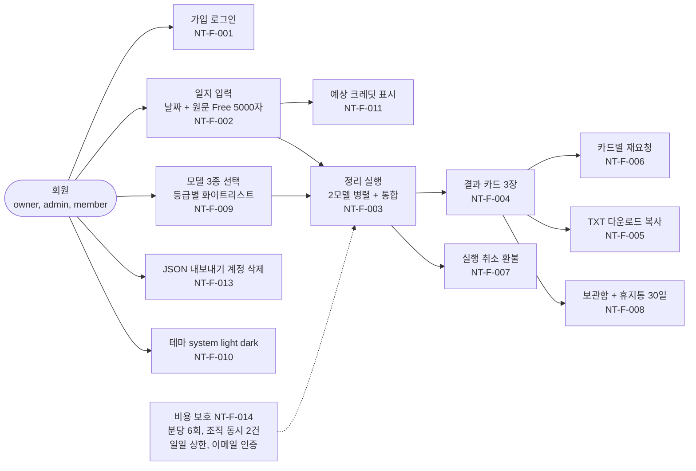

### 그림 1-2. AI 학습 기능

읽는 법: 위 줄이 자료가 들어오는 길(업로드·강의 녹음), 가운데가 정리 그래프와 결과물(요약·위키·퀴즈), 아래가 그것을 활용하는 채팅·퀴즈 풀이입니다. 과목은 별도 테이블이 아니라 위키 페이지로 표현합니다(D-16, 3-2 그림). 모두 MVP입니다.

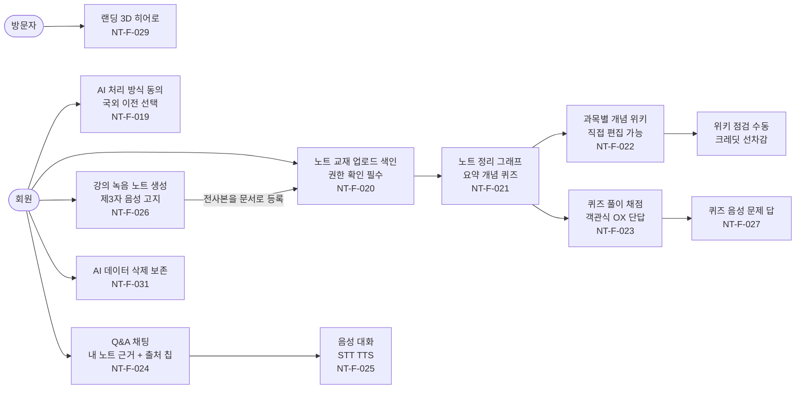

### 그림 1-3. 운영자, 로그인 단계, Phase 구분

읽는 법: 운영자 기능은 MVP에 없고 Phase 2의 모델 카탈로그 관리뿐입니다. 로그인은 Stage A→B→C 순서로 켜지고, 아래 두 상자는 MVP 밖 항목입니다. 구분은 `01_PRD.md` 2절 표 그대로입니다. Pro 플랜과 크레딧팩은 베타 동안 `is_active=false`입니다.

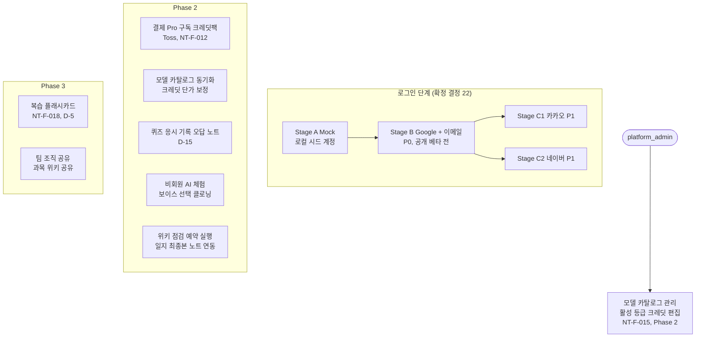

## 2. 구성요소

### 그림 2-1. 웹·워커·AI·외부 서비스

읽는 법: 일지 정리(위 경로)는 Route Handler가 DB 함수 `start_run`을 불러 차감·실행·잡을 한 번에 만들고 TS 워커가 OpenRouter를 호출합니다. AI 기능(아래 경로)은 FastAPI가 맡습니다. 웹 앱(Vercel)에는 LLM 키가 없고, 점선은 구독 또는 Phase 2입니다.

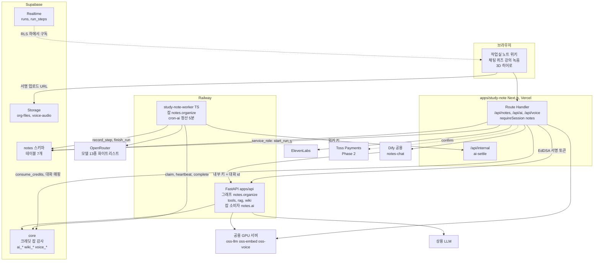

### 그림 2-2. AI 계층 상세

읽는 법: 왼쪽 Next.js 엔드포인트가 오른쪽 FastAPI 도구·그래프를 부릅니다. 그래프 `notes.organize`는 5개 노드이고 `compliance`에서 걸린 항목만 해당 노드로 돌아가 1회 다시 씁니다(점선). 채팅은 그래프가 아니라 `/tools/answer` 도구 경로입니다. 이 제품은 `/dify/retrieval`을 쓰지 않습니다(`04` 6.1절).

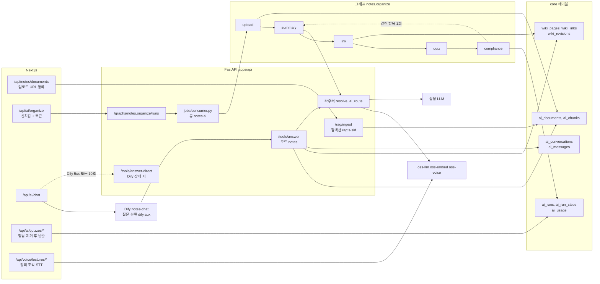

## 3. 데이터 모델

### 그림 3-1. `notes` 스키마 7개 테이블과 코어 참조 4개

읽는 법: 선은 FK입니다. 제품 테이블 7개(model_catalog, runtime_config, cost_guard, user_settings, entries, runs, run_steps)와 코어 참조 4개를 그렸습니다. 일지 한 건에 실행이 여러 번(카드 재요청 포함) 붙고, 실행 한 건에 카드 3장(base1, base2, merge)이 붙습니다. 상자 아래 note가 RLS와 쓰기 주체입니다.

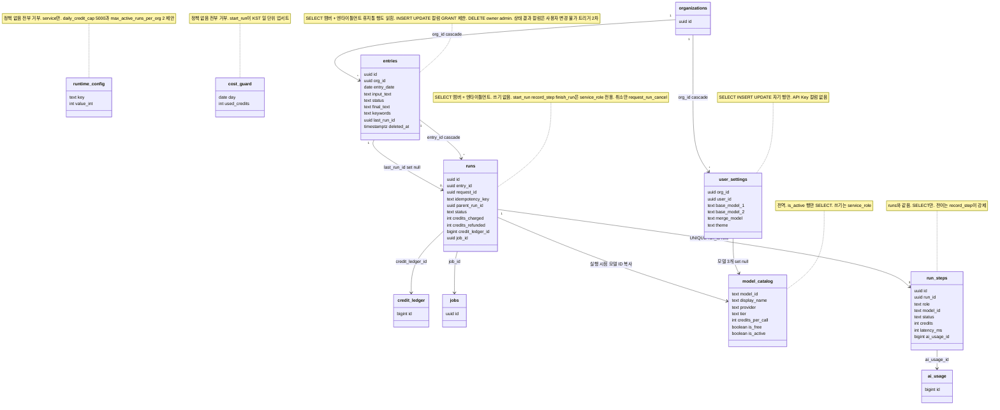

### 그림 3-2. AI 기능의 데이터는 코어의 어디에 있는가

읽는 법: 이 제품은 AI용 제품 테이블을 새로 만들지 않았습니다(`05` 6절). 왼쪽이 사용자가 보는 개념, 오른쪽이 실제로 저장되는 코어 객체입니다. 과목 수는 플랜 키 `ai_subjects_max`로 제한합니다(Free 5).

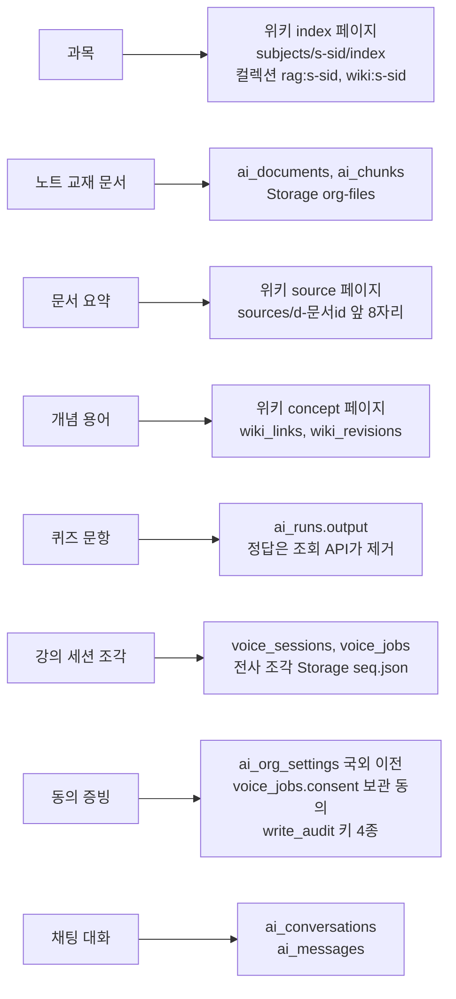

## 4. 핵심 시퀀스

### 그림 4-1. 일지 정리 실행 (NT-F-003, 006, 017)

읽는 법: Route Handler는 입력만 확인하고 DB 함수 `start_run` 한 번으로 검증·선차감·실행 생성·잡 생성을 한 트랜잭션에 끝냅니다(고아 과금 없음). 워커가 기본 모델 2개를 병렬로 부르고 두 결과가 모두 있을 때만 통합합니다. 중복 실행은 `NT002`, 잔액 부족은 `CR001`, 일일 상한은 `NT005`로 거절됩니다. 상태 이름은 그림 5-2, 5-3과 같습니다.

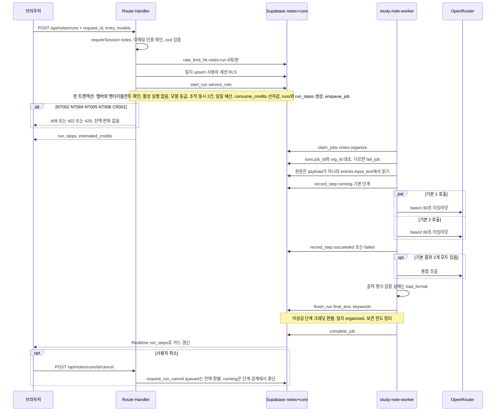

### 그림 4-2. 노트 정리 그래프 (NT-F-020, 021, 028)

읽는 법: 문서가 `ready`가 된 뒤 [AI로 정리]를 누르면 Next.js가 선차감하고 서명 토큰(수명 10분, 1회 사용)으로 FastAPI에 실행을 요청합니다. 실제 그래프는 FastAPI 잡 소비자가 돌립니다. 최종 실패는 `fail_job`이 자동 환불하고, 끝난 뒤 실제 사용량으로 정산해 차액을 환불합니다.

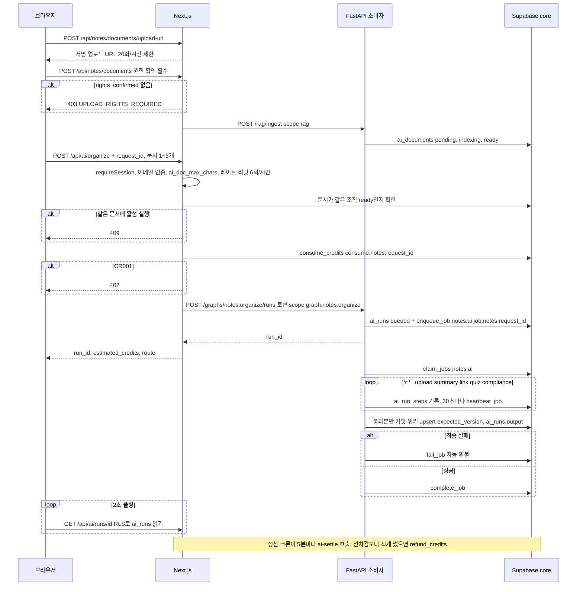

### 그림 4-3. 강의 녹음에서 노트 생성 (NT-F-026)

읽는 법: 강의에는 제3자 목소리가 담기므로 매번 고지를 확인받고, STT는 오픈소스 제공자로 강제하며 상용으로 대체하지 않습니다. 5분 조각마다 길이 기준으로 선차감하고, 조각이 실패하면 그 조각만 환불하고 재시도합니다. 끝난 전사본은 문서로 등록되어 그림 4-2 흐름으로 이어집니다.

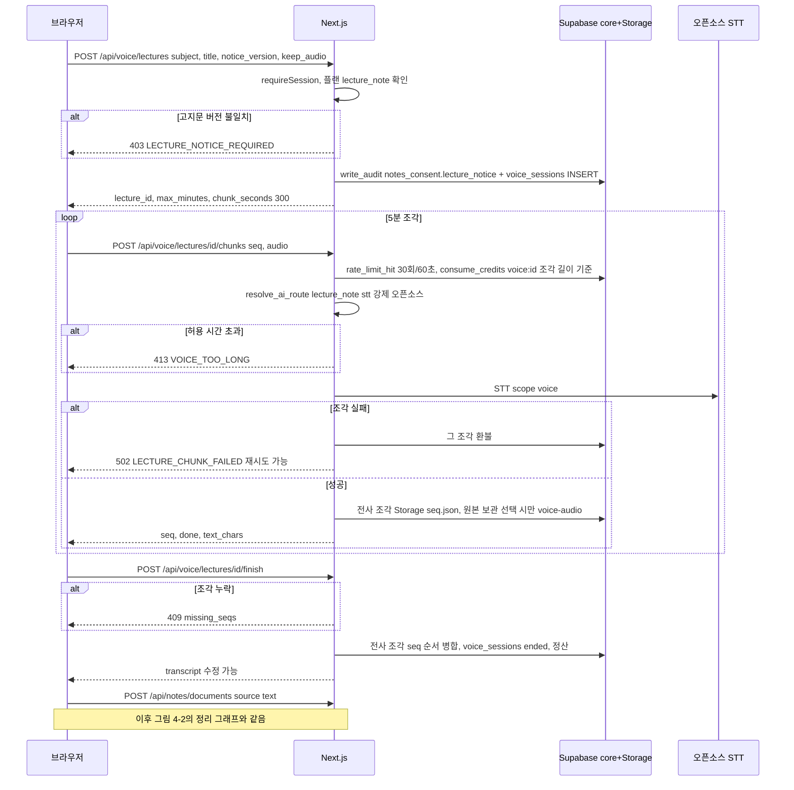

### 그림 4-4. AI 채팅 한 턴 (NT-F-024, 028)

읽는 법: 브라우저는 `/api/ai/*`만 부르고 Dify와 FastAPI는 서버끼리 부릅니다. 제공자 호출 전에 오픈소스 경로 2, 상용 경로 5를 선차감하고 끝난 뒤 실제 사용량으로 정산합니다. 근거가 없으면 "노트 밖 일반 설명"으로 구분해 표시합니다.

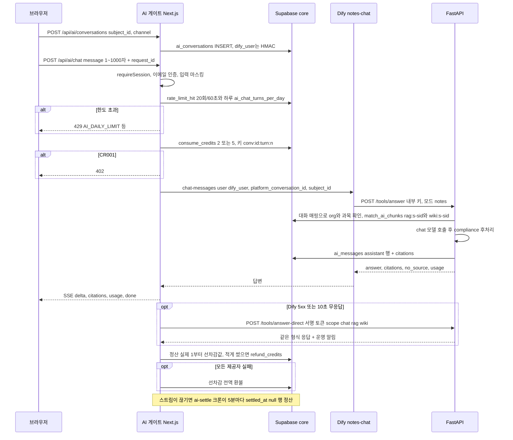

## 5. 상태 머신

### 그림 5-1. `entries.status`

읽는 법: 일지 한 건의 상태입니다. 전이는 `entries_status_transition` 트리거가 강제하며 service_role에도 적용됩니다. 이전 최종본이 있는 일지에서 새 실행이 실패하면 `organized`로 돌아가 이전 최종본을 유지합니다. 휴지통은 상태가 아니라 `deleted_at` 컬럼입니다.

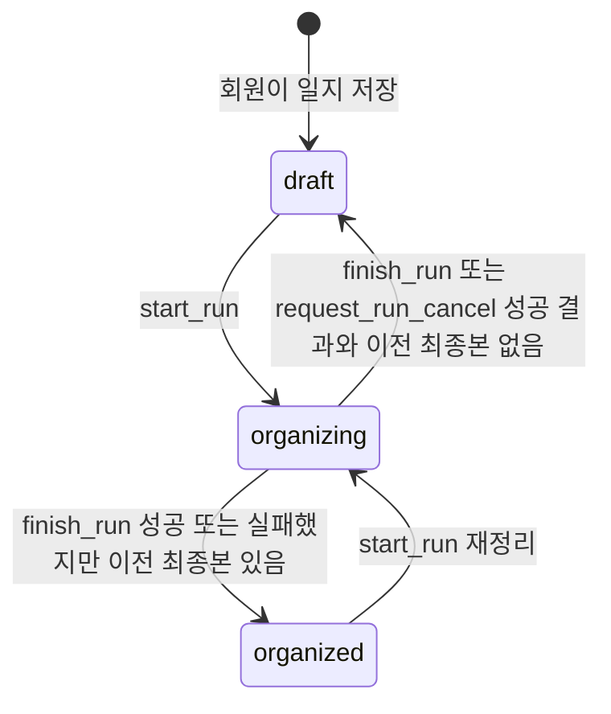

### 그림 5-2. `runs.status`

읽는 법: 실행 한 건의 상태입니다. 전이를 일으키는 함수 이름이 화살표 옆에 있습니다. 종료 상태에서는 단계나 종료 쓰기가 모두 `NT003`으로 거절되어 늦게 온 응답이 결과를 덮어쓰지 못합니다.

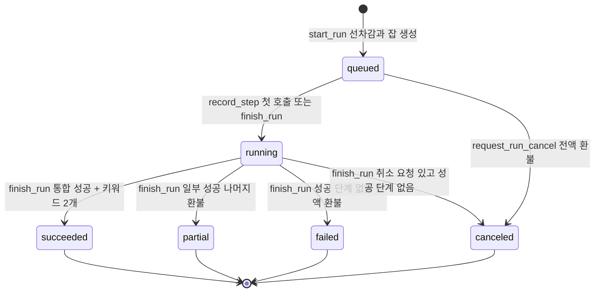

### 그림 5-3. `run_steps.status`

읽는 법: 카드 한 장(base1, base2, merge)의 상태이며 `record_step`이 전이를 강제합니다. `reused`는 카드별 재요청에서 부모 실행의 성공 결과를 복사한 상태로 0크레딧입니다. 남은 `pending`은 `finish_run`이 `skipped`(취소 실행은 `canceled`)로, `running`은 `failed`(`aborted`)로 정리합니다.

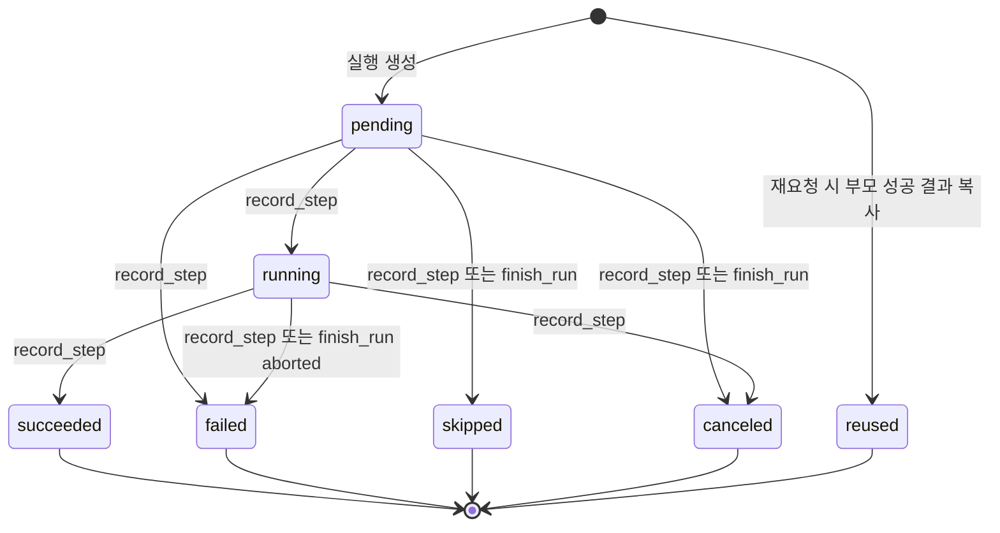

### 그림 5-4. 문서 색인 상태 `ai_documents.status`

읽는 법: 업로드한 노트·교재의 색인 상태입니다. 이 표는 `05_DATA_MODEL.md`가 아니라 `01_PRD.md` NT-F-020(pending, indexing, ready, failed)과 NT-F-031(deleted)의 서술을 그린 것이고, `failed`에서 다시 시도하는 전이는 `03` 2.5절의 [다시 시도] 버튼에서 가져왔습니다. 정확한 전이 규칙은 코어 SQL이 정본입니다.

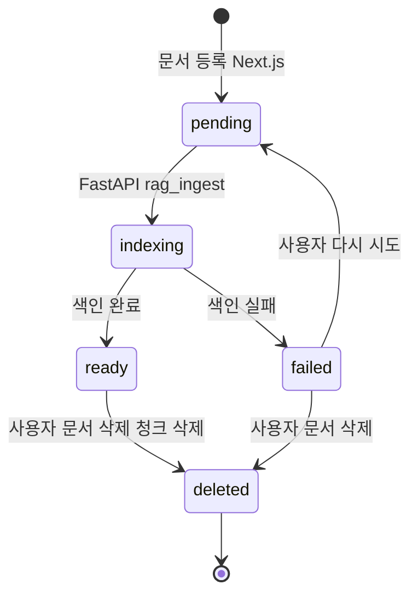

## 6. 화면 흐름

### 그림 6-1. 공개 화면, 가입, 온보딩

읽는 법: 랜딩에서 가입·로그인으로 들어가 콜백을 거치고, OAuth 첫 로그인이면 약관 동의(`/onboarding/terms`, 제안 경로)를 지나 AI 처리 방식 동의를 한 뒤 작업실로 갑니다. Stage A에서는 `/login`이 개발용 패널뿐이고 `/signup`·`/verify`가 없습니다.

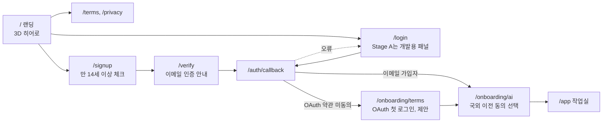

### 그림 6-2. 앱 셸 화면

읽는 법: `/app` 작업실이 첫 화면이고 GNB 두 묶음(일지, 학습)과 아래 고정 메뉴가 갈래입니다. 퀴즈 풀이는 목록 메뉴 없이 노트 상세에서 들어갑니다(결정 대기 D-25). 채팅 패널은 모든 `/app` 화면 위로 열립니다. `/app/billing`은 Phase 2 결제 전까지 잔액·사용 내역만 보입니다.

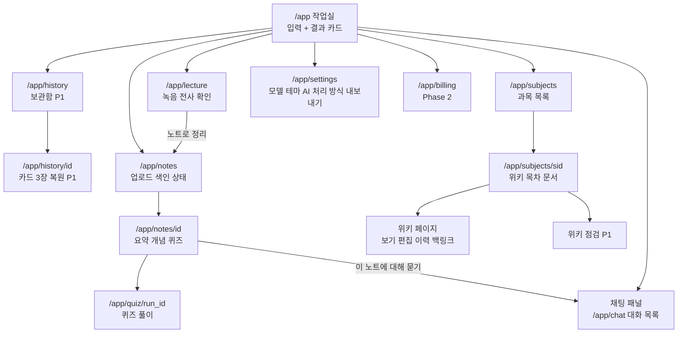

## 7. 보안 경계

### 그림 7-1. 자산·위협·대응의 신뢰 경계

읽는 법: 위에서 아래로 갈수록 믿을 수 있는 영역입니다. 이 제품의 `SECURITY.md`는 아직 비어 있어, 각 대응은 해당 문서에서 가져왔고 상자 끝에 출처를 적었습니다. § 번호는 `SECURITY_BASELINE.md` 장입니다. 핵심 자산은 서버 LLM 키(유출 시 비용), 강의 녹음의 제3자 음성, 업로드한 교재(저작물), 크레딧입니다. 최종 방어선은 DB의 RLS와 트랜잭션입니다.

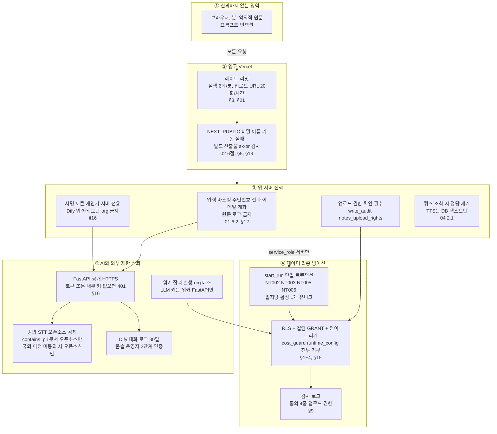

## 8. 에이전트 접근 층 (MCP)

**읽는 법:** 기존 웹 경로(위)는 그대로이고, 에이전트용 입구(아래)가 같은 Route Handler 응답과 RLS 읽기를 이용합니다. 이 제품은 학습자 원문이 중심이고 익명에게 줄 공개 데이터가 없어, 도구는 로그인 후 상태 조회와 비용 안내 5개(+ Phase 2 위키 1개)뿐입니다. 정본은 `MCP.md`, 공통 규칙은 `../_platform-core/MCP_BASELINE.md`입니다. 점선은 Phase 2 또는 미결정(D-M#)입니다.

### 8-1. API 위에 얹는 MCP 구성

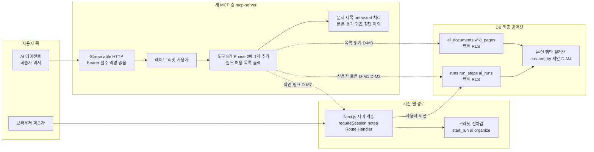

### 8-2. 정리 준비와 사람 확정 (`study_prepare_organize`)

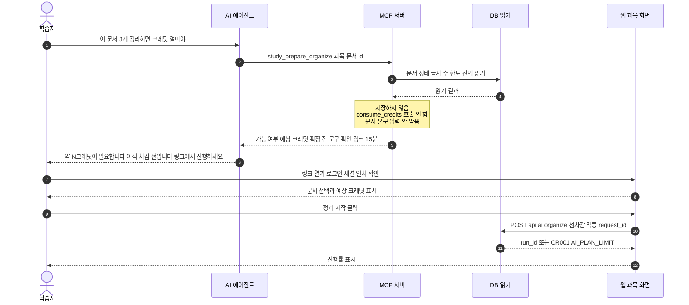

### 8-3. 도구 위험 등급과 노출 단계

```mermaid
flowchart TB
  subgraph R1["R1 로그인 읽기 1.5"]
    T1["study_list_subjects"]
    T2["study_list_documents"]
    T3["study_get_run_status"]
    T4["study_get_ai_run_status"]
  end
  subgraph PR["준비 저장 안 함 1.5"]
    T5["study_prepare_organize"]
  end
  subgraph P2["Phase 2 결정 후"]
    T6["study_get_wiki_page"]
  end
  subgraph NO["만들지 않음"]
    N1["일지 원문 정리 결과 위키 퀴즈 정답"]
    N2["정리 실행 재시도 취소 채팅 채점"]
    N3["강의 녹음 전사 음성"]
    N4["업로드 삭제 내보내기 계정 삭제 결제"]
  end
  R1 --> PR --> P2
  PR -.->|"사람이 웹에서 확정"| N2
```

## 문서 불일치

그림에는 아래 각 항목에서 표시한 쪽을 골랐습니다.

| # | 내용 | 문서 A | 문서 B | 그림에서 고른 쪽 |
|---|---|---|---|---|
| 1 | 제품 보안 문서의 상태 | `SECURITY.md`는 자산·위협·수치가 모두 "작성 필요"인 템플릿이고 "1~21장"을 가리킴 | `SECURITY_BASELINE.md`는 22장까지 있고 22장이 제품별 `SECURITY.md` 규칙 | 그림 7-1은 `01_PRD` 6장, `02` 6절, `04` 1절, `05` 7절 내용으로 구성, 장 번호는 baseline 기준 |
| 2 | 문서 색인 상태의 정의 위치 | `05_DATA_MODEL.md`에는 `ai_documents` 상태 전이 표가 없음(코어 객체라 참조만) | `01_PRD.md` NT-F-020, 031과 `03` 2.5절에만 상태 이름이 나옴 | 그림 5-4는 01·03에서 구성, 코어 SQL로 확인 필요 |
| 3 | 퀴즈 풀이 진입 경로 | `03_SCREENS_UX.md` 1절은 `/app/quiz/[run_id]`만 있고 목록 경로 없음 | 같은 문서 8.1절 D-25(퀴즈 목록 메뉴)가 결정 대기 | 목록 없이 노트 상세에서 진입(그림 6-2) |
| 4 | MCP 과목·문서 목록 | `MCP.md`의 `study_list_subjects`·`study_list_documents`는 목록 읽기 경로가 필요 | `04_API.md` 2.1절 하단은 RLS 직접 읽기만 말하고 목록 Route Handler와 `ai_documents` 컬럼 정의가 없음(`05_DATA_MODEL.md` 6절은 표 이름만) | 그림 8-1은 "멤버 RLS 읽기"로만 표기(D-M3) |
| 5 | MCP 본인 행 필터 | `MCP.md` 5절 MT4: 도구는 호출 사용자 본인이 만든 행만 돌려줌 | `05_DATA_MODEL.md` 4절: `runs`·`run_steps` SELECT는 조직 멤버 전체. `runs`에 `created_by`가 있는지 문서에 없음 | 그림 8-1의 "본인 행만 걸러냄"은 제안(D-M4) |
| 6 | MCP 예상 크레딧 읽기 | `MCP.md`의 `study_prepare_organize`는 한도와 예상 크레딧을 읽기만 해야 함 | `04_API.md` 3절: `notes.org_features`는 service 전용이고 예상 크레딧은 `POST /api/ai/organize` 응답(선차감과 한 번에)으로만 나옴 | 읽기 전용 경로 필요(D-M6), 그림 8-2는 "DB 읽기"로만 표기 |
| 7 | 보안 문서 범위 | `SECURITY.md`는 아직 템플릿("작성 필요")이고 MCP 위협 행(T2)은 그 표의 첫 실제 행임 | `MCP.md`: 학습자 원문·미성년·제3자 음성 통제는 `01_PRD.md` 6장에 흩어져 있음 | `MCP.md` 5절에 필요한 부분만 인용 |

## 갱신 규칙

`01_PRD.md`, `02_ARCHITECTURE.md`, `03_SCREENS_UX.md`, `04_API.md`, `05_DATA_MODEL.md`, `SECURITY.md`를 고치면 해당 절의 그림도 같은 변경에서 함께 고칩니다(표의 "근거 문서 절" 참조).
