# DIAGRAMS: Toon Factory UML 시각화

작성일 2026-10-23. 이해관계자(기획·개발·운영·법무) 소통용 그림 모음입니다. 정본은 이 폴더의 각 문서이며, 그림과 문서가 다르면 문서가 우선입니다. GitHub에서 그림이 바로 렌더링됩니다(Mermaid). 전체 구조는 `../_platform-core/ARCHITECTURE_DIAGRAMS.md`와 같은 스타일입니다.

**제품 한 줄 정의**: 이야기를 넣으면 AI가 회차 콘티(컷 구성, 대사)를 짜고, 미리 만든 캐릭터 모듈(포즈와 표정)로 컷을 조립하며, 배경은 AI로 생성해 인스타툰 PNG/ZIP, 세로 스크롤 웹툰 이미지, 9:16 MP4로 내보내는 AI 웹툰 제작 도구입니다(`README.md` 1절).

**근거 문서**: `README.md`, `01_PRD.md`, `02_ARCHITECTURE.md`, `03_SCREENS_UX.md`, `04_API.md`, `05_DATA_MODEL.md`, `SECURITY.md`(미작성 상태, 7번 그림 참고), 공통 `../_platform-core/SECURITY_BASELINE.md`.

**표기**: **실선 화살표** = 호출·데이터 흐름, **점선** = 검증·참조·보조 경로, "(제안)" = 문서가 제안이라고 한 값. 기능 ID는 `TN-F-nnn`(01_PRD), 오류 코드는 `TNnnn`(04_API 7절)입니다.

| # | 그림 | UML 종류 | 근거 문서 절 |
|---|---|---|---|
| 1 | 사용자와 기능 | 유스케이스 관점 | 01_PRD 1절, 2절, 3절 |
| 2 | 구성요소 | 컴포넌트 | 02_ARCHITECTURE 2절, 3절, 4절, 7절 |
| 3 | 데이터 모델 | 클래스 | 05_DATA_MODEL 1~4절 |
| 4-1 | AI 콘티 생성 | 시퀀스 | 04_API 2절, 4절, 02_ARCHITECTURE 4절, 5.2절 |
| 4-2 | 내보내기와 협찬 승인 | 시퀀스 | 04_API 2절, 05_DATA_MODEL 2.6절, 02_ARCHITECTURE 4절 |
| 4-3 | Pro 구독 결제 | 시퀀스 | 04_API 2절, 03_SCREENS_UX 2.3절 |
| 4-4 | AI 채팅 한 턴 | 시퀀스 | 04_API 2.1절, 6.2절 |
| 5-1 | 생성·내보내기 실행 상태 | 상태 머신 | 05_DATA_MODEL 3절 |
| 5-2 | 협찬 상태 | 상태 머신 | 05_DATA_MODEL 2.6절, 3절 |
| 5-3 | 에셋 팩 상태 | 상태 머신 | 05_DATA_MODEL 2.1절, 3절 |
| 6 | 화면 흐름 | 흐름도 | 03_SCREENS_UX 1절, 2절, 8절 |
| 7 | 보안 경계 | 신뢰 경계 | 05_DATA_MODEL 4절, 7절, 02_ARCHITECTURE 6절, 04_API 1절 |

## 1. 사용자와 기능

읽는 법: 왼쪽이 역할, 오른쪽이 기능입니다. 실선 박스 안은 MVP(Pro 전용은 표시), 점선으로 이어진 박스는 Phase 2·3입니다. 역할별 접근은 03_SCREENS_UX 1절 표를 따릅니다.

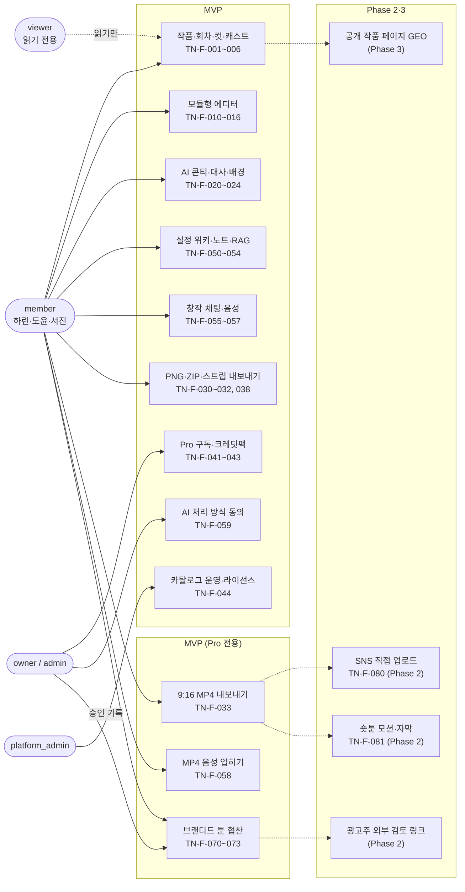

## 2. 구성요소

읽는 법: 브라우저는 Supabase(RLS)와 Next.js만 부릅니다. LLM은 FastAPI만, ElevenLabs는 Next.js만, fal은 워커만 호출합니다. 점선은 서명 토큰·잡 토큰 같은 검증이 붙는 경로입니다. 코어(인증·크레딧·결제·잡·감사)는 `core` 한 묶음으로 줄였습니다.

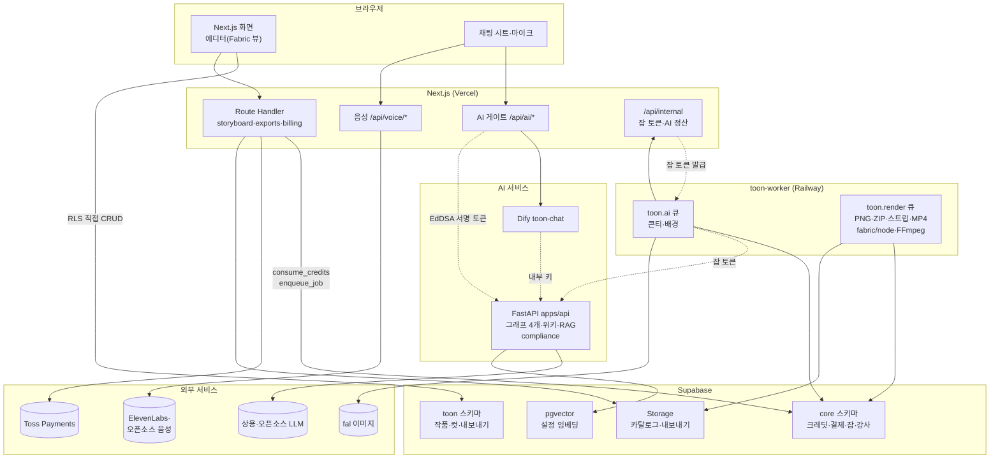

## 3. 데이터 모델

읽는 법: `toon` 스키마의 핵심 테이블 11개와 코어 참조 3개입니다. `org_id`는 모든 테넌트 테이블에 있고(카탈로그 제외) 다른 조직의 부모를 가리키면 복합 FK가 `23503`으로 막습니다. 접근 주체는 각 클래스의 note에 적었습니다. 컬럼은 05_DATA_MODEL 2절의 핵심만 담았습니다.

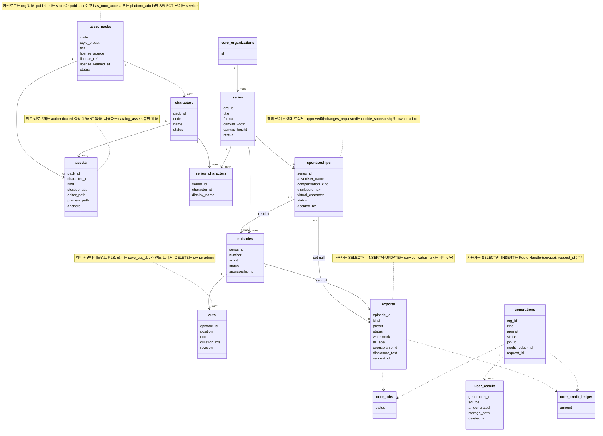

## 4. 핵심 시퀀스

### 4-1. AI 콘티 생성 (TN-F-020, TN-F-052)

읽는 법: 위에서 아래로 시간 순서입니다. 검증 → 크레딧 선차감 → 잡 등록 순서가 04_API 1절의 규칙이며, 실패하면 환불합니다. 워커는 LLM 키가 없어서 잡 토큰으로 FastAPI 그래프를 부릅니다.

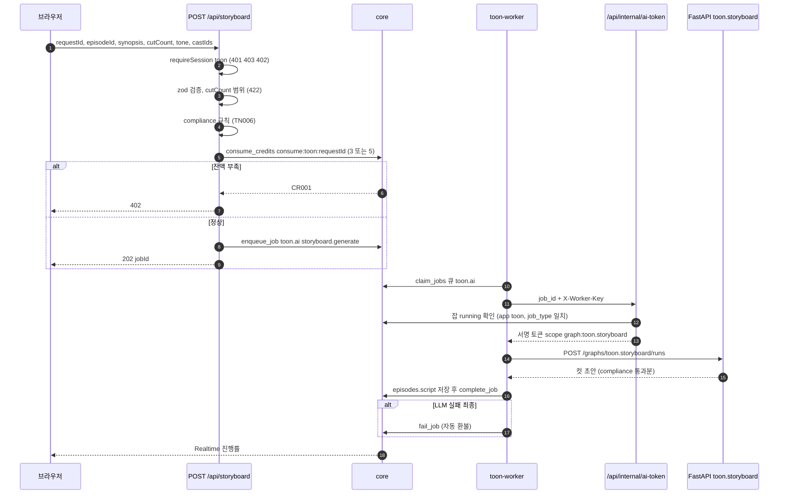

### 4-2. 내보내기와 협찬 승인 (TN-F-030, TN-F-033, TN-F-070~072)

읽는 법: 협찬 회차의 최종 내보내기는 DB 트리거가 승인 여부를 판정합니다. 워터마크·대가성 문구는 요청 값이 아니라 서버가 채운 `exports` 행의 값만 렌더 워커가 믿습니다.

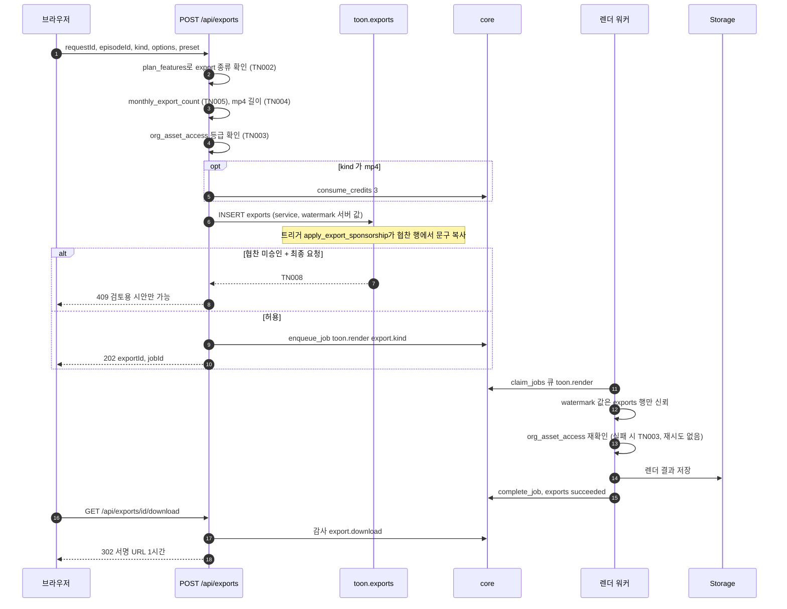

### 4-3. Pro 구독 결제 (TN-F-041)

읽는 법: 금액은 클라이언트가 아니라 DB의 주문 행이 정합니다. 지급은 confirm 경로에서만 일어나고 웹훅은 상태 동기화만 합니다.

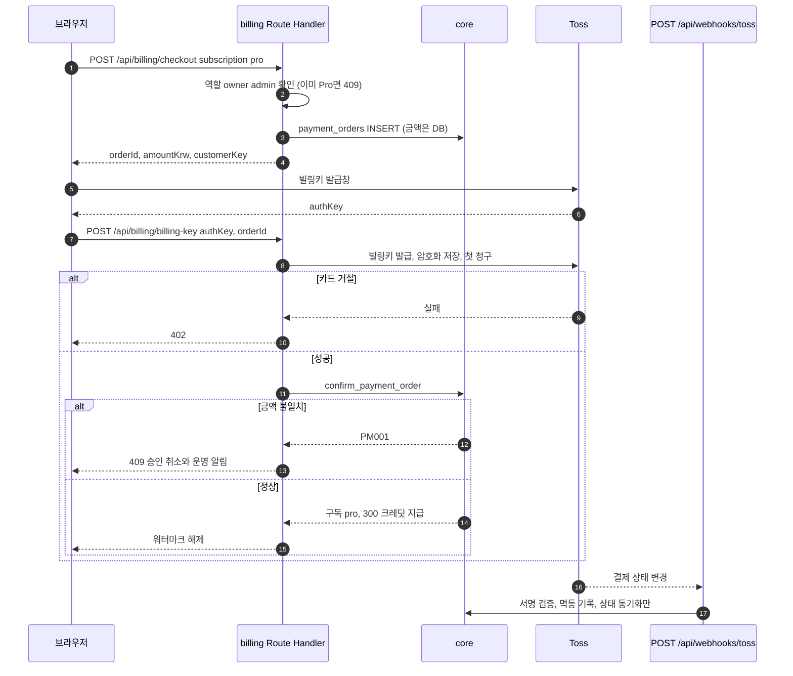

### 4-4. AI 채팅 한 턴 (TN-F-055, TN-F-060)

읽는 법: 브라우저는 Dify를 직접 부르지 않습니다. Dify가 5xx이거나 10초 무응답이면 FastAPI 직접 경로로 대체합니다. 크레딧은 선차감 후 실제 사용량으로 정산합니다.

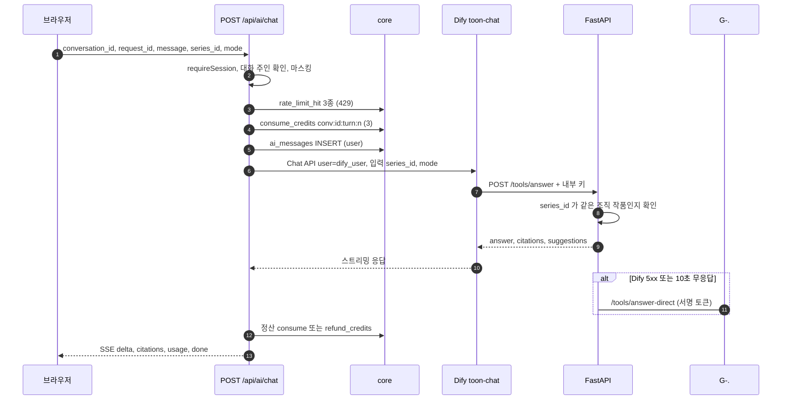

## 5. 상태 머신

### 5-1. 생성·내보내기 실행 상태 (`generations.status`, `exports.status`)

읽는 법: 사용자는 쓸 수 없고 service만 바꿉니다. 트리거 `enforce_run_status_transition`이 허용 전이 밖이면 `22023`을 냅니다. 괄호는 전이를 일으키는 주체입니다.

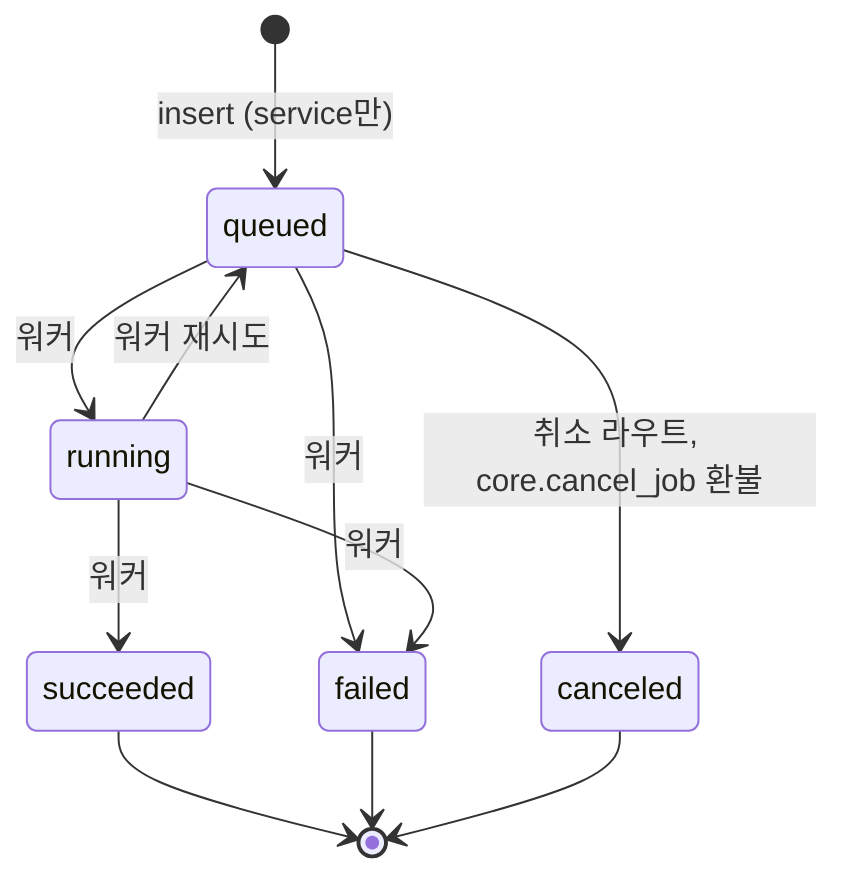

### 5-2. 협찬 상태 (`sponsorships.status`)

읽는 법: 판정 상태(`approved`, `changes_requested`)는 owner/admin이 `decide_sponsorship`을 부를 때만 생깁니다. 사용자가 직접 바꾸면 `42501`입니다. 승인 뒤 핵심 내용을 고치면 자동으로 `in_review`로 돌아가고 결정 기록이 지워집니다.

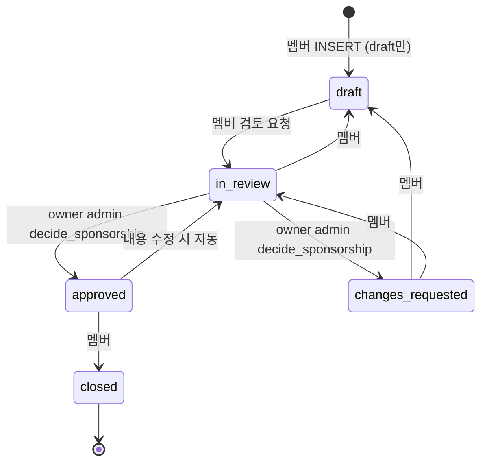

### 5-3. 에셋 팩 상태 (`asset_packs.status`)

읽는 법: `published`는 라이선스 검증(`license_verified_at/by`)이 있어야 CHECK를 통과합니다. 전이는 platform_admin(service)만 하고 감사 로그가 남습니다.

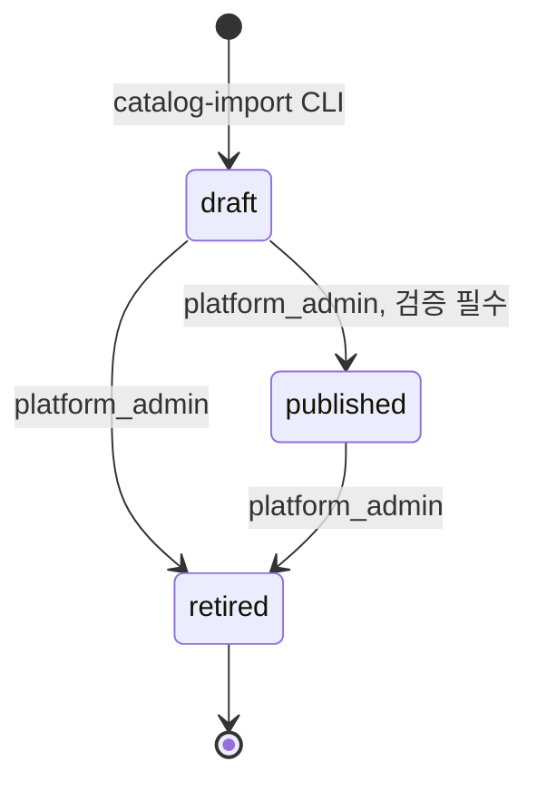

## 6. 화면 흐름

읽는 법: 가입 → AI 처리 방식 → 템플릿 → 에디터가 첫 사용 흐름이고, 에디터는 GNB가 없는 셸 밖 화면입니다. 협찬 경로는 문서끼리 다릅니다(맨 끝 "문서 불일치"). 이 그림은 8.4절의 새 경로를 따랐습니다.

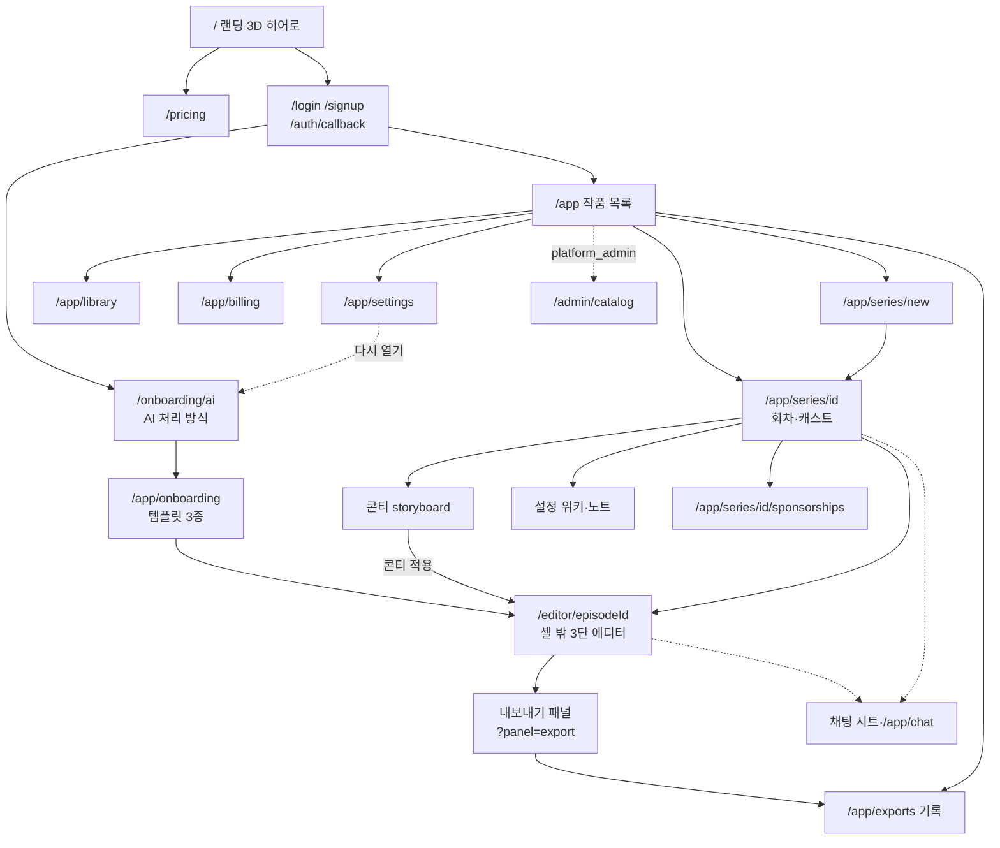

## 7. 보안 경계

읽는 법: 바깥에서 안쪽으로 신뢰가 높아집니다. 이 제품의 `SECURITY.md`는 아직 양식만 있고 자산·위협 표가 비어 있어서(맨 끝 "문서 불일치"), 이 그림은 05_DATA_MODEL 4절·7절, 02_ARCHITECTURE 6절, 04_API 1절의 차단 설계를 근거로 그렸습니다. 공통 규칙은 `SECURITY_BASELINE.md`의 장 번호(§)로 참조합니다. 리뷰 "높음" #1~#6은 `docs/reviews/Toon-Factory.md` 3장의 번호입니다.

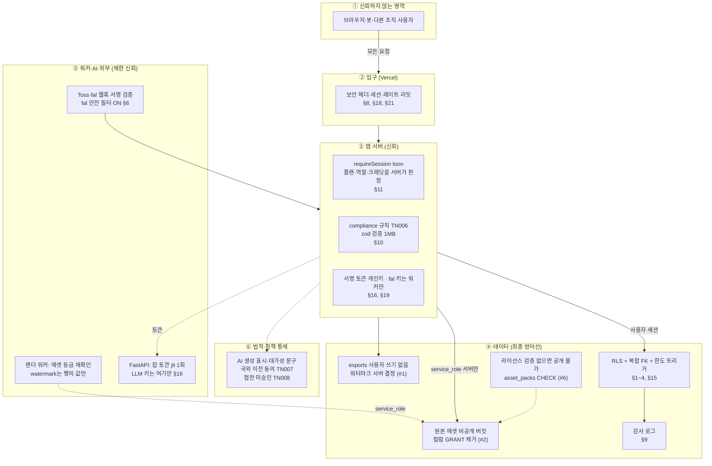

## 문서 불일치

| # | 내용 | 그림에서 고른 쪽 |
|---|---|---|
| 1 | 협찬 화면 경로: `03_SCREENS_UX.md` 2.11절은 `/series/[id]/sponsorships`, 8.4절과 8.1절은 `/app/series/[seriesId]/sponsorships`(D26 미정, 기본값). 06_AGENT_PLAN TN-06-063도 앞쪽 경로 | 6번 그림은 8.4절 경로 |
| 2 | `SECURITY.md`가 양식 상태(자산, 위협, 수치 표가 "작성 필요")라 7번 그림에 쓸 제품 위협 표가 없음. 대신 05장 4절·7절, 02장 6절, 04장 1절을 근거로 사용 | 위 3개 문서 |
| 3 | `02_ARCHITECTURE.md` 4절 표에는 잡 유형 외에 동기 호출(로그라인)까지 11행인데 3절 jobs 행은 "10개 job_type"이라 적음. 구성요소 그림은 개수를 쓰지 않음 | 개수 미표기 |

## 갱신 규칙

`01_PRD.md`, `02_ARCHITECTURE.md`, `03_SCREENS_UX.md`, `04_API.md`, `05_DATA_MODEL.md`, `SECURITY.md` 중 하나를 고치면 이 문서의 해당 그림(위 표의 근거 절)도 같은 변경에서 함께 고칩니다.
