# DIAGRAMS: Floria (website-floria) UML 시각화

작성일 2026-10-23. 이 문서는 `website-floria`의 기획 문서를 그림으로 옮긴 것이다. 정본은 각 문서이며 그림과 문서가 다르면 문서가 우선한다. GitHub에서 Mermaid가 바로 렌더링된다. 전체 플랫폼 구조는 `../_platform-core/ARCHITECTURE_DIAGRAMS.md`와 같은 스타일로 맞췄다. 이 제품은 규모가 작아(DB 테이블 3개, 결제·크레딧·잡 없음) 그림 수를 줄였다.

**제품 한 줄 정의**: 고급 주거·갤러리·기업 공간의 식물 설치를 의뢰하려는 방문자가 작업물을 보고 문의 또는 뉴스레터 구독으로 이어지게 하는 Floria "Botanic Architecture" 브랜드 사이트와, 그 문의를 받아 처리하는 초대제 운영 콘솔. 방문자 AI 상담(문의 전환), 음성 상담, 브랜드 지식 위키, 3D 히어로가 MVP에 들어 있다.

**근거 문서**: `README.md`, `01_PRD.md`, `02_ARCHITECTURE.md`, `03_SCREENS_UX.md`, `04_API.md`, `05_DATA_MODEL.md`, `MCP.md`. 공통은 `../_platform-core/SECURITY_BASELINE.md`, `CORE_SPEC.md`, `AI_ARCHITECTURE.md`.

**표기**: 실선 화살표 = 호출·데이터 흐름, 점선 = 검증·참조·구독, "(제안)" = 문서가 제안이라 한 값. Phase 2·3 항목은 이름에 `P2`, `P3`를 붙였다.

| # | 그림 | UML 종류 | 근거 문서 절 |
|---|---|---|---|
| 1 | 사용자와 기능 | 유스케이스(flowchart) | 01_PRD 1장, 2장, 3장 |
| 2 | 구성요소 | 컴포넌트(flowchart) | 02_ARCHITECTURE 2절, 4절, 5절, 7절 |
| 3 | 데이터 모델 (site 3표 + 코어 AI 참조) | 클래스(classDiagram) | 05_DATA_MODEL 1~4절, 6절 |
| 4-A | 시퀀스: 문의 접수와 알림 | 시퀀스 | 03_SCREENS_UX 2.1절, 04_API 2~3절, 01_PRD SI-F-006~009 |
| 4-B | 시퀀스: 뉴스레터 이중 동의 | 시퀀스 | 03_SCREENS_UX 2.2절, 04_API 2.1절, 01_PRD SI-F-010~011 |
| 4-C | 시퀀스: AI 상담에서 문의 전환 | 시퀀스 | 03_SCREENS_UX 2.5절, 02_ARCHITECTURE 5.3절, 01_PRD SI-F-022~025 |
| 5-A | 상태: 문의 | 상태 머신 | 05_DATA_MODEL 3절 |
| 5-B | 상태: 뉴스레터 구독 | 상태 머신 | 05_DATA_MODEL 3절 |
| 6 | 화면 흐름 | flowchart | 03_SCREENS_UX 1절, 2절 |
| 7 | 보안 신뢰 경계 | flowchart | 05_DATA_MODEL 4절·7절, 01_PRD 5~6장, 02_ARCHITECTURE 6~7절 |
| 8-1 | 구성요소: API 위에 얹는 MCP 층 | 컴포넌트(flowchart) | MCP 1~3절, MCP_BASELINE 1·7절 |
| 8-3 | 도구 위험 등급과 노출 단계 | flowchart | MCP 1·2절, MCP_BASELINE 2절 |

> 이 제품의 `SECURITY.md`는 아직 템플릿 상태("작성 필요")라서 7번 그림은 `05_DATA_MODEL` 4·7장, `01_PRD` 5·6장, `02_ARCHITECTURE` 6·7장을 근거로 그렸다. 맨 끝 "문서 불일치" 참고.

---

## 1. 사용자와 기능

**읽는 법**: 사람 역할 3종(방문자, 스튜디오 운영자, 플랫폼 관리자)과 기능이다. 방문자는 로그인이 없고, 운영자는 초대받은 소수다. 기능 ID는 `SI-F-###`이며 MVP는 실선 묶음, Phase 2·3은 점선 묶음이다. Phase 구분은 01_PRD 2장 표를 그대로 따랐다.

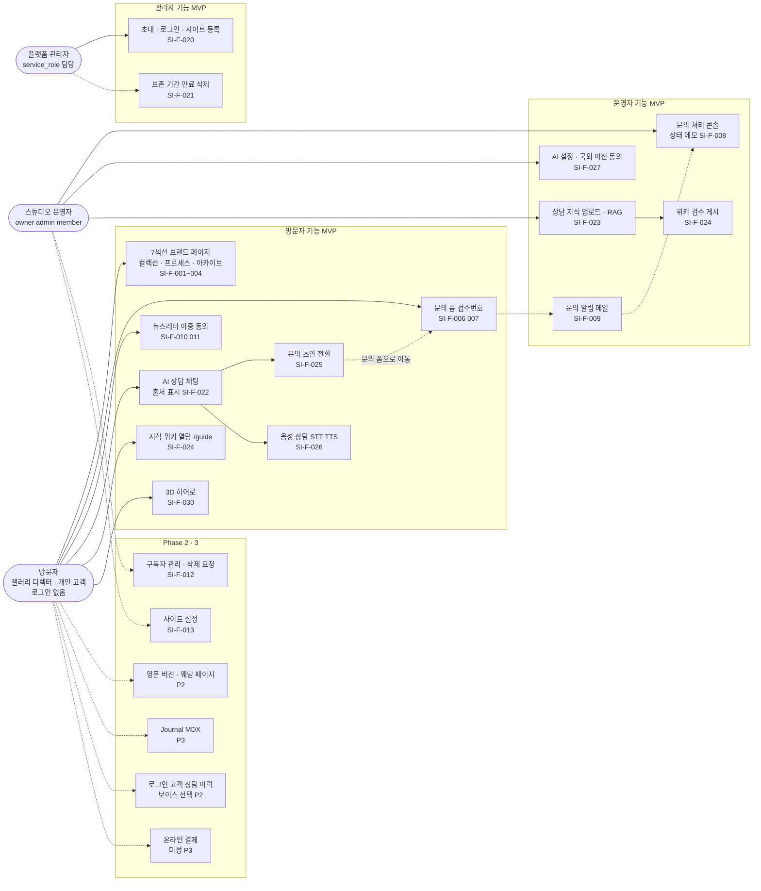

---

## 2. 구성요소

**읽는 법**: 공개 쓰기(문의, 구독, 상담)는 모두 Next.js Route Handler를 거쳐 DB의 SECURITY DEFINER RPC로 들어간다. 운영 콘솔은 로그인 세션과 RLS로 읽고 RPC로 쓴다. 잡 시스템(`core.jobs`)은 쓰지 않고, 알림 워커 하나가 1분 폴링한다. 크레딧이 없으므로 AI 비용은 운영자 조직이 낸다. 이 제품은 모듈러 통합 DB가 1차, 모놀리스가 대안이다(README 5장).

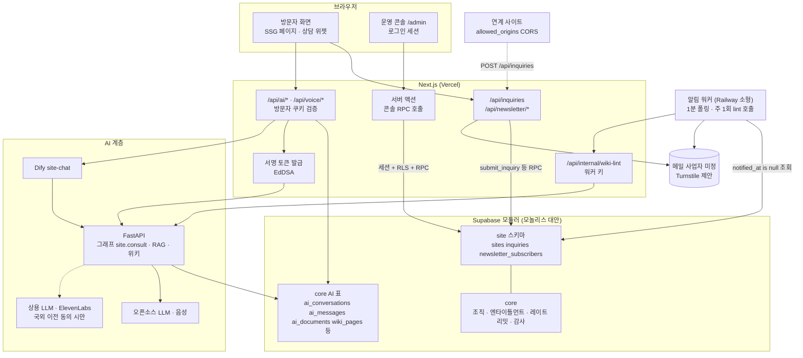

---

## 3. 데이터 모델

**읽는 법**: 제품 전용 테이블은 3개뿐이다(콘텐츠는 저장소 `src/content/*.ts`가 정본이라 CMS 표가 없고, AI 표도 만들지 않고 코어 `core.ai_*`, `wiki_*`, `voice_*`를 참조한다). 그래서 아래 그림은 `site` 3표와 AI가 쓰는 코어 표를 함께 그렸다. 코어 표는 이름만 적었고 컬럼은 05_DATA_MODEL 6절에 있는 용도만 note로 달았다. 모든 테이블 RLS ON, 쓰기 정책 없음(RPC와 service_role만).

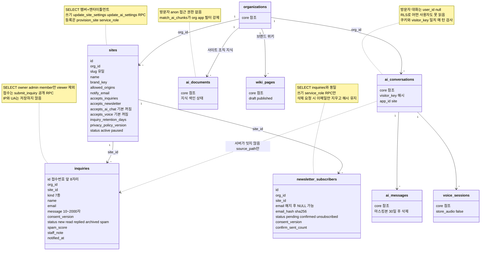

---

## 4. 핵심 시퀀스

### 그림 4-A. 문의 접수와 알림 (SI-F-006~009)

**읽는 법**: 방문자 폼은 Route Handler에서 1차(크기, Origin, Turnstile, IP 레이트 리밋)를 거르고, DB RPC 안에서 2차(접수 스위치, 동의 문구 버전, 레이트 리밋, 허니팟, 스팸 점수)를 거른다. 점수 60 이상은 `spam`으로 격리한다. 알림 메일에는 개인정보 전문 없이 콘솔 링크만 넣는다.

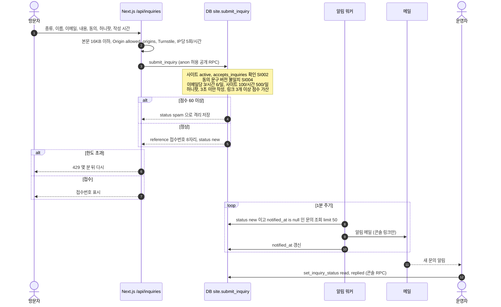

### 그림 4-B. 뉴스레터 이중 동의 (SI-F-010, 011)

**읽는 법**: 구독 요청의 응답은 항상 같은 `202`라서 가입 여부를 알 수 없다(계정 열거 방지). 확인 링크의 GET은 토큰 검증만 하고 버튼을 보이며, 상태는 버튼 POST에서만 바뀐다(메일 보안 스캐너 선열람 대응). 토큰은 HMAC 서명이라 DB에 저장하지 않는다.

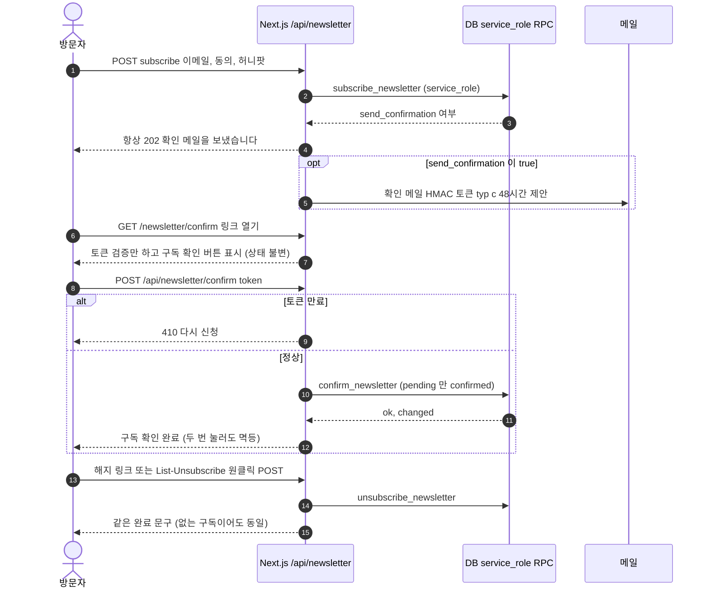

### 그림 4-C. AI 상담에서 문의 전환 (SI-F-022~025, 028)

**읽는 법**: 크레딧이 없어서 선차감 대신 레이트 리밋 5종과 사이트 일일 상한으로 비용을 통제한다. 상담은 문의 초안(`inquiry_hint`)만 만들고 DB에 쓰지 않으며, 제출은 방문자가 `/contact` 폼에서 직접 한다. 답변은 근거가 있을 때만 생성하고 `compliance`를 통과해야 한다.

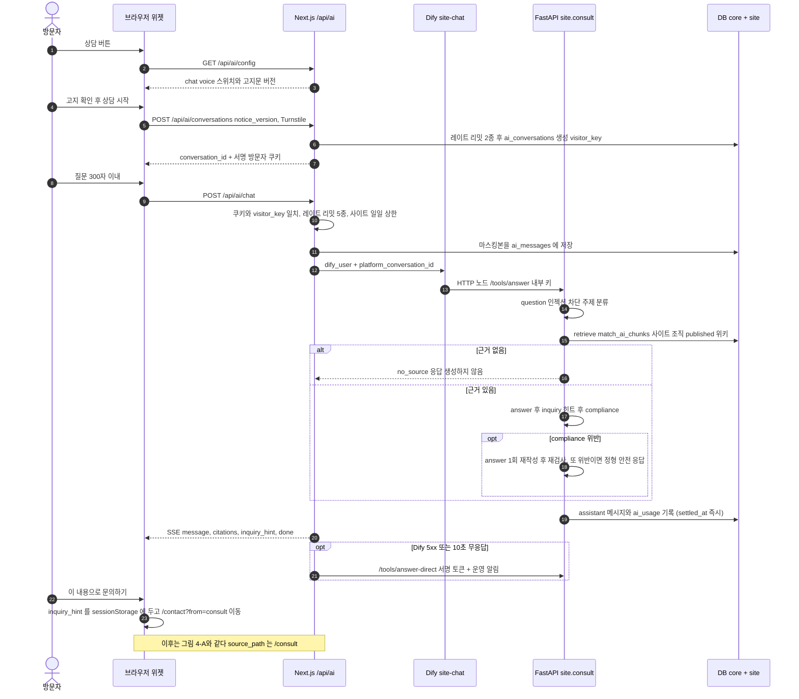

---

## 5. 상태 머신

전이는 `inquiry_status_transition`, `newsletter_status_transition` 트리거가 service_role 쓰기에도 강제한다(위반 `22023`).

### 그림 5-A. 문의 `inquiries.status`

**읽는 법**: 전이는 소속 조직의 멤버(`set_inquiry_status`) 또는 service_role이 일으키고 감사 로그가 남는다. `spam`은 오탐 복구 때만 `new`로 돌아갈 수 있다. 처음 상태 `new` 또는 `spam`은 접수 RPC가 점수로 정한다.

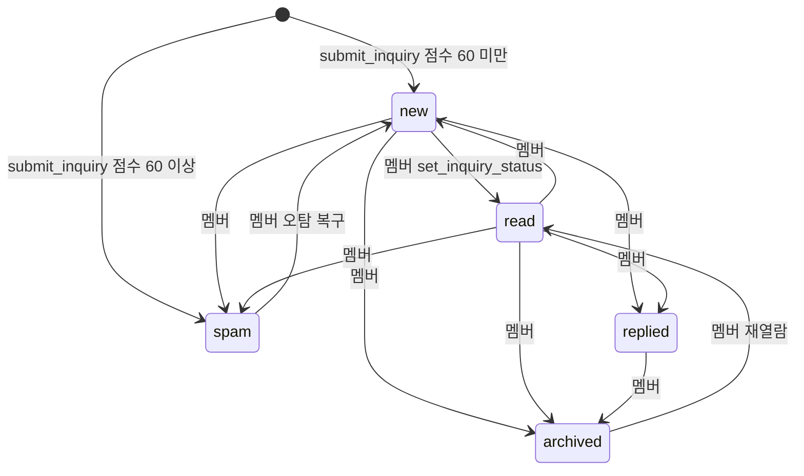

### 그림 5-B. 뉴스레터 `newsletter_subscribers.status`

**읽는 법**: 모든 전이는 service_role RPC가 일으킨다. 해지 뒤 다시 구독하면 새 동의로 `pending`부터 시작한다. 해지 30일 뒤나 삭제 요청(`erase_subscriber`) 때 이메일 원문만 지우고 `email_hash`와 해지 상태는 남긴다.

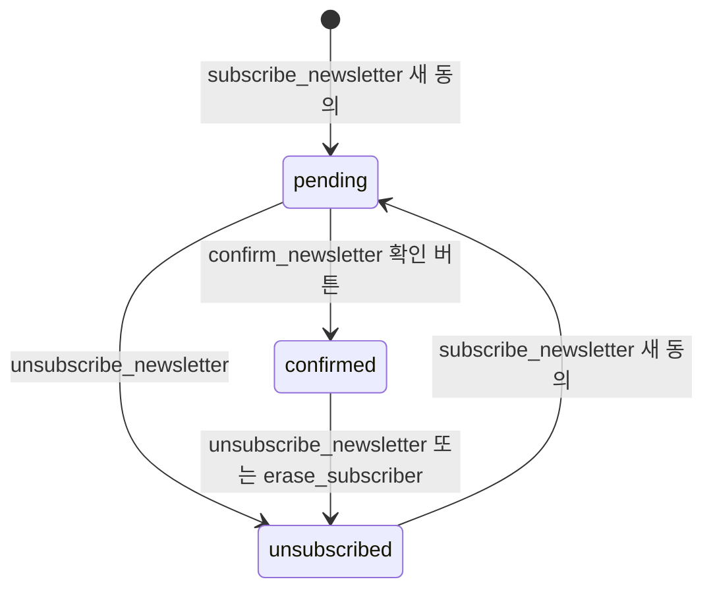

---

## 6. 화면 흐름

**읽는 법**: 위쪽은 로그인 없는 방문자 화면, 아래쪽은 운영자 콘솔이다. 점선은 메일 링크로 들어오는 경로나 Phase 2·3 화면이다. 경로는 03_SCREENS_UX 1절 표기이다.

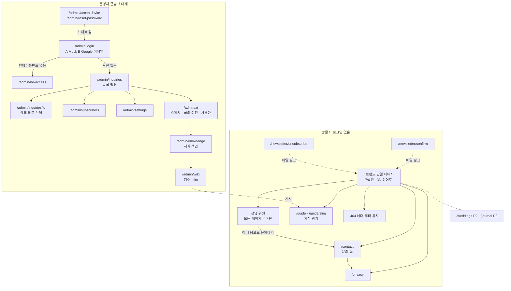

---

## 7. 보안 신뢰 경계

**읽는 법**: 이 제품에서 공개 쓰기 경로는 DB의 `submit_inquiry`와 AI 상담뿐이고, 나머지 쓰기는 service_role RPC나 운영자 RPC다. 방문자는 DB 테이블 권한이 전혀 없다. `§`는 `../_platform-core/SECURITY_BASELINE.md`의 장 번호이다. 이 제품의 `SECURITY.md`가 템플릿 상태라 자산·위협은 05_DATA_MODEL 7장, 01_PRD 5·6장, 02_ARCHITECTURE 6·7장에서 가져왔다.

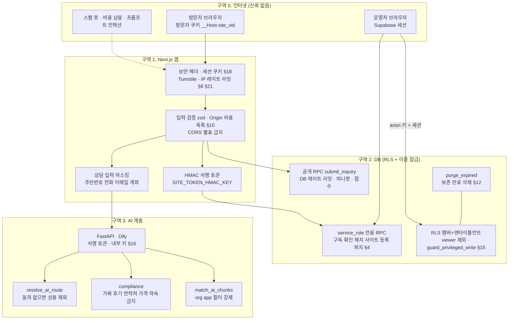

**위협과 대응 요약** (문서에 있는 것만)

| 위협 | 대응 | 근거 |
|---|---|---|
| 공개 쓰기 경로의 홍수·스팸 | 앞단 Turnstile+IP 제한, DB 내 레이트 리밋 4종, 허니팟, 작성 시간, 점수 60 이상 격리 | 05_DATA_MODEL 7장, SI-F-007 |
| 익명의 문의 열람·변조 | anon 테이블 권한 없음, 쓰기 정책 없음, `guard_privileged_write` | 05_DATA_MODEL 4·7장 |
| 구독 계정 열거, 스캐너 선열람 확정 | 항상 같은 202 응답, GET 상태 불변·버튼 POST로 확정, 토큰은 HMAC | 04_API 2절, 05_DATA_MODEL 7장 |
| 타 조직 문의 열람, 개인정보 노출 | 멤버십+엔타이틀먼트 정책, viewer 제외, IP와 UA 비저장 | 05_DATA_MODEL 2.2·4절 |
| 동의 문구 변경 후 구버전 폼 제출 | `privacy_policy_version` 불일치 시 SI004 | 05_DATA_MODEL 7장 |
| 개인정보 장기 보존 | `purge_expired`(문의 365일, spam 30일, 미확인 구독 7일 등 제안) | SI-F-021 |
| 방문자 대화 탈취(대화 id 추측) | 서명 쿠키 해시 `visitor_key` 매 턴 일치, 방문자 대화는 RLS로 누구도 못 읽음 | 05_DATA_MODEL 7장 |
| AI 비용 남용 | Turnstile, 레이트 리밋 5종, 사이트 일일 상한, 입력·턴·토큰 상한, 스위치 기본 꺼짐 | 01_PRD 5장, SI-F-028 |
| 프롬프트 인젝션·허위 정보 | 검색 결과를 자료로만 전달, `compliance`, 연락처는 `business.ts` 값만 | 05_DATA_MODEL 7장 |
| 타 조직 지식 접근, 국외 이전 우회 | `match_ai_chunks` org·app 필터, 동의 없는 조직의 상용 체인 제거 | 05_DATA_MODEL 7장 |

---

## 8. 에이전트 접근 층 (MCP)

**읽는 법**: 기존 웹 경로(위)는 그대로이고, 에이전트용 입구(아래)는 운영자 콘솔의 집계 읽기 2개만 사용자 세션과 RLS 뒤에서 읽는다. 방문자 쓰기(문의, 뉴스레터)와 방문자 AI 상담은 에이전트에 연결하지 않는다. 정본은 `MCP.md`, 공통 규칙은 `../_platform-core/MCP_BASELINE.md`이다. 점선은 Phase 1.5 이후 또는 미결정(D-M#)이다. 쓰기·준비 도구가 없어 시퀀스(8-2)는 그리지 않았다.

### 8-1. 구성요소: API 위에 얹는 MCP 층

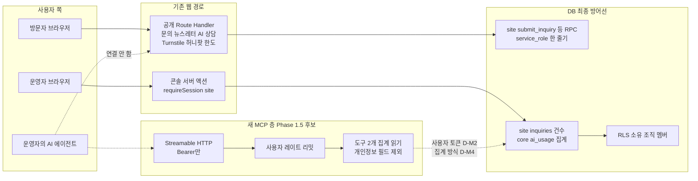

### 8-3. 도구 위험 등급과 노출 단계

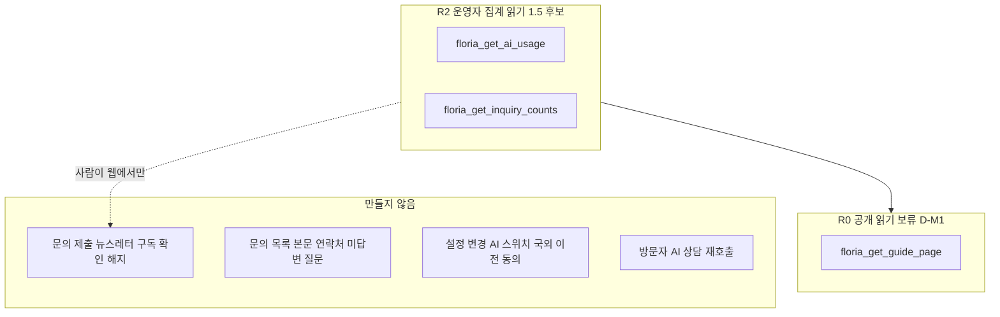

## 문서 불일치

1. **`SECURITY.md` 미작성**: 자산, 위협, 공통 규칙 제품별 수치, 외부 서비스 이전 표가 모두 "(작성 필요)"다. 그림 7과 위 표는 다른 문서에서 가져왔으므로 SECURITY.md가 채워지면 다시 맞춘다.
2. **구독자 관리와 사이트 설정의 단계**: `01_PRD` 2장은 구독자 관리와 사이트 설정(알림 이메일, 접수 중지, 동의 버전)을 Phase 2로 두는데 3장의 SI-F-012, SI-F-013은 단계 표기가 없고 `03_SCREENS_UX` 1절은 `/admin/subscribers`, `/admin/settings`를 P1로 둔다. 그림 1은 01_PRD 2장을 따랐다.
3. **코어 점검 결과 미반영**: `05_DATA_MODEL` 6절은 모듈러 코어에서 명시적 `revoke`가 없는 함수에 PUBLIC EXECUTE가 남는다는 점검 결과를 적고 코어는 고치지 않았다고 한다. 그림 7의 "service_role 전용 RPC"는 이 제품 함수가 `is_service_caller`로 2차 방어한다는 전제로 그렸다.
4. **MCP 작성 중 발견, 읽기 경로 부재**: `04_API.md`에는 문의 건수를 집계하는 RPC·Route Handler가 없고(콘솔은 컬럼 명시 select), 공개 `/guide` 위키는 service_role 서버 컴포넌트가 읽는데 anon은 `core.wiki_*` 권한이 없다. 그래서 `MCP.md`의 `floria_get_inquiry_counts`와 `floria_get_guide_page`는 새 읽기 경로가 필요하다(D-M1, D-M4). 그림 8-1은 집계를 사용자 세션 RLS로 읽는 것으로, 공개 읽기 도구는 그리지 않았다.
5. **MCP 작성 중 발견, `submit_inquiry`의 anon 허용**: `04_API.md` 3절은 `site.submit_inquiry`를 anon에도 열어 두고(방어 2선) 브라우저의 직접 RPC 호출은 설계에서 제외한다고 한다. 에이전트가 anon 키로 이 RPC를 직접 부르면 Turnstile·허니팟 검사를 우회하므로 `MCP.md`는 이 RPC를 호출하는 도구를 만들지 않는다. 필요하면 anon 직접 호출을 막는 방안은 별도 결정이다.

## 갱신 규칙

`01_PRD`, `02_ARCHITECTURE`, `03_SCREENS_UX`, `04_API`, `05_DATA_MODEL`, `SECURITY.md` 중 하나를 고치면 해당 그림(위 표의 근거 절)도 같은 변경에서 함께 고친다. 수정 뒤에는 Mermaid 검증을 다시 돌린다.
